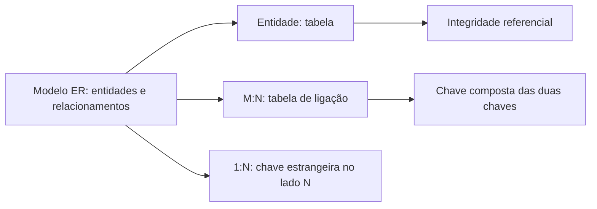

# 52 · Modelo entidade-relacionamento e mapeamento

**Tempo estimado:** 50 minutos · **Pré-requisito:** [[51 - Modelo relacional, chaves e álgebra relacional]].

**Ao final você vai conseguir:**

1. Descrever um domínio com entidades, atributos e relacionamentos, antes de escrever tabelas.
2. Reconhecer relacionamentos 1:1, 1:N e M:N, e a entidade fraca.
3. Transformar um modelo ER em esquema relacional: uma tabela por entidade, uma tabela de ligação para M:N.
4. Criar as tabelas no SQLite e ver a integridade referencial e a chave composta agirem.

**Antes de começar:** no módulo 51 você viu relações e chaves. O modelo ER é um desenho anterior às tabelas, em que a pergunta é "o que existe e como se relaciona".

---

## Para começar

Uma escola tem alunos e disciplinas. Um aluno faz várias disciplinas, e uma disciplina tem vários alunos. Antes de criar qualquer tabela, é preciso decidir essa relação: ela pertence ao aluno, à disciplina, ou é uma entidade própria? O modelo entidade-relacionamento responde a essa pergunta em forma de diagrama, e depois ele vira tabelas.

---

## Mapa do módulo



*Figura 1: cada entidade vira uma tabela; M:N precisa de uma tabela própria; 1:N cabe como chave estrangeira.*

**Como ler:** o modelo ER é o ponto de partida; as regras de mapeamento levam dele ao esquema.

---

## Mini-aula 1: entidades, atributos e relacionamentos

> [!tip] Ideia
> Entidade é uma coisa do domínio com existência própria, como um aluno. Atributo é uma propriedade dela. Relacionamento liga entidades, e tem uma cardinalidade.

> [!info] Definição
> Watt e Eng descrevem entidades fortes e fracas, atributos simples, compostos, multivalorados e derivados, e os tipos de relacionamento 1:M, 1:1 e M:N. Uma **entidade fraca** não tem chave própria: a chave é a da entidade dona mais uma chave parcial. A nota de RPI diz exatamente isso.

Veja a chave da entidade fraca `dependente`: o funcionário e o nome. Antes de rodar, diga se o mesmo nome de dependente pode aparecer duas vezes para o mesmo funcionário.

```python
import sqlite3

con = sqlite3.connect(":memory:")
con.execute("PRAGMA foreign_keys = ON")
con.execute("CREATE TABLE funcionario (id INTEGER PRIMARY KEY, nome TEXT)")
con.execute(
    "CREATE TABLE dependente (funcionario_id INTEGER REFERENCES funcionario(id), "
    "nome TEXT, PRIMARY KEY (funcionario_id, nome))"
)
con.execute("INSERT INTO funcionario VALUES (1, 'Ana')")
con.execute("INSERT INTO dependente VALUES (1, 'Lia')")
print("dependentes:", con.execute("SELECT * FROM dependente").fetchall())
try:
    con.execute("INSERT INTO dependente VALUES (1, 'Lia')")
except sqlite3.IntegrityError as e:
    print("repetição recusada:", e)
```

Saída real:

```
dependentes: [(1, 'Lia')]
repetição recusada: UNIQUE constraint failed: dependente.funcionario_id, dependente.nome
```

**Como ler:** a chave composta é `(funcionario_id, nome)`. A segunda inserção de `Lia` para o mesmo funcionário é recusada pelo banco, que informa a restrição violada.

> [!warning] Armadilha comum
> Uma entidade fraca não existe sem a dona. Apagar o funcionário apaga os dependentes, e o modelo deve dizer isso com a regra de remoção, não só com o desenho.

> [!question]- Checkpoint
> 1. Qual é a chave da entidade `dependente`?
> 2. Por que duas `Lia` para o mesmo funcionário são recusadas?
>
> > [!success]- Resposta
> > 1. A chave do funcionário mais o nome do dependente.
> > 2. Porque a chave primária composta não aceita duas linhas com os mesmos valores.

---

## Mini-aula 2: do ER ao esquema relacional

> [!tip] Ideia
> Cada entidade vira uma tabela. Um relacionamento M:N vira uma tabela de ligação, com a chave de cada lado. Um 1:N cabe no lado N, como chave estrangeira.

> [!info] Definição
> Watt e Eng dizem que modelos ER se traduzem facilmente em relações. Na tabela de ligação de um M:N, a chave primária é a combinação das chaves dos dois lados. A regra de 1:N com chave estrangeira no lado muitos e a de subclasses vêm da nota de RPI. Watt e Eng tratam o 1:N apenas com um exemplo, sem regra formal.

Veja a tabela de ligação de `aluno` e `disciplina`, com o atributo `nota` do relacionamento. Antes de rodar, pense: quais colunas essa tabela deve ter?

```python
entidades = {"aluno": ["id", "nome"], "disciplina": ["codigo", "titulo"]}
relacionamento = ("matricula", "aluno", "disciplina", ["nota"])

rel, a, b, extras = relacionamento
esquema = dict(entidades)
esquema[rel] = [f"{a}_{entidades[a][0]}", f"{b}_{entidades[b][0]}"] + extras
for tabela, colunas in esquema.items():
    print(tabela, colunas)
```

Saída real:

```
aluno ['id', 'nome']
disciplina ['codigo', 'titulo']
matricula ['aluno_id', 'disciplina_codigo', 'nota']
```

**Como ler:** a matrícula tem uma coluna para cada lado do relacionamento, pela chave de cada entidade, e a coluna `nota` pertence ao relacionamento.

> [!warning] Armadilha comum
> O atributo `nota` pertence à matrícula, e não ao aluno nem à disciplina. Por isso ele vai para a tabela de ligação.

> [!question]- Checkpoint
> 1. Quais colunas formam a chave primária da tabela de ligação?
> 2. Onde fica a chave estrangeira de um 1:N?
>
> > [!success]- Resposta
> > 1. As chaves dos dois lados, juntas.
> > 2. No lado muitos.

---

## Mini-aula 3: integridade referencial

> [!tip] Ideia
> Uma chave estrangeira precisa apontar para uma linha que existe, ou ser nula. Isso impede linhas órfãs, que se referem a algo apagado.

> [!info] Definição
> A **integridade de entidade** diz que a chave primária não tem nulos. A **integridade referencial** diz que uma chave estrangeira tem correspondente na chave primária da tabela referenciada, ou é nula (Watt e Eng, The Guide). No SQLite, as chaves estrangeiras só valem se o `PRAGMA foreign_keys` estiver ligado, por conexão.

A demonstração da mini-aula 1 ligou esse pragma. Sem ele, o SQLite aceitaria a inserção de uma dependente de funcionário inexistente.

> [!question]- Checkpoint
> 1. O que a integridade referencial impede?
> 2. Por que o SQLite precisa de `PRAGMA foreign_keys = ON`?
>
> > [!success]- Resposta
> > 1. Linhas que apontam para uma chave que não existe.
> > 2. Porque, por padrão, o SQLite não verifica chaves estrangeiras; a verificação é ativada por conexão.

---

## Exercícios

Cada exercício tem um bloco com a função a completar e os testes com `assert`. Quando todos passarem, aparece `Passou!`. As funções definidas em exercícios anteriores aparecem no código inicial.

### Aquecimento

**A1. Colunas da tabela de ligação.** Uma relação M:N vira uma tabela de ligação com a chave de cada lado. Cada coluna recebe o nome `entidade_chave`, em minúsculas. Complete `atributos_ligacao(ent_a, chave_a, ent_b, chave_b)`, que devolve a lista com as duas colunas, nessa ordem.

```python
def atributos_ligacao(ent_a, chave_a, ent_b, chave_b):
    """Colunas da tabela de ligação de um M:N: a chave de cada lado, com o nome da entidade."""
    ...

assert atributos_ligacao("aluno", "id", "disciplina", "codigo") == ["aluno_id", "disciplina_codigo"], "duas chaves"
assert atributos_ligacao("a", "x", "b", "y") == ["a_x", "b_y"], "outro exemplo"
print("Passou!")
```

> [!hint]- Dica 1
> Use f-strings: `f"{ent_a}_{chave_a}"`.

> [!hint]- Dica 2
> Para `aluno`, `id`, `disciplina` e `codigo`, o resultado é `["aluno_id", "disciplina_codigo"]`.

> [!example]- Solução
> ```python
> def atributos_ligacao(ent_a, chave_a, ent_b, chave_b):
>     """Colunas da tabela de ligação de um M:N: a chave de cada lado, com o nome da entidade."""
>     return [f"{ent_a}_{chave_a}", f"{ent_b}_{chave_b}"]
> ```
>
> **Erro comum:** Esquecer a chave de um dos lados. Sem ela, a tabela de ligação não sabe quais linhas relaciona.

**A2. Entidade fraca.** Uma entidade fraca não tem chave própria: sua chave é a chave da entidade dona mais uma chave parcial. A nota de RPI diz exatamente isso. Complete `chave_fraca(chave_dona, chave_parcial)`, que devolve a lista de atributos da chave composta, com a chave da dona primeiro.

```python
def chave_fraca(chave_dona, chave_parcial):
    """Chave de entidade fraca: chave da dona seguida da chave parcial."""
    ...

assert chave_fraca(["funcionario_id"], "nome") == ["funcionario_id", "nome"], "dona como lista"
assert chave_fraca("funcionario_id", "nome") == ["funcionario_id", "nome"], "dona como texto"
print("Passou!")
```

> [!hint]- Dica 1
> Use `chave_dona + [chave_parcial]`, se `chave_dona` já for uma lista; senão, `[chave_dona, chave_parcial]`.

> [!hint]- Dica 2
> Para `["funcionario_id"]` e `"nome"`, o resultado é `["funcionario_id", "nome"]`.

> [!example]- Solução
> ```python
> def chave_fraca(chave_dona, chave_parcial):
>     """Chave de entidade fraca: chave da dona seguida da chave parcial."""
>     dona = chave_dona if isinstance(chave_dona, list) else [chave_dona]
>     return dona + [chave_parcial]
> ```
>
> **Erro comum:** Devolver só a chave parcial. Ela é ambígua sem a dona, porque nomes de dependentes se repetem entre funcionários.

**A3. Tipo de relacionamento.** A nota de Watt e Eng lista os tipos de relacionamento: `"1:1"`, `"1:N"` e `"M:N"`. Complete `tipo_valido(tipo)`, que devolve `True` para esses três e levanta `ValueError` para qualquer outro texto.

```python
def tipo_valido(tipo):
    """True para 1:1, 1:N e M:N; outro tipo levanta ValueError."""
    ...

assert tipo_valido("M:N") is True, "muitos para muitos"
assert tipo_valido("1:1") is True, "um para um"
try:
    tipo_valido("N:1:1")
    assert False, "deveria levantar ValueError"
except ValueError:
    pass
print("Passou!")
```

> [!hint]- Dica 1
> Use `if tipo in ("1:1", "1:N", "M:N"):`.

> [!hint]- Dica 2
> No caso contrário, levante `ValueError("tipo desconhecido")`.

> [!example]- Solução
> ```python
> def tipo_valido(tipo):
>     """True para 1:1, 1:N e M:N; outro tipo levanta ValueError."""
>     if tipo in ("1:1", "1:N", "M:N"):
>         return True
>     raise ValueError("tipo desconhecido")
> ```
>
> **Erro comum:** Devolver `False` para tipos desconhecidos. A função precisa avisar, e não confundir com um tipo inválido sem erro.

### Praticando

**P1. Esquema de um M:N.** Complete `esquema_relacionamento(entidades, rel, a, b, extras)`. `entidades` é um dicionário que associa cada entidade a uma lista de atributos, cuja primeira posição é a chave. Devolva um dicionário com uma única entrada, o nome da tabela de ligação `rel` associado às suas colunas: as chaves de `a` e de `b`, pelo nome da função `atributos_ligacao`, seguidas dos atributos extras. Use `atributos_ligacao`, já definida acima.

```python
def atributos_ligacao(ent_a, chave_a, ent_b, chave_b):
    return [f"{ent_a}_{chave_a}", f"{ent_b}_{chave_b}"]

def esquema_relacionamento(entidades, rel, a, b, extras):
    """Tabela de ligação de um M:N: chaves dos dois lados mais os atributos extras."""
    ...

ents = {"aluno": ["id", "nome"], "disciplina": ["codigo", "titulo"]}
assert esquema_relacionamento(ents, "matricula", "aluno", "disciplina", ["nota"]) == {"matricula": ["aluno_id", "disciplina_codigo", "nota"]}, "com um atributo extra"
assert esquema_relacionamento(ents, "matricula", "aluno", "disciplina", []) == {"matricula": ["aluno_id", "disciplina_codigo"]}, "sem extras"
print("Passou!")
```

> [!hint]- Dica 1
> A chave de `a` é `entidades[a][0]`.

> [!hint]- Dica 2
> Some `extras` ao final da lista de colunas.

> [!example]- Solução
> ```python
> def esquema_relacionamento(entidades, rel, a, b, extras):
>     """Tabela de ligação de um M:N: chaves dos dois lados mais os atributos extras."""
>     colunas = atributos_ligacao(a, entidades[a][0], b, entidades[b][0]) + list(extras)
>     return {rel: colunas}
> ```
>
> **Erro comum:** Devolver as colunas sem as chaves. A tabela de ligação precisa delas para relacionar as duas entidades.

**P2. Chave estrangeira no lado N.** Pela regra de RPI, um relacionamento 1:N não vira tabela própria: a chave do lado 1 vira coluna estrangeira do lado N. Complete `esquema_1_n(colunas_n, ent_1, chave_1)`, que devolve a lista de colunas da tabela do lado N com a coluna estrangeira `ent_1_chave_1` acrescentada ao final.

```python
def esquema_1_n(colunas_n, ent_1, chave_1):
    """Colunas do lado N com a chave do lado 1 acrescentada como coluna estrangeira."""
    ...

original = ["id", "nome"]
assert esquema_1_n(original, "departamento", "id") == ["id", "nome", "departamento_id"], "coluna estrangeira no fim"
assert original == ["id", "nome"], "a lista original não muda"
print("Passou!")
```

> [!hint]- Dica 1
> Copie a lista com `list(colunas_n)` e acrescente o nome da coluna estrangeira.

> [!hint]- Dica 2
> Para `["id", "nome"]`, `"departamento"` e `"id"`, o resultado é `["id", "nome", "departamento_id"]`.

> [!example]- Solução
> ```python
> def esquema_1_n(colunas_n, ent_1, chave_1):
>     """Colunas do lado N com a chave do lado 1 acrescentada como coluna estrangeira."""
>     nova = list(colunas_n)
>     nova.append(f"{ent_1}_{chave_1}")
>     return nova
> ```
>
> **Erro comum:** Modificar a lista original. A função deve devolver uma nova lista, sem alterar a que recebeu.

### Desafio

**D1. Ordem de criação das tabelas.** Uma tabela com chave estrangeira só pode ser criada depois da tabela que ela referencia. Complete `ordem_de_criacao(referencias)`, em que `referencias` é um dicionário que associa cada tabela às tabelas que ela referencia. Devolva uma lista em que cada tabela aparece depois de todas as que referencia. Use uma busca em profundidade, como na ordenação topológica do módulo 26.

```python
def ordem_de_criacao(referencias):
    """Lista de tabelas em que cada uma aparece depois das que ela referencia."""
    ...

assert ordem_de_criacao({"matricula": ["aluno", "disciplina"], "aluno": [], "disciplina": []}) == ["aluno", "disciplina", "matricula"], "a referenciada vem antes"
assert ordem_de_criacao({"a": []}) == ["a"], "uma tabela"
assert ordem_de_criacao({}) == [], "sem tabelas"
print("Passou!")
```

> [!hint]- Dica 1
> Visite cada tabela; antes de adicioná-la à lista, visite todas as que ela referencia.

> [!hint]- Dica 2
> Use um conjunto `visitadas` para não repetir tabelas.

> [!example]- Solução
> ```python
> def ordem_de_criacao(referencias):
>     """Lista de tabelas em que cada uma aparece depois das que ela referencia."""
>     visitadas = set()
>     ordem = []
>     def visita(t):
>         if t in visitadas:
>             return
>         visitadas.add(t)
>         for r in referencias.get(t, []):
>             visita(r)
>         ordem.append(t)
>     for t in referencias:
>         visita(t)
>     return ordem
> ```
>
> **Erro comum:** Adicionar a tabela antes de visitar as referenciadas. A lista sai com uma tabela antes de sua dependência, e o `CREATE` falharia.


---

## Mini-projeto (opcional)

Você vai gerar os comandos `CREATE TABLE` de um modelo ER e executá-los no SQLite. Tente sozinho antes de abrir a solução.

**Mini-projeto: gerador de esquema.** Complete `esquema_sql(entidades, relacionamentos)`, que devolve uma lista de comandos `CREATE TABLE` em SQL, um por entidade e um por relacionamento M:N. Cada entidade vira uma tabela com a chave primária na primeira coluna. Cada relacionamento vira uma tabela de ligação, com as duas colunas de chave como chave composta e chaves estrangeiras para as entidades. Use `atributos_ligacao`, já definida acima. Teste a saída executando-a no SQLite.

```python
import sqlite3

def atributos_ligacao(ent_a, chave_a, ent_b, chave_b):
    return [f"{ent_a}_{chave_a}", f"{ent_b}_{chave_b}"]

def esquema_sql(entidades, relacionamentos):
    """Comandos CREATE TABLE: uma tabela por entidade e uma de ligação por relacionamento M:N."""
    ...

ents = {"aluno": ["id", "nome"], "disciplina": ["codigo", "titulo"]}
rels = [("matricula", "aluno", "disciplina", ["nota"])]
comandos = esquema_sql(ents, rels)
assert comandos is not None, "a função devolve a lista"
assert len(comandos) == 3, "duas entidades e uma ligação"
con = sqlite3.connect(":memory:")
con.execute("PRAGMA foreign_keys = ON")
for c in comandos:
    con.execute(c)
tabelas = sorted(r[0] for r in con.execute("SELECT name FROM sqlite_master WHERE type='table'"))
assert tabelas == ["aluno", "disciplina", "matricula"], "as três tabelas existem"
print("Passou!")
```

> [!hint]- Dica 1
> Para a entidade, monte `CREATE TABLE nome (chave INTEGER PRIMARY KEY, outro TEXT, ...)`. Para a ligação, use `PRIMARY KEY (c1, c2)` e `REFERENCES`.

> [!hint]- Dica 2
> Use o tipo `INTEGER` para chaves e `TEXT` para os demais atributos.

> [!example]- Solução
> ```python
> def esquema_sql(entidades, relacionamentos):
>     """Comandos CREATE TABLE: uma tabela por entidade e uma de ligação por relacionamento M:N."""
>     comandos = []
>     for nome, atributos in entidades.items():
>         cols = [f"{atributos[0]} INTEGER PRIMARY KEY"] + [f"{a} TEXT" for a in atributos[1:]]
>         comandos.append(f"CREATE TABLE {nome} ({', '.join(cols)})")
>     for rel, a, b, extras in relacionamentos:
>         ca, cb = atributos_ligacao(a, entidades[a][0], b, entidades[b][0])
>         cols = [f"{ca} INTEGER REFERENCES {a}({entidades[a][0]})", f"{cb} INTEGER REFERENCES {b}({entidades[b][0]})"]
>         cols += [f"{e} TEXT" for e in extras]
>         cols.append(f"PRIMARY KEY ({ca}, {cb})")
>         comandos.append(f"CREATE TABLE {rel} ({', '.join(cols)})")
>     return comandos
> ```
>
> **Erro comum:** Esquecer a chave composta na ligação. Sem ela, a mesma dupla aluno-disciplina poderia aparecer duas vezes.


---

## Fechando

**Resumo**

- O modelo ER descreve entidades, atributos e relacionamentos antes das tabelas.
- Entidade fraca tem chave composta com a chave da dona.
- Cada entidade vira tabela; M:N vira tabela de ligação com chave composta; 1:N vira chave estrangeira no lado N.
- A integridade referencial impede chaves estrangeiras apontando para o nada; no SQLite ela depende de um pragma.

**Glossário rápido**

- **Entidade** (entity): coisa do domínio com existência própria.
- **Entidade fraca** (weak entity): depende da chave de outra entidade.
- **Tabela de ligação** (linking relation): tabela de um M:N.
- **Chave estrangeira** (foreign key): coluna que aponta para uma chave primária.
- **Integridade referencial** (referential integrity): toda chave estrangeira tem correspondente.

**Perguntas de revisão**

1. Por que o atributo `nota` de uma matrícula não pertence a `aluno`?
2. Um relacionamento 1:1 precisa de tabela própria? A nota de RPI dá uma regra?
3. O que acontece com os dependentes se o funcionário for removido, sem regra de remoção definida?

**E agora?** O próximo módulo é **Dependências funcionais e normalização**. Ele mostra como as dependências entre colunas revelam redundância, e como dividir tabelas para eliminá-la.

---

## Para ir mais fundo

- [[Entity-Relationship Modeling]]
- [[Mapping ER to Relational Schema]]
- [[Integrity Constraints]]
