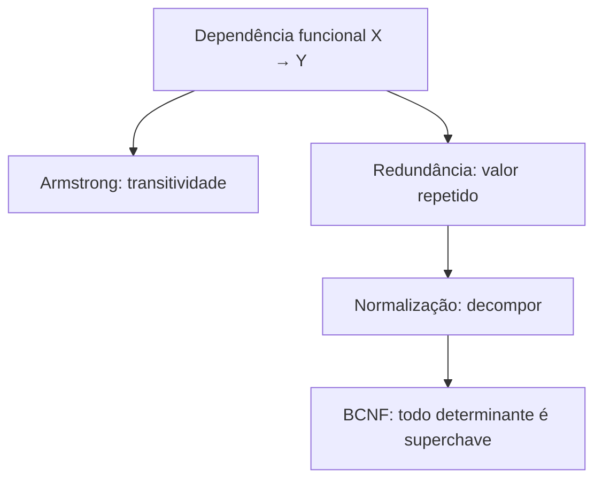

# 53 · Dependências funcionais e normalização

**Tempo estimado:** 50 minutos · **Pré-requisito:** [[52 - Modelo entidade-relacionamento e mapeamento]] e [[51 - Modelo relacional, chaves e álgebra relacional]].

**Ao final você vai conseguir:**

1. Definir dependência funcional e testá-la em uma tabela.
2. Aplicar a regra da transitividade de Armstrong.
3. Reconhecer redundância e a dependência parcial e transitiva que a causam.
4. Decompor uma tabela para eliminar uma violação de BCNF, sem perder linhas.

**Antes de começar:** no módulo 51 as chaves identificavam linhas. Uma dependência funcional vai além: diz que um atributo é determinado por outro, e isso revela repetição de dados.

---

## Para começar

Uma tabela de alunos guarda, em cada linha, o nome do departamento e o nome do chefe. Se dez alunos são do mesmo departamento, o nome do chefe aparece dez vezes. Quando o chefe muda, é preciso atualizar dez linhas, e uma pode ficar esquecida. A redundância é o problema, e a dependência entre `departamento` e `chefe` é a causa.

---

## Mapa do módulo



*Figura 1: a dependência explica a redundância; a normalização divide a tabela até que cada determinante seja superchave.*

**Como ler:** a dependência é o fato; a redundância é o sintoma; a decomposição é o remédio.

---

## Mini-aula 1: dependência funcional

> [!tip] Ideia
> `X → Y` quer dizer: se duas linhas têm o mesmo valor em `X`, elas têm o mesmo valor em `Y`. É uma regra sobre todas as linhas, e não sobre uma só.

> [!info] Definição
> Segundo Watt e Eng, o atributo `Y` depende funcionalmente de `X` quando isso vale na tabela; `X` é o determinante. As regras de Armstrong são reflexividade, aumento e transitividade, e delas saem a união e a decomposição. A nota diz que a definição de Watt e Eng é centrada na chave primária.

Veja se as dependências valem nas linhas de alunos. Antes de rodar, diga qual dependência falha.

```python
alunos = [
    (1, "Ana", "CC", "Lima"),
    (2, "Bruno", "CC", "Lima"),
    (3, "Carla", "BD", "Souza"),
]
colunas = ["id", "nome", "dept", "chefe"]

def fd_vale(linhas, x, y):
    vistos = {}
    for l in linhas:
        chave = tuple(l[i] for i in x)
        valor = tuple(l[i] for i in y)
        if chave in vistos and vistos[chave] != valor:
            return False
        vistos[chave] = valor
    return True

for x, y in [([0], [1]), ([2], [3]), ([1], [2])]:
    print(colunas[x[0]], "->", colunas[y[0]], ":", fd_vale(alunos, x, y))
```

Saída real:

```
id -> nome : True
dept -> chefe : True
nome -> dept : True
```

**Como ler:** `id → nome` vale, porque cada id tem um nome. `dept → chefe` também vale: os dois alunos do CC têm o mesmo chefe. `nome → chefe` vale apenas porque os nomes são todos diferentes, e não por uma regra de negócio. Uma dependência pode valer por acaso nos dados atuais.

> [!warning] Armadilha comum
> Uma dependência que vale nos dados de hoje não é uma regra do modelo. Ela só vira regra quando a semântica do domínio a garante, e um dado novo pode quebrá-la.

> [!question]- Checkpoint
> 1. Por que `id → nome` vale nessa tabela?
> 2. Por que `nome → chefe` vale sem ser uma regra do domínio?
>
> > [!success]- Resposta
> > 1. Porque cada id aparece em uma só linha, com um só nome.
> > 2. Porque os nomes são distintos nas três linhas; a regra só valeria se os nomes fossem sempre únicos por definição.

---

## Mini-aula 2: transitividade e redundância

> [!tip] Ideia
> Se `id → dept` e `dept → chefe`, então `id → chefe`. Essa dependência derivada pode vir de uma cadeia, e é ela que causa a repetição do chefe por aluno.

> [!info] Definição
> A regra da **transitividade** (Armstrong) diz que, se `X → Y` e `Y → Z`, então `X → Z`. A **redundância** é o mesmo valor guardado em várias linhas. Quando um não chave determina outro não chave, há uma dependência transitiva, e a 3FN a proíbe.

Veja a contagem de repetições da coluna de departamento. Antes de começar o exercício A3, pense: quantas repetições há em `[CC, CC, BD]`?

> [!question]- Checkpoint
> 1. O que a transitividade permite derivar?
> 2. Qual é a dependência transitiva no exemplo dos alunos?
>
> > [!success]- Resposta
> > 1. Uma dependência que não aparece diretamente, a partir de uma cadeia.
> > 2. `id → dept → chefe`, em que `chefe` depende de `dept`, e não diretamente do aluno.

---

## Mini-aula 3: formas normais e decomposição

> [!tip] Ideia
> A decomposição separa o determinante e seus dependentes em tabelas próprias. Cada departamento passa a aparecer uma vez, com o seu chefe.

> [!info] Definição
> Watt e Eng definem as formas normais pela chave primária. A **2FN** proíbe dependência parcial de uma chave composta. A **3FN** proíbe dependência transitiva de atributos não chave. A **BCNF** exige que todo determinante seja chave (superchave).

Veja a decomposição da tabela de alunos em duas tabelas. Antes de rodar, diga quantas linhas tem a tabela de departamentos.

```python
linhas = [
    (1, "Ana", "CC", "Lima"),
    (2, "Bruno", "CC", "Lima"),
    (3, "Carla", "BD", "Souza"),
]

alunos = [(l[0], l[1], l[2]) for l in linhas]
departamentos = sorted({(l[2], l[3]) for l in linhas})
print("tabela original, com chefe repetido:", len(linhas), "linhas")
print("alunos:", alunos)
print("departamentos:", departamentos)
```

Saída real:

```
tabela original, com chefe repetido: 3 linhas
alunos: [(1, 'Ana', 'CC'), (2, 'Bruno', 'CC'), (3, 'Carla', 'BD')]
departamentos: [('BD', 'Souza'), ('CC', 'Lima')]
```

**Como ler:** a tabela de alunos mantém as três linhas, e a de departamentos guarda o par `CC`/`Lima` uma só vez.

> [!warning] Armadilha comum
> Decompor sem preservar as linhas é um erro: a junção das tabelas tem que devolver os dados originais. A decomposição do exercício P2 mantém todos os alunos, e a tabela de departamentos só guarda cada par uma vez.

> [!question]- Checkpoint
> 1. Qual forma normal proíbe dependência parcial de chave composta?
> 2. Por que a tabela de departamentos tem menos linhas que a de alunos?
>
> > [!success]- Resposta
> > 1. A 2FN.
> > 2. Porque cada departamento aparece uma vez, e vários alunos podem estar no mesmo departamento.

---

## Exercícios

Cada exercício tem um bloco com a função a completar e os testes com `assert`. Quando todos passarem, aparece `Passou!`. As funções definidas em exercícios anteriores aparecem no código inicial.

### Aquecimento

**A1. Dependência funcional.** Watt e Eng definem: o atributo `Y` depende funcionalmente de `X` quando duas linhas com o mesmo valor em `X` têm sempre o mesmo valor em `Y`. Complete `fd_vale(linhas, x, y)`, em que `x` e `y` são listas de índices de colunas, e devolva `True` se `X → Y` vale na tabela.

```python
def fd_vale(linhas, x, y):
    """True se X → Y vale: linhas com o mesmo X têm o mesmo Y."""
    ...

t = [(1, "a", "x"), (2, "a", "x"), (3, "b", "y")]
assert fd_vale(t, [1], [2]) is True, "a → x em todas as linhas"
assert fd_vale(t, [0], [1]) is True, "id é único"
assert fd_vale([(1, "a"), (2, "b"), (1, "c")], [0], [1]) is False, "id 1 com dois nomes"
print("Passou!")
```

> [!hint]- Dica 1
> Para cada linha, monte `chave = tuple(l[i] for i in x)` e `valor = tuple(l[i] for i in y)`.

> [!hint]- Dica 2
> Guarde os valores já vistos em um dicionário. Se a mesma chave aparece com valor diferente, a dependência não vale.

> [!example]- Solução
> ```python
> def fd_vale(linhas, x, y):
>     """True se X → Y vale: linhas com o mesmo X têm o mesmo Y."""
>     vistos = {}
>     for l in linhas:
>         chave = tuple(l[i] for i in x)
>         valor = tuple(l[i] for i in y)
>         if chave in vistos and vistos[chave] != valor:
>             return False
>         vistos[chave] = valor
>     return True
> ```
>
> **Erro comum:** Comparar só a última linha com a primeira. A dependência tem que valer para todos os pares de linhas com o mesmo `X`.

**A2. Transitividade.** Uma das regras de Armstrong diz que, se `X → Y` e `Y → Z` valem, então `X → Z` vale. A nota dá essas regras, e o exemplo do aluno com departamento e chefe usa essa transitividade. Complete `derivada_por_transitividade(fds, x, z)`, em que `fds` é uma lista de pares `(X, Y)` de atributos, em texto. Devolva `True` se existe um atributo `y` tal que `(x, y)` e `(y, z)` estão em `fds`.

```python
def derivada_por_transitividade(fds, x, z):
    """True se existe y com (x, y) e (y, z) em fds: X → Y e Y → Z implicam X → Z."""
    ...

fds = [("id", "dept"), ("dept", "chefe")]
assert derivada_por_transitividade(fds, "id", "chefe") is True, "transitividade pelo dept"
assert derivada_por_transitividade(fds, "chefe", "id") is False, "a direção importa"
assert derivada_por_transitividade([], "a", "b") is False, "sem dependências"
print("Passou!")
```

> [!hint]- Dica 1
> Percorra `fds` procurando um par `(x, y)`; para cada um, veja se `(y, z)` também está.

> [!hint]- Dica 2
> Com `[("id", "dept"), ("dept", "chefe")]`, `x = "id"` e `z = "chefe"` dá `True`.

> [!example]- Solução
> ```python
> def derivada_por_transitividade(fds, x, z):
>     """True se existe y com (x, y) e (y, z) em fds: X → Y e Y → Z implicam X → Z."""
>     return any((y, z) in fds for (a, y) in fds if a == x)
> ```
>
> **Erro comum:** Verificar só se `(x, z)` está diretamente na lista. A transitividade existe justamente para derivar dependências que não aparecem.

**A3. Redundância.** Quando um valor se repete em muitas linhas, a tabela guarda o mesmo fato várias vezes. A quantidade de repetições de uma coluna é um sinal de redundância. Complete `redundancia(linhas, i)`, que devolve quantas vezes o valor da coluna `i` aparece além da primeira, somando sobre todas as repetições: `len(linhas) - número de valores distintos`.

```python
def redundancia(linhas, i):
    """Número de repetições de valores na coluna i: linhas menos valores distintos."""
    ...

assert redundancia([(1, "CC"), (2, "CC"), (3, "BD")], 1) == 1, "CC aparece duas vezes"
assert redundancia([(1, "x"), (2, "y")], 1) == 0, "nenhum repetido"
assert redundancia([], 0) == 0, "tabela vazia"
print("Passou!")
```

> [!hint]- Dica 1
> Monte o conjunto `{l[i] for l in linhas}` e compare o tamanho com `len(linhas)`.

> [!hint]- Dica 2
> Para a coluna `dept` de `[(1, "CC"), (2, "CC"), (3, "BD")]`, o resultado é `1`.

> [!example]- Solução
> ```python
> def redundancia(linhas, i):
>     """Número de repetições de valores na coluna i: linhas menos valores distintos."""
>     return len(linhas) - len({l[i] for l in linhas})
> ```
>
> **Erro comum:** Contar os valores distintos e devolver esse número. O exercício pede as repetições, que são o total menos os distintos.

### Praticando

**P1. Dependência parcial.** Em 2FN, um atributo não chave não pode depender de só parte de uma chave composta. A nota de Watt e Eng define isso. Complete `dependencia_parcial(linhas, chave, atributo)`, que devolve `True` se existe um subconjunto próprio e não vazio de `chave` que determina `atributo`. Use `fd_vale`, já definida acima, e `itertools.combinations`.

```python
from itertools import combinations

def fd_vale(linhas, x, y):
    vistos = {}
    for l in linhas:
        chave = tuple(l[i] for i in x)
        valor = tuple(l[i] for i in y)
        if chave in vistos and vistos[chave] != valor:
            return False
        vistos[chave] = valor
    return True

def dependencia_parcial(linhas, chave, atributo):
    """True se parte própria e não vazia da chave determina o atributo."""
    ...

pedidos = [(1, 10, "Ana"), (1, 11, "Ana"), (2, 10, "Bruno")]
assert dependencia_parcial(pedidos, [0, 1], 2) is True, "o cliente (coluna 0) determina o nome"
outros = [(1, 10, "x"), (1, 11, "y"), (2, 10, "z")]
assert dependencia_parcial(outros, [0, 1], 2) is False, "nenhuma parte determina o atributo"
assert dependencia_parcial([], [0, 1], 2) is True, "sem linhas, toda dependência vale"
print("Passou!")
```

> [!hint]- Dica 1
> Teste todos os tamanhos de `1` até `len(chave) - 1`, com `combinations(chave, tam)`.

> [!hint]- Dica 2
> Para cada subconjunto `s`, veja se `fd_vale(linhas, list(s), [atributo])`.

> [!example]- Solução
> ```python
> def dependencia_parcial(linhas, chave, atributo):
>     """True se parte própria e não vazia da chave determina o atributo."""
>     for tam in range(1, len(chave)):
>         for s in combinations(chave, tam):
>             if fd_vale(linhas, list(s), [atributo]):
>                 return True
>     return False
> ```
>
> **Erro comum:** Incluir a própria chave no teste. Ela sempre determina os atributos, e isso não é dependência parcial.

**P2. Decomposição.** Para remover a dependência transitiva de `dept → chefe` em uma tabela de alunos, separa-se o chefe em outra tabela, com um registro por departamento. Complete `decompoe(linhas, principal, dependente)`, em que `principal` e `dependente` são listas de índices de colunas. Devolva a tupla `(tabela_principal, tabela_dependente)`: a primeira mantém as linhas com as colunas `principal`, na ordem original; a segunda tem as tuplas distintas com as colunas `dependente`, em ordem crescente.

```python
def decompoe(linhas, principal, dependente):
    """Divide em duas tabelas: colunas principais com as linhas, e as dependentes distintas."""
    ...

linhas = [(1, "Ana", "CC", "Lima"), (2, "Bruno", "CC", "Lima"), (3, "Carla", "BD", "Souza")]
assert decompoe(linhas, [0, 1, 2], [2, 3]) is not None, "a função devolve a dupla"
principal, dependente = decompoe(linhas, [0, 1, 2], [2, 3])
assert principal == [(1, "Ana", "CC"), (2, "Bruno", "CC"), (3, "Carla", "BD")], "os alunos, nas mesmas linhas"
assert dependente == [("BD", "Souza"), ("CC", "Lima")], "um registro por departamento"
print("Passou!")
```

> [!hint]- Dica 1
> Para a primeira, use uma lista de `tuple(l[i] for i in principal)`. Para a segunda, `sorted({...})` sobre as colunas `dependente`.

> [!hint]- Dica 2
> Para `dependente = [2, 3]`, duplicatas dessa dupla somem.

> [!example]- Solução
> ```python
> def decompoe(linhas, principal, dependente):
>     """Divide em duas tabelas: colunas principais com as linhas, e as dependentes distintas."""
>     tab_principal = [tuple(l[i] for i in principal) for l in linhas]
>     tab_dependente = sorted({tuple(l[i] for i in dependente) for l in linhas})
>     return (tab_principal, tab_dependente)
> ```
>
> **Erro comum:** Devolver a tabela dependente com repetições. O objetivo da decomposição é guardar cada departamento uma vez.

### Desafio

**D1. Violação de BCNF.** Na BCNF, todo determinante de uma dependência deve ser superchave. Uma dependência `X → Y` que viola a BCNF tem `X` que não é superchave. Complete `viola_bcnf(linhas, x, y, n_colunas)`, que devolve `True` se `X → Y` vale e `X` não identifica as linhas sozinho. Use `fd_vale`, já definida acima. A nota diz que as definições são as de Watt e Eng, feitas sobre a chave primária.

```python
def fd_vale(linhas, x, y):
    vistos = {}
    for l in linhas:
        chave = tuple(l[i] for i in x)
        valor = tuple(l[i] for i in y)
        if chave in vistos and vistos[chave] != valor:
            return False
        vistos[chave] = valor
    return True

def viola_bcnf(linhas, x, y, n_colunas):
    """True se X → Y vale e X não é superchave da tabela."""
    ...

linhas = [(1, "Ana", "CC", "Lima"), (2, "Bruno", "CC", "Lima"), (3, "Carla", "BD", "Souza")]
assert viola_bcnf(linhas, [2], [3], 4) is True, "dept → chefe com dept repetido"
assert viola_bcnf(linhas, [0], [1], 4) is False, "id é superchave"
assert viola_bcnf([(1, 2), (2, 2)], [1], [1], 2) is True, "X e Y iguais, X repetido"
print("Passou!")
```

> [!hint]- Dica 1
> `X` é superchave se `len({tuple(l[i] for i in x) for l in linhas}) == len(linhas)`.

> [!hint]- Dica 2
> Teste as duas condições: a dependência vale e `X` não é superchave.

> [!example]- Solução
> ```python
> def viola_bcnf(linhas, x, y, n_colunas):
>     """True se X → Y vale e X não é superchave da tabela."""
>     x_eh_superchave = len({tuple(l[i] for i in x) for l in linhas}) == len(linhas)
>     return fd_vale(linhas, x, y) and not x_eh_superchave
> ```
>
> **Erro comum:** Inverter a condição de superchave. Uma superchave não viola a BCNF, por definição.


---

## Mini-projeto (opcional)

Você vai aplicar um passo de normalização: se a dependência viola BCNF, a tabela é decomposta. Tente sozinho antes de abrir a solução.

**Mini-projeto: um passo de normalização.** Complete `normaliza_uma(linhas, x, y, n_colunas)`. Se `viola_bcnf(linhas, x, y, n_colunas)` é verdadeiro, decomponha a tabela: a tabela principal fica com todas as colunas menos `y`, e a dependente com as colunas `x + y` distintas. Devolva a tupla `(principal, dependente)`. Se não há violação, devolva `None`. Use `viola_bcnf` e `decompoe`, definidas acima.

```python
def fd_vale(linhas, x, y):
    vistos = {}
    for l in linhas:
        chave = tuple(l[i] for i in x)
        valor = tuple(l[i] for i in y)
        if chave in vistos and vistos[chave] != valor:
            return False
        vistos[chave] = valor
    return True

def viola_bcnf(linhas, x, y, n_colunas):
    x_eh_superchave = len({tuple(l[i] for i in x) for l in linhas}) == len(linhas)
    return fd_vale(linhas, x, y) and not x_eh_superchave

def decompoe(linhas, principal, dependente):
    tab_principal = [tuple(l[i] for i in principal) for l in linhas]
    tab_dependente = sorted({tuple(l[i] for i in dependente) for l in linhas})
    return (tab_principal, tab_dependente)

def normaliza_uma(linhas, x, y, n_colunas):
    """Se X → Y viola BCNF, decompõe: principal sem Y, dependente com X + Y distintos; senão None."""
    ...

linhas = [(1, "Ana", "CC", "Lima"), (2, "Bruno", "CC", "Lima"), (3, "Carla", "BD", "Souza")]
r = normaliza_uma(linhas, [2], [3], 4)
assert r is not None, "a decomposição acontece"
assert r[1] == [("BD", "Souza"), ("CC", "Lima")], "dependente com X + Y distintos"
assert normaliza_uma(linhas, [0], [1], 4) is None, "sem violação"
print("Passou!")
```

> [!hint]- Dica 1
> A principal tem as colunas `[i for i in range(n_colunas) if i not in y]`.

> [!hint]- Dica 2
> Use `decompoe(linhas, principal_cols, x + y)` e devolva o resultado da decomposição.

> [!example]- Solução
> ```python
> def normaliza_uma(linhas, x, y, n_colunas):
>     """Se X → Y viola BCNF, decompõe: principal sem Y, dependente com X + Y distintos; senão None."""
>     if not viola_bcnf(linhas, x, y, n_colunas):
>         return None
>     principal_cols = [i for i in range(n_colunas) if i not in y]
>     return decompoe(linhas, principal_cols, list(x) + list(y))
> ```
>
> **Erro comum:** Deixar a coluna `y` na tabela principal. Ela já está na dependente, e a redundância continuaria.


---

## Fechando

**Resumo**

- `X → Y` vale quando linhas com o mesmo `X` têm o mesmo `Y`; é uma regra sobre todas as linhas.
- Transitividade de Armstrong deriva `X → Z` a partir de `X → Y` e `Y → Z`.
- Redundância aparece quando um determinante não chave repete valores; isso causa dependências parciais e transitivas.
- A BCNF exige que todo determinante seja superchave; a decomposição divide a tabela para atingir isso.

**Glossário rápido**

- **Dependência funcional** (functional dependency): `X → Y`, com `X` determinando `Y`.
- **Determinante** (determinant): o lado esquerdo de uma dependência.
- **Transitividade** (transitivity): regra de Armstrong para cadeias de dependências.
- **Dependência parcial** (partial dependency): atributo depende de parte de uma chave composta.
- **BCNF** (Boyce-Codd normal form): todo determinante é superchave.

**Perguntas de revisão**

1. Uma dependência que vale nos dados atuais pode deixar de valer quando novos dados entram? Dê um exemplo.
2. Por que a decomposição deve manter todas as linhas originais?
3. Uma tabela com determinante que é superchave pode violar a BCNF? Justifique.

**E agora?** O próximo módulo é **SQL com SQLite**. Ele mostra como consultas, junções, visões e restrições se escrevem na prática, e como o Python acessa o banco.

---

## Para ir mais fundo

- [[Functional Dependencies]]
- [[Normal Forms 1NF to BCNF]]
- [[Relational Model and Keys]]
