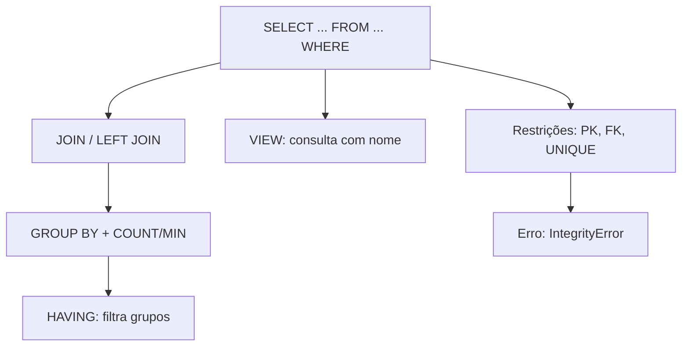

# 54 · SQL com SQLite: consultas, junções, visões e restrições

**Tempo estimado:** 55 minutos · **Pré-requisito:** [[52 - Modelo entidade-relacionamento e mapeamento]] e [[53 - Dependências funcionais e normalização]].

**Ao final você vai conseguir:**

1. Escrever consultas com `SELECT`, `WHERE`, `ORDER BY` e junções.
2. Usar `LEFT JOIN` para manter linhas sem correspondência, e `COUNT`, `MIN` com `GROUP BY` e `HAVING`.
3. Criar uma visão e ver que ela acompanha a tabela.
4. Usar `sqlite3` do Python com parâmetros, e ver a integridade referencial e a unicidade recusarem dados inválidos.

**Antes de começar:** os módulos 51 a 53 deram o modelo e as chaves. Aqui essas ideias viram comandos que o banco executa.

---

## Para começar

Você quer saber, para cada departamento, quantos alunos tem, incluindo os departamentos sem nenhum aluno. Com uma junção comum, os departamentos vazios sumiriam. A resposta depende de escolher a junção certa, e de contar a coluna certa. SQL dá a você esse controle, e o banco garante as regras que você declarou.

---

## Mapa do módulo



*Figura 1: consultas combinam tabelas e agregam; visões dão nome a consultas; restrições recusam dados inválidos.*

**Como ler:** `WHERE` filtra linhas, `HAVING` filtra grupos; a visão reaproveita uma consulta; a restrição impede a inserção.

---

## Mini-aula 1: consulta e junção externa

> [!tip] Ideia
> Uma junção interna só traz linhas que têm correspondência nas duas tabelas. A junção externa à esquerda traz todas as linhas da tabela da esquerda, com nulos onde não há par.

> [!info] Definição
> A **junção externa à esquerda** (`LEFT OUTER JOIN`) mantém as linhas da tabela da esquerda sem correspondência, preenchendo com nulos. A nota de PostgreSQL define a junção como uma consulta que acessa várias tabelas ao mesmo tempo. O `COUNT(a.id)` conta só valores não nulos, por isso o departamento sem alunos recebe zero.

Veja a contagem de alunos por departamento com junção externa. Antes de rodar, diga quantos alunos o departamento `BD` tem.

```python
import sqlite3

con = sqlite3.connect(":memory:")
con.executescript("""
CREATE TABLE dept (id INTEGER PRIMARY KEY, nome TEXT);
CREATE TABLE aluno (id INTEGER PRIMARY KEY, nome TEXT, dept_id INTEGER REFERENCES dept(id));
INSERT INTO dept VALUES (1, 'CC'), (2, 'BD');
INSERT INTO aluno VALUES (1, 'Ana', 1), (2, 'Bruno', 1), (3, 'Carla', 2), (4, 'Dani', NULL);
""")
print("alunos por departamento (junção externa):")
for linha in con.execute(
    "SELECT d.nome, COUNT(a.id) FROM dept d LEFT JOIN aluno a ON a.dept_id = d.id "
    "GROUP BY d.nome ORDER BY d.nome"
):
    print(linha)
```

Saída real:

```
alunos por departamento (junção externa):
('BD', 1)
('CC', 2)
```

**Como ler:** `CC` tem dois alunos. `BD` tem um. O aluno `Dani`, sem departamento, não entra em nenhum grupo, porque o `dept_id` é nulo.

> [!warning] Armadilha comum
> `COUNT(*)` conta linhas, mesmo que as colunas sejam nulas. Com junção externa, um departamento sem aluno geraria uma linha, e `COUNT(*)` daria um. `COUNT(a.id)` evita isso.

> [!question]- Checkpoint
> 1. Por que `Dani` não aparece em nenhum departamento?
> 2. Qual é a diferença entre `COUNT(*)` e `COUNT(a.id)` numa junção externa?
>
> > [!success]- Resposta
> > 1. Porque o `dept_id` dele é nulo, e a junção não encontra correspondência.
> > 2. `COUNT(*)` conta a linha mesmo sem par; `COUNT(a.id)` conta só valores não nulos.

---

## Mini-aula 2: filtros e agregação

> [!tip] Ideia
> `WHERE` escolhe linhas antes da agregação. `HAVING` escolhe grupos depois dela. Por isso só `HAVING` pode usar `COUNT` como condição.

> [!info] Definição
> A nota de PostgreSQL diz que `WHERE` seleciona linhas de entrada antes de os grupos serem calculados, e `HAVING` seleciona linhas de grupo depois. Agregados são `COUNT`, `SUM`, `AVG`, `MAX` e `MIN`. A nota de RPI lista as mesmas cláusulas e as operações de conjunto `UNION`, `INTERSECT` e `EXCEPT`.

No exercício A3 você filtra departamentos pelo número de alunos. Antes de começar, pense: esse filtro vai no `WHERE` ou no `HAVING`?

> [!question]- Checkpoint
> 1. Em qual cláusula se filtra um grupo pelo seu `COUNT`?
> 2. O que `NULL` faz com `=`?
>
> > [!success]- Resposta
> > 1. No `HAVING`.
> > 2. A comparação com `=` não dá verdadeiro; para nulo, o teste correto é `IS NULL`.

---

## Mini-aula 3: visões

> [!tip] Ideia
> Uma visão é uma consulta com nome, que se usa como tabela. Ela não guarda dados próprios: a cada uso, o banco executa a consulta sobre as tabelas atuais.

> [!info] Definição
> A nota de PostgreSQL define a visão como uma consulta nomeada que pode ser usada como tabela, com a função de abstração. A nota diz que privilégios são controlados à parte, com `GRANT` e `REVOKE`. O SQLite não tem o sistema de privilégios do PostgreSQL, então a demonstração mostra só a visão.

Veja uma visão que esconde a coluna de e-mail e acompanha uma nova inserção na tabela. Antes de rodar, diga se a visão mostra a linha nova.

```python
import sqlite3

con = sqlite3.connect(":memory:")
con.execute("CREATE TABLE aluno (id INTEGER PRIMARY KEY, nome TEXT)")
con.executemany("INSERT INTO aluno VALUES (?, ?)", [(1, "Ana"), (2, "Bruno")])
con.execute("CREATE VIEW v_alunos AS SELECT id, nome FROM aluno")
print("visão:", con.execute("SELECT * FROM v_alunos").fetchall())
con.execute("ALTER TABLE aluno ADD COLUMN email TEXT")
con.execute("INSERT INTO aluno VALUES (3, 'Carla', 'c@x')")
print("visão depois de mudar a tabela:", con.execute("SELECT * FROM v_alunos").fetchall())
```

Saída real:

```
visão: [(1, 'Ana'), (2, 'Bruno')]
visão depois de mudar a tabela: [(1, 'Ana'), (2, 'Bruno'), (3, 'Carla')]
```

**Como ler:** a visão mostra `id` e `nome`. Depois de uma coluna nova, ela continua mostrando só essas. A linha inserida depois aparece, porque a visão lê a tabela na hora.

> [!warning] Armadilha comum
> Uma visão não é uma cópia. Se a consulta dela depende de dados que mudam, ela devolve o resultado atual, não o de quando foi criada.

> [!question]- Checkpoint
> 1. A visão guarda as linhas de `aluno`?
> 2. A coluna `email` aparece na visão?
>
> > [!success]- Resposta
> > 1. Não; a visão só executa a consulta quando é usada.
> > 2. Não, porque a visão só seleciona `id` e `nome`.

---

## Mini-aula 4: restrições e sqlite3

> [!tip] Ideia
> O banco pode recusar dados que violam uma regra. A integridade referencial e a unicidade são regras declaradas no esquema. O Python recebe a recusa como uma exceção.

> [!info] Definição
> A **integridade de entidade** proíbe nulos na chave primária; a **integridade referencial** exige que cada chave estrangeira tenha correspondente ou seja nula. No SQLite, a verificação de chave estrangeira precisa de `PRAGMA foreign_keys = ON` por conexão. A nota de sqlite3 recomenda parâmetros com `?`, e não texto montado com concatenação, para evitar injeção de SQL.

Os exercícios P3 e D1 mostram as duas recusas. Note que o código fala com o banco por parâmetros, e a recusa chega como `sqlite3.IntegrityError`.

> [!question]- Checkpoint
> 1. Qual exceção do `sqlite3` sinaliza violação de restrição?
> 2. Por que usar `?` em vez de montar o texto do SQL?
>
> > [!success]- Resposta
> > 1. `sqlite3.IntegrityError`.
> > 2. Para evitar injeção de SQL, porque o parâmetro é tratado como dado, e não como comando.

---

## Exercícios

Cada exercício tem um bloco com a função a completar e os testes com `assert`. Quando todos passarem, aparece `Passou!`. A função `cria_base`, que monta a base de exemplo, aparece no código inicial de cada exercício.

### Aquecimento

**A1. Consulta simples.** Complete `nomes_alunos(con)`, que recebe uma conexão SQLite com as tabelas `dept` e `aluno` e devolve a lista dos nomes de todos os alunos, em ordem alfabética. A função `cria_base`, definida aqui, monta a base de exemplo usada em todos os exercícios deste módulo.

```python
import sqlite3

def cria_base():
    """Base de exemplo: departamentos CC e BD, quatro alunos, um sem departamento."""
    con = sqlite3.connect(":memory:")
    con.execute("PRAGMA foreign_keys = ON")
    con.execute("CREATE TABLE dept (id INTEGER PRIMARY KEY, nome TEXT UNIQUE)")
    con.execute("CREATE TABLE aluno (id INTEGER PRIMARY KEY, nome TEXT, dept_id INTEGER REFERENCES dept(id))")
    con.executemany("INSERT INTO dept VALUES (?, ?)", [(1, "CC"), (2, "BD")])
    con.executemany("INSERT INTO aluno VALUES (?, ?, ?)", [(1, "Ana", 1), (2, "Bruno", 1), (3, "Carla", 2), (4, "Dani", None)])
    return con

def nomes_alunos(con):
    """Nomes de todos os alunos, em ordem alfabética."""
    ...

assert nomes_alunos(cria_base()) == ["Ana", "Bruno", "Carla", "Dani"], "todos, em ordem"
print("Passou!")
```

> [!hint]- Dica 1
> Use `con.execute("SELECT nome FROM aluno ORDER BY nome")`.

> [!hint]- Dica 2
> Cada linha do resultado é uma tupla; pegue o primeiro elemento de cada uma.

> [!example]- Solução
> ```python
> def nomes_alunos(con):
>     """Nomes de todos os alunos, em ordem alfabética."""
>     return [r[0] for r in con.execute("SELECT nome FROM aluno ORDER BY nome")]
> ```
>
> **Erro comum:** Esquecer o `ORDER BY`. O SQL não garante ordem sem ele, e o teste pode falhar de forma aleatória.

**A2. Junção externa com contagem.** Complete `alunos_por_dept(con)`, que devolve uma lista de tuplas `(nome_do_departamento, quantidade_de_alunos)` para todos os departamentos, ordenada pelo nome. Um departamento sem alunos deve aparecer com contagem zero. Use `LEFT JOIN` e `COUNT`.

```python
import sqlite3

def cria_base():
    con = sqlite3.connect(":memory:")
    con.execute("PRAGMA foreign_keys = ON")
    con.execute("CREATE TABLE dept (id INTEGER PRIMARY KEY, nome TEXT UNIQUE)")
    con.execute("CREATE TABLE aluno (id INTEGER PRIMARY KEY, nome TEXT, dept_id INTEGER REFERENCES dept(id))")
    con.executemany("INSERT INTO dept VALUES (?, ?)", [(1, "CC"), (2, "BD")])
    con.executemany("INSERT INTO aluno VALUES (?, ?, ?)", [(1, "Ana", 1), (2, "Bruno", 1), (3, "Carla", 2), (4, "Dani", None)])
    return con

def alunos_por_dept(con):
    """Lista de (departamento, quantidade de alunos), com zero para quem não tem, por nome."""
    ...

assert alunos_por_dept(cria_base()) == [("BD", 1), ("CC", 2)], "contagem por departamento"
con = cria_base()
con.execute("INSERT INTO dept VALUES (3, 'SO')")
assert alunos_por_dept(con) == [("BD", 1), ("CC", 2), ("SO", 0)], "departamento vazio aparece com zero"
print("Passou!")
```

> [!hint]- Dica 1
> Use `FROM dept d LEFT JOIN aluno a ON a.dept_id = d.id`, com `GROUP BY d.nome`.

> [!hint]- Dica 2
> Conte `a.id`, e não `*`. Com a junção externa, `COUNT(*)` contaria a linha sem aluno.

> [!example]- Solução
> ```python
> def alunos_por_dept(con):
>     """Lista de (departamento, quantidade de alunos), com zero para quem não tem, por nome."""
>     return [tuple(r) for r in con.execute(
>         "SELECT d.nome, COUNT(a.id) FROM dept d LEFT JOIN aluno a ON a.dept_id = d.id "
>         "GROUP BY d.nome ORDER BY d.nome")]
> ```
>
> **Erro comum:** Usar `JOIN` no lugar de `LEFT JOIN`. Um departamento sem alunos some do resultado.

**A3. Filtro sobre grupos.** `WHERE` filtra linhas antes da agregação; `HAVING` filtra grupos depois. Complete `dept_com_mais_de(con, n)`, que devolve os nomes dos departamentos com mais de `n` alunos, em ordem alfabética. Use `HAVING` com um parâmetro `?`.

```python
import sqlite3

def cria_base():
    con = sqlite3.connect(":memory:")
    con.execute("PRAGMA foreign_keys = ON")
    con.execute("CREATE TABLE dept (id INTEGER PRIMARY KEY, nome TEXT UNIQUE)")
    con.execute("CREATE TABLE aluno (id INTEGER PRIMARY KEY, nome TEXT, dept_id INTEGER REFERENCES dept(id))")
    con.executemany("INSERT INTO dept VALUES (?, ?)", [(1, "CC"), (2, "BD")])
    con.executemany("INSERT INTO aluno VALUES (?, ?, ?)", [(1, "Ana", 1), (2, "Bruno", 1), (3, "Carla", 2), (4, "Dani", None)])
    return con

def dept_com_mais_de(con, n):
    """Nomes dos departamentos com mais de n alunos, em ordem."""
    ...

assert dept_com_mais_de(cria_base(), 1) == ["CC"], "só CC tem mais de um"
assert dept_com_mais_de(cria_base(), 0) == ["BD", "CC"], "os dois têm alunos"
assert dept_com_mais_de(cria_base(), 5) == [], "ninguém tem tantos"
print("Passou!")
```

> [!hint]- Dica 1
> Use `GROUP BY d.nome HAVING COUNT(a.id) > ?` e passe `(n,)` como parâmetro.

> [!hint]- Dica 2
> Para `n = 1`, o resultado é `["CC"]`.

> [!example]- Solução
> ```python
> def dept_com_mais_de(con, n):
>     """Nomes dos departamentos com mais de n alunos, em ordem."""
>     return [r[0] for r in con.execute(
>         "SELECT d.nome FROM dept d LEFT JOIN aluno a ON a.dept_id = d.id "
>         "GROUP BY d.nome HAVING COUNT(a.id) > ? ORDER BY d.nome", (n,))]
> ```
>
> **Erro comum:** Colocar a condição de contagem no `WHERE`. Não há como contar dentro do `WHERE`, e o SQL recusa a consulta.

### Praticando

**P1. Valor nulo.** Em SQL, `NULL` não é igual a nada, nem a `NULL`. Por isso a comparação `dept_id = NULL` não serve, e o teste correto é `IS NULL`. Complete `alunos_sem_dept(con)`, que devolve a lista dos nomes dos alunos sem departamento, em ordem.

```python
import sqlite3

def cria_base():
    con = sqlite3.connect(":memory:")
    con.execute("PRAGMA foreign_keys = ON")
    con.execute("CREATE TABLE dept (id INTEGER PRIMARY KEY, nome TEXT UNIQUE)")
    con.execute("CREATE TABLE aluno (id INTEGER PRIMARY KEY, nome TEXT, dept_id INTEGER REFERENCES dept(id))")
    con.executemany("INSERT INTO dept VALUES (?, ?)", [(1, "CC"), (2, "BD")])
    con.executemany("INSERT INTO aluno VALUES (?, ?, ?)", [(1, "Ana", 1), (2, "Bruno", 1), (3, "Carla", 2), (4, "Dani", None)])
    return con

def alunos_sem_dept(con):
    """Nomes, em ordem, dos alunos cujo dept_id é nulo."""
    ...

assert alunos_sem_dept(cria_base()) == ["Dani"], "só Dani não tem departamento"
con = cria_base()
con.execute("INSERT INTO aluno VALUES (5, 'Eva', NULL)")
assert alunos_sem_dept(con) == ["Dani", "Eva"], "vários nulos"
print("Passou!")
```

> [!hint]- Dica 1
> Use `WHERE dept_id IS NULL`.

> [!hint]- Dica 2
> Na base de exemplo, o resultado é `["Dani"]`.

> [!example]- Solução
> ```python
> def alunos_sem_dept(con):
>     """Nomes, em ordem, dos alunos cujo dept_id é nulo."""
>     return [r[0] for r in con.execute("SELECT nome FROM aluno WHERE dept_id IS NULL ORDER BY nome")]
> ```
>
> **Erro comum:** Escrever `dept_id = NULL`. A consulta roda, mas não devolve nada: a comparação com nulo é desconhecida.

**P2. Visão.** Uma visão é uma consulta com nome, usada como tabela. A nota de PostgreSQL diz que ela dá abstração, e a demonstração mostrou que a visão acompanha a tabela. Complete `cria_visao(con)`, que cria a visão `v_alunos` com as colunas `id` e `nome` da tabela `aluno` e devolve a lista de todas as suas linhas, ordenada pelo id.

```python
import sqlite3

def cria_base():
    con = sqlite3.connect(":memory:")
    con.execute("PRAGMA foreign_keys = ON")
    con.execute("CREATE TABLE dept (id INTEGER PRIMARY KEY, nome TEXT UNIQUE)")
    con.execute("CREATE TABLE aluno (id INTEGER PRIMARY KEY, nome TEXT, dept_id INTEGER REFERENCES dept(id))")
    con.executemany("INSERT INTO dept VALUES (?, ?)", [(1, "CC"), (2, "BD")])
    con.executemany("INSERT INTO aluno VALUES (?, ?, ?)", [(1, "Ana", 1), (2, "Bruno", 1), (3, "Carla", 2), (4, "Dani", None)])
    return con

def cria_visao(con):
    """Cria a visão v_alunos (id, nome) e devolve suas linhas ordenadas pelo id."""
    ...

assert cria_visao(cria_base()) == [(1, "Ana"), (2, "Bruno"), (3, "Carla"), (4, "Dani")], "a visão tem id e nome"
print("Passou!")
```

> [!hint]- Dica 1
> Execute `CREATE VIEW v_alunos AS SELECT id, nome FROM aluno`.

> [!hint]- Dica 2
> Para a leitura, use `SELECT * FROM v_alunos ORDER BY id`.

> [!example]- Solução
> ```python
> def cria_visao(con):
>     """Cria a visão v_alunos (id, nome) e devolve suas linhas ordenadas pelo id."""
>     con.execute("CREATE VIEW v_alunos AS SELECT id, nome FROM aluno")
>     return [tuple(r) for r in con.execute("SELECT * FROM v_alunos ORDER BY id")]
> ```
>
> **Erro comum:** Criar a visão com `SELECT *`. Depois, a visão mostraria colunas novas da tabela, e o objetivo de escondê-las se perderia.

**P3. Chave estrangeira.** Com `PRAGMA foreign_keys = ON`, o SQLite recusa uma linha cuja chave estrangeira não existe na tabela referenciada. A nota de Watt e Eng chama isso de integridade referencial. Complete `insere_invalido(con)`, que tenta inserir um aluno com `dept_id = 99` e devolve `True` se o banco recusou com `sqlite3.IntegrityError`, e `False` se aceitou.

```python
import sqlite3

def cria_base():
    con = sqlite3.connect(":memory:")
    con.execute("PRAGMA foreign_keys = ON")
    con.execute("CREATE TABLE dept (id INTEGER PRIMARY KEY, nome TEXT UNIQUE)")
    con.execute("CREATE TABLE aluno (id INTEGER PRIMARY KEY, nome TEXT, dept_id INTEGER REFERENCES dept(id))")
    con.executemany("INSERT INTO dept VALUES (?, ?)", [(1, "CC"), (2, "BD")])
    con.executemany("INSERT INTO aluno VALUES (?, ?, ?)", [(1, "Ana", 1), (2, "Bruno", 1), (3, "Carla", 2), (4, "Dani", None)])
    return con

def insere_invalido(con):
    """True se o banco recusa aluno com departamento inexistente (integridade referencial)."""
    ...

assert insere_invalido(cria_base()) is True, "departamento 99 não existe"
con = cria_base()
con.execute("INSERT INTO dept VALUES (99, 'XX')")
assert insere_invalido(con) is False, "com o departamento criado, a inserção passa"
print("Passou!")
```

> [!hint]- Dica 1
> Use `try:` com o `INSERT`, e `except sqlite3.IntegrityError:` com o retorno `True`.

> [!hint]- Dica 2
> Depois do `try` que funciona, devolva `False`.

> [!example]- Solução
> ```python
> def insere_invalido(con):
>     """True se o banco recusa aluno com departamento inexistente (integridade referencial)."""
>     try:
>         con.execute("INSERT INTO aluno VALUES (9, 'Eva', 99)")
>     except sqlite3.IntegrityError:
>         return True
>     return False
> ```
>
> **Erro comum:** Capturar qualquer exceção. Um erro de sintaxe também seria escondido, e a função daria `True` por motivo errado.

### Desafio

**D1. Restrição de unicidade.** A tabela `dept` tem `nome UNIQUE`. Complete `duplica_dept(con)`, que tenta inserir um departamento de nome `"CC"`, que já existe, e devolve `True` se o banco recusa com `sqlite3.IntegrityError`, e `False` se aceita. A nota de integridade chama essa classe de restrição de regra de negócio.

```python
import sqlite3

def cria_base():
    con = sqlite3.connect(":memory:")
    con.execute("PRAGMA foreign_keys = ON")
    con.execute("CREATE TABLE dept (id INTEGER PRIMARY KEY, nome TEXT UNIQUE)")
    con.execute("CREATE TABLE aluno (id INTEGER PRIMARY KEY, nome TEXT, dept_id INTEGER REFERENCES dept(id))")
    con.executemany("INSERT INTO dept VALUES (?, ?)", [(1, "CC"), (2, "BD")])
    con.executemany("INSERT INTO aluno VALUES (?, ?, ?)", [(1, "Ana", 1), (2, "Bruno", 1), (3, "Carla", 2), (4, "Dani", None)])
    return con

def duplica_dept(con):
    """True se o banco recusa um segundo departamento com o mesmo nome."""
    ...

assert duplica_dept(cria_base()) is True, "nome repetido é recusado"
con = cria_base()
con.execute("INSERT INTO dept VALUES (3, 'SO')")
assert duplica_dept(con) is True, "o nome CC continua repetido"
print("Passou!")
```

> [!hint]- Dica 1
> Use o mesmo padrão de `try` e `except` do exercício P3.

> [!hint]- Dica 2
> Insira com `INSERT INTO dept VALUES (3, 'CC')`.

> [!example]- Solução
> ```python
> def duplica_dept(con):
>     """True se o banco recusa um segundo departamento com o mesmo nome."""
>     try:
>         con.execute("INSERT INTO dept VALUES (3, 'CC')")
>     except sqlite3.IntegrityError:
>         return True
>     return False
> ```
>
> **Erro comum:** Escrever `INSERT OR IGNORE`. O banco não recusa nada e a função sempre devolveria `False`, sem testar a restrição.


---

## Mini-projeto (opcional)

Você vai montar um relatório por departamento com quantidade e o menor nome de aluno. Tente sozinho antes de abrir a solução.

**Mini-projeto: relatório por departamento.** Complete `relatorio(con)`, que devolve uma lista de tuplas `(departamento, quantidade, primeiro_nome)`, em que `primeiro_nome` é o menor nome de aluno do departamento. Só entram departamentos com pelo menos um aluno. Ordene pelo nome do departamento. Use `JOIN`, `COUNT`, `MIN` e `GROUP BY`.

```python
import sqlite3

def cria_base():
    con = sqlite3.connect(":memory:")
    con.execute("PRAGMA foreign_keys = ON")
    con.execute("CREATE TABLE dept (id INTEGER PRIMARY KEY, nome TEXT UNIQUE)")
    con.execute("CREATE TABLE aluno (id INTEGER PRIMARY KEY, nome TEXT, dept_id INTEGER REFERENCES dept(id))")
    con.executemany("INSERT INTO dept VALUES (?, ?)", [(1, "CC"), (2, "BD")])
    con.executemany("INSERT INTO aluno VALUES (?, ?, ?)", [(1, "Ana", 1), (2, "Bruno", 1), (3, "Carla", 2), (4, "Dani", None)])
    return con

def relatorio(con):
    """(departamento, quantidade, menor nome) para os departamentos com alunos, por nome."""
    ...

assert relatorio(cria_base()) == [("BD", 1, "Carla"), ("CC", 2, "Ana")], "os dois departamentos com alunos"
con = cria_base()
con.execute("INSERT INTO dept VALUES (3, 'SO')")
assert relatorio(con) == [("BD", 1, "Carla"), ("CC", 2, "Ana")], "departamento sem aluno não entra"
print("Passou!")
```

> [!hint]- Dica 1
> Use `SELECT d.nome, COUNT(a.id), MIN(a.nome) FROM dept d JOIN aluno a ON a.dept_id = d.id GROUP BY d.nome ORDER BY d.nome`.

> [!hint]- Dica 2
> Na base de exemplo, o resultado é `[("BD", 1, "Carla"), ("CC", 2, "Ana")]`.

> [!example]- Solução
> ```python
> def relatorio(con):
>     """(departamento, quantidade, menor nome) para os departamentos com alunos, por nome."""
>     return [tuple(r) for r in con.execute(
>         "SELECT d.nome, COUNT(a.id), MIN(a.nome) FROM dept d JOIN aluno a ON a.dept_id = d.id "
>         "GROUP BY d.nome ORDER BY d.nome")]
> ```
>
> **Erro comum:** Usar `LEFT JOIN`. Um departamento sem alunos apareceria com contagem zero, e o enunciado pede só os que têm aluno.


---

## Fechando

**Resumo**

- `LEFT JOIN` mantém linhas sem correspondência; `COUNT(coluna)` não conta nulos.
- `WHERE` filtra linhas; `HAVING` filtra grupos, e é onde entra a condição sobre `COUNT`.
- Uma visão é uma consulta com nome, que reflete o estado atual das tabelas.
- Chaves estrangeiras e unicidade recusam dados inválidos, e o `sqlite3` levanta `IntegrityError`.

**Glossário rápido**

- **Junção externa** (outer join): mantém linhas sem par, com nulos.
- **Agregado** (aggregate): função que resume um grupo, como `COUNT`.
- **HAVING**: filtra grupos depois da agregação.
- **Visão** (view): consulta nomeada, usada como tabela.
- **Parâmetro** (placeholder): `?` que o driver preenche com segurança.

**Perguntas de revisão**

1. Por que o `MIN(nome)` do relatório precisa do `GROUP BY`?
2. Se a base não ligar `PRAGMA foreign_keys`, o que acontece com `insere_invalido`?
3. Uma visão que filtra alunos com `dept_id IS NULL` mostra o `Dani`? Justifique.

**E agora?** O próximo módulo é **Transações e isolamento**. Ele mostra o que acontece quando duas transações mexem nos mesmos dados ao mesmo tempo.

---

## Para ir mais fundo

- [[SQL Queries, Joins and Aggregation]]
- [[SQL Views and Authorization]]
- [[Integrity Constraints]]
- [[SQLite and Python sqlite3]]
