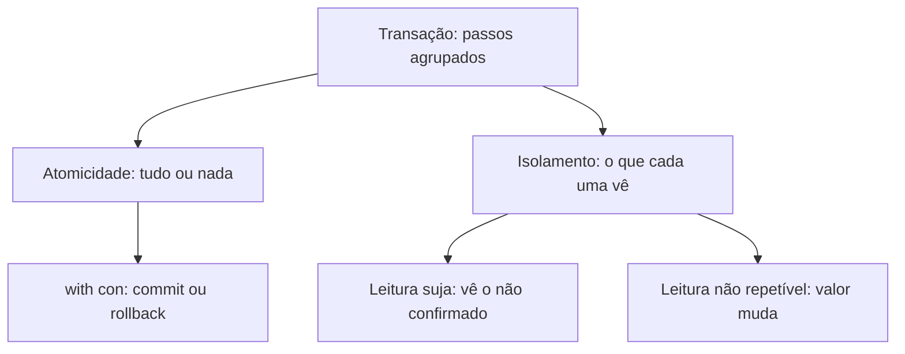

# 55 · Transações e isolamento

**Tempo estimado:** 50 minutos · **Pré-requisito:** [[54 - SQL com SQLite - consultas, junções, visões e restrições]] e o módulo 43 (condições de corrida).

**Ao final você vai conseguir:**

1. Explicar atomicidade: uma transação faz tudo ou nada.
2. Usar `with con:` do `sqlite3`, que confirma em caso de sucesso e desfaz em caso de exceção.
3. Reconhecer leitura suja e leitura não repetível, e ver como o nível de isolamento as controla.
4. Verificar que transferências preservam o total dos saldos.

**Antes de começar:** no módulo 43 duas atividades intercaladas perdiam uma atualização. No banco, a transação é o mecanismo que impede isso, e o isolamento define o que uma transação pode ver das outras.

---

## Para começar

Você transfere 150 reais de uma conta com 100. O sistema debita a primeira conta, e antes de creditar a segunda, cai a energia. Sem uma garantia, o dinheiro some. Uma transação agrupa os passos: ou todos são confirmados, ou nenhum deixa rastro. É a atomicidade, e ela é o primeiro pilar das propriedades ACID.

---

## Mapa do módulo



*Figura 1: a transação agrupa passos; a atomicidade decide entre confirmar e desfazer; o isolamento controla o que cada transação enxerga.*

**Como ler:** a atomicidade é o que o `with` garante; o isolamento é o que as anomalias desafiam.

---

## Mini-aula 1: atomicidade

> [!tip] Ideia
> Uma transação é uma sequência de operações tratada como uma só. Se uma falha, as anteriores são desfeitas. Se todas passam, são confirmadas juntas.

> [!info] Definição
> A **atomicidade** é a propriedade de uma transação ser tudo ou nada. No `sqlite3`, `with con:` confirma (`commit`) se o bloco termina sem exceção, e desfaz (`rollback`) se houver exceção; a exceção continua sendo levantada depois do desfazer. A nota de sqlite3 descreve esse comportamento.

Veja uma transferência em que o débito acontece e depois uma falha interrompe o bloco. Antes de rodar, diga qual é o saldo de `A` depois.

```python
import sqlite3

con = sqlite3.connect(":memory:")
con.execute("CREATE TABLE conta (nome TEXT PRIMARY KEY, saldo INTEGER)")
con.executemany("INSERT INTO conta VALUES (?, ?)", [("A", 100), ("B", 0)])
con.commit()
try:
    with con:
        con.execute("UPDATE conta SET saldo = saldo - 150 WHERE nome = 'A'")
        raise RuntimeError("falha no meio da transferência")
except RuntimeError as e:
    print("erro:", e)
print("saldos depois:", con.execute("SELECT nome, saldo FROM conta ORDER BY nome").fetchall())
```

Saída real:

```
erro: falha no meio da transferência
saldos depois: [('A', 100), ('B', 0)]
```

**Como ler:** o débito de 150 foi feito, mas a exceção desfez a operação. `A` continua com 100, e `B` continua com 0.

> [!warning] Armadilha comum
> Um `try` ao redor do `with` é diferente de um `try` dentro dele. Dentro, a exceção ainda aciona o desfazer; se você a engole antes do `with`, o bloco confirma o que foi feito até ali.

> [!question]- Checkpoint
> 1. Qual é o saldo de `A` após a falha?
> 2. O que `with con:` faz quando termina sem exceção?
>
> > [!success]- Resposta
> > 1. 100, porque o débito foi desfeito.
> > 2. Confirma a transação (`commit`).

---

## Mini-aula 2: isolamento e anomalias

> [!tip] Ideia
> Quando várias transações rodam ao mesmo tempo, cada uma pode ver ou não o trabalho das outras. O nível de isolamento escolhe quanto ela vê.

> [!info] Definição
> A **leitura suja** (dirty read) acontece quando uma transação lê um dado escrito por outra que ainda não confirmou. A **leitura não repetível** (nonrepeatable read) acontece quando a mesma leitura devolve valores diferentes dentro da mesma transação. A nota de PostgreSQL define esses termos. Segundo a mesma nota, o padrão SQL tem quatro níveis; o PostgreSQL implementa três, e o padrão do PostgreSQL é Read Committed.

A nota é específica do PostgreSQL, e o SQLite trata o isolamento de outra forma. A demonstração abaixo mostra o comportamento do SQLite, com duas conexões ao mesmo arquivo. Antes de rodar, diga o que a segunda conexão vê antes do `commit`.

```python
import os
import sqlite3

caminho = "exemplo_transacao.db"
if os.path.exists(caminho):
    os.remove(caminho)
c0 = sqlite3.connect(caminho)
c0.execute("CREATE TABLE conta (nome TEXT PRIMARY KEY, saldo INTEGER)")
c0.execute("INSERT INTO conta VALUES ('A', 100)")
c0.commit()
c0.close()

c1 = sqlite3.connect(caminho)
c2 = sqlite3.connect(caminho)
c1.execute("UPDATE conta SET saldo = 50 WHERE nome = 'A'")
print("c2 vê antes do commit:", c2.execute("SELECT saldo FROM conta").fetchall())
c1.commit()
print("c2 vê depois do commit:", c2.execute("SELECT saldo FROM conta").fetchall())
c1.close()
c2.close()
os.remove(caminho)
```

Saída real:

```
c2 vê antes do commit: [(100,)]
c2 vê depois do commit: [(50,)]
```

**Como ler:** antes do `commit`, a segunda conexão vê o saldo antigo, `100`. Depois do `commit`, vê `50`. Ela não leu o valor não confirmado.

> [!warning] Armadilha comum
> O nome do nível de isolamento não garante o mesmo comportamento em todos os bancos. A nota de PostgreSQL diz que Read Uncommitted se comporta como Read Committed lá; em outro banco, pode ser diferente.

> [!question]- Checkpoint
> 1. Qual valor a segunda conexão vê antes do `commit`?
> 2. Qual anomalia seria a leitura do valor `50` antes do `commit`?
>
> > [!success]- Resposta
> > 1. `100`, o valor confirmado.
> > 2. Leitura suja, porque leria um valor não confirmado.

---

## Mini-aula 3: transferências e conservação

> [!tip] Ideia
> Uma transferência retira de uma conta e põe em outra. O total dos saldos não muda. Se mudar, a transação não foi atômica.

> [!info] Definição
> A **transferência** é um par de atualizações que precisam acontecer juntas. A propriedade de conservação do total é o efeito da atomicidade sobre a soma dos saldos. Não é uma regra que a nota enuncie diretamente: ela segue da definição de transação tudo ou nada.

No exercício A3, a transferência recusada não deixa rastro. No P3, você confere a conservação do total.

> [!question]- Checkpoint
> 1. O que acontece com o total se a transferência é parcial?
> 2. A conservação depende de qual propriedade?
>
> > [!success]- Resposta
> > 1. O total muda, porque um débito foi feito sem o crédito.
> > 2. Da atomicidade.

---

## Exercícios

Cada exercício tem um bloco com a função a completar e os testes com `assert`. Quando todos passarem, aparece `Passou!`. As funções definidas em exercícios anteriores aparecem no código inicial.

### Aquecimento

**A1. Base de contas.** Complete `cria_contas()`, que cria um banco em memória com a tabela `conta (nome, saldo)`, insere `("A", 100)` e `("B", 0)`, confirma a transação e devolve a conexão. Esta base é usada nos próximos exercícios.

```python
import sqlite3

def cria_contas():
    """Banco em memória com contas A (100) e B (0), já confirmado."""
    ...

con = cria_contas()
assert con is not None, "a função devolve a conexão"
assert con.execute("SELECT saldo FROM conta WHERE nome = 'A'").fetchall() == [(100,)], "A começa com 100"
assert con.execute("SELECT COUNT(*) FROM conta").fetchall() == [(2,)], "duas contas"
print("Passou!")
```

> [!hint]- Dica 1
> Use `con.executemany("INSERT INTO conta VALUES (?, ?)", [...])` e depois `con.commit()`.

> [!hint]- Dica 2
> Sem o `commit`, os dados ficam em uma transação aberta; a demonstração mostra o efeito disso.

> [!example]- Solução
> ```python
> def cria_contas():
>     """Banco em memória com contas A (100) e B (0), já confirmado."""
>     con = sqlite3.connect(":memory:")
>     con.execute("CREATE TABLE conta (nome TEXT PRIMARY KEY, saldo INTEGER NOT NULL)")
>     con.executemany("INSERT INTO conta VALUES (?, ?)", [("A", 100), ("B", 0)])
>     con.commit()
>     return con
> ```
>
> **Erro comum:** Esquecer o `commit`. Os dados existem só na transação aberta, e uma nova conexão não os enxergaria.

**A2. Consulta de saldos.** Complete `saldos(con)`, que devolve um dicionário com o nome de cada conta associado ao seu saldo.

```python
import sqlite3

def cria_contas():
    con = sqlite3.connect(":memory:")
    con.execute("CREATE TABLE conta (nome TEXT PRIMARY KEY, saldo INTEGER NOT NULL)")
    con.executemany("INSERT INTO conta VALUES (?, ?)", [("A", 100), ("B", 0)])
    con.commit()
    return con

def saldos(con):
    """Dicionário nome -> saldo de todas as contas."""
    ...

assert saldos(cria_contas()) == {"A": 100, "B": 0}, "saldos iniciais"
print("Passou!")
```

> [!hint]- Dica 1
> Use `dict(con.execute("SELECT nome, saldo FROM conta").fetchall())`.

> [!hint]- Dica 2
> Para a base de `cria_contas`, o resultado é `{"A": 100, "B": 0}`.

> [!example]- Solução
> ```python
> def saldos(con):
>     """Dicionário nome -> saldo de todas as contas."""
>     return dict(con.execute("SELECT nome, saldo FROM conta").fetchall())
> ```
>
> **Erro comum:** Esquecer de executar a consulta e tratar a conexão como uma lista. O resultado tem que vir do banco.

**A3. Transferência atômica.** Uma transferência tem dois passos, um de débito e um de crédito. Eles precisam acontecer juntos. Complete `transferencia(con, origem, destino, valor)`, usando `with con:`: se o saldo de `origem` for menor que `valor`, levante `ValueError("saldo insuficiente")` dentro do bloco, e nenhum dos dois passos deve ficar. A nota de sqlite3 diz que `with con:` confirma em caso de sucesso e desfaz em caso de exceção.

```python
import sqlite3

def cria_contas():
    con = sqlite3.connect(":memory:")
    con.execute("CREATE TABLE conta (nome TEXT PRIMARY KEY, saldo INTEGER NOT NULL)")
    con.executemany("INSERT INTO conta VALUES (?, ?)", [("A", 100), ("B", 0)])
    con.commit()
    return con

def saldos(con):
    return dict(con.execute("SELECT nome, saldo FROM conta").fetchall())

def transferencia(con, origem, destino, valor):
    """Move valor de origem para destino numa transação: falta de saldo desfaz tudo."""
    ...

con = cria_contas()
transferencia(con, "A", "B", 50)
assert saldos(con) == {"A": 50, "B": 50}, "transferência feita"
try:
    transferencia(con, "A", "B", 500)
    assert False, "deveria levantar ValueError"
except ValueError:
    pass
assert saldos(con) == {"A": 50, "B": 50}, "a transferência recusada não deixou rastro"
print("Passou!")
```

> [!hint]- Dica 1
> Dentro de `with con:`, leia o saldo com `fetchone()[0]`, verifique e faça os dois `UPDATE`.

> [!hint]- Dica 2
> Um `UPDATE` do débito usa `saldo - ?`, e o do crédito `saldo + ?`.

> [!example]- Solução
> ```python
> def transferencia(con, origem, destino, valor):
>     """Move valor de origem para destino numa transação: falta de saldo desfaz tudo."""
>     with con:
>         saldo = con.execute("SELECT saldo FROM conta WHERE nome = ?", (origem,)).fetchone()[0]
>         if saldo < valor:
>             raise ValueError("saldo insuficiente")
>         con.execute("UPDATE conta SET saldo = saldo - ? WHERE nome = ?", (valor, origem))
>         con.execute("UPDATE conta SET saldo = saldo + ? WHERE nome = ?", (valor, destino))
> ```
>
> **Erro comum:** Fazer o débito fora do `with`. Se o crédito falhar, o dinheiro sumiria, e a exceção não desfaria o débito.

### Praticando

**P1. Tudo ou nada.** Complete `executa_tudo(con, operacoes)`, que executa em sequência uma lista de comandos SQL dentro de uma única transação, com `with con:`. Se todos funcionam, devolva `True`; se algum falha com `sqlite3.Error`, desfaça tudo e devolva `False`. A nota diz que a execução de mais de um comando é atômica quando envolvida por `with`.

```python
import sqlite3

def cria_contas():
    con = sqlite3.connect(":memory:")
    con.execute("CREATE TABLE conta (nome TEXT PRIMARY KEY, saldo INTEGER NOT NULL)")
    con.executemany("INSERT INTO conta VALUES (?, ?)", [("A", 100), ("B", 0)])
    con.commit()
    return con

def saldos(con):
    return dict(con.execute("SELECT nome, saldo FROM conta").fetchall())

def executa_tudo(con, operacoes):
    """Executa os comandos numa transação: True se todos passam; senão desfaz tudo e devolve False."""
    ...

con = cria_contas()
assert executa_tudo(con, ["UPDATE conta SET saldo = saldo - 10 WHERE nome = 'A'", "UPDATE conta SET saldo = saldo + 10 WHERE nome = 'B'"]) is True, "as duas passam"
assert saldos(con) == {"A": 90, "B": 10}, "as duas foram confirmadas"
assert executa_tudo(con, ["UPDATE conta SET saldo = 0 WHERE nome = 'A'", "UPDATE conta SETT saldo = 0"]) is False, "a segunda falha"
assert saldos(con) == {"A": 90, "B": 10}, "a primeira foi desfeita"
print("Passou!")
```

> [!hint]- Dica 1
> Capture `sqlite3.Error` fora do `with`, e devolva `True` no fim do bloco `try`.

> [!hint]- Dica 2
> Um comando com erro de sintaxe, como `"UPDATE conta SETT"`, gera `sqlite3.OperationalError`, que é um `sqlite3.Error`.

> [!example]- Solução
> ```python
> def executa_tudo(con, operacoes):
>     """Executa os comandos numa transação: True se todos passam; senão desfaz tudo e devolve False."""
>     try:
>         with con:
>             for sql in operacoes:
>                 con.execute(sql)
>         return True
>     except sqlite3.Error:
>         return False
> ```
>
> **Erro comum:** Capturar a exceção dentro do `with`. Assim, o `with` não vê a falha e confirma o que deu certo.

**P2. Leitura suja e leitura confirmada.** A nota de PostgreSQL define a leitura suja: uma transação lê um dado escrito por outra que ainda não confirmou. Este exercício simula o efeito. Os eventos são `("escreve", valor)`, `("commit",)` e `("le",)`. O valor inicial é `0`. Complete `leitura_vista(eventos, modo)`: no modo `"sujo"`, uma leitura devolve o último valor escrito; no modo `"comitado"`, devolve o último valor confirmado. Devolva a lista de valores lidos.

```python
def leitura_vista(eventos, modo):
    """Valores lidos: no modo sujo, o último escrito; no comitado, o último confirmado."""
    ...

ev = [("escreve", 5), ("le",), ("commit",), ("le",)]
assert leitura_vista(ev, "sujo") == [5, 5], "a leitura suja vê o 5 antes do commit"
assert leitura_vista(ev, "comitado") == [0, 5], "a confirmada só vê o 5 depois"
assert leitura_vista([("le",)], "sujo") == [0], "sem escritas, lê zero"
print("Passou!")
```

> [!hint]- Dica 1
> Mantenha `atual` (último escrito), `comitado` (último confirmado) e a lista de leituras.

> [!hint]- Dica 2
> No evento `"commit"`, faça `comitado = atual`.

> [!example]- Solução
> ```python
> def leitura_vista(eventos, modo):
>     """Valores lidos: no modo sujo, o último escrito; no comitado, o último confirmado."""
>     atual = 0
>     comitado = 0
>     leituras = []
>     for ev in eventos:
>         if ev[0] == "escreve":
>             atual = ev[1]
>         elif ev[0] == "commit":
>             comitado = atual
>         elif ev[0] == "le":
>             leituras.append(atual if modo == "sujo" else comitado)
>     return leituras
> ```
>
> **Erro comum:** Atualizar `comitado` na escrita. Assim o modo confirmado lê o valor que ainda não foi confirmado, e a diferença entre os modos desaparece.

**P3. Conservação do total.** Uma transferência move dinheiro sem criar nem destruir: a soma dos saldos não muda. Complete `total(con)`, que devolve a soma de todos os saldos da tabela `conta`.

```python
import sqlite3

def cria_contas():
    con = sqlite3.connect(":memory:")
    con.execute("CREATE TABLE conta (nome TEXT PRIMARY KEY, saldo INTEGER NOT NULL)")
    con.executemany("INSERT INTO conta VALUES (?, ?)", [("A", 100), ("B", 0)])
    con.commit()
    return con

def total(con):
    """Soma de todos os saldos da tabela conta."""
    ...

con = cria_contas()
assert total(con) == 100, "o total inicial"
con.execute("UPDATE conta SET saldo = saldo - 30 WHERE nome = 'A'")
con.execute("UPDATE conta SET saldo = saldo + 30 WHERE nome = 'B'")
assert total(con) == 100, "transferir não cria nem destrói dinheiro"
print("Passou!")
```

> [!hint]- Dica 1
> Use `con.execute("SELECT SUM(saldo) FROM conta").fetchone()[0]`.

> [!hint]- Dica 2
> Para a base inicial, o total é `100`.

> [!example]- Solução
> ```python
> def total(con):
>     """Soma de todos os saldos da tabela conta."""
>     return con.execute("SELECT SUM(saldo) FROM conta").fetchone()[0]
> ```
>
> **Erro comum:** Somar em Python sem consultar o banco. A função tem que refletir o estado atual da tabela.

### Desafio

**D1. Leitura não repetível.** Uma leitura não repetível acontece quando uma transação lê o mesmo dado duas vezes e recebe valores diferentes, porque outra transação confirmou uma mudança entre as leituras. A nota de PostgreSQL usa esse termo. Complete `leituras_diferem(valores)`, que devolve `True` se alguma leitura consecutiva é diferente da anterior.

```python
def leituras_diferem(valores):
    """True se alguma leitura consecutiva difere da anterior: sinal de leitura não repetível."""
    ...

assert leituras_diferem([1, 1, 1]) is False, "mesma leitura sempre"
assert leituras_diferem([1, 2]) is True, "a segunda leitura mudou"
assert leituras_diferem([5, 5, 7, 7]) is True, "a mudança no meio conta"
assert leituras_diferem([]) is False, "sem leituras"
print("Passou!")
```

> [!hint]- Dica 1
> Use `any(a != b for a, b in zip(valores, valores[1:]))`.

> [!hint]- Dica 2
> Uma lista vazia ou com um único valor não tem anomalia: devolva `False`.

> [!example]- Solução
> ```python
> def leituras_diferem(valores):
>     """True se alguma leitura consecutiva difere da anterior: sinal de leitura não repetível."""
>     return any(a != b for a, b in zip(valores, valores[1:]))
> ```
>
> **Erro comum:** Comparar o primeiro com o último valor. Uma mudança no meio da sequência também é uma anomalia.


---

## Mini-projeto (opcional)

Você vai aplicar um lote de transferências como uma única transação: ou todas passam, ou nenhuma. Tente sozinho antes de abrir a solução.

**Mini-projeto: lote tudo ou nada.** Complete `transfere_lote(con, transferencias)`, em que `transferencias` é uma lista de tuplas `(origem, destino, valor)`. Aplique todas numa única transação com `with con:`. Se uma delas tiver saldo insuficiente, levante `ValueError` dentro do bloco, para desfazer tudo, e devolva `0`. Se todas passarem, devolva o número de transferências aplicadas.

```python
import sqlite3

def cria_contas():
    con = sqlite3.connect(":memory:")
    con.execute("CREATE TABLE conta (nome TEXT PRIMARY KEY, saldo INTEGER NOT NULL)")
    con.executemany("INSERT INTO conta VALUES (?, ?)", [("A", 100), ("B", 0)])
    con.commit()
    return con

def saldos(con):
    return dict(con.execute("SELECT nome, saldo FROM conta").fetchall())

def transfere_lote(con, transferencias):
    """Aplica todas as transferências numa transação; qualquer falta desfaz o lote e devolve 0."""
    ...

con = cria_contas()
assert transfere_lote(con, [("A", "B", 500)]) == 0, "uma falta desfaz o lote"
assert saldos(con) == {"A": 100, "B": 0}, "nada foi aplicado"
assert transfere_lote(con, [("A", "B", 30), ("B", "A", 10)]) == 2, "as duas passam"
assert saldos(con) == {"A": 80, "B": 20}, "os dois saldos finais"
print("Passou!")
```

> [!hint]- Dica 1
> Use a mesma lógica de `transferencia`, mas dentro de um único `with con:` que cobre o laço.

> [!hint]- Dica 2
> Capture `ValueError` fora do `with`, e devolva `0`.

> [!example]- Solução
> ```python
> def transfere_lote(con, transferencias):
>     """Aplica todas as transferências numa transação; qualquer falta desfaz o lote e devolve 0."""
>     try:
>         with con:
>             for origem, destino, valor in transferencias:
>                 saldo = con.execute("SELECT saldo FROM conta WHERE nome = ?", (origem,)).fetchone()[0]
>                 if saldo < valor:
>                     raise ValueError("saldo insuficiente")
>                 con.execute("UPDATE conta SET saldo = saldo - ? WHERE nome = ?", (valor, origem))
>                 con.execute("UPDATE conta SET saldo = saldo + ? WHERE nome = ?", (valor, destino))
>         return len(transferencias)
>     except ValueError:
>         return 0
> ```
>
> **Erro comum:** Confirmar cada transferência com `commit` no meio do laço. Assim, as que passaram antes da falha ficariam gravadas, e o lote não seria atômico.


---

## Fechando

**Resumo**

- Uma transação agrupa operações: `with con:` confirma no sucesso e desfaz na exceção.
- Leitura suja vê dado não confirmado; leitura não repetível vê valores diferentes na mesma transação.
- O nível de isolamento controla essas anomalias, e o comportamento muda de banco para banco.
- Transferências preservam o total dos saldos quando são atômicas.

**Glossário rápido**

- **Transação** (transaction): conjunto de operações tratado como uma unidade.
- **Atomicidade** (atomicity): tudo ou nada.
- **Commit**: confirmação de uma transação.
- **Rollback**: desfazer uma transação.
- **Leitura suja** (dirty read): ler dado não confirmado.
- **Leitura não repetível** (nonrepeatable read): mesma leitura com valores diferentes.

**Perguntas de revisão**

1. Por que o `try` fora do `with` não desfaz o débito na exceção?
2. Um lote com uma falta no meio deve confirmar as transferências anteriores? Justifique.
3. O que a simulação de leitura suja do exercício P2 muda se o modo for `"comitado"`?

**E agora?** O próximo módulo é **Consistência e modelos não relacionais**. Ele mostra por que alguns sistemas trocam garantias por disponibilidade, e quais formas de dados fogem do modelo de tabelas.

---

## Para ir mais fundo

- [[Isolation Levels and Anomalies]]
- [[SQLite and Python sqlite3]]
- [[Integrity Constraints]]
