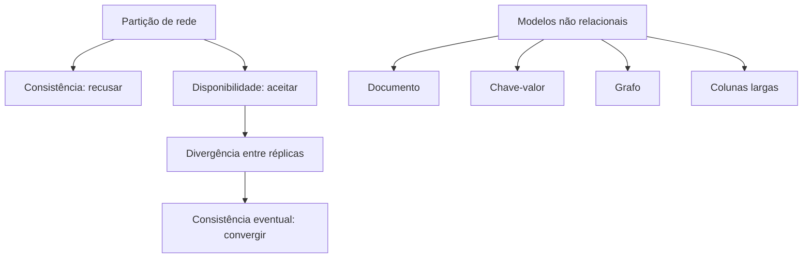

# 56 · Consistência e modelos não relacionais

**Tempo estimado:** 50 minutos · **Pré-requisito:** [[55 - Transações e isolamento]] e [[51 - Modelo relacional, chaves e álgebra relacional]].

**Ao final você vai conseguir:**

1. Explicar o teorema CAP como uma escolha durante uma partição de rede.
2. Diferenciar consistência forte de consistência eventual, e reconhecer a divergência entre réplicas.
3. Descrever os quatro modelos não relacionais que a nota cita: documento, chave-valor, grafo e colunas largas.
4. Decidir entre embutir e referenciar dados em um documento.

**Antes de começar:** os módulos 51 a 55 trataram de um banco relacional, que garante restrições e transações em um único lugar. Ao distribuir os dados entre máquinas, surgem escolhas novas.

---

## Para começar

Um site de compras tem servidores em duas cidades. Um cliente põe um item no carrinho pelo servidor de São Paulo, e o do Rio não recebe essa mudança porque o cabo entre elas caiu. O que o sistema deve fazer? Aceitar a compra nos dois lados, arriscando divergência, ou recusar até o cabo voltar? Essa pergunta é o núcleo do teorema CAP.

---

## Mapa do módulo



*Figura 1: durante a partição, o sistema escolhe; a escolha de disponibilidade leva à divergência, que a consistência eventual corrige com o tempo.*

**Como ler:** a partição é o gatilho. Sem ela, consistência e disponibilidade podem coexistir.

---

## Mini-aula 1: CAP e partição

> [!tip] Ideia
> O sistema distribuído precisa escolher, durante uma partição, entre responder com dados possivelmente antigos e recusar a resposta.

> [!info] Definição
> O **teorema CAP** (Brewer) diz que um sistema de dados compartilhados em rede pode ter no máximo duas de três propriedades: consistência, disponibilidade e tolerância a partições. A nota registra que Brewer considera o "dois de três" enganoso: a escolha pesa principalmente durante uma partição, e a consistência e a disponibilidade são contínuas e podem variar por operação.

Veja uma escrita durante a partição, com duas réplicas. Antes de rodar, diga se a segunda escrita, em `B`, altera a réplica `A`.

```python
replicas = {"A": 10, "B": 10}
particionado = True

def escreve(no, valor, modo):
    if particionado and modo == "CP":
        return "recusado: prioriza consistência"
    replicas[no] = valor
    return "aceito em " + no

print(escreve("A", 20, "AP"))
print(escreve("B", 30, "AP"))
print("réplicas durante a partição:", replicas)
print(escreve("A", 40, "CP"))
```

Saída real:

```
aceito em A
aceito em B
réplicas durante a partição: {'A': 20, 'B': 30}
recusado: prioriza consistência
```

**Como ler:** no modo de disponibilidade, as duas escritas são aceitas, e as réplicas ficam com valores diferentes. No modo de consistência, a escrita é recusada. `A` não muda, e o sistema prefere não responder.

> [!warning] Armadilha comum
> CAP não diz que um sistema deve sempre escolher duas propriedades. Em operação normal, sem partição, as três podem valer. A escolha é uma decisão sobre o que fazer quando a rede falha.

> [!question]- Checkpoint
> 1. Quais valores as réplicas têm depois das duas escritas aceitas?
> 2. O que o modo de consistência faz com a escrita em `A`?
>
> > [!success]- Resposta
> > 1. `A` com 20 e `B` com 30: divergem.
> > 2. Recusa a escrita, deixando `A` como estava.

---

## Mini-aula 2: consistência eventual

> [!tip] Ideia
> Quando as réplicas divergem, a consistência eventual diz que, sem novas escritas, elas acabam iguais. O problema é decidir qual valor vence.

> [!info] Definição
> A **consistência eventual** é a propriedade de réplicas convergirem com o tempo. A nota de Brewer apresenta o BASE (Basically Available, Soft state, Eventually consistent) como o par do ACID, e cita técnicas como vetores de versão, CRDTs e ações compensatórias. A regra de "última escrita vence" do exercício P1 é uma escolha simples, não a da nota.

No exercício A1, você detecta a divergência. No P1, aplica uma regra de convergência.

> [!question]- Checkpoint
> 1. O que é BASE, segundo a nota?
> 2. Quando as réplicas divergem, o que a consistência eventual promete?
>
> > [!success]- Resposta
> > 1. O par do ACID: disponibilidade básica, estado flexível e consistência eventual.
> > 2. Que elas convirjam com o tempo, sem novas escritas.

---

## Mini-aula 3: modelos não relacionais

> [!tip] Ideia
> Os modelos não relacionais organizam os dados por necessidade de acesso. Cada um tem uma forma de agrupar e de consultar.

> [!info] Definição
> A nota de Non-Relational Data Models cita quatro modelos, cada um com um produto de referência. **Documento** (MongoDB): documentos podem ter campos diferentes, e dados acessados juntos ficam juntos. **Chave-valor** (Redis): um servidor de estruturas de dados, com strings, listas, hashes e conjuntos. **Grafo** (Neo4j): nós, rótulos e relações dirigidas com propriedades. **Colunas largas** (Cassandra): dados particionados pela chave de partição, sem transações entre partições nem junções distribuídas.

Veja uma coleção de documentos com campos diferentes. Antes de rodar, diga o que aparece para o segundo documento no campo `email`.

```python
colecao = [
    {"nome": "Ana", "cursos": ["BD", "IA"]},
    {"nome": "Bruno", "email": "bruno@x"},
]
for doc in colecao:
    print(doc["nome"], "| email:", doc.get("email", "sem email"))
```

Saída real:

```
Ana | email: sem email
Bruno | email: bruno@x
```

**Como ler:** a coleção aceita documentos com campos diferentes. Quando o campo falta, a consulta devolve um valor padrão, sem erro.

> [!warning] Armadilha comum
> Um documento sem esquema não dispensa o cuidado com os dados. O banco não impõe a estrutura, e a aplicação precisa tratar campos ausentes.

> [!question]- Checkpoint
> 1. Qual modelo tem nós e relações dirigidas com propriedades?
> 2. Por que o Cassandra não faz junções distribuídas?
>
> > [!success]- Resposta
> > 1. O modelo de grafo, com Neo4j como exemplo.
> > 2. A nota diz que ele não tem junções distribuídas nem transações entre partições.

---

## Exercícios

Cada exercício tem um bloco com a função a completar e os testes com `assert`. Quando todos passarem, aparece `Passou!`. As funções definidas em exercícios anteriores aparecem no código inicial.

### Aquecimento

**A1. Réplicas divergentes.** Quando uma partição de rede separa réplicas, cada uma pode aceitar escritas diferentes. Esse é o caso que a nota de Brewer discute. Complete `divergencia(replicas)`, em que `replicas` é um dicionário de nome da réplica para valor. Devolva `True` se os valores não são todos iguais.

```python
def divergencia(replicas):
    """True se as réplicas não têm o mesmo valor."""
    ...

assert divergencia({"A": 20, "B": 30}) is True, "valores diferentes"
assert divergencia({"A": 20, "B": 20, "C": 20}) is False, "todas iguais"
assert divergencia({}) is False, "sem réplicas"
print("Passou!")
```

> [!hint]- Dica 1
> Compare o número de valores distintos: `len(set(replicas.values())) > 1`.

> [!hint]- Dica 2
> Para um dicionário vazio, não há divergência.

> [!example]- Solução
> ```python
> def divergencia(replicas):
>     """True se as réplicas não têm o mesmo valor."""
>     return len(set(replicas.values())) > 1
> ```
>
> **Erro comum:** Comparar só as duas primeiras réplicas. Uma terceira réplica diferente também é divergência.

**A2. Campo opcional.** Em um banco de documentos, um documento pode não ter um campo, e a nota de MongoDB diz que documentos de uma coleção não precisam ter os mesmos campos. Complete `valor_do_documento(doc, campo, padrao)`, que devolve o valor do campo, ou `padrao` se o documento não o tem.

```python
def valor_do_documento(doc, campo, padrao):
    """Valor do campo no documento, ou padrao se o documento não tem o campo."""
    ...

assert valor_do_documento({"nome": "Ana"}, "email", "sem email") == "sem email", "campo ausente"
assert valor_do_documento({"nome": "Ana"}, "nome", "x") == "Ana", "campo presente"
assert valor_do_documento({}, "a", 0) == 0, "documento vazio"
print("Passou!")
```

> [!hint]- Dica 1
> Use `doc.get(campo, padrao)`.

> [!hint]- Dica 2
> Para `{"nome": "Ana"}`, o campo `"email"` com padrão `"sem email"` devolve `"sem email"`.

> [!example]- Solução
> ```python
> def valor_do_documento(doc, campo, padrao):
>     """Valor do campo no documento, ou padrao se o documento não tem o campo."""
>     return doc.get(campo, padrao)
> ```
>
> **Erro comum:** Usar `doc[campo]`. Um campo ausente gera `KeyError`, e o documento inteiro deixa de ser consultável.

**A3. Consistência ou disponibilidade.** O teorema CAP, na versão de Brewer citada na nota, diz que, durante uma partição, um sistema deve escolher entre consistência e disponibilidade. Complete `modo_escrita(particionado, prioriza)`, que devolve `"recusa"` quando há partição e `prioriza` é `"consistencia"`, e `"aceita"` nos demais casos. Se `prioriza` não for `"consistencia"` nem `"disponibilidade"`, levante `ValueError`. A regra de escolha é a deste exercício, dada a escolha que o teorema descreve.

```python
def modo_escrita(particionado, prioriza):
    """'recusa' se há partição e se prioriza consistência; 'aceita' nos demais casos."""
    ...

assert modo_escrita(True, "consistencia") == "recusa", "partição e consistência"
assert modo_escrita(True, "disponibilidade") == "aceita", "partição e disponibilidade"
assert modo_escrita(False, "consistencia") == "aceita", "sem partição, aceita"
try:
    modo_escrita(False, "x")
    assert False, "deveria levantar ValueError"
except ValueError:
    pass
print("Passou!")
```

> [!hint]- Dica 1
> Valide `prioriza` primeiro, com `if prioriza not in (...)`.

> [!hint]- Dica 2
> Sem partição, a escrita é sempre aceita.

> [!example]- Solução
> ```python
> def modo_escrita(particionado, prioriza):
>     """'recusa' se há partição e se prioriza consistência; 'aceita' nos demais casos."""
>     if prioriza not in ("consistencia", "disponibilidade"):
>         raise ValueError("prioridade desconhecida")
>     if particionado and prioriza == "consistencia":
>         return "recusa"
>     return "aceita"
> ```
>
> **Erro comum:** Recusar escritas sem partição. A escolha de CAP só pesa durante uma partição, como a nota de Brewer diz.

### Praticando

**P1. Convergência pela última escrita.** Quando réplicas divergem e depois se reencontram, é preciso decidir qual valor vale. Uma regra simples é a da última escrita: vence o valor com o maior tempo. Complete `ultima_escrita(versoes)`, em que `versoes` é uma lista de pares `(valor, tempo)` de todas as réplicas. Devolva o valor de maior tempo. Esta regra é a deste exercício; a nota de Brewer fala em compensação e outras técnicas, sem detalhar essa.

```python
def ultima_escrita(versoes):
    """Valor da versão com maior tempo, a regra da última escrita deste exercício."""
    ...

assert ultima_escrita([(20, 1), (30, 2)]) == 30, "a de tempo 2 vence"
assert ultima_escrita([(30, 5), (20, 1)]) == 30, "a ordem da lista não importa"
assert ultima_escrita([(7, 0)]) == 7, "uma só versão"
print("Passou!")
```

> [!hint]- Dica 1
> Use `max(versoes, key=lambda v: v[1])[0]`.

> [!hint]- Dica 2
> Para `[(20, 1), (30, 2)]`, o resultado é `30`.

> [!example]- Solução
> ```python
> def ultima_escrita(versoes):
>     """Valor da versão com maior tempo, a regra da última escrita deste exercício."""
>     return max(versoes, key=lambda v: v[1])[0]
> ```
>
> **Erro comum:** Escolher pelo maior valor, e não pelo maior tempo. A regra decide pelo momento da escrita.

**P2. Consulta por campo.** Em um banco de documentos, uma consulta filtra por valores de campos. Complete `filtra_documentos(colecao, campo, valor)`, que devolve a lista dos documentos da coleção cujo campo `campo` é igual a `valor`. Documentos sem esse campo não entram.

```python
def filtra_documentos(colecao, campo, valor):
    """Documentos da coleção cujo campo é igual a valor."""
    ...

colecao = [{"nome": "Ana", "cidade": "SP"}, {"nome": "Bruno"}, {"nome": "Carla", "cidade": "RJ"}]
assert filtra_documentos(colecao, "cidade", "SP") == [{"nome": "Ana", "cidade": "SP"}], "um casamento"
assert filtra_documentos(colecao, "cidade", None) == [], "documento sem o campo não casa com None"
assert filtra_documentos([], "x", 1) == [], "coleção vazia"
print("Passou!")
```

> [!hint]- Dica 1
> Use `[d for d in colecao if d.get(campo) == valor]`.

> [!hint]- Dica 2
> Cuidado: `d.get(campo)` devolve `None` quando o campo falta, então um filtro por `None` pode casar com documentos sem o campo.

> [!example]- Solução
> ```python
> def filtra_documentos(colecao, campo, valor):
>     """Documentos da coleção cujo campo é igual a valor."""
>     return [d for d in colecao if campo in d and d[campo] == valor]
> ```
>
> **Erro comum:** Usar `d[campo] == valor`. Um documento sem o campo gera `KeyError` na consulta inteira.

**P3. Partição por chave.** Em Cassandra, a chave de partição decide em qual nó um dado fica, segundo a nota. Complete `particao_da_chave(chave, n_particoes)`, que devolve um número de 0 a `n_particoes - 1` para a chave. Use uma função determinística: a soma dos códigos dos caracteres, módulo `n_particoes`. Esta função é ilustrativa; a nota não define a função de dispersão do Cassandra.

```python
def particao_da_chave(chave, n_particoes):
    """Partição de 0 a n-1 para a chave: soma dos códigos de caracteres módulo n (ilustrativa)."""
    ...

assert particao_da_chave("ab", 4) == 3, "195 % 4"
assert particao_da_chave("ab", 4) == particao_da_chave("ab", 4), "a mesma chave vai sempre ao mesmo lugar"
assert particao_da_chave("", 5) == 0, "chave vazia"
print("Passou!")
```

> [!hint]- Dica 1
> Some `ord(c)` para cada caractere com `sum(ord(c) for c in chave)`.

> [!hint]- Dica 2
> Para `"ab"` e `4`, a soma é `97 + 98 = 195`, e o resto `195 % 4` é `3`.

> [!example]- Solução
> ```python
> def particao_da_chave(chave, n_particoes):
>     """Partição de 0 a n-1 para a chave: soma dos códigos de caracteres módulo n (ilustrativa)."""
>     return sum(ord(c) for c in chave) % n_particoes
> ```
>
> **Erro comum:** Usar `hash(chave)` do Python. O `hash` de texto muda de um processo para outro, e a partição deixaria de ser estável.

### Desafio

**D1. Embutir ou referenciar.** Em modelos de documentos, a nota de MongoDB diz que dados acessados juntos devem ficar juntos, e cita a escolha entre embutir e referenciar. Complete `incorpora_ou_referencia(n_relacionados, limite)`, que devolve `"embutir"` quando o número de documentos relacionados é menor ou igual a `limite`, e `"referenciar"` caso contrário. A regra de corte é a deste exercício; a nota não fixa um número.

```python
def incorpora_ou_referencia(n_relacionados, limite):
    """'embutir' se há poucos relacionados; 'referenciar' se há muitos (regra deste exercício)."""
    ...

assert incorpora_ou_referencia(3, 10) == "embutir", "poucos relacionados"
assert incorpora_ou_referencia(50, 10) == "referenciar", "muitos relacionados"
assert incorpora_ou_referencia(10, 10) == "embutir", "no limite, embute"
print("Passou!")
```

> [!hint]- Dica 1
> Use um `if n_relacionados <= limite:` simples.

> [!hint]- Dica 2
> Para 3 relacionados e limite 10, o resultado é `"embutir"`.

> [!example]- Solução
> ```python
> def incorpora_ou_referencia(n_relacionados, limite):
>     """'embutir' se há poucos relacionados; 'referenciar' se há muitos (regra deste exercício)."""
>     if n_relacionados <= limite:
>         return "embutir"
>     return "referenciar"
> ```
>
> **Erro comum:** Inverter a comparação. Embutir cresce com o tamanho, e referenciar protege o documento quando ele fica grande.


---

## Mini-projeto (opcional)

Você vai consultar uma coleção de documentos com vários filtros ao mesmo tempo. Tente sozinho antes de abrir a solução.

**Mini-projeto: consulta com vários campos.** Complete `consulta_documentos(colecao, filtros)`, em que `filtros` é um dicionário de campo para valor. Devolva os documentos que casam com todos os filtros ao mesmo tempo, como em um `AND`. Um documento sem algum dos campos não casa. Use `filtra_documentos`, já definida acima, uma vez por filtro, aplicando um filtro sobre o resultado do anterior.

```python
def filtra_documentos(colecao, campo, valor):
    return [d for d in colecao if campo in d and d[campo] == valor]

def consulta_documentos(colecao, filtros):
    """Documentos que casam com todos os filtros (campo -> valor), como um AND."""
    ...

colecao = [{"nome": "Ana", "cidade": "SP", "ativo": True}, {"nome": "Bruno", "cidade": "SP", "ativo": False}, {"nome": "Carla", "cidade": "RJ", "ativo": True}]
assert consulta_documentos(colecao, {"cidade": "SP", "ativo": True}) == [{"nome": "Ana", "cidade": "SP", "ativo": True}], "os dois campos juntos"
assert consulta_documentos(colecao, {}) == colecao, "sem filtros, tudo"
assert consulta_documentos(colecao, {"cidade": "XX"}) == [], "nenhum casa"
print("Passou!")
```

> [!hint]- Dica 1
> Comece com `resultado = colecao`, e para cada `(campo, valor)` do dicionário, reatribua `resultado = filtra_documentos(resultado, campo, valor)`.

> [!hint]- Dica 2
> Com `filtros` vazio, o resultado é a coleção inteira.

> [!example]- Solução
> ```python
> def consulta_documentos(colecao, filtros):
>     """Documentos que casam com todos os filtros (campo -> valor), como um AND."""
>     resultado = list(colecao)
>     for campo, valor in filtros.items():
>         resultado = filtra_documentos(resultado, campo, valor)
>     return resultado
> ```
>
> **Erro comum:** Aplicar cada filtro à coleção original e juntar os resultados. Isso dá um `OR`, e não o `AND` pedido.


---

## Fechando

**Resumo**

- CAP: durante uma partição, escolhe-se entre consistência e disponibilidade; sem partição, as duas podem valer.
- Escrever dos dois lados durante a partição leva à divergência, que a consistência eventual corrige com o tempo.
- Os quatro modelos não relacionais da nota são documento, chave-valor, grafo e colunas largas.
- Em documentos, a decisão de embutir ou referenciar depende de quais dados são lidos juntos.

**Glossário rápido**

- **Partição** (partition): perda de comunicação entre partes do sistema.
- **Consistência eventual** (eventual consistency): réplicas convergem com o tempo.
- **BASE**: disponibilidade básica, estado flexível e consistência eventual.
- **Chave de partição** (partition key): chave que decide o nó de um dado.
- **Embutir** (embedding): guardar dados relacionados dentro do mesmo documento.

**Perguntas de revisão**

1. Por que o teorema CAP só pesa durante uma partição?
2. Duas réplicas com valores diferentes são um erro? Justifique com a ideia de consistência eventual.
3. Por que um documento que cresce sem limite favorece referenciar?

**E agora?** Com este módulo, o bloco 6 (Bancos de dados) está completo. O próximo bloco é **Teoria da computação**, que trata de autômatos, linguagens e máquinas abstratas.

---

## Para ir mais fundo

- [[CAP and Eventual Consistency]]
- [[Non-Relational Data Models]]
- [[Relational Model and Keys]]
