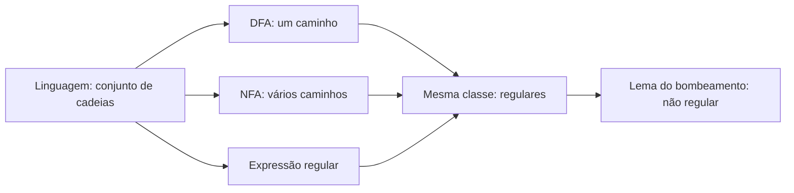

# 57 · Linguagens, autômatos finitos e expressões regulares

**Tempo estimado:** 50 minutos · **Pré-requisito:** [[05 - Lógica proposicional]] e [[08 - Indução e recursão]].

**Ao final você vai conseguir:**

1. Definir alfabeto, cadeia e linguagem, e tratar um problema de decisão como um conjunto de cadeias.
2. Executar um DFA e um NFA sobre uma cadeia.
3. Usar a construção de complemento e a de pares (produto), para DFAs.
4. Testar se uma cadeia pertence a uma linguagem regular com uma expressão regular.
5. Reconhecer que `a^n b^n` não é regular, e ainda assim testar a pertinência.

**Antes de começar:** no módulo 05 você viu proposições e conectivos. Aqui uma linguagem é um conjunto de cadeias, e um autômato é uma máquina que aceita ou rejeita cada cadeia.

---

## Para começar

Um verificador de formulário aceita um código de cliente só se ele começa com duas letras e termina com quatro dígitos. A regra é um conjunto de cadeias possíveis. Quem decide se uma cadeia pertence a ele? Uma máquina simples, que lê um símbolo por vez e guarda só em que estado está. Esse é o autômato finito.

---

## Mapa do módulo



*Figura 1: DFA, NFA e expressões regulares descrevem a mesma classe de linguagens. O lema do bombeamento marca o que fica de fora.*

**Como ler:** as três formas são equivalentes segundo a nota; a seta final mostra o limite da classe.

---

## Mini-aula 1: alfabeto, cadeia e linguagem

> [!tip] Ideia
> Um alfabeto é um conjunto finito de símbolos. Uma cadeia é uma sequência finita de símbolos. Uma linguagem é um conjunto de cadeias.

> [!info] Definição
> Segundo Critchlow e Eck, um alfabeto é um conjunto finito e não vazio de símbolos, e uma cadeia é uma sequência finita de símbolos. Uma **linguagem** sobre o alfabeto Σ é um subconjunto de Σ*. Um problema de decisão pode ser visto como o conjunto das cadeias para as quais a resposta é sim.

Veja um DFA com dois estados, que conta a paridade de `a`. Antes de rodar, diga se a cadeia `aa` é aceita.

```python
delta = {("q0", "a"): "q1", ("q0", "b"): "q0", ("q1", "a"): "q0", ("q1", "b"): "q1"}
finais = {"q0"}

for w in ["", "a", "aa", "baba", "aab"]:
    estado = "q0"
    for simbolo in w:
        estado = delta[(estado, simbolo)]
    print(repr(w), "aceita" if estado in finais else "rejeita")
```

Saída real:

```
'' aceita
'a' rejeita
'aa' aceita
'baba' aceita
'aab' aceita
```

**Como ler:** o DFA começa em `q0`. Cada `a` troca o estado entre `q0` e `q1`, e `b` mantém. Aceita se termina em `q0`, que é o estado de zero (ou número par) de `a`.

> [!warning] Armadilha comum
> Um DFA não tem escolha: para cada estado e símbolo, há exatamente uma transição. Se a tabela não cobre algum par, a máquina precisa de um estado de erro, ou a definição fica incompleta.

> [!question]- Checkpoint
> 1. Qual é o estado depois de `aab`?
> 2. A cadeia `a` é aceita?
>
> > [!success]- Resposta
> > 1. `q0`, porque há dois `a`.
> > 2. Não; termina em `q1`, que não é final.

---

## Mini-aula 2: DFA e NFA são equivalentes

> [!tip] Ideia
> Um NFA pode seguir vários caminhos ao mesmo tempo. Mesmo assim, ele não reconhece nada além do que um DFA reconhece.

> [!info] Definição
> A nota de Critchlow e Eck prova que toda linguagem gerada por uma expressão regular é reconhecida por um NFA (Teorema 3.3), e toda linguagem aceita por um DFA ou NFA é gerada por uma expressão regular (Teorema 3.4). Assim, expressões regulares, NFAs e DFAs definem a mesma classe, a das linguagens regulares. Para DFAs, o complemento é obtido trocando estados de aceitação e de rejeição; para NFAs, isso não funciona.

No exercício D1 você executa um NFA guardando o conjunto de estados possíveis. Antes de começar, pense: por que o conjunto cresce quando há mais de uma transição para o mesmo símbolo?

> [!warning] Armadilha comum
> A troca de estados finais para calcular o complemento vale para DFAs. Aplicada a um NFA, ela não calcula o complemento: uma cadeia pode ter caminhos aceitos e rejeitados ao mesmo tempo.

> [!question]- Checkpoint
> 1. Quais três formas definem a mesma classe de linguagens?
> 2. Por que o complemento por troca de estados não serve para um NFA?
>
> > [!success]- Resposta
> > 1. Expressões regulares, NFAs e DFAs.
> > 2. Porque a cadeia é aceita se algum caminho aceita, e a troca não considera todos os caminhos.

---

## Mini-aula 3: expressões regulares em Python

> [!tip] Ideia
> Uma expressão regular descreve um padrão de cadeias. Em Python, `re.fullmatch` testa se a cadeia inteira pertence à linguagem do padrão.

> [!info] Definição
> A documentação do Python diz que `re.fullmatch(padrao, cadeia)` devolve um resultado só se a cadeia inteira casa com o padrão, enquanto `re.search` procura em qualquer posição e `re.match` só no início. Para a teoria, a expressão `(ab)*` descreve as cadeias formadas por repetições de `ab`.

Veja o mesmo padrão testado com três funções. Antes de rodar, diga qual delas aceita `ababa`.

```python
import re

for w in ["abab", "ababa", ""]:
    print(repr(w), bool(re.fullmatch(r"(ab)*", w)))
print("match só no início:", bool(re.match(r"(ab)*", "ababa")))
```

Saída real:

```
'abab' True
'ababa' False
'' True
match só no início: True
```

**Como ler:** `fullmatch` rejeita `ababa`, porque sobra um `a`. `match` aceita, porque o prefixo `abab` casa. A diferença está na função, e não no padrão.

> [!warning] Armadilha comum
> `re.match` e `re.search` não testam pertinência à linguagem. Para isso, use `fullmatch`, que exige a cadeia inteira.

> [!question]- Checkpoint
> 1. Por que `re.match` aceita `ababa`?
> 2. Qual função testa a pertinência de forma correta?
>
> > [!success]- Resposta
> > 1. Porque casa com o prefixo `abab` e não exige o restante.
> > 2. `re.fullmatch`.

---

## Mini-aula 4: o limite das linguagens regulares

> [!tip] Ideia
> Nem toda linguagem é regular. A linguagem `a^n b^n` pede contar os `a` para casar com os `b`, e um autômato finito não tem memória para isso.

> [!info] Definição
> O lema do bombeamento é uma propriedade que toda linguagem regular satisfaz. A nota de Critchlow e Eck usa esse lema, no Teorema 3.7, para mostrar que `{a^n b^n | n ≥ 0}` não é regular. A nota não reproduz o enunciado exato do lema.

Você verá que a pertinência a `a^n b^n` é fácil de testar com contagem, mesmo sem ser regular, no exercício P1.

> [!question]- Checkpoint
> 1. Por que `a^n b^n` não é regular?
> 2. Testar a pertinência é o mesmo que ser regular?
>
> > [!success]- Resposta
> > 1. Porque um autômato finito não guarda a contagem de `a` para comparar com os `b`.
> > 2. Não; uma função qualquer pode testar pertinência a uma linguagem não regular.

---

## Exercícios

Cada exercício tem um bloco com a função a completar e os testes com `assert`. Quando todos passarem, aparece `Passou!`. As funções definidas em exercícios anteriores aparecem no código inicial.

### Aquecimento

**A1. Complemento de um DFA.** Para um DFA, o complemento da linguagem é obtido trocando os estados de aceitação pelos de não aceitação, como a nota de Critchlow e Eck registra. Complete `complemento(estados, finais)`, que devolve o conjunto de estados que não são finais.

```python
def complemento(estados, finais):
    """Estados não finais: ao trocar aceitação por rejeição, o DFA reconhece o complemento."""
    ...

assert complemento({"q0", "q1"}, {"q0"}) == {"q1"}, "o não final"
assert complemento({"q0"}, set()) == {"q0"}, "nenhum final: tudo vira final"
assert complemento({"q0"}, {"q0"}) == set(), "todos finais: nada sobra"
print("Passou!")
```

> [!hint]- Dica 1
> Use a diferença de conjuntos: `set(estados) - set(finais)`.

> [!hint]- Dica 2
> Com `estados = {"q0", "q1"}` e `finais = {"q0"}`, o resultado é `{"q1"}`.

> [!example]- Solução
> ```python
> def complemento(estados, finais):
>     """Estados não finais: ao trocar aceitação por rejeição, o DFA reconhece o complemento."""
>     return set(estados) - set(finais)
> ```
>
> **Erro comum:** Devolver `finais` no lugar do complemento. Assim a linguagem aceita seria a mesma, sem a inversão.

**A2. Executar um DFA.** Um DFA lê a cadeia símbolo a símbolo, mudando de estado segundo `delta`, que é um dicionário `(estado, símbolo) -> estado`. Ele aceita se termina em um estado final. Complete `aceita_dfa(delta, inicial, finais, cadeia)`.

```python
def aceita_dfa(delta, inicial, finais, cadeia):
    """True se o DFA termina em estado final ao ler a cadeia."""
    ...

delta = {("q0", "a"): "q1", ("q0", "b"): "q0", ("q1", "a"): "q0", ("q1", "b"): "q1"}
assert aceita_dfa(delta, "q0", {"q0"}, "aa") is True, "dois a: volta ao início"
assert aceita_dfa(delta, "q0", {"q0"}, "a") is False, "um a: termina em q1"
assert aceita_dfa(delta, "q0", {"q0"}, "") is True, "a cadeia vazia fica em q0"
print("Passou!")
```

> [!hint]- Dica 1
> Comece com `estado = inicial`, e para cada símbolo faça `estado = delta[(estado, simbolo)]`.

> [!hint]- Dica 2
> Devolva `estado in finais` no fim do laço.

> [!example]- Solução
> ```python
> def aceita_dfa(delta, inicial, finais, cadeia):
>     """True se o DFA termina em estado final ao ler a cadeia."""
>     estado = inicial
>     for simbolo in cadeia:
>         estado = delta[(estado, simbolo)]
>     return estado in finais
> ```
>
> **Erro comum:** Verificar o estado final dentro do laço. A cadeia pode passar por um estado final e terminar em outro, e isso deve ser rejeitado.

**A3. Expressão regular inteira.** O Python tem `re.fullmatch(padrao, cadeia)`, que devolve um resultado só se a cadeia inteira casa com o padrão. A nota de Critchlow e Eck diz que expressões regulares e autômatos definem a mesma classe de linguagens. Complete `padrao_casa(padrao, cadeia)`, que devolve `True` se a cadeia inteira casa com o padrão.

```python
import re

def padrao_casa(padrao, cadeia):
    """True se a cadeia inteira casa com a expressão regular."""
    ...

assert padrao_casa("(ab)*", "abab") is True, "repetições inteiras"
assert padrao_casa("(ab)*", "ababa") is False, "sobra um a"
assert padrao_casa("(ab)*", "") is True, "zero repetições"
print("Passou!")
```

> [!hint]- Dica 1
> Use `bool(re.fullmatch(padrao, cadeia))`.

> [!hint]- Dica 2
> Para `(ab)*` e `"abab"`, o resultado é `True`; para `"ababa"`, `False`.

> [!example]- Solução
> ```python
> def padrao_casa(padrao, cadeia):
>     """True se a cadeia inteira casa com a expressão regular."""
>     return bool(re.fullmatch(padrao, cadeia))
> ```
>
> **Erro comum:** Usar `re.search`. Ele procura em qualquer posição, e aceitaria `"ababa"` por conter `abab`.

### Praticando

**P1. Pertencer a a^n b^n.** A linguagem `{a^n b^n | n >= 0}` não é regular, como o lema do bombeamento mostra na nota. Ainda assim, dizer se uma cadeia pertence a ela é simples. Complete `pertence_anbn(cadeia)`, que devolve `True` se a cadeia tem `n` letras `a` seguidas de `n` letras `b`, com `n >= 0`. Para a cadeia vazia, a resposta é `True`.

```python
def pertence_anbn(cadeia):
    """True se a cadeia é a^n b^n para algum n >= 0."""
    ...

assert pertence_anbn("aabb") is True, "dois a e dois b"
assert pertence_anbn("") is True, "n = 0"
assert pertence_anbn("aab") is False, "faltam b"
assert pertence_anbn("abab") is False, "a e b misturados"
print("Passou!")
```

> [!hint]- Dica 1
> Conte os `a` no início. Depois, confira se o restante são exatamente esses `b`.

> [!hint]- Dica 2
> Uma forma direta: `n = len(cadeia) // 2` e compare com `"a" * n + "b" * n`.

> [!example]- Solução
> ```python
> def pertence_anbn(cadeia):
>     """True se a cadeia é a^n b^n para algum n >= 0."""
>     n = len(cadeia) // 2
>     return len(cadeia) % 2 == 0 and cadeia == "a" * n + "b" * n
> ```
>
> **Erro comum:** Aceitar `"ab"` seguido de `"aab"`, ou qualquer cadeia com o mesmo número total de letras. A ordem e a contagem separadas importam.

**P2. Construção do produto.** Para intersecção de linguagens regulares, a nota de Critchlow e Eck descreve uma construção de pares: o estado do novo DFA é um par de estados, um de cada DFA. Complete `produto_estados(estados1, estados2)`, que devolve o conjunto de todos os pares `(p, q)`, com `p` de `estados1` e `q` de `estados2`.

```python
def produto_estados(estados1, estados2):
    """Pares de estados, um de cada automato: o conjunto de estados da construção de pares."""
    ...

assert produto_estados({"a"}, {"x", "y"}) == {("a", "x"), ("a", "y")}, "dois pares"
assert len(produto_estados({1, 2}, {3, 4})) == 4, "todos os pares"
assert produto_estados(set(), {1}) == set(), "sem estados, sem pares"
print("Passou!")
```

> [!hint]- Dica 1
> Use `{(p, q) for p in estados1 for q in estados2}`.

> [!hint]- Dica 2
> Para `{"a"}` e `{"x", "y"}`, o resultado tem dois pares.

> [!example]- Solução
> ```python
> def produto_estados(estados1, estados2):
>     """Pares de estados, um de cada automato: o conjunto de estados da construção de pares."""
>     return {(p, q) for p in estados1 for q in estados2}
> ```
>
> **Erro comum:** Devolver a união dos estados. Pares são o produto cartesiano, não uma união.

### Desafio

**D1. Executar um NFA.** Um NFA pode ter mais de uma transição para o mesmo símbolo. A nota diz que NFAs aceitam exatamente as linguagens regulares. Para executá-lo, mantenha o conjunto de estados possíveis. Complete `nfa_aceita(delta, inicial, finais, cadeia)`, em que `delta` associa `(estado, símbolo)` a um conjunto de estados. Aceite se, no fim, algum estado possível é final.

```python
def nfa_aceita(delta, inicial, finais, cadeia):
    """True se algum caminho possível termina em estado final."""
    ...

delta = {("q0", "a"): {"q0", "q1"}, ("q0", "b"): {"q0"}, ("q1", "b"): {"q2"}}
assert nfa_aceita(delta, "q0", {"q2"}, "ab") is True, "termina em q2 por um caminho"
assert nfa_aceita(delta, "q0", {"q2"}, "aa") is False, "nenhum caminho chega a q2"
assert nfa_aceita(delta, "q0", {"q2"}, "abb") is False, "q2 não tem saída, e o caminho morre"
print("Passou!")
```

> [!hint]- Dica 1
> Comece com `atuais = {inicial}`. Para cada símbolo, `atuais = união de delta.get((e, s), set())` sobre `e` em `atuais`.

> [!hint]- Dica 2
> Use `any(e in finais for e in atuais)` no fim.

> [!example]- Solução
> ```python
> def nfa_aceita(delta, inicial, finais, cadeia):
>     """True se algum caminho possível termina em estado final."""
>     atuais = {inicial}
>     for simbolo in cadeia:
>         proximos = set()
>         for e in atuais:
>             proximos |= delta.get((e, simbolo), set())
>         atuais = proximos
>     return any(e in finais for e in atuais)
> ```
>
> **Erro comum:** Escolher um único caminho ao acaso. A definição de NFA considera todos os caminhos possíveis, e o conjunto guarda todos eles.


---

## Mini-projeto (opcional)

Você vai filtrar uma lista de cadeias pela linguagem de um padrão. Tente sozinho antes de abrir a solução.

**Mini-projeto: filtro por linguagem.** Complete `filtra_padrao(padrao, cadeias)`, que devolve a lista das cadeias de `cadeias` que pertencem à linguagem do padrão, na ordem original. Use `padrao_casa`, já definida acima.

```python
import re

def padrao_casa(padrao, cadeia):
    return bool(re.fullmatch(padrao, cadeia))

def filtra_padrao(padrao, cadeias):
    """Cadeias da lista que pertencem à linguagem do padrão, na ordem original."""
    ...

assert filtra_padrao("(ab)*", ["ab", "a", ""]) == ["ab", ""], "as que casam"
assert filtra_padrao("a+", ["aa", "b"]) == ["aa"], "um padrão diferente"
assert filtra_padrao("x", []) == [], "lista vazia"
print("Passou!")
```

> [!hint]- Dica 1
> Use uma comprehension: `[c for c in cadeias if padrao_casa(padrao, c)]`.

> [!hint]- Dica 2
> Com `padrao = "(ab)*"` e as cadeias `["ab", "a", ""]`, o resultado é `["ab", ""]`.

> [!example]- Solução
> ```python
> def filtra_padrao(padrao, cadeias):
>     """Cadeias da lista que pertencem à linguagem do padrão, na ordem original."""
>     return [c for c in cadeias if padrao_casa(padrao, c)]
> ```
>
> **Erro comum:** Aplicar `padrao_casa` ao padrão, e não à cadeia. Os argumentos são (padrão, cadeia), nessa ordem.


---

## Fechando

**Resumo**

- Alfabeto é um conjunto finito de símbolos; cadeia é uma sequência; linguagem é um conjunto de cadeias.
- DFA e NFA reconhecem as linguagens regulares, e expressões regulares as descrevem; as três são equivalentes.
- O complemento de um DFA troca estados finais e não finais; para NFA, não vale.
- `a^n b^n` não é regular, mas sua pertinência é testável com contagem.

**Glossário rápido**

- **Alfabeto** (alphabet): conjunto finito e não vazio de símbolos.
- **Linguagem** (language): subconjunto de Σ*.
- **DFA**: autômato finito determinístico.
- **NFA**: autômato finito não determinístico.
- **Construção de pares**: estado do produto como par de estados.

**Perguntas de revisão**

1. Qual é a diferença entre DFA e NFA quanto às transições para um mesmo par estado-símbolo?
2. Um DFA com um estado só, final, aceita quais cadeias?
3. Por que `re.fullmatch` é o teste certo para pertinência?

**E agora?** O próximo módulo é **Gramáticas livres de contexto e autômatos com pilha**. Ele mostra a classe seguinte da hierarquia, que precisa de memória em pilha para casar parênteses e `a^n b^n`.

---

## Para ir mais fundo

- [[Finite Automata - DFA and NFA]]
- [[Regular Expressions and Regular Languages]]
- [[Pumping Lemma for Regular Languages]]
- [[Alphabets, Strings and Languages]]
