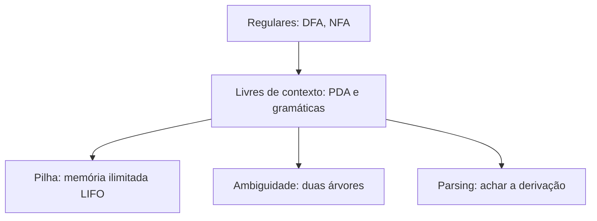

# 58 · Gramáticas livres de contexto e autômatos com pilha

**Tempo estimado:** 50 minutos · **Pré-requisito:** [[57 - Linguagens, autômatos finitos e expressões regulares]] e [[07 - Provas direta e por contradição]].

**Ao final você vai conseguir:**

1. Explicar por que um autômato com pilha reconhece `a^n b^n`, que um finito não reconhece.
2. Usar uma pilha para conferir parênteses balanceados, inclusive com tipos diferentes.
3. Gerar cadeias de uma gramática livre de contexto e reconhecer quando uma cadeia tem duas derivações.
4. Relacionar a ambiguidade com a árvore de derivação.

**Antes de começar:** no módulo 57 você viu que um DFA não guarda contagem. Aqui a pilha dá essa memória, e a gramática é a forma de gerar as cadeias.

---

## Para começar

Um editor de código confere se cada `(` tem o seu `)`, e se cada `[` fecha no lugar certo. Um DFA não faz isso: ele não lembra quantos parênteses abertos há. Uma pilha lembra. Esse é o ingrediente que separa a classe das linguagens livres de contexto da das regulares.

---

## Mapa do módulo



*Figura 1: a classe livre de contexto contém a regular. A pilha dá a memória extra; a gramática gera as cadeias, e o parsing confere se uma cadeia pertence.*

**Como ler:** a seta indica inclusão. A pilha é o que o autômato ganha em relação ao finito.

---

## Mini-aula 1: pilha e a^n b^n

> [!tip] Ideia
> Para reconhecer `a^n b^n`, empilhe um símbolo a cada `a`, e desempilhe um a cada `b`. Se a pilha termina vazia e a ordem está certa, a cadeia pertence.

> [!info] Definição
> Um **autômato com pilha** (pushdown automaton, PDA) é um autômato finito com uma pilha auxiliar. A nota de Critchlow e Eck, no Teorema 4.6, diz que uma linguagem é livre de contexto se, e somente se, algum PDA a aceita. A nota de DePaul usa `a^n b^n` como exemplo: um autômato finito não o reconhece, mas um PDA sim.

Veja um reconhecedor que usa uma lista como pilha. Antes de rodar, diga se `abab` pertence a `a^n b^n`.

```python
def pda_anbn(cadeia):
    pilha = []
    i = 0
    while i < len(cadeia) and cadeia[i] == "a":
        pilha.append("A")
        i += 1
    while i < len(cadeia) and cadeia[i] == "b" and pilha:
        pilha.pop()
        i += 1
    return i == len(cadeia) and not pilha

for w in ["aabb", "aab", "abab", ""]:
    print(repr(w), pda_anbn(w))
```

Saída real:

```
'aabb' True
'aab' False
'abab' False
'' True
```

**Como ler:** `aabb` empilha dois e desempilha dois. `aab` sobra um na pilha. `abab` falha no segundo bloco de `a`, porque a ordem não é de todos os `a` antes dos `b`.

> [!warning] Armadilha comum
> A pilha é do tipo último a entrar, primeiro a sair. Isso basta para `a^n b^n`; a nota não discute quais outras linguagens uma pilha só reconhece.

> [!question]- Checkpoint
> 1. Por que `aab` é rejeitada?
> 2. Qual é a ordem de saída da pilha?
>
> > [!success]- Resposta
> > 1. Porque sobra uma letra `a` empilhada no fim.
> > 2. Último a entrar, primeiro a sair.

---

## Mini-aula 2: gramáticas e árvores de derivação

> [!tip] Ideia
> Uma gramática livre de contexto gera cadeias com regras que trocam um símbolo não terminal por uma sequência. A árvore de derivação mostra quais regras foram usadas.

> [!info] Definição
> Uma **árvore de derivação** (parse tree) tem o símbolo inicial como raiz e os terminais como folhas. A nota de Critchlow e Eck diz que derivações mais à esquerda correspondem uma a uma às árvores. Uma gramática é **ambígua** quando alguma cadeia tem mais de uma derivação mais à esquerda. O exemplo da nota é `x + y * z`.

Veja duas derivações mais à esquerda para `id + id * id`. Antes de rodar, diga se elas terminam na mesma cadeia.

```python
derivacao_1 = ["E", "E + E", "id + E * E", "id + id * E", "id + id * id"]
derivacao_2 = ["E", "E * E", "E + E * E", "id + E * E", "id + id * E", "id + id * id"]
print("derivação mais à esquerda 1 termina em:", derivacao_1[-1])
print("derivação mais à esquerda 2 termina em:", derivacao_2[-1])
print("mesma cadeia, derivações diferentes:", derivacao_1[-1] == derivacao_2[-1] and derivacao_1 != derivacao_2)
```

Saída real:

```
derivação mais à esquerda 1 termina em: id + id * id
derivação mais à esquerda 2 termina em: id + id * id
mesma cadeia, derivações diferentes: True
```

**Como ler:** as duas derivações chegam na mesma cadeia, mas usam regras em ordem diferente. A primeira faz `+` na raiz; a segunda faz `*` na raiz. Isso é ambiguidade: a mesma cadeia tem duas estruturas, com significados diferentes.

> [!warning] Armadilha comum
> Ambiguidade não é um erro de digitação: é uma propriedade da gramática. Ela importa porque cada árvore significa uma operação diferente, e um analisador precisa escolher uma.

> [!question]- Checkpoint
> 1. Qual operação fica na raiz da primeira derivação?
> 2. O que caracteriza a ambiguidade?
>
> > [!success]- Resposta
> > 1. A soma, `+`.
> > 2. Uma cadeia com mais de uma derivação mais à esquerda.

---

## Mini-aula 3: parsing em duas famílias

> [!tip] Ideia
> Parsing é achar a derivação de uma cadeia, ou concluir que ela não existe. Há duas famílias práticas de analisadores: uma de cima para baixo e outra de baixo para cima.

> [!info] Definição
> O **LL(1)** constrói a derivação mais à esquerda de cima para baixo, com um símbolo de lookahead. O **LR(1)** faz o caminho de baixo para cima, com empilhamento e redução, e a nota diz que algumas gramáticas sem ambiguidade são LR(1) mas não LL(1).

Você verá a pilha em ação no exercício A1, com parênteses balanceados.

> [!question]- Checkpoint
> 1. Qual família constrói a derivação de cima para baixo?
> 2. O que o LR(1) usa para decidir cada passo?
>
> > [!success]- Resposta
> > 1. A LL(1).
> > 2. Um símbolo de lookahead, empilhamento e redução.

---

## Exercícios

Cada exercício tem um bloco com a função a completar e os testes com `assert`. Quando todos passarem, aparece `Passou!`. As funções definidas em exercícios anteriores aparecem no código inicial.

### Aquecimento

**A1. Parênteses balanceados.** Um autômato com pilha reconhece parênteses balanceados: empilha ao abrir e desempilha ao fechar, e aceita se a pilha está vazia no fim e nunca faltou abertura. Complete `balanceado(texto)`, que devolve `True` se os parênteses `(` e `)` de `texto` estão balanceados.

```python
def balanceado(texto):
    """True se os parênteses estão balanceados, usando uma pilha como o autômato com pilha."""
    ...

assert balanceado("(()())") is True, "balanceado"
assert balanceado(")(") is False, "a ordem importa"
assert balanceado("((") is False, "sobra abertura"
assert balanceado("") is True, "vazio está balanceado"
print("Passou!")
```

> [!hint]- Dica 1
> Use uma lista como pilha: `append` ao ver `(`, e `pop` ao ver `)`.

> [!hint]- Dica 2
> Se ver `)` com a pilha vazia, já é erro: devolva `False`. No fim, a pilha deve estar vazia.

> [!example]- Solução
> ```python
> def balanceado(texto):
>     """True se os parênteses estão balanceados, usando uma pilha como o autômato com pilha."""
>     pilha = []
>     for c in texto:
>         if c == "(":
>             pilha.append(c)
>         elif c == ")":
>             if not pilha:
>                 return False
>             pilha.pop()
>     return not pilha
> ```
>
> **Erro comum:** Só contar aberturas e fechamentos. A ordem importa: `)(` tem a mesma contagem de `()` e não está balanceado.

**A2. Derivação da gramática.** Uma gramática para `a^n b^n` tem as regras `S → aSb` e `S → ε`. Aplicar `S → aSb` uma vez por vez, `n` vezes, e depois `S → ε` produz a cadeia. Complete `deriva_anbn(n)`, que devolve a cadeia gerada com `n` aplicações da primeira regra. Use `replace("S", "aSb", 1)` para aplicar uma regra, e no fim troque o `S` restante por vazio.

```python
def deriva_anbn(n):
    """Cadeia gerada pela gramática S → aSb | ε, aplicando S → aSb n vezes e depois S → ε."""
    ...

assert deriva_anbn(0) == "", "S → ε direto"
assert deriva_anbn(1) == "ab", "uma aplicação"
assert deriva_anbn(2) == "aabb", "duas aplicações"
print("Passou!")
```

> [!hint]- Dica 1
> Comece com `forma = "S"`, e repita `n` vezes `forma = forma.replace("S", "aSb", 1)`.

> [!hint]- Dica 2
> No fim, `forma.replace("S", "")` aplica `S → ε`.

> [!example]- Solução
> ```python
> def deriva_anbn(n):
>     """Cadeia gerada pela gramática S → aSb | ε, aplicando S → aSb n vezes e depois S → ε."""
>     forma = "S"
>     for _ in range(n):
>         forma = forma.replace("S", "aSb", 1)
>     return forma.replace("S", "")
> ```
>
> **Erro comum:** Esquecer o `S → ε` no fim. A cadeia ainda teria a variável `S`, que não é um símbolo do alfabeto.

**A3. Ambiguidade.** Uma gramática é ambígua quando alguma cadeia tem mais de uma derivação mais à esquerda. A nota de Critchlow e Eck usa `x + y * z` como exemplo. Complete `ambigua(derivacoes)`, em que `derivacoes` é uma lista de derivações, cada uma uma lista de formas. Todas devem ser derivações da mesma cadeia. Devolva `True` se há pelo menos duas derivações diferentes.

```python
def ambigua(derivacoes):
    """True se há pelo menos duas derivações mais à esquerda diferentes para a mesma cadeia."""
    ...

d1 = ["E", "E + E", "id + E * E", "id + id * E", "id + id * id"]
d2 = ["E", "E * E", "E + E * E", "id + E * E", "id + id * E", "id + id * id"]
assert ambigua([d1, d2]) is True, "duas derivações diferentes"
assert ambigua([d1, d1]) is False, "a mesma derivação duas vezes"
assert ambigua([]) is False, "nenhuma derivação"
print("Passou!")
```

> [!hint]- Dica 1
> Compare as derivações como tuplas: `len(set(tuple(d) for d in derivacoes)) > 1`.

> [!hint]- Dica 2
> Duas derivações iguais não contam como ambiguidade.

> [!example]- Solução
> ```python
> def ambigua(derivacoes):
>     """True se há pelo menos duas derivações mais à esquerda diferentes para a mesma cadeia."""
>     return len({tuple(d) for d in derivacoes}) > 1
> ```
>
> **Erro comum:** Comparar só a última forma de cada derivação. Duas derivações podem terminar igual e ter passos diferentes.

### Praticando

**P1. Mais de um tipo de parênteses.** Com tipos diferentes de pares, como `()` e `[]`, o autômato com pilha precisa conferir que o fechamento é do mesmo tipo do último aberto. Complete `balanceado_com_pares(texto)`, que devolve `True` se cada fechamento combina com a abertura mais recente, para os pares `()` e `[]`. Ignore os demais caracteres.

```python
def balanceado_com_pares(texto):
    """True se cada fechamento casa com a abertura mais recente, para () e []."""
    ...

assert balanceado_com_pares("([])") is True, "aninhados e do tipo certo"
assert balanceado_com_pares("([)]") is False, "cruzados"
assert balanceado_com_pares("a(b)[c]") is True, "outros caracteres são ignorados"
assert balanceado_com_pares("(") is False, "sobra abertura"
print("Passou!")
```

> [!hint]- Dica 1
> Use um dicionário `pares = {")": "(", "]": "["}`. Ao ver um fechamento, confira se o topo da pilha é `pares[c]`.

> [!hint]- Dica 2
> Use `pilha[-1]` para olhar o topo sem desempilhar.

> [!example]- Solução
> ```python
> def balanceado_com_pares(texto):
>     """True se cada fechamento casa com a abertura mais recente, para () e []."""
>     pares = {")": "(", "]": "["}
>     pilha = []
>     for c in texto:
>         if c in "([":
>             pilha.append(c)
>         elif c in pares:
>             if not pilha or pilha[-1] != pares[c]:
>                 return False
>             pilha.pop()
>     return not pilha
> ```
>
> **Erro comum:** Conferir só se o número de fechamentos bate com o de aberturas. `([)]` tem a contagem certa e está errado.

**P2. Altura da pilha.** A pilha de um autômato mede a memória que ele usa. Complete `profundidade_maxima(texto)`, que devolve a maior altura que a pilha atinge ao ler os parênteses de `texto`, usando a mesma regra de `balanceado`. Para `"(()())"`, a altura máxima é 2.

```python
def profundidade_maxima(texto):
    """Maior altura que a pilha atinge ao processar os parênteses de texto."""
    ...

assert profundidade_maxima("(()())") == 2, "a altura chega a 2"
assert profundidade_maxima("((()))") == 3, "três aberturas seguidas"
assert profundidade_maxima("") == 0, "sem parênteses"
print("Passou!")
```

> [!hint]- Dica 1
> Mantenha `atual` e `maxima`. Ao empilhar, faça `maxima = max(maxima, atual)`.

> [!hint]- Dica 2
> Ao desempilhar, diminua `atual`.

> [!example]- Solução
> ```python
> def profundidade_maxima(texto):
>     """Maior altura que a pilha atinge ao processar os parênteses de texto."""
>     atual = 0
>     maxima = 0
>     for c in texto:
>         if c == "(":
>             atual += 1
>             maxima = max(maxima, atual)
>         elif c == ")":
>             atual -= 1
>     return maxima
> ```
>
> **Erro comum:** Medir a altura só no final. A pilha pode crescer e encolher, e o máximo acontece no meio.

### Desafio

**D1. Palíndromo de tamanho par.** Uma cadeia `w w^R` é formada por uma palavra seguida do seu reverso, e tem tamanho par. Um autômato com pilha reconhece essas cadeias empilhando a primeira metade e comparando com a segunda. Complete `palindromo_par(cadeia)`, que devolve `True` se a cadeia tem tamanho par e é igual ao seu reverso.

```python
def palindromo_par(cadeia):
    """True se a cadeia tem tamanho par e é igual ao seu reverso: a forma w w^R."""
    ...

assert palindromo_par("abba") is True, "par e palíndromo"
assert palindromo_par("abab") is False, "par, não palíndromo"
assert palindromo_par("aba") is False, "palíndromo ímpar não entra"
assert palindromo_par("") is True, "vazia"
print("Passou!")
```

> [!hint]- Dica 1
> Confira `len(cadeia) % 2 == 0` e `cadeia == cadeia[::-1]`.

> [!hint]- Dica 2
> A cadeia vazia é aceita, com `n = 0`.

> [!example]- Solução
> ```python
> def palindromo_par(cadeia):
>     """True se a cadeia tem tamanho par e é igual ao seu reverso: a forma w w^R."""
>     return len(cadeia) % 2 == 0 and cadeia == cadeia[::-1]
> ```
>
> **Erro comum:** Aceitar palíndromos de tamanho ímpar. O exercício pede a forma `w w^R`, que tem tamanho par.


---

## Mini-projeto (opcional)

Você vai gerar cadeias de uma gramática e conferir se elas pertencem à linguagem. Tente sozinho antes de abrir a solução.

**Mini-projeto: gerar e conferir.** Complete `gera_e_confere(n)`, que gera a cadeia `deriva_anbn(n)` e confere se ela é balanceada no sentido de `a` e `b`: devolve `True` se a cadeia tem `n` letras `a` seguidas de `n` letras `b`. Use `deriva_anbn`, já definida acima.

```python
def deriva_anbn(n):
    forma = "S"
    for _ in range(n):
        forma = forma.replace("S", "aSb", 1)
    return forma.replace("S", "")

def gera_e_confere(n):
    """True se a cadeia gerada por n aplicações é exatamente a^n b^n."""
    ...

assert gera_e_confere(0) is True, "n = 0"
assert gera_e_confere(3) is True, "n = 3"
assert gera_e_confere(5) is True, "n = 5"
print("Passou!")
```

> [!hint]- Dica 1
> Gere `c = deriva_anbn(n)` e compare com `"a" * n + "b" * n`.

> [!hint]- Dica 2
> Para qualquer `n >= 0`, o resultado deve ser `True`: a gramática gera exatamente essas cadeias.

> [!example]- Solução
> ```python
> def gera_e_confere(n):
>     """True se a cadeia gerada por n aplicações é exatamente a^n b^n."""
>     c = deriva_anbn(n)
>     return c == "a" * n + "b" * n
> ```
>
> **Erro comum:** Conferir só o tamanho. Qualquer cadeia de mesmo tamanho passaria, mesmo fora de `a^n b^n`.


---

## Fechando

**Resumo**

- PDA é um autômato finito com pilha, e reconhece exatamente as linguagens livres de contexto.
- A pilha permite conferir `a^n b^n` e parênteses balanceados.
- Gramáticas geram cadeias; a árvore de derivação mostra a estrutura.
- Ambiguidade é haver mais de uma derivação mais à esquerda para a mesma cadeia.

**Glossário rápido**

- **PDA**: autômato com pilha.
- **Árvore de derivação** (parse tree): árvore com a raiz no símbolo inicial.
- **Ambiguidade** (ambiguity): mais de uma árvore para a mesma cadeia.
- **Parsing**: achar a derivação de uma cadeia.
- **LL(1), LR(1)**: famílias de analisadores.

**Perguntas de revisão**

1. Por que um DFA não reconhece `a^n b^n`, e um PDA reconhece?
2. Qual é o efeito de uma gramática ambígua sobre a análise de uma cadeia?
3. Por que a pilha de parênteses precisa do tipo de cada abertura, no exercício P1?

**E agora?** O próximo módulo é **Máquinas de Turing, decidibilidade e a tese de Church-Turing**. Ele mostra o modelo que computa tudo o que se considera computável, e onde ele também falha.

---

## Para ir mais fundo

- [[Context-Free Grammars and Parsing]]
- [[Pushdown Automata]]
- [[Chomsky Hierarchy]]
- [[Pumping Lemma for Regular Languages]]
