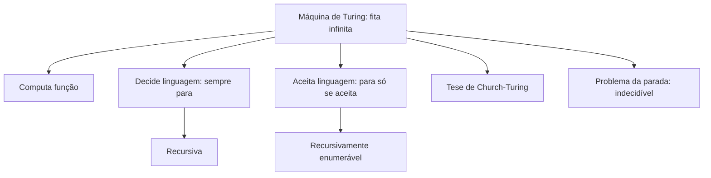

# 59 · Máquinas de Turing, decidibilidade e a tese de Church-Turing

**Tempo estimado:** 55 minutos · **Pré-requisito:** [[58 - Gramáticas livres de contexto e autômatos com pilha]] e [[08 - Indução e recursão]].

**Ao final você vai conseguir:**

1. Descrever uma máquina de Turing por sua tabela de transições, e simulá-la sobre uma fita.
2. Distinguir decidir (sempre responder) de aceitar (parar só nas cadeias da linguagem).
3. Explicar a tese de Church-Turing como uma tese sobre a noção informal de algoritmo.
4. Seguir a construção diagonal que a nota registra para o problema da parada.

**Antes de começar:** nos módulos anteriores os modelos tinham memória limitada ou só uma pilha. A máquina de Turing tem uma fita infinita, e é o modelo que a tese de Church-Turing identifica com a computação efetiva.

---

## Para começar

Um programa de computador pode entrar em laço e nunca terminar. Você quer um verificador que diga, antes de rodar, se um programa qualquer para ou não. Isso é possível? A teoria responde que não, e a prova não depende de um computador mais rápido. Para entender por que, é preciso um modelo exato de computação, que é a máquina de Turing.

---

## Mapa do módulo



*Figura 1: a máquina de Turing separa o que é decidível do que é apenas aceitável. A tese relaciona essa máquina à noção informal de algoritmo.*

**Como ler:** a linha de decidir e aceitar é a distinção central; o problema da parada é o exemplo de linguagem que cai do lado de aceitar, sem decidir.

---

## Mini-aula 1: a máquina e sua fita

> [!tip] Ideia
> A máquina tem um controlador de estados finitos e uma fita infinita. Em cada passo, lê um símbolo, escreve outro, anda à esquerda ou à direita, e muda de estado.

> [!info] Definição
> Segundo Critchlow e Eck, uma máquina de Turing tem um conjunto de estados, um alfabeto de fita, um estado inicial, uma função de transição e um estado de parada `h`. A fita é infinita nos dois sentidos, com um símbolo branco. Uma computação pode nunca parar.

Veja uma máquina que inverte os bits da entrada e para no branco. Antes de rodar, diga qual é a saída para a entrada `1011`.

```python
delta = {
    ("q0", "0"): ("1", "R", "q0"),
    ("q0", "1"): ("0", "R", "q0"),
    ("q0", "#"): ("#", "R", "h"),
}

fita = list("1011") + ["#"]
pos, estado = 0, "q0"
passos = 0
while estado != "h":
    novo, direcao, estado = delta[(estado, fita[pos])]
    fita[pos] = novo
    pos += 1 if direcao == "R" else -1
    passos += 1
print("saída:", "".join(fita).rstrip("#"), "| passos:", passos)
```

Saída real:

```
saída: 0100 | passos: 5
```

**Como ler:** a cabeça anda para a direita e troca cada bit. Ao encontrar o branco, a máquina entra no estado de parada. A saída é a fita sem os brancos.

> [!warning] Armadilha comum
> A fita é infinita, mas a máquina lê uma célula de cada vez. Dizer que ela "tem muita memória" não captura o ponto: o que importa é que ela pode usar quantas células precisar, sem limite fixo.

> [!question]- Checkpoint
> 1. Quantas trocas de bit a máquina faz para `1011`?
> 2. Quando a máquina para?
>
> > [!success]- Resposta
> > 1. Quatro, uma por bit.
> > 2. Quando lê o branco no estado `q0`.

---

## Mini-aula 2: decidir e aceitar

> [!tip] Ideia
> Uma máquina pode decidir uma linguagem, respondendo sempre, ou apenas aceitá-la, parando quando a cadeia pertence e podendo rodar para sempre quando não pertence.

> [!info] Definição
> Pela nota de Critchlow e Eck, uma máquina **computa uma função** se produz a saída; **decide** uma linguagem se para com `1` ou `0` em toda entrada; **aceita** uma linguagem se para exatamente nas cadeias dela. Toda linguagem decidível é aceitável. As linguagens **recursivas** são as decididas por alguma máquina; as **recursivamente enumeráveis** são as aceitas por alguma.

Veja o caso de uma máquina sem resposta dentro de um limite de passos. Antes de rodar, diga se ela já parou.

```python
delta = {("q0", "0"): ("0", "R", "q0"), ("q0", "1"): ("1", "R", "q0"), ("q0", "#"): ("#", "R", "q0")}

fita = list("0101") + ["#"]
pos, estado = 0, "q0"
for _ in range(50):
    novo, direcao, estado = delta[(estado, fita[pos])]
    fita[pos] = novo
    pos += 1 if direcao == "R" else -1
    if pos == len(fita):
        fita.append("#")
print("após 50 passos, estado:", estado, "| a máquina ainda não parou")
```

Saída real:

```
após 50 passos, estado: q0 | a máquina ainda não parou
```

**Como ler:** a máquina varre a fita para sempre sem chegar ao estado de parada. Depois de 50 passos, ainda não respondeu. Isso não diz se ela pararia depois.

> [!warning] Armadilha comum
> Não ter resposta dentro de um limite não prova que a máquina não para. Só um decisor, que sempre responde, dá a resposta. Sem ele, o limite é apenas um orçamento.

> [!question]- Checkpoint
> 1. A máquina do exemplo parou em 50 passos?
> 2. Qual é a diferença entre decidir e aceitar?
>
> > [!success]- Resposta
> > 1. Não; não chegou ao estado de parada.
> > 2. Decidir responde sempre, com `1` ou `0`; aceitar para só nas cadeias da linguagem.

---

## Mini-aula 3: tese de Church-Turing

> [!tip] Ideia
> A tese diz que tudo o que é efetivamente computável pode ser computado por uma máquina de Turing. É uma tese sobre a noção informal de procedimento mecânico, não um teorema.

> [!info] Definição
> A **tese de Church-Turing**, na formulação da nota de SEP, afirma que toda computação efetiva pode ser realizada por uma máquina de Turing. A nota de Critchlow e Eck diz que ela não pode ser provada, porque se refere a uma noção informal. Uma máquina universal de Turing pode simular qualquer outra, guardando sua descrição na fita.

> [!question]- Checkpoint
> 1. A tese é um teorema?
> 2. O que a máquina universal faz?
>
> > [!success]- Resposta
> > 1. Não; é uma tese sobre uma noção informal.
> > 2. Simula qualquer outra máquina, lendo a descrição dela na fita.

---

## Mini-aula 4: o problema da parada

> [!tip] Ideia
> Não existe uma máquina que decida, para toda máquina e toda entrada, se ela para. A prova é por contradição: supondo que exista, constrói-se uma máquina que a contradiz.

> [!info] Definição
> O **problema da parada** pergunta se a máquina `T` para na entrada `w`. A nota de Critchlow e Eck prova que ele é indecidível: a partir de um decisor hipotético `H`, constrói-se `M` que entra em laço quando `H` diz que `M` para, e para quando `H` diz que não para. Assim, `H` erraria sobre `M` aplicada a si mesma. A nota lista outros problemas indecidíveis sem prova.

No exercício P2 você escreve essa construção diagonal.

> [!question]- Checkpoint
> 1. Qual é a suposição que a prova deriva em contradição?
> 2. O que a máquina `M` faz quando `H` diz que ela para?
>
> > [!success]- Resposta
> > 1. Que existe um decisor `H` para o problema da parada.
> > 2. Entra em laço, contrariando a previsão de `H`.

---

## Exercícios

Cada exercício tem um bloco com a função a completar e os testes com `assert`. Quando todos passarem, aparece `Passou!`. As funções definidas em exercícios anteriores aparecem no código inicial.

### Aquecimento

**A1. Simulador.** Uma máquina de Turing é descrita por uma tabela `delta`, que associa `(estado, símbolo)` a `(novo_símbolo, direção, novo_estado)`, com direção `"R"` ou `"L"`. O estado `"h"` é o de parada. Complete `roda_tm(delta, entrada, limite)`, que simula a máquina a partir do estado `"q0"`, com a fita iniciada pela entrada seguida de `#`. Devolva a fita sem os brancos finais quando parar, e `None` se não parar em `limite` passos. Isso mostra que uma simulação precisa de um orçamento de passos.

```python
def roda_tm(delta, entrada, limite):
    """Fita final sem brancos quando a máquina para (estado h), ou None se passar de limite passos."""
    ...

inverte = {("q0", "0"): ("1", "R", "q0"), ("q0", "1"): ("0", "R", "q0"), ("q0", "#"): ("#", "R", "h")}
assert roda_tm(inverte, "1011", 100) == "0100", "inverte cada bit"
assert roda_tm({("q0", "0"): ("0", "R", "q0"), ("q0", "#"): ("#", "R", "q0")}, "0", 5) is None, "não para: o limite estoura"
print("Passou!")
```

> [!hint]- Dica 1
> Use `fita = list(entrada) + ["#"]`, e um `for` de `limite` passos.

> [!hint]- Dica 2
> Ao ler `"h"`, devolva `"".join(fita).rstrip("#")`. Se a posição sair do fim da fita, acrescente um `#`.

> [!example]- Solução
> ```python
> def roda_tm(delta, entrada, limite):
>     """Fita final sem brancos quando a máquina para (estado h), ou None se passar de limite passos."""
>     fita = list(entrada) + ["#"]
>     pos, estado = 0, "q0"
>     for _ in range(limite):
>         if estado == "h":
>             return "".join(fita).rstrip("#")
>         novo, direcao, estado = delta[(estado, fita[pos])]
>         fita[pos] = novo
>         pos += 1 if direcao == "R" else -1
>         if pos == len(fita):
>             fita.append("#")
>         if pos < 0:
>             fita.insert(0, "#")
>             pos = 0
>     return None
> ```
>
> **Erro comum:** Esquecer de acrescentar brancos quando a cabeça anda além do fim. A simulação quebra com `IndexError`.

**A2. Decidir ou não.** Uma máquina que decide uma linguagem para sempre responde com `1` ou `0`, segundo a nota de Critchlow e Eck. Complete `decisao_tm(saida)`, que recebe a saída de `roda_tm`: devolve `True` se a saída é `"1"`, `False` se é `"0"`, e levanta `ValueError` nos demais casos, inclusive `None`, que significa que a máquina não respondeu.

```python
def decisao_tm(saida):
    """True se a saída é '1', False se é '0'; qualquer outra coisa (inclusive None) levanta ValueError."""
    ...

assert decisao_tm("1") is True, "aceita"
assert decisao_tm("0") is False, "rejeita"
try:
    decisao_tm(None)
    assert False, "deveria levantar ValueError"
except ValueError:
    pass
print("Passou!")
```

> [!hint]- Dica 1
> Teste `saida == "1"` e `saida == "0"`.

> [!hint]- Dica 2
> Para `None`, o `ValueError` é o comportamento certo: a máquina ainda não decidiu.

> [!example]- Solução
> ```python
> def decisao_tm(saida):
>     """True se a saída é '1', False se é '0'; qualquer outra coisa (inclusive None) levanta ValueError."""
>     if saida == "1":
>         return True
>     if saida == "0":
>         return False
>     raise ValueError("a máquina não decidiu")
> ```
>
> **Erro comum:** Devolver `False` para qualquer saída que não é `"1"`. Isso confunde `"0"` com `None`, que não é resposta.

**A3. Tabela de inversão.** Escreva a tabela de uma máquina que inverte os bits de uma cadeia binária, andando à direita e parando ao encontrar o branco. Complete `delta_inverte()`, que devolve o dicionário `delta`. A máquina usa o estado `"q0"` para andar e `"h"` para parar.

```python
def roda_tm(delta, entrada, limite):
    fita = list(entrada) + ["#"]
    pos, estado = 0, "q0"
    for _ in range(limite):
        if estado == "h":
            return "".join(fita).rstrip("#")
        novo, direcao, estado = delta[(estado, fita[pos])]
        fita[pos] = novo
        pos += 1 if direcao == "R" else -1
        if pos == len(fita):
            fita.append("#")
    return None

def delta_inverte():
    """Tabela da máquina que inverte os bits e para no branco."""
    ...

assert delta_inverte() is not None, "a função devolve a tabela"
assert roda_tm(delta_inverte(), "101", 100) == "010", "inverte os três bits"
assert roda_tm(delta_inverte(), "", 100) == "", "cadeia vazia"
print("Passou!")
```

> [!hint]- Dica 1
> Há três entradas: `("q0", "0")`, `("q0", "1")` e `("q0", "#")`. As duas primeiras trocam o bit e andam à direita; a última escreve `#`, anda à direita e vai para `"h"`.

> [!hint]- Dica 2
> Teste com `roda_tm(delta_inverte(), "101", 100)`, que deve dar `"010"`.

> [!example]- Solução
> ```python
> def delta_inverte():
>     """Tabela da máquina que inverte os bits e para no branco."""
>     return {
>         ("q0", "0"): ("1", "R", "q0"),
>         ("q0", "1"): ("0", "R", "q0"),
>         ("q0", "#"): ("#", "R", "h"),
>     }
> ```
>
> **Erro comum:** Parar no primeiro bit. A máquina tem que percorrer a cadeia inteira antes do branco.

### Praticando

**P1. Três respostas.** Uma máquina pode aceitar (parar em `"h"`), rejeitar (parar em `"r"`) ou não responder dentro do limite. Complete `resultado_tm(delta, entrada, limite)`, que devolve `"aceita"`, `"rejeita"` ou `"indefinido"`. A nota de Critchlow e Eck define aceitação como parar, e decisão como parar com resposta. Use a mesma simulação de `roda_tm`, mas com estados de parada `"h"` e `"r"`.

```python
def resultado_tm(delta, entrada, limite):
    """'aceita' se para em h, 'rejeita' se para em r, 'indefinido' se passa do limite."""
    ...

aceita_par = {("q0", "1"): ("1", "R", "q1"), ("q1", "1"): ("1", "R", "q0"), ("q0", "#"): ("#", "R", "h"), ("q1", "#"): ("#", "R", "r")}
assert resultado_tm(aceita_par, "11", 50) == "aceita", "dois uns passam"
assert resultado_tm(aceita_par, "1", 50) == "rejeita", "um um não passa"
assert resultado_tm({("q0", "0"): ("0", "R", "q0"), ("q0", "#"): ("#", "R", "q0")}, "0", 5) == "indefinido", "passou do limite"
print("Passou!")
```

> [!hint]- Dica 1
> Simule passo a passo; ao entrar em `"h"`, devolva `"aceita"`; em `"r"`, `"rejeita"`.

> [!hint]- Dica 2
> Ao final do laço sem parar, devolva `"indefinido"`.

> [!example]- Solução
> ```python
> def resultado_tm(delta, entrada, limite):
>     """'aceita' se para em h, 'rejeita' se para em r, 'indefinido' se passa do limite."""
>     fita = list(entrada) + ["#"]
>     pos, estado = 0, "q0"
>     for _ in range(limite):
>         if estado == "h":
>             return "aceita"
>         if estado == "r":
>             return "rejeita"
>         novo, direcao, estado = delta[(estado, fita[pos])]
>         fita[pos] = novo
>         pos += 1 if direcao == "R" else -1
>         if pos == len(fita):
>             fita.append("#")
>     if estado == "h":
>         return "aceita"
>     if estado == "r":
>         return "rejeita"
>     return "indefinido"
> ```
>
> **Erro comum:** Tratar a falta de resposta como rejeição. A máquina pode ainda estar rodando, e não rejeitou.

**P2. A construção diagonal.** A prova de que o problema da parada é indecidível, segundo a nota, parte de um decisor hipotético `H` e constrói uma máquina `M` que entra em laço quando `H` diz que ela para. Complete `constroi_m(h)`, que recebe uma função `h(p, q)`, com resposta booleana sobre o programa `p` e a entrada `q`, e devolve a função `m(p)` que devolve `True` quando `h(p, p)` é falso, e entra em laço infinito quando `h(p, p)` é verdadeiro.

```python
def constroi_m(h):
    """Máquina diagonal: entra em laço se h(p, p) é verdadeiro; senão devolve True."""
    ...

m_false = constroi_m(lambda p, q: False)
assert m_false is not None, "a função devolve a máquina"
assert m_false("x") is True, "h diz que não para, então M para"
assert callable(constroi_m(lambda p, q: True)), "a construção sempre devolve uma função"
print("Passou!")
```

> [!hint]- Dica 1
> Defina `m(p)` com um `if h(p, p):` que roda `while True: pass`.

> [!hint]- Dica 2
> Teste o caso em que `h` diz que não para: `constroi_m(lambda p, q: False)("x")` deve dar `True`.

> [!example]- Solução
> ```python
> def constroi_m(h):
>     """Máquina diagonal: entra em laço se h(p, p) é verdadeiro; senão devolve True."""
>     def m(p):
>         if h(p, p):
>             while True:
>                 pass
>         return True
>     return m
> ```
>
> **Erro comum:** Inverter a condição. O argumento é que `M` faz o oposto do que `H` previu sobre si mesma.

### Desafio

**D1. Hierarquia de Chomsky.** A nota de Chomsky Hierarchy liga cada classe de gramáticas a um modelo de máquina: regular ao autômato finito, livre de contexto ao autômato com pilha, sensível ao contexto ao autômato linearmente limitado (LBA) e irrestrita à máquina de Turing. Complete `modelo_chomsky(classe)`, que devolve o nome do modelo para cada classe, e levanta `ValueError` para outra classe.

```python
def modelo_chomsky(classe):
    """Modelo de máquina correspondente a cada classe da hierarquia de Chomsky."""
    ...

assert modelo_chomsky("regular") == "automato finito", "a classe mais simples"
assert modelo_chomsky("irrestrita") == "maquina de Turing", "a mais geral"
try:
    modelo_chomsky("x")
    assert False, "deveria levantar ValueError"
except ValueError:
    pass
print("Passou!")
```

> [!hint]- Dica 1
> Use um dicionário com as quatro classes e os nomes dos modelos.

> [!hint]- Dica 2
> Para `"regular"`, o resultado é `"automato finito"`.

> [!example]- Solução
> ```python
> def modelo_chomsky(classe):
>     """Modelo de máquina correspondente a cada classe da hierarquia de Chomsky."""
>     modelos = {
>         "regular": "automato finito",
>         "livre de contexto": "automato com pilha",
>         "sensivel ao contexto": "automato linearmente limitado",
>         "irrestrita": "maquina de Turing",
>     }
>     if classe not in modelos:
>         raise ValueError("classe desconhecida")
>     return modelos[classe]
> ```
>
> **Erro comum:** Esquecer a classe irrestrita. Ela é a que corresponde à máquina de Turing, e não tem uma classe abaixo que a cubra.


---

## Mini-projeto (opcional)

Você vai rodar a mesma máquina sobre várias entradas, e ver quais respostas ela dá. Tente sozinho antes de abrir a solução.

**Mini-projeto: várias entradas.** Complete `executa_varias(delta, entradas, limite)`, que aplica `roda_tm` a cada entrada da lista e devolve a lista de resultados, na mesma ordem (cada resultado é uma fita ou `None`). Use `roda_tm`, já definida acima.

```python
def roda_tm(delta, entrada, limite):
    fita = list(entrada) + ["#"]
    pos, estado = 0, "q0"
    for _ in range(limite):
        if estado == "h":
            return "".join(fita).rstrip("#")
        novo, direcao, estado = delta[(estado, fita[pos])]
        fita[pos] = novo
        pos += 1 if direcao == "R" else -1
        if pos == len(fita):
            fita.append("#")
    return None

def executa_varias(delta, entradas, limite):
    """Resultado de roda_tm para cada entrada, na mesma ordem."""
    ...

inverte = {("q0", "0"): ("1", "R", "q0"), ("q0", "1"): ("0", "R", "q0"), ("q0", "#"): ("#", "R", "h")}
assert executa_varias(inverte, ["10", "11"], 100) == ["01", "00"], "duas entradas"
assert executa_varias(inverte, [], 100) == [], "lista vazia"
print("Passou!")
```

> [!hint]- Dica 1
> Use uma comprehension: `[roda_tm(delta, e, limite) for e in entradas]`.

> [!hint]- Dica 2
> Para uma lista vazia, o resultado é a lista vazia.

> [!example]- Solução
> ```python
> def executa_varias(delta, entradas, limite):
>     """Resultado de roda_tm para cada entrada, na mesma ordem."""
>     return [roda_tm(delta, e, limite) for e in entradas]
> ```
>
> **Erro comum:** Parar na primeira entrada que não termina. As outras também devem ser executadas, e o resultado de cada uma aparece na lista.


---

## Fechando

**Resumo**

- Uma máquina de Turing tem uma tabela de transições, uma fita infinita e um estado de parada.
- Ela pode computar uma função, decidir ou apenas aceitar uma linguagem; decidir exige parar sempre.
- A tese de Church-Turing identifica computação efetiva com máquinas de Turing; é uma tese, não um teorema.
- O problema da parada é indecidível, por uma prova diagonal por contradição.

**Glossário rápido**

- **Máquina de Turing**: modelo com fita infinita e controle finito.
- **Decidir**: parar sempre, com resposta.
- **Aceitar**: parar só nas cadeias da linguagem.
- **Recursiva**: decidível. **Recursivamente enumerável**: aceitável.
- **Problema da parada**: decidir se uma máquina para sobre uma entrada.

**Perguntas de revisão**

1. Por que um limite de passos não resolve o problema da parada?
2. Toda linguagem recursiva é recursivamente enumerável? Justifique pela definição de decidir.
3. Por que a tese de Church-Turing não pode ser provada como um teorema?

**E agora?** O próximo módulo é **Complexidade: P, NP e NP-completude**. Ele trata dos problemas que têm solução, mas podem exigir mais tempo do que se pode pagar.

---

## Para ir mais fundo

- [[Turing Machines]]
- [[Church-Turing Thesis]]
- [[Decidability and Recursively Enumerable Languages]]
- [[The Halting Problem]]
