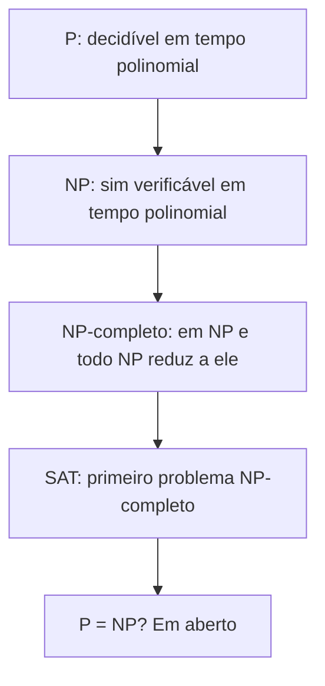

# 60 · Complexidade: P, NP e NP-completude

**Tempo estimado:** 55 minutos · **Pré-requisito:** [[59 - Máquinas de Turing, decidibilidade e a tese de Church-Turing]] e [[15 - Medindo algoritmos]].

**Ao final você vai conseguir:**

1. Distinguir P (decidível em tempo polinomial) de NP (verificável em tempo polinomial com certificado).
2. Explicar por que a busca exaustiva em SAT cresce como `2^n`.
3. Verificar um certificado de SAT em tempo proporcional ao tamanho da fórmula.
4. Descrever NP-completude: pertencer a NP e receber qualquer problema de NP por redução.

**Antes de começar:** no módulo 15 você contou passos de algoritmos e comparou crescimentos. Aqui a pergunta é se existe um algoritmo com crescimento polinomial para um problema, e não só para um algoritmo dado.

---

## Para começar

Você tem uma lista de tarefas com dependências e quer saber se é possível escolher um subconjunto de tarefas que caiba em um orçamento. Conferir uma escolha dada é fácil. Achar a escolha, entre todas as combinações possíveis, parece muito mais difícil. Essa diferença entre conferir e achar é o núcleo da classe NP.

---

## Mapa do módulo



*Figura 1: P está dentro de NP. Os problemas NP-completos são os mais difíceis de NP, e a questão de P = NP está aberta.*

**Como ler:** a seta indica inclusão. A última caixa é o problema em aberto.

---

## Mini-aula 1: P e NP

> [!tip] Ideia
> P são os problemas resolvidos por um algoritmo que roda em tempo polinomial. NP são os que têm respostas sim que podem ser conferidas em tempo polinomial, dado um certificado.

> [!info] Definição
> Segundo SEP, P é o conjunto dos problemas de decisão decidíveis por uma máquina de Turing determinística em tempo polinomial. NP é o conjunto dos decidíveis por uma máquina não determinística em tempo polinomial, equivalentemente, os que têm certificados de tamanho polinomial verificáveis em tempo polinomial. O **certificado** é a testemunha que o verificador confere.

Veja a busca exaustiva em SAT sobre uma fórmula de três variáveis. Antes de rodar, diga quantas atribuições serão testadas antes de achar uma satisfatória.

```python
from itertools import product

clausulas = [[1, -2], [2, 3], [-1, -3]]
n = 3

def literal_valor(lit, atrib):
    v = atrib[abs(lit) - 1]
    return v if lit > 0 else not v

def satisfaz(clausulas, atrib):
    return all(any(literal_valor(l, atrib) for l in c) for c in clausulas)

testadas = 0
for atrib in product([False, True], repeat=n):
    testadas += 1
    if satisfaz(clausulas, atrib):
        print("atribuição satisfatória:", atrib)
        break
print("atribuições testadas:", testadas, "de", 2 ** n)
```

Saída real:

```
atribuição satisfatória: (False, False, True)
atribuições testadas: 2 de 8
```

**Como ler:** a busca para na segunda atribuição, que satisfaz as três cláusulas. No pior caso, a busca testaria as oito atribuições de três variáveis.

> [!warning] Armadilha comum
> P é a classe dos problemas que se resolvem rápido. NP não é "os difíceis". Todo problema em P está em NP, e não se sabe se NP contém algo fora de P.

> [!question]- Checkpoint
> 1. Quantas atribuições a busca testa até parar?
> 2. Qual é o certificado que o verificador de SAT recebe?
>
> > [!success]- Resposta
> > 1. Duas.
> > 2. Uma atribuição de valores às variáveis.

---

## Mini-aula 2: crescimento exponencial

> [!tip] Ideia
> Quando há `n` variáveis booleanas, há `2^n` atribuições. A busca exaustiva cresce com essa conta, e logo deixa de ser viável, mesmo com um computador rápido.

> [!info] Definição
> Um problema está em P quando há um algoritmo de tempo polinomial, isto é, limitado por `n^k` para algum `k`. A busca exaustiva é exponencial, `2^n`. A nota de SEP não diz que SAT não tem algoritmo polinomial; isso é exatamente a questão de P = NP, que está em aberto.

Veja a diferença entre `n^3` e `2^n` para alguns valores de `n`. Antes de rodar, diga em qual linha a coluna de `2^n` ultrapassa a de `n³`.

```python
print("n | n^3 (polinomial) | 2^n (exponencial)")
for n in (5, 10, 20, 30):
    print(n, "|", n ** 3, "|", 2 ** n)
```

Saída real:

```
n | n^3 (polinomial) | 2^n (exponencial)
5 | 125 | 32
10 | 1000 | 1024
20 | 8000 | 1048576
30 | 27000 | 1073741824
```

**Como ler:** para `n = 5`, `n³` ainda vale mais (125 contra 32). A partir de `n = 10`, `2^n` passa de `n³` (1024 contra 1000). Para `n = 30`, a exponencial já passa de um bilhão, e a polinomial fica em 27 mil.

> [!warning] Armadilha comum
> Um algoritmo exponencial pode ser rápido para entradas pequenas. A diferença só se torna dramática quando `n` cresce.

> [!question]- Checkpoint
> 1. A partir de que `n` a exponencial passa da polinomial?
> 2. Por que a busca em SAT é exponencial?
>
> > [!success]- Resposta
> > 1. Em `n = 10`: `1024` contra `1000`. Depois, a diferença cresce muito rápido.
> > 2. Porque testa até `2^n` atribuições de `n` variáveis.

---

## Mini-aula 3: NP-completude

> [!tip] Ideia
> Um problema é NP-completo se está em NP e, além disso, todo problema de NP pode ser reduzido a ele em tempo polinomial. Se um deles tiver algoritmo polinomial, todos terão.

> [!info] Definição
> Segundo SEP, um problema é NP-completo quando está em NP e todo problema de NP se reduz a ele por redução muitos-um de tempo polinomial. Cook (1971) e Levin (1973) mostraram que SAT é NP-completo. Depois, 3-SAT, cobertura de vértices e TSP foram mostrados NP-completos por reduções. A nota registra que não se sabe se P = NP.

No exercício D1 você escreve a busca por força bruta de uma cobertura de vértices, que é um problema NP-completo segundo a nota.

> [!warning] Armadilha comum
> Um problema NP-completo não está provado como difícil para sempre. Está provado que é tão difícil quanto qualquer problema de NP, e, se P = NP, deixaria de ser difícil.

> [!question]- Checkpoint
> 1. O que a redução precisa mostrar para provar NP-completude?
> 2. Quem mostrou que SAT é NP-completo?
>
> > [!success]- Resposta
> > 1. Que todo problema de NP se reduz a ele em tempo polinomial.
> > 2. Cook (1971) e Levin (1973).

---

## Exercícios

Cada exercício tem um bloco com a função a completar e os testes com `assert`. Quando todos passarem, aparece `Passou!`. As funções definidas em exercícios anteriores aparecem no código inicial.

### Aquecimento

**A1. Valor de um literal.** Uma fórmula em forma normal conjuntiva tem cláusulas, e cada cláusula é uma disjunção de literais. Um literal `k` (positivo) é a variável `k`, e `-k` é a negação. Uma atribuição é uma tupla de booleanos, em que a posição `i - 1` diz o valor da variável `i`. Complete `valor_literal(lit, atrib)`, que devolve o valor do literal sob a atribuição.

```python
def valor_literal(lit, atrib):
    """Valor do literal (k ou -k) sob a atribuição, em que a posição k - 1 guarda a variável k."""
    ...

assert valor_literal(1, (True, False)) is True, "variável 1 é verdadeira"
assert valor_literal(-2, (True, False)) is True, "negação de 2, que é falsa"
assert valor_literal(2, (True, False)) is False, "variável 2 é falsa"
print("Passou!")
```

> [!hint]- Dica 1
> Pegue `v = atrib[abs(lit) - 1]`. Se o literal é negativo, devolva `not v`.

> [!hint]- Dica 2
> Para `lit = -2` e `atrib = (True, False)`, o resultado é `True`.

> [!example]- Solução
> ```python
> def valor_literal(lit, atrib):
>     """Valor do literal (k ou -k) sob a atribuição, em que a posição k - 1 guarda a variável k."""
>     v = atrib[abs(lit) - 1]
>     return v if lit > 0 else not v
> ```
>
> **Erro comum:** Usar `lit - 1` como índice. Para literais negativos, o índice sairia negativo e leria a variável errada.

**A2. Satisfazer a fórmula.** Uma fórmula em forma normal conjuntiva é satisfeita quando cada cláusula tem pelo menos um literal verdadeiro. Complete `satisfaz(clausulas, atrib)`, que devolve `True` se a atribuição satisfaz todas as cláusulas. Use `valor_literal`, já definida acima. Verificar uma atribuição dada é rápido: basta percorrer as cláusulas. Esse é o núcleo do que a classe NP exige.

```python
def valor_literal(lit, atrib):
    v = atrib[abs(lit) - 1]
    return v if lit > 0 else not v

def satisfaz(clausulas, atrib):
    """True se cada cláusula tem pelo menos um literal verdadeiro sob a atribuição."""
    ...

f = [[1, -2], [2, 3]]
assert satisfaz(f, (True, True, False)) is True, "a primeira cláusula vale pelo 1, a segunda pelo 2"
assert satisfaz(f, (False, False, False)) is False, "a segunda cláusula falha"
assert satisfaz([], (False,)) is True, "fórmula sem cláusulas é verdadeira"
print("Passou!")
```

> [!hint]- Dica 1
> Use `all(any(valor_literal(l, atrib) for l in c) for c in clausulas)`.

> [!hint]- Dica 2
> Para uma lista vazia de cláusulas, a fórmula é verdadeira: `all` devolve `True`.

> [!example]- Solução
> ```python
> def satisfaz(clausulas, atrib):
>     """True se cada cláusula tem pelo menos um literal verdadeiro sob a atribuição."""
>     return all(any(valor_literal(l, atrib) for l in c) for c in clausulas)
> ```
>
> **Erro comum:** Exigir que todas as cláusulas tenham todos os literais verdadeiros. Basta um literal por cláusula.

**A3. Busca exaustiva.** Para decidir SAT por força bruta, percorre-se todas as atribuições de `n` variáveis, e para na primeira que satisfaz a fórmula. Complete `sat_forca_bruta(clausulas, n)`, que devolve a primeira atribuição satisfatória, como tupla, ou `None` se nenhuma satisfaz. Use `itertools.product([False, True], repeat=n)` na ordem em que ele gera, e `satisfaz`, já definida acima.

```python
from itertools import product

def valor_literal(lit, atrib):
    v = atrib[abs(lit) - 1]
    return v if lit > 0 else not v

def satisfaz(clausulas, atrib):
    return all(any(valor_literal(l, atrib) for l in c) for c in clausulas)

def sat_forca_bruta(clausulas, n):
    """Primeira atribuição de n variáveis que satisfaz a fórmula, ou None."""
    ...

assert sat_forca_bruta([[1, -2], [2, 3], [-1, -3]], 3) == (False, False, True), "a primeira que satisfaz"
assert sat_forca_bruta([[1], [-1]], 1) is None, "insatisfatível"
assert sat_forca_bruta([], 2) == (False, False), "sem cláusulas, a primeira"
print("Passou!")
```

> [!hint]- Dica 1
> Use `for atrib in product([False, True], repeat=n):` e, dentro, `if satisfaz(clausulas, atrib): return atrib`.

> [!hint]- Dica 2
> Ao fim do laço, devolva `None`.

> [!example]- Solução
> ```python
> def sat_forca_bruta(clausulas, n):
>     """Primeira atribuição de n variáveis que satisfaz a fórmula, ou None."""
>     for atrib in product([False, True], repeat=n):
>         if satisfaz(clausulas, atrib):
>             return atrib
>     return None
> ```
>
> **Erro comum:** Devolver a primeira atribuição testada, satisfazendo ou não. A função só devolve quando a atribuição de fato satisfaz.

### Praticando

**P1. Quantas atribuições.** A busca do exercício A3 testa atribuições até achar uma que satisfaça. Complete `numero_de_testes(clausulas, n)`, que devolve quantas atribuições são testadas até a primeira satisfatória, contando-a. Se nenhuma satisfaz, devolve `2 ** n`, o total de atribuições. Use `satisfaz` e `product`.

```python
from itertools import product

def valor_literal(lit, atrib):
    v = atrib[abs(lit) - 1]
    return v if lit > 0 else not v

def satisfaz(clausulas, atrib):
    return all(any(valor_literal(l, atrib) for l in c) for c in clausulas)

def numero_de_testes(clausulas, n):
    """Atribuições testadas até a primeira satisfatória, contando-a; 2 elevado a n se nenhuma satisfaz."""
    ...

assert numero_de_testes([[1, -2], [2, 3], [-1, -3]], 3) == 2, "a segunda já satisfaz"
assert numero_de_testes([[1], [-1]], 1) == 2, "nenhuma satisfaz: 2 elevado a 1"
assert numero_de_testes([], 3) == 1, "a primeira já satisfaz"
print("Passou!")
```

> [!hint]- Dica 1
> Conte com um contador que sobe a cada atribuição testada, antes do `if`.

> [!hint]- Dica 2
> Para `[[1, -2], [2, 3], [-1, -3]]` e `n = 3`, a primeira satisfatória é a segunda testada, então o resultado é `2`.

> [!example]- Solução
> ```python
> def numero_de_testes(clausulas, n):
>     """Atribuições testadas até a primeira satisfatória, contando-a; 2 elevado a n se nenhuma satisfaz."""
>     testadas = 0
>     for atrib in product([False, True], repeat=n):
>         testadas += 1
>         if satisfaz(clausulas, atrib):
>             return testadas
>     return 2 ** n
> ```
>
> **Erro comum:** Contar só as atribuições satisfatórias. O pedido é o número de testes, inclusive os que falharam.

**P2. Certificado.** Um problema está em NP quando uma resposta sim tem um certificado que pode ser verificado em tempo polinomial. Para SAT, o certificado é a atribuição. Complete `verifica_certificado(clausulas, n, certificado)`, que devolve `True` se o certificado tem `n` valores e satisfaz a fórmula. A nota de SEP descreve esse papel do certificado.

```python
def valor_literal(lit, atrib):
    v = atrib[abs(lit) - 1]
    return v if lit > 0 else not v

def satisfaz(clausulas, atrib):
    return all(any(valor_literal(l, atrib) for l in c) for c in clausulas)

def verifica_certificado(clausulas, n, certificado):
    """True se o certificado tem n valores e satisfaz a fórmula: verificação rápida de um sim."""
    ...

assert verifica_certificado([[1, -2], [2, 3]], 3, (True, False, True)) is True, "certificado válido"
assert verifica_certificado([[1, -2], [2, 3]], 3, (True, True)) is False, "tamanho errado"
assert verifica_certificado([[1], [-1]], 1, (True,)) is False, "não satisfaz"
print("Passou!")
```

> [!hint]- Dica 1
> Teste `len(certificado) == n` e `satisfaz(clausulas, certificado)`, com `and`.

> [!hint]- Dica 2
> Um certificado de tamanho errado não é válido, mesmo que os valores satisfaçam as cláusulas.

> [!example]- Solução
> ```python
> def verifica_certificado(clausulas, n, certificado):
>     """True se o certificado tem n valores e satisfaz a fórmula: verificação rápida de um sim."""
>     return len(certificado) == n and satisfaz(clausulas, certificado)
> ```
>
> **Erro comum:** Verificar a fórmula sem conferir o tamanho. Uma atribuição incompleta pode parecer satisfatória por acaso.

### Desafio

**D1. Cobertura de vértices.** A nota de NP-completude cita o problema da cobertura de vértices como NP-completo. Dado um grafo por suas arestas, uma cobertura é um conjunto de vértices que toca toda aresta. Complete `cobertura_de_vertices(arestas, k)`, que devolve `True` se existe uma cobertura com no máximo `k` vértices, testando todos os conjuntos pelo tamanho crescente com `combinations`.

```python
from itertools import combinations

def cobertura_de_vertices(arestas, k):
    """True se há cobertura de no máximo k vértices, por força bruta sobre os conjuntos."""
    ...

triangulo = [(1, 2), (2, 3), (1, 3)]
assert cobertura_de_vertices(triangulo, 1) is False, "um vértice não cobre o triângulo"
assert cobertura_de_vertices(triangulo, 2) is True, "dois vértices cobrem"
assert cobertura_de_vertices([], 0) is True, "sem arestas, nada a cobrir"
print("Passou!")
```

> [!hint]- Dica 1
> Os vértices são `{v for a in arestas for v in a}`. Teste `combinations(vertices, tam)` para `tam` de `0` até `k`.

> [!hint]- Dica 2
> Um conjunto `c` cobre se, para cada aresta `(u, v)`, `u in c or v in c`.

> [!example]- Solução
> ```python
> def cobertura_de_vertices(arestas, k):
>     """True se há cobertura de no máximo k vértices, por força bruta sobre os conjuntos."""
>     vertices = sorted({v for a in arestas for v in a})
>     for tam in range(0, k + 1):
>         for c in combinations(vertices, tam):
>             if all(u in c or v in c for u, v in arestas):
>                 return True
>     return False
> ```
>
> **Erro comum:** Testar só conjuntos de tamanho exatamente `k`. Uma cobertura menor também conta como solução de até `k` vértices.


---

## Mini-projeto (opcional)

Você vai construir uma tabela que compara o crescimento polinomial com o exponencial. Tente sozinho antes de abrir a solução.

**Mini-projeto: crescimento.** Complete `tabela_crescimento(ns)`, que devolve uma lista de tuplas `(n, n ** 3, 2 ** n)` para cada `n` da lista, na mesma ordem. A comparação mostra por que a busca exaustiva de SAT é impraticável mesmo para entradas modestas.

```python
def tabela_crescimento(ns):
    """Tuplas (n, n elevado a 3, 2 elevado a n), para comparar crescimento polinomial e exponencial."""
    ...

assert tabela_crescimento([10]) == [(10, 1000, 1024)], "uma linha"
assert tabela_crescimento([]) == [], "lista vazia"
assert tabela_crescimento([1, 2]) == [(1, 1, 2), (2, 8, 4)], "duas linhas"
print("Passou!")
```

> [!hint]- Dica 1
> Use `[(n, n ** 3, 2 ** n) for n in ns]`.

> [!hint]- Dica 2
> Para `[10]`, o resultado é `[(10, 1000, 1024)]`.

> [!example]- Solução
> ```python
> def tabela_crescimento(ns):
>     """Tuplas (n, n elevado a 3, 2 elevado a n), para comparar crescimento polinomial e exponencial."""
>     return [(n, n ** 3, 2 ** n) for n in ns]
> ```
>
> **Erro comum:** Trocar a ordem das duas funções na tupla. A coluna do polinômio é `n ** 3`, e a do exponencial é `2 ** n`.


---

## Fechando

**Resumo**

- P: decidíveis em tempo polinomial; NP: sim verificável em tempo polinomial com certificado.
- A busca exaustiva em SAT testa até `2^n` atribuições.
- Um problema NP-completo está em NP e recebe por redução qualquer problema de NP.
- Cook e Levin mostraram que SAT é NP-completo; se P = NP, todos os NP-completos seriam polinomiais, e isso está em aberto.

**Glossário rápido**

- **P**: problemas decidíveis em tempo polinomial.
- **NP**: problemas cujos sins têm certificados verificáveis em tempo polinomial.
- **Certificado** (certificate): testemunha que o verificador confere.
- **NP-completo** (NP-complete): em NP e todo NP reduz a ele.
- **Redução** (reduction): transformação polinomial de um problema em outro.

**Perguntas de revisão**

1. Por que todo problema em P também está em NP?
2. Se você achar um algoritmo polinomial para SAT, o que acontece com os outros NP-completos?
3. Por que conferir uma atribuição dada é mais barato que procurá-la?

**E agora?** Este é o último módulo do bloco 7, Teoria da computação. O próximo bloco é **Inteligência artificial**, que trata de busca e de aprendizado.

---

## Para ir mais fundo

- [[Complexity Classes P and NP]]
- [[NP-Completeness and Cook-Levin]]
- [[Space Complexity and Complexity Hierarchy]]
- [[Turing Machines]]
