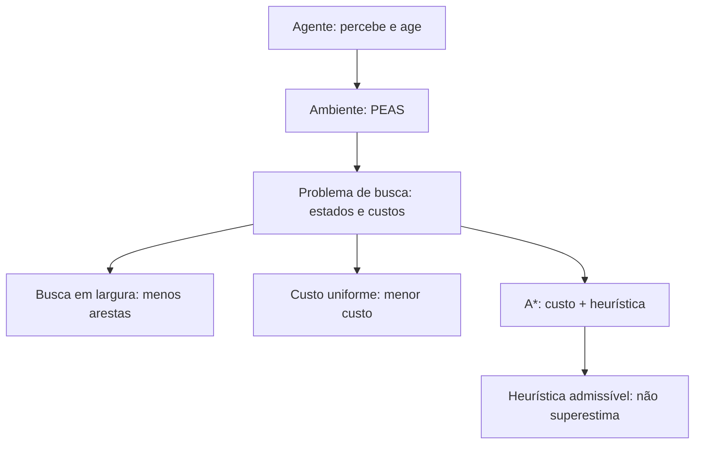

# 61 · Agentes e busca em espaços de estados

**Tempo estimado:** 55 minutos · **Pré-requisito:** [[41 - Processos, threads e fork]] (fila de prontos) e [[24 - Ordenação]] (ordenação por chave).

**Ao final você vai conseguir:**

1. Descrever um agente racional como o ciclo de percepção e ação, e especificar uma tarefa com PEAS.
2. Aplicar busca em largura e reconhecer quando ela é ótima.
3. Calcular o custo de um caminho e encontrar o de custo mínimo pela busca de custo uniforme.
4. Usar uma heurística admissível no A* e comparar com a busca em largura.

**Antes de começar:** no módulo 24 você ordenou por uma chave. A fila de prioridade do A* faz a mesma coisa, mas com a estimativa total `f(n) = g(n) + h(n)`.

---

## Para começar

Um aplicativo de mapas precisa achar uma rota entre duas cidades. O sistema observa a posição atual, escolhe uma ação (virar, seguir) e repete. Por baixo, o problema é um grafo: cada cruzamento é um estado, e cada trecho de rua tem um custo. Achar a rota é achar um caminho nesse grafo, e a qualidade da rota depende de como o custo é medido.

---

## Mapa do módulo



*Figura 1: o agente usa uma busca sobre o espaço de estados. BFS minimiza arestas; custo uniforme minimiza custo; A* usa uma estimativa admissível para ser ótimo mais depressa.*

**Como ler:** a seta indica "usa". A heurística é a peça que separa A* das outras.

---

## Mini-aula 1: agente racional

> [!tip] Ideia
> Um agente percebe o ambiente por sensores e age por atuadores. Ele é racional quando age para obter o melhor resultado esperado, dados seus objetivos.

> [!info] Definição
> Segundo Berkeley CS188, um agente racional é uma entidade que tem objetivos ou preferências e tenta executar uma sequência de ações que produzam o melhor resultado esperado. **PEAS** é a lista de quatro itens para descrever uma tarefa: medida de desempenho, ambiente, atuadores e sensores. Agentes reflexos escolhem a ação pela percepção atual; agentes de planejamento consideram as consequências.

Descreva o agente de mapas com PEAS. Antes de começar, pense: qual é a medida de desempenho dele?

> [!warning] Armadilha comum
> Um agente reflexo não é pior que um de planejamento em todo caso. Ele é adequado quando a percepção atual basta para decidir, e falha quando a decisão depende de consequências.

> [!question]- Checkpoint
> 1. O que faz um agente racional?
> 2. Quais são os quatro itens do PEAS?
>
> > [!success]- Resposta
> > 1. Age para obter o melhor resultado esperado, dados seus objetivos.
> > 2. Medida de desempenho, ambiente, atuadores e sensores.

---

## Mini-aula 2: busca em largura

> [!tip] Ideia
> A busca em largura visita os estados por camadas, a partir do início. A primeira vez que alcança a meta, o caminho tem o menor número de arestas.

> [!info] Definição
> A busca em largura usa uma fila FIFO. Segundo Berkeley, ela é completa e ótima quando todos os custos das arestas são iguais; com custos diferentes, a ótima é pelo número de arestas, não pelo custo total.

Veja a busca em largura sobre um grafo com custos diferentes. Antes de rodar, diga qual caminho ela acha de `S` a `G`, e qual é o custo dele.

```python
from collections import deque

grafo = {
    "S": {"A": 1, "B": 4},
    "A": {"S": 1, "B": 2, "G": 5},
    "B": {"S": 4, "A": 2, "G": 1},
    "G": {"A": 5, "B": 1},
}

def bfs(grafo, inicio, meta):
    pai = {inicio: None}
    fila = deque([inicio])
    while fila:
        n = fila.popleft()
        if n == meta:
            caminho = []
            while n is not None:
                caminho.append(n)
                n = pai[n]
            return caminho[::-1]
        for v in grafo[n]:
            if v not in pai:
                pai[v] = n
                fila.append(v)
    return None

caminho = bfs(grafo, "S", "G")
custo = sum(grafo[a][b] for a, b in zip(caminho, caminho[1:]))
print("BFS:", caminho, "| custo:", custo)
```

Saída real:

```
BFS: ['S', 'A', 'G'] | custo: 6
```

**Como ler:** `S-A-G` tem dois saltos, e a busca em largura para ali. O custo é `1 + 5 = 6`. Há um caminho mais barato, `S-B-G`, com custo `4 + 1 = 5`, mas ele tem dois saltos também. A busca não distingue os dois, porque olha só o número de saltos.

> [!warning] Armadilha comum
> Largura não é custo. Com custos diferentes, a busca em largura pode achar um caminho mais caro, mesmo sendo o mais curto em saltos.

> [!question]- Checkpoint
> 1. Qual caminho a busca em largura acha?
> 2. Por que ela não acha o de custo 5?
>
> > [!success]- Resposta
> > 1. `S-A-G`, com custo 6.
> > 2. Porque olha o número de arestas, e `S-A-G` e `S-B-G` têm dois saltos cada.

---

## Mini-aula 3: custo uniforme e A*

> [!tip] Ideia
> Com custos diferentes, a busca de custo uniforme expande sempre o caminho mais barato até agora. O A* soma a isso uma estimativa do que falta, e expande primeiro os caminhos que parecem mais promissores.

> [!info] Definição
> No A*, `f(n) = g(n) + h(n)`, em que `g` é o custo acumulado e `h` a estimativa até a meta. Segundo Berkeley, uma heurística é admissível quando `0 ≤ h(n) ≤ h*(n)`, em que `h*(n)` é o custo real. Com heurística admissível, o A* em busca em árvore é ótimo. Para busca em grafo, a nota diz que é preciso reabrir um estado quando se acha caminho mais barato até ele.

Veja o A* com a heurística da demonstração. Antes de rodar, diga o custo do caminho que ele acha.

```python
import heapq

grafo = {
    "S": {"A": 1, "B": 4},
    "A": {"S": 1, "B": 2, "G": 5},
    "B": {"S": 4, "A": 2, "G": 1},
    "G": {"A": 5, "B": 1},
}
h = {"S": 3, "A": 3, "B": 1, "G": 0}

def a_estrela(grafo, inicio, meta, h):
    aberta = [(h[inicio], 0, inicio, [inicio])]
    melhor = {}
    while aberta:
        f, g, n, caminho = heapq.heappop(aberta)
        if n == meta:
            return caminho, g
        if n in melhor and melhor[n] <= g:
            continue
        melhor[n] = g
        for v, c in grafo[n].items():
            heapq.heappush(aberta, (g + c + h[v], g + c, v, caminho + [v]))
    return None

print("A*:", a_estrela(grafo, "S", "G", h))
```

Saída real:

```
A*: (['S', 'A', 'B', 'G'], 4)
```

**Como ler:** o A* expande `B` antes de `G`, e encontra `S-A-B-G`, de custo 4. Esse é o caminho mínimo, e a busca em largura não o achou.

> [!warning] Armadilha comum
> Uma heurística que superestima o custo real pode fazer o A* devolver um caminho que não é o ótimo. Admissibilidade é uma condição da heurística, não do algoritmo.

> [!question]- Checkpoint
> 1. Qual é o custo do caminho do A*?
> 2. O que a heurística admissível garante?
>
> > [!success]- Resposta
> > 1. 4.
> > 2. Que o A* em árvore acha um caminho ótimo.

---

## Exercícios

Cada exercício tem um bloco com a função a completar e os testes com `assert`. Quando todos passarem, aparece `Passou!`. As funções definidas em exercícios anteriores aparecem no código inicial.

### Aquecimento

**A1. Vizinhança.** Em um problema de busca, o grafo de estados mostra, para cada estado, os estados alcançados com uma ação. Complete `vizinhos(grafo, n)`, que devolve a lista ordenada dos vizinhos de `n`. Um nó sem arestas tem lista vazia.

```python
def vizinhos(grafo, n):
    """Lista ordenada dos vizinhos de n no grafo de estados."""
    ...

g = {"S": {"A": 1, "B": 4}, "A": {"S": 1}}
assert vizinhos(g, "S") == ["A", "B"], "dois vizinhos, ordenados"
assert vizinhos(g, "B") == [], "nó sem arestas"
assert vizinhos({}, "S") == [], "grafo vazio"
print("Passou!")
```

> [!hint]- Dica 1
> Use `sorted(grafo.get(n, {}))`, que pega as chaves do dicionário de vizinhos.

> [!hint]- Dica 2
> Para `"S"` no grafo da demonstração, o resultado é `["A", "B"]`.

> [!example]- Solução
> ```python
> def vizinhos(grafo, n):
>     """Lista ordenada dos vizinhos de n no grafo de estados."""
>     return sorted(grafo.get(n, {}))
> ```
>
> **Erro comum:** Devolver os custos em vez dos vizinhos. O dicionário associa cada vizinho ao custo da aresta.

**A2. Busca em largura.** A busca em largura explora os estados por camadas, com uma fila FIFO, e acha o caminho com menos arestas. A nota de Berkeley diz que ela é completa e ótima quando todos os custos são iguais. Complete `bfs_caminho(grafo, inicio, meta)`, que devolve a lista de estados do caminho, do início à meta, ou `None` se a meta não é alcançável.

```python
from collections import deque

def bfs_caminho(grafo, inicio, meta):
    """Caminho com menos arestas de inicio a meta, por busca em largura; None se não há."""
    ...

g = {"S": {"A": 1, "B": 4}, "A": {"S": 1, "B": 2, "G": 5}, "B": {"S": 4, "A": 2, "G": 1}, "G": {"A": 5, "B": 1}}
assert bfs_caminho(g, "S", "G") == ["S", "A", "G"], "dois saltos: S-A-G ou S-B-G"
assert bfs_caminho(g, "S", "S") == ["S"], "a meta é o início"
assert bfs_caminho({"S": {}, "X": {}}, "S", "X") is None, "meta inalcançável"
print("Passou!")
```

> [!hint]- Dica 1
> Use `deque`. Guarde o pai de cada estado descoberto em um dicionário, e reconstrua o caminho andando pelos pais a partir da meta.

> [!hint]- Dica 2
> Marque um estado ao colocá-lo na fila, para não visitá-lo duas vezes.

> [!example]- Solução
> ```python
> def bfs_caminho(grafo, inicio, meta):
>     """Caminho com menos arestas de inicio a meta, por busca em largura; None se não há."""
>     pai = {inicio: None}
>     fila = deque([inicio])
>     while fila:
>         n = fila.popleft()
>         if n == meta:
>             caminho = []
>             while n is not None:
>                 caminho.append(n)
>                 n = pai[n]
>             return caminho[::-1]
>         for v in grafo.get(n, {}):
>             if v not in pai:
>                 pai[v] = n
>                 fila.append(v)
>     return None
> ```
>
> **Erro comum:** Verificar a meta quando o estado é descoberto e não quando é retirado da fila. O caminho pode sair certo, mas a ordem de visita muda, e a garantia de menor número de arestas depende de checar ao retirar.

**A3. Custo de um caminho.** O custo de um caminho é a soma dos custos das arestas que ele percorre. Complete `custo_do_caminho(grafo, caminho)`, que devolve esse custo. Um caminho com um único estado custa zero.

```python
def custo_do_caminho(grafo, caminho):
    """Soma dos custos das arestas consecutivas do caminho; zero para um caminho de um estado."""
    ...

g = {"S": {"A": 1, "B": 4}, "A": {"S": 1, "B": 2, "G": 5}, "B": {"S": 4, "A": 2, "G": 1}, "G": {"A": 5, "B": 1}}
assert custo_do_caminho(g, ["S", "A", "B", "G"]) == 4, "1 + 2 + 1"
assert custo_do_caminho(g, ["S"]) == 0, "um estado só"
assert custo_do_caminho(g, ["S", "B", "G"]) == 5, "4 + 1"
print("Passou!")
```

> [!hint]- Dica 1
> Some `grafo[a][b]` para cada par de estados consecutivos: `zip(caminho, caminho[1:])`.

> [!hint]- Dica 2
> Para `["S", "A", "B", "G"]`, o custo é `1 + 2 + 1 = 4`.

> [!example]- Solução
> ```python
> def custo_do_caminho(grafo, caminho):
>     """Soma dos custos das arestas consecutivas do caminho; zero para um caminho de um estado."""
>     return sum(grafo[a][b] for a, b in zip(caminho, caminho[1:]))
> ```
>
> **Erro comum:** Somar todos os custos do grafo. Só as arestas do caminho entram na soma.

### Praticando

**P1. Custo uniforme.** A busca de custo uniforme expande sempre o estado de menor custo acumulado, com uma fila de prioridade. A nota de Berkeley diz que ela é ótima com custos não negativos. Complete `ucs_custo(grafo, inicio, meta)`, que devolve o menor custo de `inicio` até `meta`, ou `None` se a meta não é alcançável. Use `heapq`.

```python
import heapq

def ucs_custo(grafo, inicio, meta):
    """Menor custo de inicio a meta por custo uniforme; None se a meta não é alcançável."""
    ...

g = {"S": {"A": 1, "B": 4}, "A": {"S": 1, "B": 2, "G": 5}, "B": {"S": 4, "A": 2, "G": 1}, "G": {"A": 5, "B": 1}}
assert ucs_custo(g, "S", "G") == 4, "o menor custo é 4"
assert ucs_custo(g, "S", "S") == 0, "o início é a meta"
assert ucs_custo({"S": {}, "X": {}}, "S", "X") is None, "inalcançável"
print("Passou!")
```

> [!hint]- Dica 1
> Coloque `(0, inicio)` na fila. A cada retirada `(g, n)`, se `n == meta` devolva `g`; senão, empilhe `(g + c, v)` para cada vizinho `v` com custo `c`.

> [!hint]- Dica 2
> Ignore um estado já retirado com custo menor, usando um conjunto de visitados.

> [!example]- Solução
> ```python
> def ucs_custo(grafo, inicio, meta):
>     """Menor custo de inicio a meta por custo uniforme; None se a meta não é alcançável."""
>     fila = [(0, inicio)]
>     visitados = set()
>     while fila:
>         g, n = heapq.heappop(fila)
>         if n == meta:
>             return g
>         if n in visitados:
>             continue
>         visitados.add(n)
>         for v, c in grafo.get(n, {}).items():
>             heapq.heappush(fila, (g + c, v))
>     return None
> ```
>
> **Erro comum:** Devolver o custo do primeiro caminho achado, sem a fila de prioridade. Pode não ser o menor.

**P2. Heurística admissível.** Uma heurística `h` é admissível quando, para todo estado `n`, vale `0 <= h(n) <= h*(n)`, em que `h*(n)` é o custo real até a meta. A nota de Berkeley usa essa definição para o A*. Complete `heuristica_admissivel(grafo, meta, h)`, que devolve `True` se `h` é admissível em todos os estados do grafo. Use `ucs_custo`, já definida acima, para obter `h*(n)`.

```python
import heapq

def ucs_custo(grafo, inicio, meta):
    fila = [(0, inicio)]
    visitados = set()
    while fila:
        g, n = heapq.heappop(fila)
        if n == meta:
            return g
        if n in visitados:
            continue
        visitados.add(n)
        for v, c in grafo.get(n, {}).items():
            heapq.heappush(fila, (g + c, v))
    return None

def heuristica_admissivel(grafo, meta, h):
    """True se 0 <= h(n) <= h*(n) para todo estado n com caminho até a meta."""
    ...

g = {"S": {"A": 1, "B": 4}, "A": {"S": 1, "B": 2, "G": 5}, "B": {"S": 4, "A": 2, "G": 1}, "G": {"A": 5, "B": 1}}
assert heuristica_admissivel(g, "G", {"S": 3, "A": 3, "B": 1, "G": 0}) is True, "a heurística da demonstração"
assert heuristica_admissivel(g, "G", {"S": 10, "A": 3, "B": 1, "G": 0}) is False, "h(S) passa de h*(S) = 4"
assert heuristica_admissivel(g, "G", {"S": -1, "A": 3, "B": 1, "G": 0}) is False, "h negativa não é admissível"
print("Passou!")
```

> [!hint]- Dica 1
> Para cada `n`, calcule `real = ucs_custo(grafo, n, meta)`. Confira `0 <= h[n] <= real`.

> [!hint]- Dica 2
> Um estado sem caminho até a meta tem `h*` infinito, e qualquer `h` finita é admissível nele; trate esse caso com `real is None`.

> [!example]- Solução
> ```python
> def heuristica_admissivel(grafo, meta, h):
>     """True se 0 <= h(n) <= h*(n) para todo estado n com caminho até a meta."""
>     for n in grafo:
>         real = ucs_custo(grafo, n, meta)
>         if real is None:
>             continue
>         if not (0 <= h[n] <= real):
>             return False
>     return True
> ```
>
> **Erro comum:** Testar só `h[n] <= real`, sem o limite inferior. Uma heurística negativa também é inválida pela definição.

### Desafio

**D1. A estrela.** A* ordena os estados pela soma `f(n) = g(n) + h(n)`, em que `g` é o custo acumulado e `h` a estimativa até a meta. Com uma heurística admissível, o primeiro caminho até a meta é ótimo, segundo a nota de Berkeley. Complete `a_estrela(grafo, inicio, meta, h)`, que devolve a tupla `(caminho, custo)`, ou `None` se a meta não é alcançável. Use `heapq`, com entradas `(f, g, estado, caminho)`.

```python
import heapq

def a_estrela(grafo, inicio, meta, h):
    """Caminho e custo ótimos por A*, com heurística admissível; None se não há caminho."""
    ...

g = {"S": {"A": 1, "B": 4}, "A": {"S": 1, "B": 2, "G": 5}, "B": {"S": 4, "A": 2, "G": 1}, "G": {"A": 5, "B": 1}}
h = {"S": 3, "A": 3, "B": 1, "G": 0}
r = a_estrela(g, "S", "G", h)
assert r is not None, "há caminho"
assert r == (["S", "A", "B", "G"], 4), "o caminho de custo 4"
assert a_estrela({"S": {}, "X": {}}, "S", "X", {"S": 0, "X": 0}) is None, "inalcançável"
print("Passou!")
```

> [!hint]- Dica 1
> Coloque `(h[inicio], 0, inicio, [inicio])` na fila. Ao retirar um estado que é a meta, devolva `(caminho, g)`.

> [!hint]- Dica 2
> Expanda somando o custo `c` da aresta a `g`, e empilhe `(g + c + h[v], g + c, v, caminho + [v])`.

> [!example]- Solução
> ```python
> def a_estrela(grafo, inicio, meta, h):
>     """Caminho e custo ótimos por A*, com heurística admissível; None se não há caminho."""
>     aberta = [(h[inicio], 0, inicio, [inicio])]
>     melhor = {}
>     while aberta:
>         f, g, n, caminho = heapq.heappop(aberta)
>         if n == meta:
>             return caminho, g
>         if n in melhor and melhor[n] <= g:
>             continue
>         melhor[n] = g
>         for v, c in grafo.get(n, {}).items():
>             heapq.heappush(aberta, (g + c + h[v], g + c, v, caminho + [v]))
>     return None
> ```
>
> **Erro comum:** Ordenar só por `g`. Isso é a busca de custo uniforme, e a heurística não entra na decisão.


---

## Mini-projeto (opcional)

Você vai comparar a busca em largura com o A* no mesmo grafo, e ver a diferença de custo. Tente sozinho antes de abrir a solução.

**Mini-projeto: BFS contra A*.** Complete `compara_buscas(grafo, inicio, meta, h)`, que devolve um dicionário com duas chaves: `"bfs_custo"`, o custo do caminho achado pela busca em largura, e `"a_estrela_custo"`, o custo do caminho do A*. Use `bfs_caminho`, `custo_do_caminho` e `a_estrela`, já definidas. A comparação mostra que a busca em largura só é ótima com custos iguais.

```python
from collections import deque
import heapq

def bfs_caminho(grafo, inicio, meta):
    pai = {inicio: None}
    fila = deque([inicio])
    while fila:
        n = fila.popleft()
        if n == meta:
            caminho = []
            while n is not None:
                caminho.append(n)
                n = pai[n]
            return caminho[::-1]
        for v in grafo.get(n, {}):
            if v not in pai:
                pai[v] = n
                fila.append(v)
    return None

def custo_do_caminho(grafo, caminho):
    return sum(grafo[a][b] for a, b in zip(caminho, caminho[1:]))

def a_estrela(grafo, inicio, meta, h):
    aberta = [(h[inicio], 0, inicio, [inicio])]
    melhor = {}
    while aberta:
        f, g, n, caminho = heapq.heappop(aberta)
        if n == meta:
            return caminho, g
        if n in melhor and melhor[n] <= g:
            continue
        melhor[n] = g
        for v, c in grafo.get(n, {}).items():
            heapq.heappush(aberta, (g + c + h[v], g + c, v, caminho + [v]))
    return None

def compara_buscas(grafo, inicio, meta, h):
    """Custo do caminho do BFS e custo ótimo do A*, para comparação."""
    ...

g = {"S": {"A": 1, "B": 4}, "A": {"S": 1, "B": 2, "G": 5}, "B": {"S": 4, "A": 2, "G": 1}, "G": {"A": 5, "B": 1}}
h = {"S": 3, "A": 3, "B": 1, "G": 0}
r = compara_buscas(g, "S", "G", h)
assert r is not None, "a função devolve o dicionário"
assert r == {"bfs_custo": 6, "a_estrela_custo": 4}, "BFS acha 6; A* acha 4"
print("Passou!")
```

> [!hint]- Dica 1
> `bfs_caminho` devolve o caminho; `custo_do_caminho` dá o custo dele. Para o A*, pegue o segundo elemento da tupla.

> [!hint]- Dica 2
> No grafo de exemplo, a busca em largura acha S-A-G (dois saltos, custo 6); o A* acha custo 4.

> [!example]- Solução
> ```python
> def compara_buscas(grafo, inicio, meta, h):
>     """Custo do caminho do BFS e custo ótimo do A*, para comparação."""
>     return {
>         "bfs_custo": custo_do_caminho(grafo, bfs_caminho(grafo, inicio, meta)),
>         "a_estrela_custo": a_estrela(grafo, inicio, meta, h)[1],
>     }
> ```
>
> **Erro comum:** Usar a contagem de arestas do caminho do BFS como custo. Com custos diferentes, isso não é o custo.


---

## Fechando

**Resumo**

- Um agente racional percebe, age e busca o melhor resultado esperado; PEAS descreve a tarefa.
- A busca em largura é ótima quando os custos são iguais; com custos diferentes, olha só o número de arestas.
- A busca de custo uniforme acha o caminho de menor custo com fila de prioridade.
- O A* com heurística admissível é ótimo e usa `f = g + h` para expandir primeiro o promissor.

**Glossário rápido**

- **PEAS**: medida de desempenho, ambiente, atuadores e sensores.
- **Busca em largura** (breadth-first search): explora por camadas, com fila FIFO.
- **Custo uniforme** (uniform-cost search): expande o menor custo acumulado.
- **Heurística** (heuristic): estimativa de custo até a meta.
- **Admissível** (admissible): nunca superestima o custo real.

**Perguntas de revisão**

1. Em que situação a busca em largura é suficiente para achar o caminho mais barato?
2. Por que `h(n) = 0` para todo `n` é admissível, e o que o A* faz com ela?
3. O que muda se a heurística superestima o custo de um estado intermediário?

**E agora?** O próximo módulo é **Jogos e busca local**. Ele trata de jogos de soma zero, com minimax e poda alfa-beta, e de buscas que melhoram uma solução sem guardar caminhos.

---

## Para ir mais fundo

- [[Intelligent Agents and Rationality]]
- [[Uninformed Search]]
- [[Informed Search and A-Star]]
