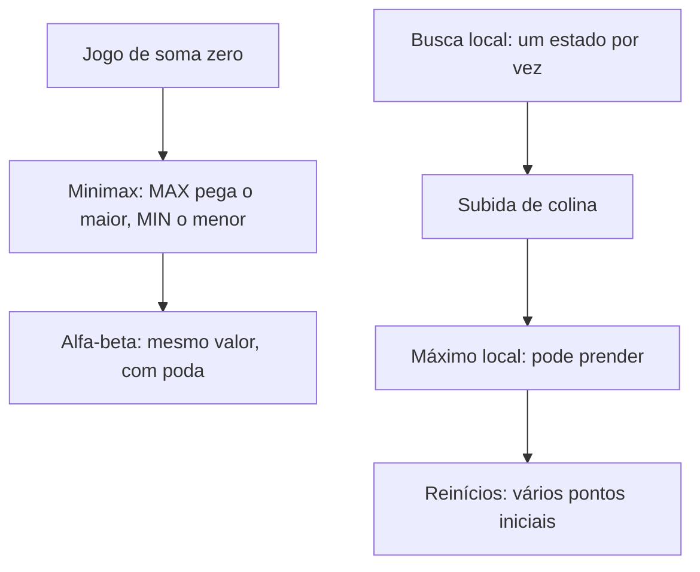

# 62 · Jogos e busca local

**Tempo estimado:** 55 minutos · **Pré-requisito:** [[61 - Agentes e busca em espaços de estados]] e [[42 - Escalonamento de CPU]] (comparação de políticas por valor).

**Ao final você vai conseguir:**

1. Calcular o valor de uma árvore de jogo de soma zero pelo minimax.
2. Escolher a jogada da raiz com base nos valores dos filhos.
3. Aplicar a poda alfa-beta e verificar que o resultado não muda.
4. Descrever a subida de colina e o problema do máximo local, e reiniciar a busca para contornar.

**Antes de começar:** no módulo 61 a busca procurava um caminho até uma meta. Num jogo, a busca precisa considerar a jogada do adversário, que quer o pior resultado para quem busca.

---

## Para começar

Dois jogadores se alternam numa partida de dois jogadores com soma zero: o ganho de um é a perda do outro. Antes de mover, cada um quer prever as respostas do adversário. O minimax modela essa previsão: em cada lance do adversário, supõe que ele escolhe o pior para você. Já uma busca local, num problema sem adversário, só melhora uma solução de cada vez.

---

## Mapa do módulo



*Figura 1: jogos e busca local têm estruturas diferentes. O minimax alterna MAX e MIN; a subida de colina segue vizinhos e pode parar num máximo local.*

**Como ler:** o ramo superior trata de jogos; o inferior, de otimização sem adversário.

---

## Mini-aula 1: minimax

> [!tip] Ideia
> Em um nó MAX, o valor é o maior dos filhos; em um nó MIN, o menor. Assim, cada jogador supõe que o outro faz o melhor para ele.

> [!info] Definição
> O **minimax** calcula o valor de uma árvore de jogo para jogos de soma zero. Segundo Berkeley CS188, o custo de tempo é O(b^m), em que `b` é o fator de ramificação e `m` a profundidade máxima. Berkeley define `b` como o fator de ramificação e `m` como a profundidade máxima.

Veja o valor da raiz para uma árvore de dois níveis. Antes de rodar, diga o valor da raiz quando MAX joga primeiro.

```python
arvore = [[3, 5], [2, 9]]

def minimax(no, max_turn):
    if isinstance(no, int):
        return no
    valores = [minimax(f, not max_turn) for f in no]
    return max(valores) if max_turn else min(valores)

print("valor da raiz (MAX joga primeiro):", minimax(arvore, True))
```

Saída real:

```
valor da raiz (MAX joga primeiro): 3
```

**Como ler:** os filhos da raiz são nós MIN: o primeiro tem folhas 3 e 5, e vale 3; o segundo tem 2 e 9, e vale 2. A raiz é MAX, e escolhe o maior, que é 3.

> [!warning] Armadilha comum
> Trocar a ordem de MAX e MIN muda o resultado. O valor depende de quem joga em cada nível.

> [!question]- Checkpoint
> 1. Quanto vale o nó MIN `[2, 9]`?
> 2. Quanto vale a raiz?
>
> > [!success]- Resposta
> > 1. 2, o menor dos dois.
> > 2. 3, o maior entre 3 e 2.

---

## Mini-aula 2: poda alfa-beta

> [!tip] Ideia
> Ao avaliar um nó MIN, se ele já é pior que a melhor opção garantida a MAX, os outros filhos dele não mudam o resultado. Podem ser ignorados.

> [!info] Definição
> A **poda alfa-beta** mantém dois limites: `alfa`, o melhor valor garantido a MAX até agora, e `beta`, o melhor a MIN. Segundo Berkeley, ela dá o mesmo resultado do minimax, e reduz o tempo; no melhor caso, chega a O(b^(m/2)). A nota diz que, na prática, costuma ser bem menor que o pior caso.

No exercício P1 você escreve a poda. O resultado deve bater com o minimax.

> [!warning] Armadilha comum
> A poda não acelera o pior caso garantidamente. Ela depende da ordem em que os filhos são avaliados.

> [!question]- Checkpoint
> 1. O que a poda muda no resultado?
> 2. Quando ela é mais eficaz?
>
> > [!success]- Resposta
> > 1. Nada: o valor é o mesmo do minimax.
> > 2. Quando os melhores filhos são avaliados primeiro.

---

## Mini-aula 3: busca local e máximos locais

> [!tip] Ideia
> Na busca local, guarda-se um estado e passa-se a um vizinho melhor. Não se guarda o caminho. A subida de colina para quando nenhum vizinho imediato é melhor, mesmo que não seja o melhor global.

> [!info] Definição
> Segundo Berkeley, a subida de colina de maior inclinação pode ficar presa em máximos locais e platôs; o reinício aleatório a torna completa. O recozimento simulado aceita movimentos piores com uma probabilidade que diminui com a temperatura, e os algoritmos genéticos trabalham com uma população.

Veja a subida de colina sobre uma função com dois picos. Antes de rodar, diga em qual ponto ela para se começa em `0`.

```python
def f(x):
    return [0, 1, 2, 1, 0, 3, 5, 3, 0][x]

def subida(x):
    while True:
        vizinhos = [v for v in (x - 1, x + 1) if 0 <= v <= 8]
        melhor = max(vizinhos, key=f)
        if f(melhor) <= f(x):
            return x
        x = melhor

for inicio in (0, 7):
    print("começando em", inicio, "a subida para em", subida(inicio), "com valor", f(subida(inicio)))
```

Saída real:

```
começando em 0 a subida para em 2 com valor 2
começando em 7 a subida para em 6 com valor 5
```

**Como ler:** de `0`, a subida sobe até `2`, que é um máximo local de valor 2. O pico global, `6`, com valor 5, não é alcançado. De `7`, a subida chega a `6`.

> [!warning] Armadilha comum
> Um máximo local não é um erro de implementação. É uma propriedade da função e do ponto de partida. A saída é reiniciar de outros pontos, ou aceitar movimentos piores.

> [!question]- Checkpoint
> 1. Em que ponto a subida a partir de `0` para?
> 2. O que o reinício muda?
>
> > [!success]- Resposta
> > 1. Em `2`, um máximo local.
> > 2. Começa de outro ponto, e pode alcançar um pico maior.

---

## Exercícios

Cada exercício tem um bloco com a função a completar e os testes com `assert`. Quando todos passarem, aparece `Passou!`. As funções definidas em exercícios anteriores aparecem no código inicial.

### Aquecimento

**A1. Minimax.** Uma árvore de jogo é representada por listas aninhadas: uma folha é um inteiro (o valor do estado final), e um nó é uma lista de filhos. No nível MAX, o valor é o maior dos filhos; no nível MIN, o menor. A nota de Berkeley define o minimax para jogos de soma zero. Complete `valor_minimax(no, max_turn)`, que devolve o valor do nó, com `max_turn` indicando se é a vez de MAX.

```python
def valor_minimax(no, max_turn):
    """Valor do nó pelo minimax: MAX pega o maior dos filhos, MIN pega o menor."""
    ...

assert valor_minimax([[3, 5], [2, 9]], True) == 3, "MIN escolhe 3 e 2; MAX pega 3"
assert valor_minimax([[3, 5], [2, 9]], False) == 5, "com a raiz MIN, o menor dos maiores filhos é 5"
assert valor_minimax(7, True) == 7, "uma folha"
print("Passou!")
```

> [!hint]- Dica 1
> Se `no` é um inteiro, devolva-o. Senão, calcule o valor de cada filho com `max_turn` invertido.

> [!hint]- Dica 2
> Use `max(valores) if max_turn else min(valores)`.

> [!example]- Solução
> ```python
> def valor_minimax(no, max_turn):
>     """Valor do nó pelo minimax: MAX pega o maior dos filhos, MIN pega o menor."""
>     if isinstance(no, int):
>         return no
>     valores = [valor_minimax(f, not max_turn) for f in no]
>     return max(valores) if max_turn else min(valores)
> ```
>
> **Erro comum:** Inverter o papel de MAX e MIN na raiz. MAX joga primeiro, então a raiz pega o maior valor entre os filhos.

**A2. Profundidade da árvore.** A profundidade de uma árvore de jogo é o número de níveis de nós até as folhas. Uma folha sozinha tem profundidade zero. Complete `altura_arvore(no)`, que devolve a profundidade da árvore representada como no exercício A1.

```python
def altura_arvore(no):
    """Número de níveis de nós até as folhas; uma folha tem altura 0."""
    ...

assert altura_arvore([[3, 5], [2, 9]]) == 2, "dois níveis"
assert altura_arvore(4) == 0, "uma folha"
assert altura_arvore([1, [2, [3]]]) == 3, "árvore desbalanceada"
print("Passou!")
```

> [!hint]- Dica 1
> Se `no` é um inteiro, a altura é 0. Senão, é `1 + max` das alturas dos filhos.

> [!hint]- Dica 2
> Para `[[3, 5], [2, 9]]`, a altura é 2.

> [!example]- Solução
> ```python
> def altura_arvore(no):
>     """Número de níveis de nós até as folhas; uma folha tem altura 0."""
>     if isinstance(no, int):
>         return 0
>     return 1 + max(altura_arvore(f) for f in no)
> ```
>
> **Erro comum:** Contar as folhas. A pergunta é sobre níveis, e não quantidade de folhas.

**A3. Escolher a jogada.** No nível da raiz, MAX escolhe o filho com o maior valor minimax. Complete `melhor_jogada(arvore)`, que devolve o índice do filho escolhido, usando `valor_minimax`, já definida acima. A raiz é um nó MAX, e os filhos começam em MIN.

```python
def valor_minimax(no, max_turn):
    if isinstance(no, int):
        return no
    valores = [valor_minimax(f, not max_turn) for f in no]
    return max(valores) if max_turn else min(valores)

def melhor_jogada(arvore):
    """Índice do filho da raiz (MAX) com maior valor minimax; os filhos começam em MIN."""
    ...

assert melhor_jogada([[3, 5], [2, 9]]) == 0, "o filho 0 vale 3"
assert melhor_jogada([[1], [4], [2]]) == 1, "o filho 1 é o maior"
print("Passou!")
```

> [!hint]- Dica 1
> Calcule `valor_minimax(f, False)` para cada filho `f` e pegue o índice do maior, com `max(range(len(arvore)), key=...)`.

> [!hint]- Dica 2
> Para `[[3, 5], [2, 9]]`, os filhos valem 3 e 2, então a jogada é o índice `0`.

> [!example]- Solução
> ```python
> def melhor_jogada(arvore):
>     """Índice do filho da raiz (MAX) com maior valor minimax; os filhos começam em MIN."""
>     return max(range(len(arvore)), key=lambda i: valor_minimax(arvore[i], False))
> ```
>
> **Erro comum:** Chamar com `max_turn = True` para os filhos. Os filhos são nós MIN, e o valor deles é o menor.

### Praticando

**P1. Poda alfa-beta.** A poda alfa-beta devolve o mesmo valor do minimax, pulando ramos que não mudam o resultado. A nota de Berkeley diz que ela dá o mesmo resultado. Complete `alfa_beta(no, max_turn, alfa, beta)`, com `alfa` o melhor valor garantido a MAX até agora, e `beta` o melhor a MIN. Em um nó MAX, interrompa quando o valor atinge `beta`; em um nó MIN, quando atinge `alfa`. Comece com `alfa = -inf` e `beta = inf`.

```python
def alfa_beta(no, max_turn, alfa, beta):
    """Valor do minimax com poda: pula ramos que não mudam o resultado."""
    ...

arvore = [[3, 5], [2, 9]]
assert alfa_beta(arvore, True, float("-inf"), float("inf")) == 3, "mesmo resultado do minimax"
assert alfa_beta([[1, 2], [3, 4]], True, float("-inf"), float("inf")) == 3, "MIN pega 1 e 3; MAX pega 3"
assert alfa_beta(9, True, float("-inf"), float("inf")) == 9, "uma folha"
print("Passou!")
```

> [!hint]- Dica 1
> Em MAX, atualize `alfa = max(alfa, v)`; se `alfa >= beta`, pare. Em MIN, atualize `beta = min(beta, v)`; se `beta <= alfa`, pare.

> [!hint]- Dica 2
> Use `float("inf")` e `float("-inf")` para os limites iniciais.

> [!example]- Solução
> ```python
> def alfa_beta(no, max_turn, alfa, beta):
>     """Valor do minimax com poda: pula ramos que não mudam o resultado."""
>     if isinstance(no, int):
>         return no
>     if max_turn:
>         v = float("-inf")
>         for f in no:
>             v = max(v, alfa_beta(f, False, alfa, beta))
>             alfa = max(alfa, v)
>             if alfa >= beta:
>                 break
>         return v
>     v = float("inf")
>     for f in no:
>         v = min(v, alfa_beta(f, True, alfa, beta))
>         beta = min(beta, v)
>         if beta <= alfa:
>             break
>     return v
> ```
>
> **Erro comum:** Atualizar `alfa` em um nó MIN. Cada tipo de nó atualiza só o seu limite.

**P2. Subida de colina.** A busca local mantém um estado e passa a um vizinho melhor, sem guardar o caminho. A subida de colina para quando nenhum vizinho imediato é melhor. Complete `subida_colina(f, x, passo, n)`, em que `f` é a função a maximizar, `x` o ponto inicial, `passo` o tamanho do salto para cada vizinho (`x - passo` e `x + passo`) e `n` o número máximo de passos. Devolva o ponto final.

```python
def subida_colina(f, x, passo, n):
    """Sobe por vizinhos de tamanho passo enquanto melhora, por no máximo n passos."""
    ...

assert subida_colina(lambda x: -(x - 3) ** 2, 0, 1, 100) == 3, "sobe até o topo"
assert subida_colina(lambda x: -(x - 3) ** 2, 3, 1, 100) == 3, "já está no topo"
assert subida_colina(lambda x: -(x - 3) ** 2, 0, 1, 2) == 2, "limite de passos"
print("Passou!")
```

> [!hint]- Dica 1
> A cada passo, escolha o vizinho de maior `f`. Se ele não é melhor que `x`, pare.

> [!hint]- Dica 2
> Para `f(x) = -(x - 3) ** 2`, `x = 0`, `passo = 1`, o resultado é `3`.

> [!example]- Solução
> ```python
> def subida_colina(f, x, passo, n):
>     """Sobe por vizinhos de tamanho passo enquanto melhora, por no máximo n passos."""
>     for _ in range(n):
>         melhor = max([x - passo, x + passo], key=f)
>         if f(melhor) <= f(x):
>             return x
>         x = melhor
>     return x
> ```
>
> **Erro comum:** Parar após o primeiro passo mesmo que o vizinho seja melhor. A subida deve continuar enquanto houver melhoria.

### Desafio

**D1. Reinícios.** A subida de colina pode parar num máximo local, que não é o melhor da função. Uma saída simples é reiniciar a busca de vários pontos e ficar com o melhor resultado. A nota de Berkeley cita os reinícios aleatórios como forma de tornar a subida completa. Complete `reinicios(f, inicios, passo, n)`, que aplica `subida_colina` a cada ponto de `inicios` e devolve o ponto de maior `f` entre os resultados.

```python
def subida_colina(f, x, passo, n):
    for _ in range(n):
        melhor = max([x - passo, x + passo], key=f)
        if f(melhor) <= f(x):
            return x
        x = melhor
    return x

def reinicios(f, inicios, passo, n):
    """Melhor resultado de subidas de colina a partir de cada ponto inicial."""
    ...

valores = [0, 1, 2, 1, 0, 3, 5, 3, 0]
f = lambda x: valores[x]
assert subida_colina(f, 0, 1, 20) == 2, "parou no máximo local"
assert reinicios(f, [0, 7], 1, 20) == 6, "o reinício em 7 acha o pico maior"
assert reinicios(f, [4], 1, 20) == 6, "de 4, a subida vai para 6"
print("Passou!")
```

> [!hint]- Dica 1
> Use `max((subida_colina(f, x0, passo, n) for x0 in inicios), key=f)`.

> [!hint]- Dica 2
> Para a função `[0, 1, 2, 1, 0, 3, 5, 3, 0]` (indexada por x), começar em `0` para no `2`, e começar em `7` para no `6`. O melhor é `6`.

> [!example]- Solução
> ```python
> def reinicios(f, inicios, passo, n):
>     """Melhor resultado de subidas de colina a partir de cada ponto inicial."""
>     return max((subida_colina(f, x0, passo, n) for x0 in inicios), key=f)
> ```
>
> **Erro comum:** Devolver só o resultado do primeiro início. Isso repete o problema do máximo local.


---

## Mini-projeto (opcional)

Você vai verificar que a poda alfa-beta e o minimax dão o mesmo valor na raiz. Tente sozinho antes de abrir a solução.

**Mini-projeto: poda sem mudar o resultado.** Complete `comparacao_minimax(arvore)`, que devolve um dicionário com `"minimax"` e `"alfa_beta"`, os valores da raiz pelos dois algoritmos. Os valores devem ser iguais. Use `valor_minimax` e `alfa_beta`, já definidas acima.

```python
def valor_minimax(no, max_turn):
    if isinstance(no, int):
        return no
    valores = [valor_minimax(f, not max_turn) for f in no]
    return max(valores) if max_turn else min(valores)

def alfa_beta(no, max_turn, alfa, beta):
    if isinstance(no, int):
        return no
    if max_turn:
        v = float("-inf")
        for f in no:
            v = max(v, alfa_beta(f, False, alfa, beta))
            alfa = max(alfa, v)
            if alfa >= beta:
                break
        return v
    v = float("inf")
    for f in no:
        v = min(v, alfa_beta(f, True, alfa, beta))
        beta = min(beta, v)
        if beta <= alfa:
            break
    return v

def comparacao_minimax(arvore):
    """Valor da raiz pelo minimax e pela poda alfa-beta, que devem coincidir."""
    ...

r = comparacao_minimax([[3, 5], [2, 9]])
assert r is not None, "a função devolve o dicionário"
assert r == {"minimax": 3, "alfa_beta": 3}, "os dois algoritmos concordam"
assert comparacao_minimax([[1, 2], [3, 4]]) == {"minimax": 3, "alfa_beta": 3}, "outro exemplo"
print("Passou!")
```

> [!hint]- Dica 1
> A raiz é MAX, então chame ambas com `max_turn = True`, e os limites `-inf` e `inf` para o alfa-beta.

> [!hint]- Dica 2
> Para `[[3, 5], [2, 9]]`, as duas chaves valem `3`.

> [!example]- Solução
> ```python
> def comparacao_minimax(arvore):
>     """Valor da raiz pelo minimax e pela poda alfa-beta, que devem coincidir."""
>     return {
>         "minimax": valor_minimax(arvore, True),
>         "alfa_beta": alfa_beta(arvore, True, float("-inf"), float("inf")),
>     }
> ```
>
> **Erro comum:** Passar `False` na raiz. A raiz é o nó de MAX, e a árvore inteira mudaria de sentido.


---

## Fechando

**Resumo**

- Minimax: MAX pega o maior valor dos filhos, MIN o menor; o custo é O(b^m) segundo Berkeley.
- Alfa-beta devolve o mesmo valor, com poda de ramos que não mudam o resultado.
- Busca local guarda um estado e passa a vizinhos melhores; a subida de colina pode parar em máximos locais.
- Reinícios de vários pontos iniciais e outras estratégias contornam o problema.

**Glossário rápido**

- **Soma zero** (zero-sum): o ganho de um é a perda do outro.
- **Minimax**: valor de uma árvore de jogo com MAX e MIN alternados.
- **Alfa-beta** (alpha-beta): poda com limites alfa e beta.
- **Máximo local** (local maximum): melhor que os vizinhos, mas não o melhor global.
- **Reinício** (restart): repetir a busca de outro ponto inicial.

**Perguntas de revisão**

1. Por que o minimax precisa supor que o adversário joga o melhor para ele?
2. A poda alfa-beta pode mudar a jogada escolhida na raiz? Justifique.
3. Por que a subida de colina a partir de `7` acha um valor melhor que a partir de `0`?

**E agora?** O próximo módulo é **Aprendizado de máquina: probabilidade, regressão e classificação**. Ele mostra como modelos aprendem a partir de dados, e como medir se aprenderam bem.

---

## Para ir mais fundo

- [[Adversarial Search - Minimax and Alpha-Beta]]
- [[Local Search and Metaheuristics]]
- [[Informed Search and A-Star]]
