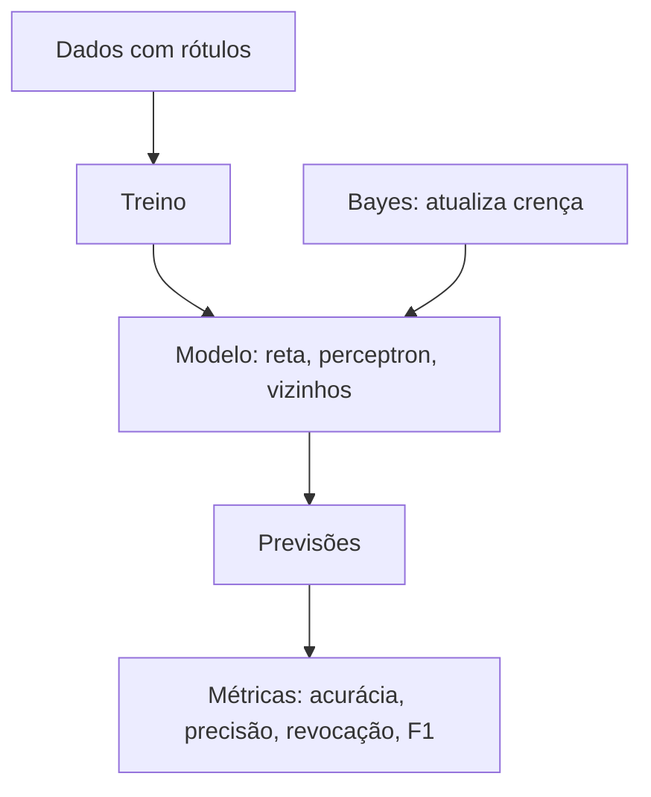

# 63 · Probabilidade, regressão, classificação e métricas

**Tempo estimado:** 60 minutos · **Pré-requisito:** [[07 - Provas direta e por contradição]] (raciocínio sobre condições) e [[62 - Jogos e busca local]] (funções de avaliação).

**Ao final você vai conseguir:**

1. Aplicar a regra de Bayes para atualizar uma probabilidade com uma evidência.
2. Ajustar uma reta de regressão linear por mínimos quadrados, com fórmula fechada.
3. Treinar um perceptron e reconhecer um conjunto de dados separável.
4. Calcular acurácia, precisão, revocação e F1, e explicar por que a acurácia sozinha engana.
5. Prever com k vizinhos mais próximos.

**Antes de começar:** o módulo 62 tratou de funções de avaliação de estados. Aqui a avaliação é sobre previsões de um modelo treinado com dados.

---

## Para começar

Um teste de diagnóstico acerta 90% dos doentes e erra 5% dos saudáveis. Se a doença é rara, qual a chance de alguém com teste positivo estar doente? Muita gente responde 90%, e a resposta é bem menor. Esse é o tipo de pergunta que a probabilidade resolve, e que o aprendizado de máquina usa em todo modelo.

---

## Mapa do módulo



*Figura 1: o modelo aprende com o treino e é avaliado pelas previsões. Bayes entra como regra de atualização de probabilidade.*

**Como ler:** a avaliação fecha o ciclo: sem métricas, não se sabe se o modelo aprendeu.

---

## Mini-aula 1: regra de Bayes

> [!tip] Ideia
> A probabilidade de uma hipótese dada uma evidência depende da chance da evidência em cada caso, e da chance prévia da hipótese. Quando a hipótese é rara, a evidência pesa menos do que parece.

> [!info] Definição
> Segundo Berkeley CS188, a regra de Bayes é `P(A | B) = P(B | A) P(A) / P(B)`. Ela sai da definição de probabilidade condicional. A nota também lista variáveis aleatórias, distribuições conjuntas, a regra da cadeia e a marginalização.

Veja o caso do teste diagnóstico: a doença tem probabilidade 1%, o teste acerta 90% dos doentes e dá falso positivo em 5% dos saudáveis. Antes de rodar, diga se a probabilidade de doença dado um positivo é maior ou menor que 50%.

```python
p_doenca = 0.01
p_pos_dado_doenca = 0.9
p_pos_sem_doenca = 0.05

p_pos = p_pos_dado_doenca * p_doenca + p_pos_sem_doenca * (1 - p_doenca)
p_doenca_dado_pos = p_pos_dado_doenca * p_doenca / p_pos
print("P(doença | teste positivo) =", round(p_doenca_dado_pos, 4))
```

Saída real:

```
P(doença | teste positivo) = 0.1538
```

**Como ler:** a probabilidade é cerca de 15%. O resultado é baixo porque a doença é rara: entre os positivos, a maior parte vem dos muitos saudáveis que o teste errou.

> [!warning] Armadilha comum
> Confundir `P(doente | positivo)` com `P(positivo | doente)`. São quantidades diferentes, e a regra de Bayes existe justamente para passar de uma à outra.

> [!question]- Checkpoint
> 1. Qual é aproximadamente `P(doente | positivo)`?
> 2. Por que o valor é baixo, apesar de o teste acertar 90% dos doentes?
>
> > [!success]- Resposta
> > 1. Cerca de 15%.
> > 2. Porque a doença é rara, e os falsos positivos entre os saudáveis são muitos.

---

## Mini-aula 2: regressão linear

> [!tip] Ideia
> A regressão linear escolhe a reta que minimiza a soma dos quadrados dos erros. Para uma variável, há uma fórmula fechada: a inclinação é a covariância dividida pela variância.

> [!info] Definição
> Segundo Berkeley, a regressão linear prevê uma saída contínua como soma ponderada das variáveis, ajustada por mínimos quadrados. Anulando o gradiente, obtém-se a solução fechada. A nota transcreve a definição de regressão: um problema de aprendizado em que a saída é contínua.

Veja o ajuste de uma reta a quatro pontos. Antes de rodar, diga qual é a inclinação, sem calcular.

```python
xs = [0.0, 1.0, 2.0, 3.0]
ys = [1.0, 3.0, 5.0, 7.0]

mx = sum(xs) / len(xs)
my = sum(ys) / len(ys)
a = sum((x - mx) * (y - my) for x, y in zip(xs, ys)) / sum((x - mx) ** 2 for x in xs)
b = my - a * mx
print("inclinação:", round(a, 4), "| intercepto:", round(b, 4))
```

Saída real:

```
inclinação: 2.0 | intercepto: 1.0
```

**Como ler:** os pontos seguem `y = 2x + 1` exatamente, e o ajuste recupera essa reta. Com dados ruidosos, a reta não passa por todos os pontos, e minimiza o erro total.

> [!warning] Armadilha comum
> A regressão linear só captura relações lineares nas variáveis de entrada. Uma reta pode errar muito num padrão curvo, mesmo com ajuste perfeito de mínimos quadrados.

> [!question]- Checkpoint
> 1. Qual é a inclinação dos pontos do exemplo?
> 2. O que a fórmula fechada exige?
>
> > [!success]- Resposta
> > 1. `2`.
> > 2. Uma variável com variância não nula; a inclinação divide a covariância pela variância.

---

## Mini-aula 3: perceptron

> [!tip] Ideia
> O perceptron é um classificador linear: traça um hiperplano e prevê pelo lado em que o exemplo cai. Quando erra, corrige os pesos na direção do exemplo.

> [!info] Definição
> Segundo Berkeley, o perceptron calcula `w · f(x)`, e a classe é positiva quando o valor é maior que zero. A nota diz que um classificador linear faz a classificação com uma combinação linear dos atributos. Um conjunto é **separável** quando um hiperplano o divide sem erros; nesse caso, o perceptron converge.

Veja o perceptron aprendendo o AND. Antes de rodar, diga se o AND é separável por uma reta.

```python
dados = [((0, 0), 0), ((0, 1), 0), ((1, 0), 0), ((1, 1), 1)]
w = [0.0, 0.0]
b = 0.0
for _ in range(10):
    for (x1, x2), y in dados:
        pred = 1 if w[0] * x1 + w[1] * x2 + b > 0 else 0
        erro = y - pred
        w[0] += erro * x1
        w[1] += erro * x2
        b += erro
print("pesos:", w, "| viés:", b)
print("previsões:", [1 if w[0] * x1 + w[1] * x2 + b > 0 else 0 for (x1, x2), _ in dados])
```

Saída real:

```
pesos: [2.0, 1.0] | viés: -2.0
previsões: [0, 0, 0, 1]
```

**Como ler:** os pesos acabam de modo que só `(1, 1)` fica do lado positivo. O AND é separável, por isso o treino acerta tudo.

> [!warning] Armadilha comum
> Nem todo conjunto é separável por uma reta, e o perceptron só garante convergência nos separáveis. O módulo seguinte empilha unidades para ir além de uma reta.

> [!question]- Checkpoint
> 1. Qual exemplo do AND vem previsto como positivo?
> 2. Por que o perceptron acerta todos depois de algumas épocas?
>
> > [!success]- Resposta
> > 1. Só `(1, 1)`.
> > 2. Porque o AND é separável, e a regra de atualização encontra a reta.

---

## Mini-aula 4: métricas e divisão dos dados

> [!tip] Ideia
> Para saber se um modelo aprendeu, avalie-o em dados que ele não viu no treino. A acurácia sozinha engana quando a classe positiva é rara.

> [!info] Definição
> Segundo a documentação de scikit-learn citada na nota, a precisão é `tp / (tp + fp)`, a revocação é `tp / (tp + fn)`, e o F1 combina as duas. A nota de Berkeley diz que o conjunto de teste não deve ser visto pelo agente até o fim do desenvolvimento. Ajustar parâmetros no conjunto de teste vaza informação, segundo a mesma documentação.

No exercício P1, você calcula precisão e revocação. No mini-projeto, o F1.

> [!warning] Armadilha comum
> Um modelo que sempre prevê a classe majoritária pode ter acurácia alta e nenhuma utilidade. Precisão e revocação mostram isso.

> [!question]- Checkpoint
> 1. O que a precisão mede?
> 2. Por que ajustar parâmetros no conjunto de teste é um erro?
>
> > [!success]- Resposta
> > 1. A fração dos positivos previstos que estão certos.
> > 2. Porque o teste deixa de ser uma avaliação de dados novos.

---

## Mini-aula 5: vizinhos mais próximos

> [!tip] Ideia
> O k-NN prevê pelo rótulo mais comum entre os `k` exemplos de treino mais próximos da consulta. Não há um modelo aprendido: os dados de treino são a própria regra.

> [!info] Definição
> Segundo scikit-learn, o k-NN é um método que guarda os dados de treino e prevê a partir dos `k` vizinhos mais próximos, por voto majoritário na classificação. A escolha de `k` depende muito dos dados: um `k` maior suaviza o ruído, mas torna as fronteiras menos definidas. A árvore de decisão, também citada na nota, é uma regra por cortes, e tende a superajustar.

No exercício D1 você implementa o k-NN com distância ao quadrado.

> [!question]- Checkpoint
> 1. Qual é o efeito de um `k` maior?
> 2. O k-NN tem um modelo treinado separado?
>
> > [!success]- Resposta
> > 1. Suaviza o ruído, mas deixa as fronteiras menos definidas.
> > 2. Não; ele guarda os dados e prevê a partir deles.

---

## Exercícios

Cada exercício tem um bloco com a função a completar e os testes com `assert`. Quando todos passarem, aparece `Passou!`. As funções definidas em exercícios anteriores aparecem no código inicial.

### Aquecimento

**A1. Regra de Bayes.** A regra de Bayes, citada pela nota de Berkeley CS188, diz que `P(A | B) = P(B | A) P(A) / P(B)`. Complete `bayes(p_a, p_b_dado_a, p_b)`, que recebe `P(A)`, `P(B | A)` e `P(B)`, e devolve `P(A | B)`.

```python
def bayes(p_a, p_b_dado_a, p_b):
    """P(A | B) pela regra de Bayes: P(B | A) P(A) / P(B)."""
    ...

assert bayes(0.5, 0.5, 0.5) == 0.5, "tudo meio a meio"
assert round(bayes(0.01, 0.9, 0.0585), 4) == 0.1538, "teste positivo de doença rara"
assert bayes(0.2, 1.0, 0.5) == 0.4, "evidência certa dada A"
print("Passou!")
```

> [!hint]- Dica 1
> Multiplique `p_b_dado_a` por `p_a` e divida por `p_b`.

> [!hint]- Dica 2
> Para `P(A) = 0.5`, `P(B | A) = 0.5` e `P(B) = 0.5`, o resultado é `0.5`.

> [!example]- Solução
> ```python
> def bayes(p_a, p_b_dado_a, p_b):
>     """P(A | B) pela regra de Bayes: P(B | A) P(A) / P(B)."""
>     return p_b_dado_a * p_a / p_b
> ```
>
> **Erro comum:** Dividir por `P(A)` em vez de `P(B)`. O denominador é a probabilidade da evidência.

**A2. Regressão linear.** A regressão linear ajusta uma reta `y = a x + b` pelo critério dos mínimos quadrados. A nota de Berkeley diz que a solução fechada sai de anular o gradiente. Para uma variável, `a = soma((x - média_x)(y - média_y)) / soma((x - média_x)²)` e `b = média_y - a × média_x`. Complete `regressao_linear_1d(xs, ys)`, que devolve a tupla `(a, b)`.

```python
def regressao_linear_1d(xs, ys):
    """Inclinação e intercepto da reta de mínimos quadrados para uma variável."""
    ...

reta = regressao_linear_1d([0.0, 1.0, 2.0, 3.0], [1.0, 3.0, 5.0, 7.0])
assert reta is not None, "a função devolve (a, b)"
a, b = reta
assert round(a, 6) == 2.0 and round(b, 6) == 1.0, "a reta y = 2x + 1"
a2, b2 = regressao_linear_1d([0.0, 2.0], [3.0, 3.0])
assert (a2, b2) == (0.0, 3.0), "reta horizontal"
print("Passou!")
```

> [!hint]- Dica 1
> Calcule `mx` e `my` como médias, depois as duas somas da fórmula.

> [!hint]- Dica 2
> Para `xs = [0, 1, 2, 3]` e `ys = [1, 3, 5, 7]`, o resultado é `(2.0, 1.0)`.

> [!example]- Solução
> ```python
> def regressao_linear_1d(xs, ys):
>     """Inclinação e intercepto da reta de mínimos quadrados para uma variável."""
>     mx = sum(xs) / len(xs)
>     my = sum(ys) / len(ys)
>     a = sum((x - mx) * (y - my) for x, y in zip(xs, ys)) / sum((x - mx) ** 2 for x in xs)
>     b = my - a * mx
>     return (a, b)
> ```
>
> **Erro comum:** Calcular `b` antes de `a`. O intercepto depende da inclinação.

**A3. Acurácia.** A acurácia é a fração de previsões corretas, uma das métricas que a documentação de scikit-learn lista. Complete `acuracia(verdadeiros, previstos)`, que devolve a fração de posições iguais nas duas listas.

```python
def acuracia(verdadeiros, previstos):
    """Fração de previsões iguais aos rótulos verdadeiros."""
    ...

assert acuracia([1, 0, 1, 1], [1, 0, 0, 1]) == 0.75, "três de quatro"
assert acuracia([1, 1], [1, 1]) == 1.0, "tudo certo"
assert acuracia([0], [1]) == 0.0, "tudo errado"
print("Passou!")
```

> [!hint]- Dica 1
> Conte as posições com `sum(v == p for v, p in zip(verdadeiros, previstos))` e divida pelo tamanho.

> [!hint]- Dica 2
> Para `[1, 0, 1, 1]` e `[1, 0, 0, 1]`, o resultado é `0.75`.

> [!example]- Solução
> ```python
> def acuracia(verdadeiros, previstos):
>     """Fração de previsões iguais aos rótulos verdadeiros."""
>     return sum(v == p for v, p in zip(verdadeiros, previstos)) / len(verdadeiros)
> ```
>
> **Erro comum:** Dividir pelo número de acertos. O denominador é o total de previsões.

### Praticando

**P1. Precisão e revocação.** Para uma classe positiva, a precisão é `tp / (tp + fp)`, e a revocação (recall) é `tp / (tp + fn)`, segundo a documentação de scikit-learn citada na nota. `tp` são os verdadeiros positivos, `fp` os falsos positivos e `fn` os falsos negativos. Complete `precisao_recall(verdadeiros, previstos)`, que devolve a tupla `(precisao, revocacao)`, para a classe `1`. Se um denominador é zero, devolva `0.0` para essa métrica.

```python
def precisao_recall(verdadeiros, previstos):
    """(precisão, revocação) para a classe 1: tp/(tp+fp) e tp/(tp+fn); zero se o denominador é zero."""
    ...

pr = precisao_recall([1, 0, 1, 1], [1, 0, 0, 1])
assert pr is not None, "a função devolve (precisão, revocação)"
p, r = pr
assert abs(p - 1.0) < 1e-9 and abs(r - 2 / 3) < 1e-9, "precisão 1, revocação 2/3"
assert precisao_recall([0, 0], [0, 0]) == (0.0, 0.0), "sem positivos: zeros"
print("Passou!")
```

> [!hint]- Dica 1
> Conte `tp`, `fp` e `fn` com um laço sobre `zip(verdadeiros, previstos)`.

> [!hint]- Dica 2
> Para `[1, 0, 1, 1]` e `[1, 0, 0, 1]`: `tp = 2`, `fp = 0`, `fn = 1`, então a precisão é `1.0` e a revocação é `2/3`.

> [!example]- Solução
> ```python
> def precisao_recall(verdadeiros, previstos):
>     """(precisão, revocação) para a classe 1: tp/(tp+fp) e tp/(tp+fn); zero se o denominador é zero."""
>     tp = fp = fn = 0
>     for v, p in zip(verdadeiros, previstos):
>         if v == 1 and p == 1:
>             tp += 1
>         elif v == 0 and p == 1:
>             fp += 1
>         elif v == 1 and p == 0:
>             fn += 1
>     precisao = tp / (tp + fp) if tp + fp else 0.0
>     revocacao = tp / (tp + fn) if tp + fn else 0.0
>     return (precisao, revocacao)
> ```
>
> **Erro comum:** Calcular a precisão com `fn` no denominador. Precisão olha para o que foi previsto como positivo, e revocação para o que realmente é positivo.

**P2. Perceptron.** O perceptron é um classificador linear, que a nota de Berkeley descreve como uma combinação linear dos atributos. Para cada exemplo `(x1, x2)` com rótulo `y` em `{0, 1}`, a previsão é `1` se `w1 x1 + w2 x2 + b > 0`, e `0` caso contrário. Quando há erro, cada peso soma `(y - previsão)` vezes o atributo correspondente, e o viés soma `(y - previsão)`. Complete `perceptron(dados, epocas)`, que repete o treino `epocas` vezes sobre `dados` e devolve a tupla `(w, b)`.

```python
def perceptron(dados, epocas):
    """Treina o perceptron: pesos e viés são corrigidos a cada erro, durante epocas épocas."""
    ...

and_dados = [((0, 0), 0), ((0, 1), 0), ((1, 0), 0), ((1, 1), 1)]
resultado = perceptron(and_dados, 10)
assert resultado is not None, "a função devolve (pesos, viés)"
w, b = resultado
previstos = [1 if w[0] * x1 + w[1] * x2 + b > 0 else 0 for (x1, x2), _ in and_dados]
assert previstos == [0, 0, 0, 1], "aprende o AND"
print("Passou!")
```

> [!hint]- Dica 1
> Comece com `w = [0.0, 0.0]` e `b = 0.0`. Em cada exemplo, calcule a previsão e aplique a atualização.

> [!hint]- Dica 2
> O conjunto de AND, `[((0, 0), 0), ((0, 1), 0), ((1, 0), 0), ((1, 1), 1)]`, é separável; depois de algumas épocas o perceptron acerta todos.

> [!example]- Solução
> ```python
> def perceptron(dados, epocas):
>     """Treina o perceptron: pesos e viés são corrigidos a cada erro, durante epocas épocas."""
>     w = [0.0, 0.0]
>     b = 0.0
>     for _ in range(epocas):
>         for (x1, x2), y in dados:
>             pred = 1 if w[0] * x1 + w[1] * x2 + b > 0 else 0
>             erro = y - pred
>             w[0] += erro * x1
>             w[1] += erro * x2
>             b += erro
>     return (w, b)
> ```
>
> **Erro comum:** Atualizar os pesos mesmo quando não há erro. A regra só muda quando `y - previsão` é diferente de zero, e o termo zero não altera nada.

### Desafio

**D1. Vizinhos mais próximos.** O k-NN prevê pelo rótulo majoritário dos `k` exemplos de treino mais próximos da consulta. A documentação de scikit-learn citada na nota descreve o método como baseado em armazenar os dados de treino. Complete `knn_prever(treino, consulta, k)`, em que `treino` é uma lista de `((x, y), rotulo)`. Use a distância euclidiana ao quadrado, e em caso de empate de voto, devolva o rótulo que aparece primeiro entre os vizinhos.

```python
from collections import Counter

def knn_prever(treino, consulta, k):
    """Rótulo majoritário dos k vizinhos mais próximos (distância euclidiana ao quadrado)."""
    ...

treino = [((0, 0), "a"), ((0, 1), "a"), ((5, 5), "b"), ((6, 5), "b"), ((5, 6), "b")]
assert knn_prever(treino, (0, 0.5), 3) == "a", "perto dos a"
assert knn_prever(treino, (5, 5.5), 3) == "b", "perto dos b"
assert knn_prever(treino, (0, 0), 1) == "a", "um vizinho"
print("Passou!")
```

> [!hint]- Dica 1
> Ordene `treino` por `(x - consulta[0])**2 + (y - consulta[1])**2` com `sorted`, pegue os `k` primeiros e conte os rótulos com `Counter`.

> [!hint]- Dica 2
> Para o desempate, use `most_common` sobre a lista de rótulos dos vizinhos, que mantém a ordem da primeira ocorrência entre empates.

> [!example]- Solução
> ```python
> def knn_prever(treino, consulta, k):
>     """Rótulo majoritário dos k vizinhos mais próximos (distância euclidiana ao quadrado)."""
>     vizinhos = sorted(treino, key=lambda t: (t[0][0] - consulta[0]) ** 2 + (t[0][1] - consulta[1]) ** 2)[:k]
>     rotulos = [r for _, r in vizinhos]
>     return Counter(rotulos).most_common(1)[0][0]
> ```
>
> **Erro comum:** Usar a distância sem quadrado para ordenar e o quadrado no resultado. Ordenar pela distância quadrada dá a mesma ordem, e é mais simples.


---

## Mini-projeto (opcional)

Você vai montar um relatório de métricas para um classificador, com acurácia, precisão, revocação e F1. Tente sozinho antes de abrir a solução.

**Mini-projeto: relatório de métricas.** Complete `avalia(verdadeiros, previstos)`, que devolve um dicionário com `"acuracia"`, `"precisao"`, `"revocacao"` e `"f1"`, para a classe `1`. O F1 é a média harmônica `2 p r / (p + r)`, com valor `0.0` quando `p + r` é zero. Use `acuracia` e `precisao_recall`, já definidas acima.

```python
def acuracia(verdadeiros, previstos):
    return sum(v == p for v, p in zip(verdadeiros, previstos)) / len(verdadeiros)

def precisao_recall(verdadeiros, previstos):
    tp = fp = fn = 0
    for v, p in zip(verdadeiros, previstos):
        if v == 1 and p == 1:
            tp += 1
        elif v == 0 and p == 1:
            fp += 1
        elif v == 1 and p == 0:
            fn += 1
    precisao = tp / (tp + fp) if tp + fp else 0.0
    revocacao = tp / (tp + fn) if tp + fn else 0.0
    return (precisao, revocacao)

def avalia(verdadeiros, previstos):
    """Acurácia, precisão, revocação e F1 para a classe 1."""
    ...

m = avalia([1, 0, 1, 1], [1, 0, 0, 1])
assert m is not None, "a função devolve o dicionário"
assert abs(m["acuracia"] - 0.75) < 1e-9, "acurácia"
assert abs(m["precisao"] - 1.0) < 1e-9, "precisão"
assert abs(m["f1"] - 0.8) < 1e-9, "F1 = 2 * 1 * (2/3) / (1 + 2/3) = 0.8"
print("Passou!")
```

> [!hint]- Dica 1
> Calcule `p, r = precisao_recall(...)` e depois `f1 = 2 * p * r / (p + r) if p + r else 0.0`.

> [!hint]- Dica 2
> Para `[1, 0, 1, 1]` e `[1, 0, 0, 1]`, a acurácia é `0.75`, a precisão `1.0` e a revocação `2/3`.

> [!example]- Solução
> ```python
> def avalia(verdadeiros, previstos):
>     """Acurácia, precisão, revocação e F1 para a classe 1."""
>     p, r = precisao_recall(verdadeiros, previstos)
>     f1 = 2 * p * r / (p + r) if p + r else 0.0
>     return {"acuracia": acuracia(verdadeiros, previstos), "precisao": p, "revocacao": r, "f1": f1}
> ```
>
> **Erro comum:** Calcular o F1 como média aritmética. A média harmônica penaliza quando uma das duas métricas é baixa.


---

## Fechando

**Resumo**

- Bayes atualiza uma probabilidade com a evidência; probabilidades prévias baixas puxam o resultado para baixo.
- A regressão linear ajusta uma reta por mínimos quadrados, com fórmula fechada para uma variável.
- O perceptron é classificador linear; converge quando o conjunto é separável.
- Acurácia, precisão, revocação e F1 avaliam o modelo em dados não usados no treino; k-NN prevê por vizinhos.

**Glossário rápido**

- **Regra de Bayes**: `P(A | B) = P(B | A) P(A) / P(B)`.
- **Mínimos quadrados**: ajuste que minimiza a soma dos quadrados dos erros.
- **Perceptron**: classificador linear de uma camada.
- **Precisão** (precision): fração dos positivos previstos que são positivos.
- **Revocação** (recall): fração dos positivos reais que foram previstos.
- **F1**: média harmônica de precisão e revocação.

**Perguntas de revisão**

1. Por que um modelo que prevê sempre a classe majoritária pode ter boa acurácia e nenhuma utilidade?
2. Num teste com precisão 1 e revocação baixa, o que isso diz sobre os falsos negativos?
3. Por que o k-NN depende de guardar os dados de treino?

**E agora?** O próximo módulo é **Redes neurais e aprendizado por reforço**. Ele mostra como empilhar perceptrons com ativações não lineares e treinar por retropropagação do gradiente.

---

## Para ir mais fundo

- [[Bayes' Rule and Probabilistic Reasoning]]
- [[Machine Learning Basics]]
- [[Linear Regression and the Perceptron]]
- [[Decision Trees and k-Nearest Neighbors]]
