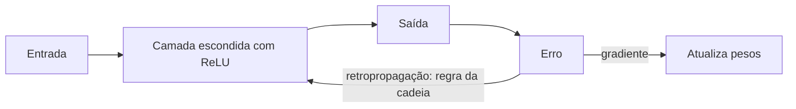

# 64 · Redes neurais e aprendizado por reforço

**Tempo estimado:** 55 minutos · **Pré-requisito:** [[63 - Probabilidade, regressão, classificação e métricas]] e [[09 - Contagem]] (somas e produtos).

**Ao final você vai conseguir:**

1. Explicar por que uma rede precisa de ativações não lineares para aprender o que um perceptron não aprende.
2. Calcular a saída de uma rede de duas camadas com ReLU, e reconhecer o XOR.
3. Aplicar a descida do gradiente e ver como a taxa de aprendizado decide entre convergir e divergir.
4. Descrever um passo de retropropagação para um neurônio, pela regra da cadeia.
5. Situar o aprendizado por reforço como aprendizado a partir de amostras (estado, ação, próximo estado, recompensa).

**Antes de começar:** no módulo 63 o perceptron separava por uma reta. Aqui empilhamos unidades, e o treino passa a depender de derivadas.

---

## Para começar

Um sistema de reconhecimento precisa dizer se uma imagem tem um gato. Um perceptron sozinho decide por uma reta sobre os pixels, o que é pouco. Empilhar unidades, com uma não linearidade entre elas, permite formas de decisão mais complexas. O preço é treinar muitos pesos ao mesmo tempo, e o método padrão é seguir o gradiente do erro.

---

## Mapa do módulo



*Figura 1: a rede calcula a saída; o erro volta pelas camadas pela regra da cadeia; cada peso anda contra o gradiente.*

**Como ler:** a ida calcula; a volta calcula derivadas; a atualização usa a taxa de aprendizado.

---

## Mini-aula 1: não linearidade

> [!tip] Ideia
> Duas camadas lineares somadas continuam sendo uma camada linear. A não linearidade entre elas é o que dá poder à rede.

> [!info] Definição
> A **ReLU** é `max(0, x)`, e a **sigmoide** é `1 / (1 + e^(-x))`. Segundo Berkeley CS188, redes são perceptrons empilhados com ativações não lineares, como a sigmoide e a ReLU; sem não linearidade, a rede colapsa numa função linear.

Veja uma rede de duas camadas com ReLU que calcula o XOR, função que um perceptron de uma camada não separa. Antes de rodar, diga qual é a saída para `(1, 0)`.

```python
def relu(x):
    return max(0, x)

print("x1 x2 | h1 = relu(x1-x2) | h2 = relu(x2-x1) | saída = h1 + h2")
for x1 in (0, 1):
    for x2 in (0, 1):
        h1 = relu(x1 - x2)
        h2 = relu(x2 - x1)
        print(x1, x2, "|", h1, "|", h2, "|", h1 + h2)
```

Saída real:

```
x1 x2 | h1 = relu(x1-x2) | h2 = relu(x2-x1) | saída = h1 + h2
0 0 | 0 | 0 | 0
0 1 | 0 | 1 | 1
1 0 | 1 | 0 | 1
1 1 | 0 | 0 | 0
```

**Como ler:** a primeira camada tem duas unidades, `relu(x1 - x2)` e `relu(x2 - x1)`. Cada uma acende só num dos lados. A saída soma as duas, e dá `1` quando as entradas são diferentes.

> [!warning] Armadilha comum
> Mais camadas sem não linearidade não ganham nada: a composição de funções lineares é linear. A não linearidade é a parte essencial.

> [!question]- Checkpoint
> 1. Qual é a saída para `(1, 0)`?
> 2. Por que uma única unidade ReLU não basta para o XOR?
>
> > [!success]- Resposta
> > 1. `1`, porque `relu(1 - 0) = 1` e `relu(0 - 1) = 0`.
> > 2. Porque ela só acende de um lado, e o XOR precisa de dois.

---

## Mini-aula 2: descida do gradiente e taxa de aprendizado

> [!tip] Ideia
> O gradiente aponta para onde a função cresce. Para minimizar o erro, anda-se na direção oposta, com um passo do tamanho da taxa de aprendizado.

> [!info] Definição
> Segundo d2l, citado em Berkeley, a descida do gradiente atualiza `x ← x − η ∇f(x)`. A nota diz que a taxa de aprendizado precisa de equilíbrio: uma taxa grande demais diverge, e uma pequena demais não avança. Para `f(x) = (x − 3)²`, o gradiente é `2(x − 3)`, e cada passo multiplica o erro `x − 3` por `1 − 2η`.

Veja a descida com duas taxas. Antes de rodar, diga qual delas converge, sabendo que o fator é `1 − 2η`.

```python
def passo(x, eta):
    grad = 2 * (x - 3)
    return x - eta * grad

for eta in (0.1, 1.1):
    x = 0.0
    for _ in range(20):
        x = passo(x, eta)
    print("taxa", eta, "após 20 passos, x =", round(x, 4))
```

Saída real:

```
taxa 0.1 após 20 passos, x = 2.9654
taxa 1.1 após 20 passos, x = -112.0128
```

**Como ler:** com `η = 0.1`, o fator é `0.8`, e o erro cai. Com `η = 1.1`, o fator é `−1.2`: o erro troca de sinal e cresce a cada passo.

> [!warning] Armadilha comum
> Uma taxa que parece boa no começo pode divergir depois. Por isso se confere a convergência por número de passos ou pela variação da função.

> [!question]- Checkpoint
> 1. Qual é o fator de contração com `η = 0.1`?
> 2. Por que a taxa `1.1` diverge?
>
> > [!success]- Resposta
> > 1. `0.8`, porque `1 − 2 × 0.1`.
> > 2. O fator `−1.2` tem valor absoluto maior que 1, então o erro cresce.

---

## Mini-aula 3: retropropagação

> [!tip] Ideia
> A retropropagação calcula o gradiente do erro em relação a cada peso, indo da saída para a entrada. Ela usa a regra da cadeia e reaproveita valores guardados na passagem para a frente.

> [!info] Definição
> Segundo d2l, a retropropagação é o método de calcular o gradiente dos parâmetros de uma rede; o gradiente sai pela regra da cadeia, da saída para a entrada, reaproveitando os valores da passagem para a frente. O treino alterna passagem para a frente, retropropagação e atualização do otimizador.

Considere um passo para um neurônio linear com erro quadrático. Antes de começar o exercício P2, pense: por que a derivada depende da entrada `x`?

> [!warning] Armadilha comum
> A derivada em relação ao peso depende da entrada que o peso multiplica. Um peso que multiplica uma entrada zero não muda nada na previsão.

> [!question]- Checkpoint
> 1. De onde vem o fator `x` na derivada do peso?
> 2. Quando o gradiente é zero?
>
> > [!success]- Resposta
> > 1. Da regra da cadeia: a previsão é `w x`, e a derivada de `w x` em relação a `w` é `x`.
> > 2. Quando o erro `pred - y` é zero, ou a entrada é zero.

---

## Mini-aula 4: aprendizado por reforço

> [!tip] Ideia
> No aprendizado por reforço, o agente aprende por tentativa, a partir de amostras de transições e recompensas, e não de um conjunto de exemplos rotulados.

> [!info] Definição
> Segundo Berkeley, o aprendizado por reforço é planejamento online a partir de amostras `(s, a, s', r)` coletadas em episódios, e os métodos se dividem em baseados em modelo e livres de modelo. D2l lista agente, recompensas, política e o compromisso entre explorar e aproveitar. A nota não detalha Q-learning, iteração de valor nem processos de decisão de Markov.

> [!question]- Checkpoint
> 1. O que é uma amostra `(s, a, s', r)`?
> 2. O que distingue um método livre de modelo?
>
> > [!success]- Resposta
> > 1. Estado, ação, próximo estado e recompensa observados numa transição.
> > 2. Aprende sem uma descrição explícita das transições e das recompensas.

---

## Exercícios

Cada exercício tem um bloco com a função a completar e os testes com `assert`. Quando todos passarem, aparece `Passou!`. As funções definidas em exercícios anteriores aparecem no código inicial.

### Aquecimento

**A1. Função ReLU.** A nota de Berkeley diz que as redes usam ativações não lineares, como sigmoide e ReLU. Sem não linearidade, a rede inteira colapsa numa função linear. A ReLU devolve `max(0, x)`. Complete `relu(x)`.

```python
def relu(x):
    """Devolve max(0, x): zero para negativos, x para positivos."""
    ...

assert relu(-2) == 0, "negativo vira zero"
assert relu(3) == 3, "positivo passa"
assert relu(0) == 0, "zero"
print("Passou!")
```

> [!hint]- Dica 1
> Use `max(0, x)`.

> [!hint]- Dica 2
> Para `x = -2`, o resultado é `0`; para `x = 3`, é `3`.

> [!example]- Solução
> ```python
> def relu(x):
>     """Devolve max(0, x): zero para negativos, x para positivos."""
>     return max(0, x)
> ```
>
> **Erro comum:** Devolver `x` quando `x` é positivo e `0` quando é zero, esquecendo os negativos. A ReLU zera tudo que está abaixo de zero.

**A2. Função sigmoide.** Outra ativação comum é a sigmoide, `1 / (1 + e^(-x))`, que leva qualquer real ao intervalo `(0, 1)`. Complete `sigmoide(x)`, usando `math.exp`, com `import math` no começo do arquivo.

```python
import math

def sigmoide(x):
    """1 / (1 + e^(-x)): leva qualquer real ao intervalo (0, 1)."""
    ...

assert sigmoide(0) == 0.5, "o centro é meio"
assert 0 < sigmoide(10) < 1, "positivo grande fica perto de 1 e abaixo"
assert sigmoide(-10) < 0.5, "negativo fica abaixo de meio"
print("Passou!")
```

> [!hint]- Dica 1
> Use `1 / (1 + math.exp(-x))`.

> [!hint]- Dica 2
> Para `x = 0`, o resultado é `0.5`.

> [!example]- Solução
> ```python
> def sigmoide(x):
>     """1 / (1 + e^(-x)): leva qualquer real ao intervalo (0, 1)."""
>     return 1 / (1 + math.exp(-x))
> ```
>
> **Erro comum:** Escrever `math.exp(x)` no lugar de `math.exp(-x)`. A curva fica espelhada e o limite passa a ser o intervalo errado.

**A3. XOR com duas camadas.** Um perceptron de uma camada não separa o XOR, e a demonstração mostra que uma rede com uma camada escondida e ReLU separa. Complete `xor_rede(x1, x2)`, com `h1 = relu(x1 - x2)`, `h2 = relu(x2 - x1)` e saída `h1 + h2`, usando `relu`, já definida acima.

```python
def relu(x):
    return max(0, x)

def xor_rede(x1, x2):
    """Rede de duas camadas com ReLU que calcula XOR para entradas em {0, 1}."""
    ...

assert xor_rede(1, 0) == 1, "um lado"
assert xor_rede(0, 1) == 1, "o outro lado"
assert xor_rede(0, 0) == 0, "iguais dão zero"
assert xor_rede(1, 1) == 0, "iguais dão zero"
print("Passou!")
```

> [!hint]- Dica 1
> Calcule `h1` e `h2` com as fórmulas, depois devolva a soma.

> [!hint]- Dica 2
> Para `(1, 0)` e `(0, 1)`, a saída é `1`; para `(0, 0)` e `(1, 1)`, é `0`.

> [!example]- Solução
> ```python
> def xor_rede(x1, x2):
>     """Rede de duas camadas com ReLU que calcula XOR para entradas em {0, 1}."""
>     h1 = relu(x1 - x2)
>     h2 = relu(x2 - x1)
>     return h1 + h2
> ```
>
> **Erro comum:** Usar só `h1`. Ela sozinha dá `1` também para `(1, 0)`, mas dá `0` para `(0, 1)`, e o XOR precisa das duas.

### Praticando

**P1. Descida do gradiente.** A nota de d2l, citada em Berkeley, descreve a atualização `x ← x − η ∇f(x)`, em que `η` é a taxa de aprendizado. Para `f(x) = (x − 3)²`, o gradiente é `2 (x − 3)`. Complete `descida_gradiente(grad, x0, eta, passos)`, que aplica a regra `passos` vezes a partir de `x0` e devolve o último `x`.

```python
def descida_gradiente(grad, x0, eta, passos):
    """Aplica x = x - eta * grad(x) passos vezes, a partir de x0."""
    ...

grad = lambda x: 2 * (x - 3)
assert descida_gradiente(grad, 0, 0.1, 100) is not None, "a função devolve x"
assert round(descida_gradiente(grad, 0, 0.1, 100), 4) == 3.0, "converge para 3"
assert round(descida_gradiente(grad, 10, 0.1, 100), 4) == 3.0, "de outro ponto também"
assert descida_gradiente(grad, 5, 0.1, 0) == 5, "sem passos, nada muda"
print("Passou!")
```

> [!hint]- Dica 1
> Em cada passo, faça `x = x - eta * grad(x)`.

> [!hint]- Dica 2
> Com `grad = lambda x: 2 * (x - 3)`, `x0 = 0`, `eta = 0.1` e 100 passos, o resultado está muito perto de `3`.

> [!example]- Solução
> ```python
> def descida_gradiente(grad, x0, eta, passos):
>     """Aplica x = x - eta * grad(x) passos vezes, a partir de x0."""
>     x = x0
>     for _ in range(passos):
>         x = x - eta * grad(x)
>     return x
> ```
>
> **Erro comum:** Atualizar com `+` no lugar de `-`. O gradiente aponta para o crescimento, e a descida anda na direção oposta.

**P2. Um passo de retropropagação.** Para um neurônio linear `pred = w x`, com perda `(pred - y)²`, a derivada em relação a `w` é `2 (pred - y) x`. A retropropagação aplica a regra da cadeia para obter essa derivada a partir da saída, e a atualização é `w ← w − η × derivada`. Complete `passo_neuronio(w, x, y, eta)`, que devolve o novo peso depois de um passo.

```python
def passo_neuronio(w, x, y, eta):
    """Um passo de descida do gradiente para w no neurônio linear com perda quadrática."""
    ...

assert passo_neuronio(0, 1, 2, 0.1) is not None, "a função devolve o peso"
assert abs(passo_neuronio(0, 1, 2, 0.1) - 0.4) < 1e-9, "o exemplo"
assert passo_neuronio(2, 1, 2, 0.1) == 2, "já acertou: o gradiente é zero"
print("Passou!")
```

> [!hint]- Dica 1
> Calcule `pred = w * x`, depois `grad = 2 * (pred - y) * x`, e devolva `w - eta * grad`.

> [!hint]- Dica 2
> Para `w = 0`, `x = 1`, `y = 2` e `eta = 0.1`, o novo peso é `0.4`.

> [!example]- Solução
> ```python
> def passo_neuronio(w, x, y, eta):
>     """Um passo de descida do gradiente para w no neurônio linear com perda quadrática."""
>     pred = w * x
>     grad = 2 * (pred - y) * x
>     return w - eta * grad
> ```
>
> **Erro comum:** Esquecer o fator `x` na derivada. A derivada depende da entrada, e não só do erro.

### Desafio

**D1. Taxa de aprendizado.** A nota de d2l diz que uma taxa grande demais diverge e uma pequena demais não avança. Complete `converge_ou_diverge(eta)`, que aplica a descida do gradiente de `f(x) = (x − 3)²`, a partir de `x = 0`, por 50 passos. Devolva `"converge"` se o resultado está a menos de `0.001` de `3`, e `"diverge"` caso contrário. Use a regra `x ← x − eta × 2(x − 3)`.

```python
def converge_ou_diverge(eta):
    """'converge' se após 50 passos x está a menos de 0.001 de 3; senão 'diverge'."""
    ...

assert converge_ou_diverge(0.1) == "converge", "taxa pequena"
assert converge_ou_diverge(1.1) == "diverge", "taxa grande demais"
assert converge_ou_diverge(0.45) == "converge", "perto do limite, ainda converge"
print("Passou!")
```

> [!hint]- Dica 1
> Use `abs(x - 3) < 0.001` no fim do laço.

> [!hint]- Dica 2
> Para `eta = 0.1`, converge; para `eta = 1.1`, diverge, porque o fator de contração `1 − 2η` tem valor absoluto maior que 1.

> [!example]- Solução
> ```python
> def converge_ou_diverge(eta):
>     """'converge' se após 50 passos x está a menos de 0.001 de 3; senão 'diverge'."""
>     x = 0.0
>     for _ in range(50):
>         x = x - eta * 2 * (x - 3)
>     return "converge" if abs(x - 3) < 0.001 else "diverge"
> ```
>
> **Erro comum:** Testar a convergência depois do primeiro passo. Uma taxa que diverge pode parecer boa no começo, e o teste só vale após o número de passos definido.


---

## Mini-projeto (opcional)

Você vai ajustar uma reta por descida do gradiente sobre o erro quadrático médio, recuperando os coeficientes de uma reta conhecida. Tente sozinho antes de abrir a solução.

**Mini-projeto: ajuste por gradiente.** Complete `ajusta_reta(xs, ys, eta, passos)`, que ajusta `y = w x + b` por descida do gradiente sobre o erro quadrático médio, partindo de `w = 0` e `b = 0`. A cada passo, calcule `grad_w = (2/n) soma((pred - y) x)` e `grad_b = (2/n) soma(pred - y)`, e atualize os dois. Devolva a tupla `(w, b)`.

```python
def ajusta_reta(xs, ys, eta, passos):
    """Descida do gradiente sobre o erro quadrático médio de y = w x + b."""
    ...

resultado = ajusta_reta([0, 1, 2, 3], [1, 3, 5, 7], 0.05, 4000)
assert resultado is not None, "a função devolve (w, b)"
w, b = resultado
assert abs(w - 2) < 0.01 and abs(b - 1) < 0.01, "recupera y = 2x + 1"
assert ajusta_reta([0, 1], [0, 0], 0.1, 0) == (0.0, 0.0), "sem passos, os pesos iniciais"
print("Passou!")
```

> [!hint]- Dica 1
> Use `n = len(xs)` e calcule os erros `pred - y` de todos os pontos antes de atualizar.

> [!hint]- Dica 2
> Para `xs = [0, 1, 2, 3]` e `ys = [1, 3, 5, 7]`, com `eta = 0.05` e 4000 passos, os valores ficam perto de `2` e `1`.

> [!example]- Solução
> ```python
> def ajusta_reta(xs, ys, eta, passos):
>     """Descida do gradiente sobre o erro quadrático médio de y = w x + b."""
>     w = 0.0
>     b = 0.0
>     n = len(xs)
>     for _ in range(passos):
>         erros = [w * x + b - y for x, y in zip(xs, ys)]
>         grad_w = (2 / n) * sum(e * x for e, x in zip(erros, xs))
>         grad_b = (2 / n) * sum(erros)
>         w = w - eta * grad_w
>         b = b - eta * grad_b
>     return (w, b)
> ```
>
> **Erro comum:** Atualizar `w` e recalcular `pred` com o novo valor antes de calcular `grad_b`. Os gradientes devem usar os mesmos pesos do passo atual.


---

## Fechando

**Resumo**

- Ativações não lineares, como ReLU e sigmoide, dão poder às redes; sem elas, a composição é linear.
- O XOR é resolvido por uma camada escondida com ReLU.
- A descida do gradiente anda contra o gradiente; a taxa de aprendizado decide convergência e divergência.
- A retropropagação usa a regra da cadeia; o aprendizado por reforço aprende de amostras de transições e recompensas.

**Glossário rápido**

- **ReLU**: `max(0, x)`.
- **Sigmoide**: `1 / (1 + e^(-x))`.
- **Retropropagação** (backpropagation): cálculo do gradiente da saída para a entrada.
- **Taxa de aprendizado** (learning rate): tamanho do passo da descida.
- **Amostra de transição**: `(s, a, s', r)`.

**Perguntas de revisão**

1. Por que a retropropagação reaproveita valores da passagem para a frente?
2. Com taxa `0.5` em `f(x) = (x − 3)²`, o que acontece com o erro? Justifique pelo fator `1 − 2η`.
3. Qual é a diferença entre um método baseado em modelo e um livre de modelo?

**E agora?** O próximo módulo é **Lógica, conhecimento e lógica fuzzy**. Ele mostra como representar conhecimento com sentenças e inferir, e como graus de pertinência tratam fronteiras vagas.

---

## Para ir mais fundo

- [[Neural Networks and Backpropagation]]
- [[Reinforcement Learning Basics]]
- [[Machine Learning Basics]]
