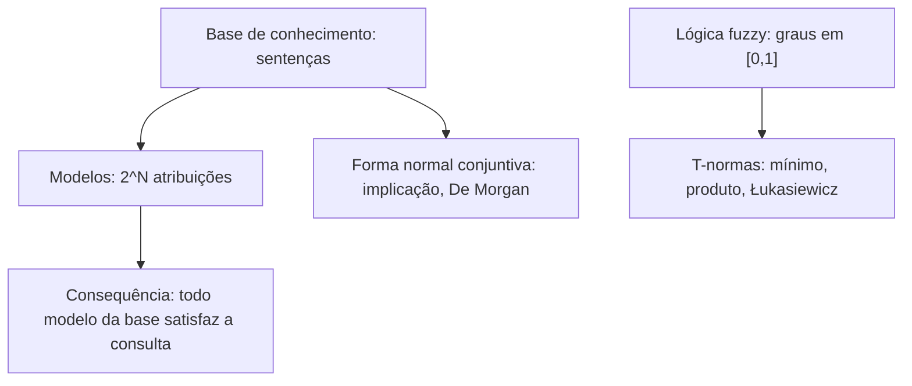

# 65 · Lógica, conhecimento e lógica fuzzy

**Tempo estimado:** 55 minutos · **Pré-requisito:** [[05 - Lógica proposicional]] e [[57 - Linguagens, autômatos finitos e expressões regulares]] (satisfazibilidade e forma normal).

**Ao final você vai conseguir:**

1. Enumerar os modelos de uma base proposicional e contar `2^N`.
2. Decidir uma consequência lógica por enumeração de modelos.
3. Aplicar a implicação como disjunção e as leis de De Morgan, passos da forma normal conjuntiva.
4. Usar graus de pertinência em `[0, 1]` e combiná-los com t-normas.

**Antes de começar:** no módulo 05 você viu conectivos e tabelas-verdade. Aqui a tabela vira um método de inferência: testar todos os modelos.

---

## Para começar

Um sistema de diagnóstico sabe que, se a bateria está fraca, o carro não liga, e que o carro ligou. Pode concluir alguma coisa sobre a bateria? A lógica responde com regras exatas. Mas e se a regra for "a temperatura está alta"? Essa fronteira é vaga, e a lógica fuzzy dá graus, em vez de verdadeiro ou falso.

---

## Mapa do módulo



*Figura 1: a lógica clássica decide por modelos; a fuzzy troca verdadeiro e falso por graus e combina graus com t-normas.*

**Como ler:** os dois ramos são alternativas. O primeiro é exato; o segundo, gradual.

---

## Mini-aula 1: modelos e consequência

> [!tip] Ideia
> Um modelo atribui verdadeiro ou falso a cada símbolo. Uma consequência é uma sentença que vale em todo modelo onde a base vale.

> [!info] Definição
> Segundo Berkeley CS188, um modelo é uma atribuição de verdadeiro ou falso a todos os símbolos proposicionais. Com `N` símbolos, há `2^N` modelos.

Veja a base `A ou B` e `não A`, e a consulta `B`. Antes de rodar, diga quais modelos satisfazem a base.

```python
from itertools import product

simbolos = ["A", "B"]
base = [lambda m: m["A"] or m["B"], lambda m: not m["A"]]
consulta = lambda m: m["B"]

modelos = [dict(zip(simbolos, v)) for v in product([False, True], repeat=len(simbolos))]
satisfazem = [m for m in modelos if all(f(m) for f in base)]
print("modelos que satisfazem a base:", satisfazem)
print("base ⊨ B:", all(consulta(m) for m in satisfazem))
```

Saída real:

```
modelos que satisfazem a base: [{'A': False, 'B': True}]
base ⊨ B: True
```

**Como ler:** a base só é verdadeira com `A` falso e `B` verdadeiro. Nesse único modelo, `B` vale, então a base implica `B`.

> [!warning] Armadilha comum
> Consequência não é um caso comum: é uma propriedade de todos os modelos onde a base vale. Se a base não vale em um modelo, esse modelo não conta.

> [!question]- Checkpoint
> 1. Quantos modelos tem a base com dois símbolos?
> 2. Quais modelos satisfazem `A ou B` e `não A`?
>
> > [!success]- Resposta
> > 1. Quatro, porque `2 elevado a 2`.
> > 2. Só `A` falso e `B` verdadeiro.

---

## Mini-aula 2: forma normal conjuntiva

> [!tip] Ideia
> Para usar um solucionador de satisfazibilidade, a fórmula é reescrita como conjunção de cláusulas. Três passos da nota fazem isso: eliminar implicações, aplicar De Morgan e distribuir.

> [!info] Definição
> Segundo Berkeley, a conversão para forma normal conjuntiva elimina bicondicionais, elimina implicações, aplica as leis de De Morgan e distribui. A implicação `p → q` é equivalente a `(não p) ou q`. As leis de De Morgan dizem que `não (p ou q)` é `(não p) e (não q)`.

No exercício P1 você escreve a implicação como disjunção e confere De Morgan em todos os casos. Antes de começar, pense: `p → q` é verdadeira quando `p` é falsa?

> [!warning] Armadilha comum
> `p → q` não é `q → p`. Trocar as variáveis muda a fórmula, e a conversão precisa manter a ordem.

> [!question]- Checkpoint
> 1. Qual é a forma sem implicação de `p → q`?
> 2. O que De Morgan diz sobre `não (p ou q)`?
>
> > [!success]- Resposta
> > 1. `(não p) ou q`.
> > 2. Que é `(não p) e (não q)`.

---

## Mini-aula 3: lógica fuzzy

> [!tip] Ideia
> Em lógica fuzzy, um elemento tem um grau de pertinência entre 0 e 1. A conjunção de dois graus é uma t-norma, e pode ser o mínimo, o produto ou a t-norma de Łukasiewicz.

> [!info] Definição
> Segundo SEP, um conjunto fuzzy atribui a cada elemento do universo um grau de pertinência, tipicamente em `[0, 1]`. A conjunção é modelada por t-normas, com exemplos o mínimo, o produto e Łukasiewicz. A disjunção é definida como máximo. A negação é `1 − x` sob a semântica de Goguen, e a de Gödel é usada com mínimo e produto.

Veja dois graus combinados com mínimo e produto. Antes de rodar, diga qual dos dois é menor.

```python
quente = 0.7
umido = 0.4
print("quente E úmido, com mínimo:", min(quente, umido))
print("quente E úmido, com produto:", round(quente * umido, 2))
```

Saída real:

```
quente E úmido, com mínimo: 0.4
quente E úmido, com produto: 0.28
```

**Como ler:** o mínimo dá `0.4`; o produto dá `0.28`. O mínimo é igual ao menor grau; o produto fica ainda mais baixo.

> [!warning] Armadilha comum
> Graus fuzzy não são probabilidades. Um grau de `0.7` não diz que há 70% de chance de algo, e sim que o elemento pertence ao conjunto nesse grau.

> [!question]- Checkpoint
> 1. Qual é o resultado do mínimo de `0.7` e `0.4`?
> 2. O produto de `0.7` e `0.4` é maior ou menor que o mínimo?
>
> > [!success]- Resposta
> > 1. `0.4`.
> > 2. Menor: `0.28` é menor que `0.4`.

---

## Exercícios

Cada exercício tem um bloco com a função a completar e os testes com `assert`. Quando todos passarem, aparece `Passou!`. As funções definidas em exercícios anteriores aparecem no código inicial.

### Aquecimento

**A1. Modelos.** Um modelo é uma atribuição de verdadeiro ou falso a cada símbolo proposicional. Com `N` símbolos, há `2^N` modelos, como diz a nota de Berkeley. Complete `modelos(simbolos)`, que devolve a lista de todos os modelos, cada um como dicionário que associa cada símbolo a `True` ou `False`.

```python
from itertools import product

def modelos(simbolos):
    """Todos os modelos: dicionários símbolo -> valor, uma para cada combinação."""
    ...

assert modelos(["A", "B"]) is not None, "a função devolve a lista"
assert len(modelos(["A", "B"])) == 4, "2 elevado a 2"
assert len(modelos(["A", "B", "C"])) == 8, "2 elevado a 3"
assert modelos([]) == [{}], "sem símbolos, um modelo vazio"
print("Passou!")
```

> [!hint]- Dica 1
> Use `itertools.product([False, True], repeat=len(simbolos))`, e para cada tupla monte um dicionário com `dict(zip(simbolos, valores))`.

> [!hint]- Dica 2
> Para dois símbolos, a lista tem quatro modelos.

> [!example]- Solução
> ```python
> def modelos(simbolos):
>     """Todos os modelos: dicionários símbolo -> valor, uma para cada combinação."""
>     return [dict(zip(simbolos, v)) for v in product([False, True], repeat=len(simbolos))]
> ```
>
> **Erro comum:** Esquecer que o produto gera tuplas, e devolver tuplas no lugar de dicionários. Quem consulta o modelo pelo nome do símbolo precisa do dicionário.

**A2. Modelo que satisfaz a base.** Uma base de conhecimento é uma lista de sentenças. Aqui cada sentença é uma função que recebe um modelo e devolve `True` ou `False`. Complete `satisfaz_base(base, modelo)`, que devolve `True` quando todas as sentenças da base são verdadeiras nesse modelo.

```python
def satisfaz_base(base, modelo):
    """True se todas as sentenças da base são verdadeiras no modelo."""
    ...

base = [lambda m: m["A"] or m["B"], lambda m: not m["A"]]
assert satisfaz_base(base, {"A": False, "B": True}) is True, "as duas são verdadeiras"
assert satisfaz_base(base, {"A": True, "B": True}) is False, "a segunda falha"
assert satisfaz_base([], {"A": True}) is True, "base vazia"
print("Passou!")
```

> [!hint]- Dica 1
> Use `all(f(modelo) for f in base)`.

> [!hint]- Dica 2
> Uma base vazia é satisfeita por qualquer modelo, e `all` devolve `True` para ela.

> [!example]- Solução
> ```python
> def satisfaz_base(base, modelo):
>     """True se todas as sentenças da base são verdadeiras no modelo."""
>     return all(f(modelo) for f in base)
> ```
>
> **Erro comum:** Testar só a primeira sentença. A base é verdadeira só quando todas as sentenças são.

**A3. Consequência lógica.** Uma base `KB` implica `consulta` quando toda interpretação que satisfaz `KB` também satisfaz a consulta. A nota de Berkeley usa essa definição por modelos: a inferência por enumeração testa todos os modelos. Complete `consequencia(base, consulta, simbolos)`, que devolve `True` se a base implica a consulta. Use `modelos` e `satisfaz_base`, já definidas acima.

```python
from itertools import product

def modelos(simbolos):
    return [dict(zip(simbolos, v)) for v in product([False, True], repeat=len(simbolos))]

def satisfaz_base(base, modelo):
    return all(f(modelo) for f in base)

def consequencia(base, consulta, simbolos):
    """True se todo modelo que satisfaz a base também satisfaz a consulta."""
    ...

base = [lambda m: m["A"] or m["B"], lambda m: not m["A"]]
assert consequencia(base, lambda m: m["B"], ["A", "B"]) is True, "A ou B, e não A, implica B"
assert consequencia(base, lambda m: m["A"], ["A", "B"]) is False, "A é falso no modelo de B"
assert consequencia([], lambda m: m["A"] or not m["A"], ["A"]) is True, "tautologia"
print("Passou!")
```

> [!hint]- Dica 1
> Percorra os modelos; para cada um que satisfaz a base, confira se a consulta vale.

> [!hint]- Dica 2
> Se nenhum modelo satisfaz a base, a implicação vale de forma trivial, e `all` sobre a lista vazia devolve `True`.

> [!example]- Solução
> ```python
> def consequencia(base, consulta, simbolos):
>     """True se todo modelo que satisfaz a base também satisfaz a consulta."""
>     return all(consulta(m) for m in modelos(simbolos) if satisfaz_base(base, m))
> ```
>
> **Erro comum:** Verificar a consulta sobre todos os modelos. A implicação só pede os modelos que satisfazem a base.

### Praticando

**P1. Leis de De Morgan e implicação.** A nota de Berkeley diz que a conversão para forma normal conjuntiva elimina implicações e aplica as leis de De Morgan. Complete `implicacao_como_ou(p, q)`, que devolve a forma equivalente de `p → q` sem implicação, usando `not` e `or`. Os testes conferem também a lei de De Morgan: `not (p or q)` é igual a `(not p) and (not q)` para todos os pares de booleanos.

```python
def implicacao_como_ou(p, q):
    """Equivalente de p → q sem implicação: (não p) ou q."""
    ...

assert implicacao_como_ou(True, False) is False, "verdadeiro implica falso é falso"
assert implicacao_como_ou(False, False) is True, "falso implica qualquer coisa"
assert all((not (p or q)) == ((not p) and (not q)) for p in (True, False) for q in (True, False)), "a lei vale nos quatro casos"
print("Passou!")
```

> [!hint]- Dica 1
> A implicação `p → q` é `(not p) or q`.

> [!hint]- Dica 2
> Para `de_morgan_ok`, percorra os quatro pares de `(True, False)` com dois `for`.

> [!example]- Solução
> ```python
> def implicacao_como_ou(p, q):
>     """Equivalente de p → q sem implicação: (não p) ou q."""
>     return (not p) or q
> ```
>
> **Erro comum:** Escrever `p → q` como `p or not q`. É a implicação com as variáveis trocadas.

**P2. Conjunção fuzzy.** Na lógica fuzzy, a conjunção é modelada por uma t-norma. A nota de SEP cita o mínimo, o produto e a t-norma de Łukasiewicz, `max(0, a + b − 1)`. Complete `t_norma(a, b, tipo)`, que devolve a conjunção de dois graus de pertinência para o tipo `"min"`, `"produto"` ou `"lukasiewicz"`. Para outro tipo, levante `ValueError`.

```python
def t_norma(a, b, tipo):
    """Conjunção fuzzy de dois graus em [0, 1], segundo a t-norma escolhida."""
    ...

assert t_norma(0.7, 0.4, "min") == 0.4, "mínimo"
assert abs(t_norma(0.7, 0.4, "produto") - 0.28) < 1e-9, "produto"
assert abs(t_norma(0.7, 0.4, "lukasiewicz") - 0.1) < 1e-9, "Łukasiewicz: 0.7 + 0.4 − 1"
assert t_norma(0.2, 0.3, "lukasiewicz") == 0, "soma abaixo de 1 zera"
print("Passou!")
```

> [!hint]- Dica 1
> Use `min(a, b)`, `a * b` e `max(0, a + b - 1)`.

> [!hint]- Dica 2
> Para `a = 0.7` e `b = 0.4`, o mínimo é `0.4` e o produto é `0.28`.

> [!example]- Solução
> ```python
> def t_norma(a, b, tipo):
>     """Conjunção fuzzy de dois graus em [0, 1], segundo a t-norma escolhida."""
>     if tipo == "min":
>         return min(a, b)
>     if tipo == "produto":
>         return a * b
>     if tipo == "lukasiewicz":
>         return max(0, a + b - 1)
>     raise ValueError("t-norma desconhecida")
> ```
>
> **Erro comum:** Usar a soma para a conjunção. A soma passa de 1, e a conjunção fuzzy nunca passa do menor dos graus.

### Desafio

**D1. Grau de pertinência.** Um conjunto fuzzy dá a cada elemento um grau em `[0, 1]`. Como função de pertinência, use uma rampa linear: `0` para `x` até `inicio`, `1` a partir de `fim`, e crescimento linear entre os dois. Esta forma é um exemplo deste exercício, não uma definição da nota. Complete `pertinencia(x, inicio, fim)`.

```python
def pertinencia(x, inicio, fim):
    """Grau em [0, 1]: 0 até inicio, 1 a partir de fim, linear no meio (regra deste exercício)."""
    ...

assert pertinencia(10, 20, 30) == 0.0, "abaixo do início"
assert pertinencia(35, 20, 30) == 1.0, "acima do fim"
assert pertinencia(25, 20, 30) == 0.5, "no meio"
print("Passou!")
```

> [!hint]- Dica 1
> Se `x <= inicio`, devolva `0.0`; se `x >= fim`, devolva `1.0`.

> [!hint]- Dica 2
> Entre os dois, devolva `(x - inicio) / (fim - inicio)`.

> [!example]- Solução
> ```python
> def pertinencia(x, inicio, fim):
>     """Grau em [0, 1]: 0 até inicio, 1 a partir de fim, linear no meio (regra deste exercício)."""
>     if x <= inicio:
>         return 0.0
>     if x >= fim:
>         return 1.0
>     return (x - inicio) / (fim - inicio)
> ```
>
> **Erro comum:** Esquecer um dos limites. Sem o tratamento de `x >= fim`, o grau passa de 1.


---

## Mini-projeto (opcional)

Você vai combinar várias condições fuzzy em uma só regra, com a t-norma escolhida. Tente sozinho antes de abrir a solução.

**Mini-projeto: regra com várias condições.** Complete `conjuncao_regra(graus, tipo)`, que combina uma lista de graus de pertinência com a t-norma `tipo`, da esquerda para a direita. Com lista vazia, devolva `1.0`, que é a identidade da conjunção. Use `t_norma`, já definida acima.

```python
def t_norma(a, b, tipo):
    if tipo == "min":
        return min(a, b)
    if tipo == "produto":
        return a * b
    if tipo == "lukasiewicz":
        return max(0, a + b - 1)
    raise ValueError("t-norma desconhecida")

def conjuncao_regra(graus, tipo):
    """Combina os graus com a t-norma, da esquerda para a direita; lista vazia dá 1.0."""
    ...

assert conjuncao_regra([0.7, 0.4], "min") == 0.4, "mínimo de dois"
assert abs(conjuncao_regra([0.7, 0.4], "produto") - 0.28) < 1e-9, "produto de dois"
assert conjuncao_regra([], "min") == 1.0, "identidade"
print("Passou!")
```

> [!hint]- Dica 1
> Comece com `resultado = 1.0` e, para cada grau `g`, faça `resultado = t_norma(resultado, g, tipo)`.

> [!hint]- Dica 2
> Para `[0.7, 0.4]` com `"min"`, o resultado é `0.4`.

> [!example]- Solução
> ```python
> def conjuncao_regra(graus, tipo):
>     """Combina os graus com a t-norma, da esquerda para a direita; lista vazia dá 1.0."""
>     resultado = 1.0
>     for g in graus:
>         resultado = t_norma(resultado, g, tipo)
>     return resultado
> ```
>
> **Erro comum:** Começar com `0` no lugar de `1.0`. A conjunção com zero zera tudo, e a regra ficaria sempre falsa.


---

## Fechando

**Resumo**

- Um modelo atribui valores a todos os símbolos; com `N` símbolos, há `2^N`.
- Consequência lógica é verdadeira em todos os modelos da base; a enumeração decide isso.
- A forma normal conjuntiva usa `(não p) ou q` para a implicação e De Morgan para negar conjunções.
- Lógica fuzzy usa graus em `[0, 1]`; a conjunção é uma t-norma, e a disjunção, o máximo.

**Glossário rápido**

- **Modelo**: atribuição de valores aos símbolos.
- **Consequência lógica** (entailment): verdade em todos os modelos da base.
- **Forma normal conjuntiva** (CNF): conjunção de cláusulas.
- **Grau de pertinência** (membership degree): valor em `[0, 1]` de um elemento num conjunto fuzzy.
- **T-norma** (t-norm): modelo da conjunção fuzzy.

**Perguntas de revisão**

1. Por que a enumeração de modelos cresce como `2^N`?
2. A conjunção fuzzy com mínimo é associativa? Use a definição para justificar.
3. Qual é a diferença entre um grau fuzzy e uma probabilidade?

**E agora?** O próximo módulo é **Ética, regulação e a natureza da IA**. Ele trata das discussões sobre o que é a IA e dos marcos de risco que tentam controlá-la.

---

## Para ir mais fundo

- [[Logic-Based Knowledge Representation and Inference]]
- [[Fuzzy Logic]]
- [[Propositional Logic]]
