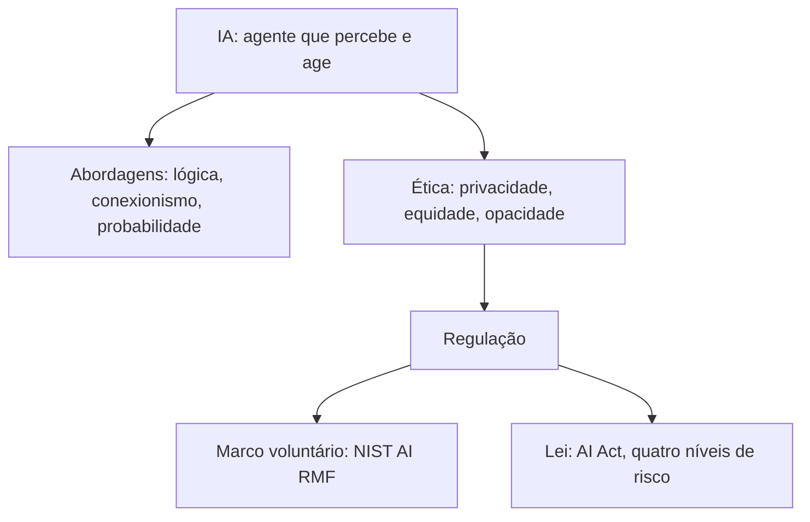

# 66 · IA, ética e regulação

**Tempo estimado:** 50 minutos · **Pré-requisito:** [[61 - Agentes e busca em espaços de estados]] e [[63 - Probabilidade, regressão, classificação e métricas]].

**Ao final você vai conseguir:**

1. Situar as principais abordagens da IA (agentes, lógica, conexionismo, probabilidade) e as notas que as cobrem.
2. Listar os temas de debate ética em IA que a nota de SEP organiza.
3. Descrever os níveis de risco do AI Act da União Europeia e a diferença entre um marco voluntário e uma lei.
4. Aplicar a ordem dos níveis de risco a casos concretos, e encontrar o pior caso de um sistema.

**Antes de começar:** os módulos anteriores trataram de técnicas. Este fecha o bloco com a pergunta de quem decide o que um sistema pode fazer, e com que limites.

---

## Para começar

Um banco usa um sistema para decidir quem recebe crédito. Há perguntas técnicas (o modelo acerta?), éticas (ele trata grupos de forma justa?) e de regulação (a lei exige explicação da decisão?). Nenhuma delas se resolve sozinha. Este módulo organiza o terreno, sem prometer uma resposta única.

---

## Mapa do módulo



*Figura 1: a IA é organizada em abordagens técnicas; a ética mapeia debates; a regulação traduz parte deles em marcos e leis.*

**Como ler:** as setas são de dependência conceitual, e não de causalidade.

---

## Mini-aula 1: o que é IA e suas abordagens

> [!tip] Ideia
> A IA é o estudo de agentes que percebem o ambiente e agem sobre ele. As abordagens diferem em como representam o conhecimento: por lógica, por redes que aprendem, ou por probabilidade.

> [!info] Definição
> Segundo a nota de SEP, atribuída a Russell e Norvig, a IA é o estudo de agentes que recebem percepções do ambiente e realizam ações. A mesma nota organiza as abordagens em lógica (simbólica), não lógica (incluindo conexionista) e centrada em agentes. A nota não registra o conteúdo dos argumentos sobre IA forte e fraca.

Veja as abordagens e as notas da biblioteca que as cobrem. Antes de rodar, diga qual abordagem trata de redes que aprendem a partir de dados.

```python
abordagens = {
    "agente": "Intelligent Agents and Rationality",
    "logica": "Logic-Based Knowledge Representation and Inference",
    "conexionista": "Neural Networks and Backpropagation",
    "probabilistica": "Bayes' Rule and Probabilistic Reasoning",
}
for tipo, nota in abordagens.items():
    print(tipo, "->", nota)
```

Saída real:

```
agente -> Intelligent Agents and Rationality
logica -> Logic-Based Knowledge Representation and Inference
conexionista -> Neural Networks and Backpropagation
probabilistica -> Bayes' Rule and Probabilistic Reasoning
```

**Como ler:** cada abordagem tem uma nota de referência. A conexionista é a que aprende a partir de dados; a lógica representa o conhecimento como sentenças.

> [!warning] Armadilha comum
> As abordagens não são exclusivas. Um sistema pode combinar regras lógicas com aprendizado e com raciocínio probabilístico.

> [!question]- Checkpoint
> 1. Como a nota de SEP define a IA?
> 2. Qual abordagem usa redes que aprendem a partir de dados?
>
> > [!success]- Resposta
> > 1. Como o estudo de agentes que percebem e agem.
> > 2. A conexionista.

---

## Mini-aula 2: debates éticos

> [!tip] Ideia
> A ética em IA não é uma lista de regras; é um conjunto de debates. Eles tratam de quem é afetado, quem responde por um dano, e se o sistema pode ser explicado.

> [!info] Definição
> A nota de SEP sobre ética de IA e robótica lista os debates: privacidade, autonomia humana, opacidade, equidade e viés, interação humano-robô, sistemas autônomos, estatuto moral e responsabilidade, superinteligência, sociedade e economia, e política de IA. A nota registra só a estrutura, não os argumentos. Opacidade é a dificuldade de entender como um sistema chega às saídas.

> [!warning] Armadilha comum
> Um sistema sem viés aparente nos testes pode ser injusto em grupos que os testes não cobriram. A equidade depende dos dados e das pessoas avaliadas.

> [!question]- Checkpoint
> 1. Quais debates a nota lista?
> 2. O que é opacidade?
>
> > [!success]- Resposta
> > 1. Privacidade, autonomia, opacidade, equidade, interação, sistemas autônomos, responsabilidade, superinteligência, sociedade e política.
> > 2. A dificuldade de entender como um sistema chega às saídas.

---

## Mini-aula 3: regulação

> [!tip] Ideia
> Há marcos voluntários e leis. Um marco voluntário orienta a gestão de riscos; uma lei impõe obrigações e proibições, com datas de aplicação.

> [!info] Definição
> O NIST AI RMF, dos Estados Unidos, é um marco voluntário para gerir riscos de IA às pessoas e à sociedade. O AI Act da União Europeia (Regulamento 2024/1689) é lei vinculante, com quatro níveis de risco: inaceitável (práticas proibidas, como pontuação social), alto (obrigações como gestão de riscos e supervisão humana), transparência (por exemplo, avisar que é um chatbot) e mínimo. As datas de aplicação do AI Act seguem abaixo.

```python
niveis = ["minimo", "transparencia", "alto", "inaceitavel"]
print("níveis de risco, do menor ao maior:", niveis)
datas = [("2025-02-02", "proibições e alfabetização em IA"), ("2025-08-02", "governança e IA de uso geral"), ("2026-08-02", "aplicação geral"), ("2027-12-02", "alto risco (Anexo III)"), ("2028-08-02", "alto risco em produtos regulados (Anexo I)")]
for d, evento in datas:
    print(d, "-", evento)
```

Saída real:

```
níveis de risco, do menor ao maior: ['minimo', 'transparencia', 'alto', 'inaceitavel']
2025-02-02 - proibições e alfabetização em IA
2025-08-02 - governança e IA de uso geral
2026-08-02 - aplicação geral
2027-12-02 - alto risco (Anexo III)
2028-08-02 - alto risco em produtos regulados (Anexo I)
```

**Como ler:** as proibições e a alfabetização valem desde fevereiro de 2025; a aplicação geral começa em agosto de 2026; o alto risco em produtos regulados, em agosto de 2028.

No exercício A1 você classifica usos pelos exemplos da nota. No A2, usa as datas.

> [!warning] Armadilha comum
> O nível de risco de um uso depende do contexto e da lei em vigor. As categorias de exemplo não bastam para classificar um caso real.

> [!question]- Checkpoint
> 1. Qual é a diferença entre um marco voluntário e uma lei?
> 2. Quais são os quatro níveis do AI Act?
>
> > [!success]- Resposta
> > 1. O marco orienta a gestão de riscos sem obrigar; a lei impõe obrigações e proibições.
> > 2. Inaceitável, alto, transparência e mínimo.

---

## Exercícios

Cada exercício tem um bloco com a função a completar e os testes com `assert`. Quando todos passarem, aparece `Passou!`. As funções definidas em exercícios anteriores aparecem no código inicial.

### Aquecimento

**A1. Níveis de risco.** A nota de regulação lista os níveis do AI Act da União Europeia: inaceitável, alto, transparência e mínimo. Os exemplos que ela dá são pontuação social (inaceitável), chatbots e deepfakes (transparência). Complete `nivel_risco(uso)`, que devolve o nível de cada uso: `"inaceitavel"` para `"pontuacao social"`; `"transparencia"` para `"chatbot"` e `"deepfake"`; `"alto"` para `"triagem de credito"` e `"diagnostico medico"`, usados aqui como exemplos de alto risco; e `"minimo"` para qualquer outro uso. A correspondência de alto risco é uma escolha deste exercício, e não um fato da nota.

```python
def nivel_risco(uso):
    """Nível de risco do uso, pela correspondência deste exercício; desconhecido é mínimo."""
    ...

assert nivel_risco("pontuacao social") == "inaceitavel", "proibido"
assert nivel_risco("chatbot") == "transparencia", "precisa avisar que é IA"
assert nivel_risco("filtro de cores") == "minimo", "uso sem categoria prevista"
print("Passou!")
```

> [!hint]- Dica 1
> Use um dicionário com os usos conhecidos e devolva `.get(uso, "minimo")`.

> [!hint]- Dica 2
> Para `"chatbot"`, o resultado é `"transparencia"`.

> [!example]- Solução
> ```python
> def nivel_risco(uso):
>     """Nível de risco do uso, pela correspondência deste exercício; desconhecido é mínimo."""
>     niveis = {
>         "pontuacao social": "inaceitavel",
>         "chatbot": "transparencia",
>         "deepfake": "transparencia",
>         "triagem de credito": "alto",
>         "diagnostico medico": "alto",
>     }
>     return niveis.get(uso, "minimo")
> ```
>
> **Erro comum:** Devolver `"inaceitavel"` para qualquer uso desconhecido. Uso sem categoria prevista é de risco mínimo nesta regra, e não proibido.

**A2. Próximo marco.** As datas de aplicação do AI Act estão na nota, em ordem crescente, no formato `AAAA-MM-DD`. Como o formato ordena bem como texto, comparações entre strings servem. Complete `proximo_marco(datas, hoje)`, que devolve a primeira data da lista que é maior ou igual a `hoje`, ou `None` se todas já passaram.

```python
def proximo_marco(datas, hoje):
    """Primeira data da lista maior ou igual a hoje (formato AAAA-MM-DD), ou None."""
    ...

marcos = ["2025-02-02", "2025-08-02", "2026-08-02", "2027-12-02", "2028-08-02"]
assert proximo_marco(marcos, "2026-01-01") == "2026-08-02", "o próximo é agosto de 2026"
assert proximo_marco(marcos, "2026-08-02") == "2026-08-02", "a própria data conta"
assert proximo_marco(marcos, "2030-01-01") is None, "todos passaram"
print("Passou!")
```

> [!hint]- Dica 1
> Percorra `datas` e devolva a primeira com `d >= hoje`.

> [!hint]- Dica 2
> Com `hoje = "2026-01-01"`, o resultado é `"2026-08-02"`.

> [!example]- Solução
> ```python
> def proximo_marco(datas, hoje):
>     """Primeira data da lista maior ou igual a hoje (formato AAAA-MM-DD), ou None."""
>     for d in datas:
>         if d >= hoje:
>             return d
>     return None
> ```
>
> **Erro comum:** Comparar com a data de hoje como número de dias. Sem conversão, o formato já ordena certo, e a conversão só acrescenta chance de erro.

**A3. Abordagens de IA.** A nota de SEP organiza a história em abordagens: agentes, lógica, conexionismo e probabilidade, cada uma com uma nota da biblioteca. Complete `abordagem(tipo)`, que devolve o nome da nota correspondente a `"agente"`, `"logica"`, `"conexionista"` ou `"probabilistica"`. Para outro tipo, levante `ValueError`.

```python
def abordagem(tipo):
    """Nome da nota da biblioteca para cada abordagem; outro tipo levanta ValueError."""
    ...

assert abordagem("logica") == "Logic-Based Knowledge Representation and Inference", "lógica"
assert abordagem("agente") == "Intelligent Agents and Rationality", "agentes"
try:
    abordagem("x")
    assert False, "deveria levantar ValueError"
except ValueError:
    pass
print("Passou!")
```

> [!hint]- Dica 1
> Use o dicionário `abordagens` da demonstração e levante o erro quando a chave não existe.

> [!hint]- Dica 2
> Para `"logica"`, o resultado é `"Logic-Based Knowledge Representation and Inference"`.

> [!example]- Solução
> ```python
> def abordagem(tipo):
>     """Nome da nota da biblioteca para cada abordagem; outro tipo levanta ValueError."""
>     abordagens = {
>         "agente": "Intelligent Agents and Rationality",
>         "logica": "Logic-Based Knowledge Representation and Inference",
>         "conexionista": "Neural Networks and Backpropagation",
>         "probabilistica": "Bayes' Rule and Probabilistic Reasoning",
>     }
>     if tipo not in abordagens:
>         raise ValueError("abordagem desconhecida")
>     return abordagens[tipo]
> ```
>
> **Erro comum:** Devolver `None` para tipo desconhecido. Quem chama precisa saber que o tipo é inválido.

### Praticando

**P1. Comparar níveis.** Os níveis de risco têm uma ordem: `"minimo" < "transparencia" < "alto" < "inaceitavel"`. Complete `risco_maior(a, b)`, que devolve o nível mais alto entre os dois. Use a lista `niveis` da demonstração, como ordem.

```python
niveis = ["minimo", "transparencia", "alto", "inaceitavel"]

def risco_maior(a, b):
    """Nível mais alto entre a e b, pela ordem de risco da lista de níveis."""
    ...

assert risco_maior("transparencia", "alto") == "alto", "alto é maior"
assert risco_maior("inaceitavel", "minimo") == "inaceitavel", "inaceitável domina"
assert risco_maior("minimo", "minimo") == "minimo", "iguais"
print("Passou!")
```

> [!hint]- Dica 1
> Compare as posições com `niveis.index(a)` e `niveis.index(b)`.

> [!hint]- Dica 2
> Para `"chatbot"` e `"alto"`, o resultado é `"alto"`.

> [!example]- Solução
> ```python
> def risco_maior(a, b):
>     """Nível mais alto entre a e b, pela ordem de risco da lista de níveis."""
>     return a if niveis.index(a) >= niveis.index(b) else b
> ```
>
> **Erro comum:** Comparar as strings em ordem alfabética. `"alto"` vem antes de `"minimo"` no alfabeto, e a ordem de risco não é essa.

### Desafio

**D1. Pior caso de uma lista.** Um sistema com vários usos recebe o nível do uso mais arriscado. Complete `nivel_maximo(usos)`, que devolve o maior nível entre os usos, usando `nivel_risco` (A1) e `risco_maior` (P1). Para lista vazia, devolva `"minimo"`.

```python
niveis = ["minimo", "transparencia", "alto", "inaceitavel"]

def nivel_risco(uso):
    mapa = {"pontuacao social": "inaceitavel", "chatbot": "transparencia", "deepfake": "transparencia", "triagem de credito": "alto", "diagnostico medico": "alto"}
    return mapa.get(uso, "minimo")

def risco_maior(a, b):
    return a if niveis.index(a) >= niveis.index(b) else b

def nivel_maximo(usos):
    """Nível do uso mais arriscado da lista; lista vazia dá minimo."""
    ...

assert nivel_maximo(["chatbot", "pontuacao social"]) == "inaceitavel", "o pior caso"
assert nivel_maximo(["filtro de cores"]) == "minimo", "só mínimo"
assert nivel_maximo([]) == "minimo", "lista vazia"
print("Passou!")
```

> [!hint]- Dica 1
> Comece com `resultado = "minimo"` e, para cada uso, faça `resultado = risco_maior(resultado, nivel_risco(uso))`.

> [!hint]- Dica 2
> Para `["chatbot", "pontuacao social"]`, o resultado é `"inaceitavel"`.

> [!example]- Solução
> ```python
> def nivel_maximo(usos):
>     """Nível do uso mais arriscado da lista; lista vazia dá minimo."""
>     resultado = "minimo"
>     for uso in usos:
>         resultado = risco_maior(resultado, nivel_risco(uso))
>     return resultado
> ```
>
> **Erro comum:** Devolver o nível do último uso. O sistema herda o pior caso, não o último.


---

## Mini-projeto (opcional)

Você vai gerar um relatório de riscos para uma lista de usos, com o pior caso. Tente sozinho antes de abrir a solução.

**Mini-projeto: relatório de riscos.** Complete `relatorio_risco(usos)`, que devolve um dicionário com cada uso como chave e seu nível como valor, com a mesma regra de `nivel_risco`. Use `nivel_risco`, já definida acima, e a função `nivel_maximo` para acrescentar a chave `"total"`, com o pior caso da lista.

```python
niveis = ["minimo", "transparencia", "alto", "inaceitavel"]

def nivel_risco(uso):
    mapa = {"pontuacao social": "inaceitavel", "chatbot": "transparencia", "deepfake": "transparencia", "triagem de credito": "alto", "diagnostico medico": "alto"}
    return mapa.get(uso, "minimo")

def risco_maior(a, b):
    return a if niveis.index(a) >= niveis.index(b) else b

def nivel_maximo(usos):
    resultado = "minimo"
    for uso in usos:
        resultado = risco_maior(resultado, nivel_risco(uso))
    return resultado

def relatorio_risco(usos):
    """Nível de cada uso e o pior caso sob a chave total."""
    ...

r = relatorio_risco(["chatbot"])
assert r is not None, "a função devolve o dicionário"
assert r == {"chatbot": "transparencia", "total": "transparencia"}, "um uso só"
assert relatorio_risco(["chatbot", "pontuacao social"])["total"] == "inaceitavel", "o pior caso"
print("Passou!")
```

> [!hint]- Dica 1
> Monte `{u: nivel_risco(u) for u in usos}` e depois acrescente `"total": nivel_maximo(usos)`.

> [!hint]- Dica 2
> Para `["chatbot"]`, o resultado é `{"chatbot": "transparencia", "total": "transparencia"}`.

> [!example]- Solução
> ```python
> def relatorio_risco(usos):
>     """Nível de cada uso e o pior caso sob a chave total."""
>     r = {u: nivel_risco(u) for u in usos}
>     r["total"] = nivel_maximo(usos)
>     return r
> ```
>
> **Erro comum:** Esquecer a chave `"total"`. O relatório precisa do pior caso, além dos níveis individuais.


---

## Fechando

**Resumo**

- A IA é o estudo de agentes; as abordagens são lógica, conexionismo e probabilidade, cada uma com notas da biblioteca.
- A ética de IA reúne debates como equidade, opacidade e responsabilidade; a nota registra a estrutura deles.
- O NIST AI RMF é voluntário; o AI Act é lei, com quatro níveis de risco e datas de aplicação.
- O risco de um sistema é o do uso mais arriscado.

**Glossário rápido**

- **Opacidade** (opacity): dificuldade de explicar como um sistema chega às saídas.
- **Marco voluntário** (voluntary framework): orientação sem obrigação legal.
- **AI Act**: regulamento da União Europeia sobre IA, de 2024.
- **Nível de risco**: categoria de obrigação de um uso segundo a lei.

**Perguntas de revisão**

1. Por que a equidade de um sistema pode falhar mesmo com boas métricas nos testes?
2. Um sistema com um uso inaceitável e vários de risco mínimo, qual é o nível do sistema?
3. Por que o tema desta nota precisa de revisão frequente?

**E agora?** Com este módulo, o bloco 8 (Inteligência artificial) está completo. O próximo bloco é **Segurança**, o último do curso, que trata de criptografia, controle de acesso e ameaças.

---

## Para ir mais fundo

- [[What Artificial Intelligence Is - History and Approaches]]
- [[AI Ethics and Risk]]
- [[AI Regulation and Risk Frameworks]]
- [[Intelligent Agents and Rationality]]
