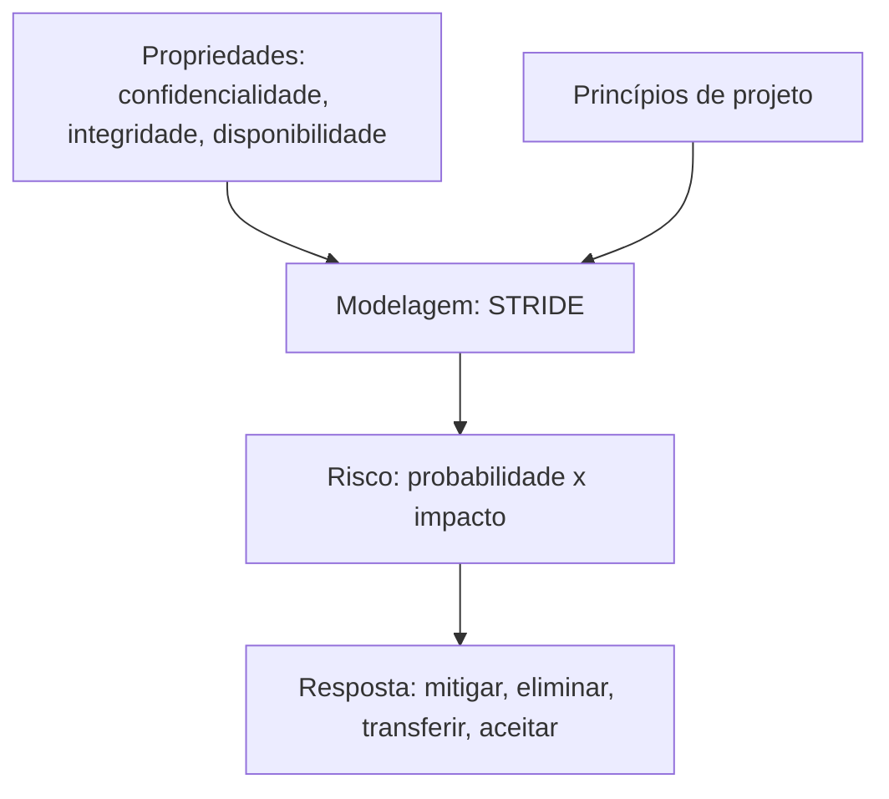

# 67 · Propriedades de segurança, princípios e modelagem de ameaças

**Tempo estimado:** 50 minutos · **Pré-requisito:** [[50 - Transporte, TCP e sockets]] (serviços de rede) e [[46 - Arquivos, inodes e journaling]] (permissões).

**Ao final você vai conseguir:**

1. Definir confidencialidade, integridade e disponibilidade, e dar um exemplo de violação de cada uma.
2. Aplicar princípios de projeto seguro, como menor privilégio e falha segura.
3. Classificar ameaças pelo modelo STRIDE e ordenar riscos por probabilidade e impacto.
4. Escolher uma resposta a um risco, e reconhecer que transferir não reduz o risco.

**Antes de começar:** no módulo 46 as permissões de arquivo já separavam quem lê de quem escreve. Aqui isso vira um vocabulário para descrever todo sistema.

---

## Para começar

Um banco recebe um pedido de transferência. Três coisas podem dar errado: alguém lê dados que não devia (o extrato de outro cliente), alguém altera o valor no caminho (a transferência sai diferente), ou o serviço cai no horário de pagamento. Cada um desses danos viola uma propriedade diferente. Pensar em segurança começa por nomear as propriedades.

---

## Mapa do módulo



*Figura 1: as propriedades definem o que proteger; a modelagem encontra as ameaças; o risco ordena o trabalho; a resposta decide o que fazer.*

**Como ler:** a seta indica o fluxo de raciocínio de uma análise de segurança.

---

## Mini-aula 1: as três propriedades

> [!tip] Ideia
> Confidencialidade protege contra leitura indevida. Integridade protege contra alteração indevida. Disponibilidade protege o acesso quando ele é necessário.

> [!info] Definição
> A NIST define segurança da informação como proteger a informação e os sistemas, em três propriedades: confidencialidade (restrições autorizadas de acesso e divulgação), integridade (proteção contra modificação ou destruição indevidas) e disponibilidade (acesso e uso oportunos e confiáveis).

> [!warning] Armadilha comum
> Proteger uma propriedade pode enfraquecer outra. Criptografar dados protege a confidencialidade, mas uma chave perdida derruba a disponibilidade.

> [!question]- Checkpoint
> 1. Qual propriedade é violada se um extrato é lido por quem não deveria?
> 2. Qual propriedade é violada se o sistema de pagamento cai no horário de pico?
>
> > [!success]- Resposta
> > 1. Confidencialidade.
> > 2. Disponibilidade.

---

## Mini-aula 2: princípios de projeto

> [!tip] Ideia
> Princípios de projeto são regras que tornam o sistema seguro por construção. O menor privilégio dá só o acesso necessário; a falha segura mantém o sistema seguro quando algo quebra.

> [!info] Definição
> O OWASP lista princípios como menor privilégio (apenas o acesso mínimo necessário), defesa em profundidade (camadas, de modo que uma falha não derrube tudo), falha segura (o sistema falha em estado seguro, sem expor vulnerabilidades), padrões seguros (segurança por padrão, com pouca configuração), confiança zero (verificar cada requisição) e segurança aberta.

No exercício A3, você verifica uma configuração contra três desses princípios.

> [!warning] Armadilha comum
> Um princípio não é uma regra mecânica. Ele orienta o projeto; a aplicação concreta depende do sistema.

> [!question]- Checkpoint
> 1. O que o menor privilégio exige?
> 2. O que significa falha segura?
>
> > [!success]- Resposta
> > 1. Dar só o acesso mínimo necessário para a tarefa.
> > 2. Que o sistema, ao falhar, fica num estado seguro, e não expõe vulnerabilidades.

---

## Mini-aula 3: modelagem de ameaças e STRIDE

> [!tip] Ideia
> Modelar ameaças é analisar o sistema do ponto de vista de um atacante, cedo no projeto. O STRIDE dá seis categorias para classificar o que pode dar errado.

> [!info] Definição
> Segundo o OWASP, o STRIDE classifica ameaças em: falsificação de identidade (Spoofing, viola autenticação), alteração (Tampering, viola integridade), repúdio (Repudiation, o rótulo do OWASP é Accounting), divulgação de informação (confidencialidade), negação de serviço (disponibilidade) e elevação de privilégio (autorização). O risco é ordenado por probabilidade e impacto. As respostas são mitigar, eliminar, transferir ou aceitar; transferir não reduz a probabilidade nem a consequência.

Veja cada categoria STRIDE com a propriedade que ela viola.

```python
stride = {
    "Spoofing": "autenticação",
    "Tampering": "integridade",
    "Repudiation": "responsabilização (rótulo Accounting, no OWASP)",
    "Information disclosure": "confidencialidade",
    "Denial of service": "disponibilidade",
    "Elevation of privilege": "autorização",
}
for ameaca, propriedade in stride.items():
    print(ameaca, "viola", propriedade)
```

Saída real:

```
Spoofing viola autenticação
Tampering viola integridade
Repudiation viola responsabilização (rótulo Accounting, no OWASP)
Information disclosure viola confidencialidade
Denial of service viola disponibilidade
Elevation of privilege viola autorização
```

**Como ler:** cada categoria aponta a propriedade do bloco anterior. Repúdio é a única que não tem par direto entre as três propriedades básicas.

Depois, ordene riscos por probabilidade vezes impacto.

```python
riscos = [("vazamento de dados", 0.2, 9), ("site fora do ar", 0.5, 4), ("senha fraca", 0.6, 6)]
ordenados = sorted(riscos, key=lambda r: r[1] * r[2], reverse=True)
for nome, prob, impacto in ordenados:
    print(f"{nome}: probabilidade {prob} x impacto {impacto} = {round(prob * impacto, 2)}")
```

Saída real:

```
senha fraca: probabilidade 0.6 x impacto 6 = 3.6
site fora do ar: probabilidade 0.5 x impacto 4 = 2.0
vazamento de dados: probabilidade 0.2 x impacto 9 = 1.8
```

**Como ler:** o risco de maior produto vem primeiro. O vazamento tem o maior impacto, mas a menor probabilidade; a senha fraca, a maior combinação dos dois.

No exercício A1 você faz o mapeamento de forma verificável; no A2, a ordenação.

> [!question]- Checkpoint
> 1. Qual categoria STRIDE viola a autenticação?
> 2. Por que transferir um risco não o reduz?
>
> > [!success]- Resposta
> > 1. Spoofing (falsificação de identidade).
> > 2. Porque a probabilidade e a consequência continuam as mesmas; só quem paga muda.

---

## Exercícios

Cada exercício tem um bloco com a função a completar e os testes com `assert`. Quando todos passarem, aparece `Passou!`. As funções definidas em exercícios anteriores aparecem no código inicial.

### Aquecimento

**A1. Ameaça e propriedade.** A nota de OWASP usa o modelo STRIDE para classificar ameaças, e cada categoria viola uma propriedade. Complete `propriedade_violada(ameaca)`, que devolve a propriedade que a ameaça viola, pelo mapa STRIDE da nota: `Spoofing` viola autenticação, `Tampering` integridade, `Information disclosure` confidencialidade, `Denial of service` disponibilidade, `Elevation of privilege` autorização, e `Repudiation` é a responsabilização. Para outro nome, levante `ValueError`.

```python
def propriedade_violada(ameaca):
    """Propriedade violada pela categoria STRIDE; ameaça fora do mapa levanta ValueError."""
    ...

assert propriedade_violada("Tampering") == "integridade", "alteração viola integridade"
assert propriedade_violada("Denial of service") == "disponibilidade", "negação de serviço"
try:
    propriedade_violada("Outra")
    assert False, "deveria levantar ValueError"
except ValueError:
    pass
print("Passou!")
```

> [!hint]- Dica 1
> Use um dicionário com as seis categorias.

> [!hint]- Dica 2
> Para `"Tampering"`, o resultado é `"integridade"`.

> [!example]- Solução
> ```python
> def propriedade_violada(ameaca):
>     """Propriedade violada pela categoria STRIDE; ameaça fora do mapa levanta ValueError."""
>     mapa = {
>         "Spoofing": "autenticação",
>         "Tampering": "integridade",
>         "Repudiation": "responsabilização",
>         "Information disclosure": "confidencialidade",
>         "Denial of service": "disponibilidade",
>         "Elevation of privilege": "autorização",
>     }
>     if ameaca not in mapa:
>         raise ValueError("categoria desconhecida")
>     return mapa[ameaca]
> ```
>
> **Erro comum:** Devolver `None` para uma ameaça fora do mapa. Ela precisa ser sinalizada como erro, para não passar despercebida na análise.

**A2. Ordem de prioridade.** A nota de OWASP classifica o risco por probabilidade e impacto, e a ordem de tratamento segue o risco. Como forma simples deste exercício, o risco de um item é o produto da probabilidade pelo impacto. Complete `prioridade_risco(itens)`, em que `itens` é uma lista de tuplas `(nome, probabilidade, impacto)`. Devolva a lista de nomes, do maior risco para o menor.

```python
def prioridade_risco(itens):
    """Nomes dos itens do maior para o menor risco, risco = probabilidade vezes impacto."""
    ...

assert prioridade_risco([("a", 0.5, 2), ("b", 0.9, 3)]) == ["b", "a"], "o produto decide"
assert prioridade_risco([("x", 0.01, 100), ("y", 0.5, 5)]) == ["y", "x"], "probabilidade alta pode pesar mais"
assert prioridade_risco([]) == [], "sem itens"
print("Passou!")
```

> [!hint]- Dica 1
> Ordene com `sorted(itens, key=lambda t: t[1] * t[2], reverse=True)`, e pegue o nome de cada item.

> [!hint]- Dica 2
> Para `[("a", 0.5, 2), ("b", 0.9, 3)]`, o resultado é `["b", "a"]`, pois 2.7 > 1.0.

> [!example]- Solução
> ```python
> def prioridade_risco(itens):
>     """Nomes dos itens do maior para o menor risco, risco = probabilidade vezes impacto."""
>     ordenados = sorted(itens, key=lambda t: t[1] * t[2], reverse=True)
>     return [t[0] for t in ordenados]
> ```
>
> **Erro comum:** Ordenar só pelo impacto. Um impacto alto com probabilidade quase nula pode ter risco menor que um impacto médio com alta probabilidade.

**A3. Princípios de projeto.** A nota de OWASP lista princípios como menor privilégio, segurança por padrão e falha segura. Complete `principios_violados(config)`, em que `config` é um dicionário de configuração. Devolva a lista de princípios violados, pelas regras deste exercício: `"menor privilegio"` se `config["acesso"]` é `"total"`; `"padroes seguros"` se `config["senha_padrao"]` é verdadeiro; `"falha segura"` se `config.get("em_erro")` é `"aberto"`. A ordem da lista é a dessa enumeração.

```python
def principios_violados(config):
    """Princípios violados pela configuração, pelas regras deste exercício."""
    ...

assert principios_violados({"acesso": "total", "senha_padrao": False}) == ["menor privilegio"], "acesso total"
assert principios_violados({"acesso": "minimo", "senha_padrao": True, "em_erro": "aberto"}) == ["padroes seguros", "falha segura"], "duas violações"
assert principios_violados({"acesso": "minimo", "em_erro": "fechado"}) == [], "configuração segura"
print("Passou!")
```

> [!hint]- Dica 1
> Teste cada condição separadamente e acrescente o nome à lista.

> [!hint]- Dica 2
> Para `{"acesso": "total", "senha_padrao": False}`, o resultado é `["menor privilegio"]`.

> [!example]- Solução
> ```python
> def principios_violados(config):
>     """Princípios violados pela configuração, pelas regras deste exercício."""
>     violados = []
>     if config.get("acesso") == "total":
>         violados.append("menor privilegio")
>     if config.get("senha_padrao"):
>         violados.append("padroes seguros")
>     if config.get("em_erro") == "aberto":
>         violados.append("falha segura")
>     return violados
> ```
>
> **Erro comum:** Testar `config["em_erro"]` sem `.get`. Uma configuração sem essa chave daria `KeyError` por algo que não é uma violação.

### Praticando

**P1. Resposta ao risco.** A nota de OWASP lista quatro respostas a um risco: mitigar, eliminar, transferir e aceitar. Ela diz que transferir não reduz a probabilidade nem a consequência. Complete `reduz_risco(resposta)`, que devolve `True` para `"mitigar"` e `"eliminar"`, e `False` para `"transferir"` e `"aceitar"`. Para outro texto, levante `ValueError`.

```python
def reduz_risco(resposta):
    """True se a resposta reduz a probabilidade ou a consequência; transferir e aceitar não reduzem."""
    ...

assert reduz_risco("mitigar") is True, "mitigar reduz"
assert reduz_risco("transferir") is False, "transferir não reduz"
assert reduz_risco("aceitar") is False, "aceitar não reduz"
print("Passou!")
```

> [!hint]- Dica 1
> Use `if resposta in ("mitigar", "eliminar"): return True`.

> [!hint]- Dica 2
> Para `"transferir"`, o resultado é `False`, como a nota exige.

> [!example]- Solução
> ```python
> def reduz_risco(resposta):
>     """True se a resposta reduz a probabilidade ou a consequência; transferir e aceitar não reduzem."""
>     if resposta in ("mitigar", "eliminar"):
>         return True
>     if resposta in ("transferir", "aceitar"):
>         return False
>     raise ValueError("resposta desconhecida")
> ```
>
> **Erro comum:** Tratar a transferência como redução. Um seguro paga o dano, mas o risco continua existindo.

### Desafio

**D1. Limite de aceitação.** Uma regra simples decide se um risco pode ser aceito: aceitar quando o produto da probabilidade pelo impacto não passa de um limite, e mitigar caso contrário. A nota de OWASP não fixa limites; esta regra é deste exercício. Complete `resposta_adequada(probabilidade, impacto, limite)`, que devolve `"aceitar"` ou `"mitigar"`.

```python
def resposta_adequada(probabilidade, impacto, limite):
    """'aceitar' se o risco (probabilidade vezes impacto) não passa do limite; senão 'mitigar'."""
    ...

assert resposta_adequada(0.1, 5, 1) == "aceitar", "risco baixo"
assert resposta_adequada(0.5, 10, 1) == "mitigar", "risco alto"
assert resposta_adequada(0.2, 5, 1) == "aceitar", "exatamente no limite"
print("Passou!")
```

> [!hint]- Dica 1
> Calcule `prob * impacto` e compare com `limite`.

> [!hint]- Dica 2
> Com `probabilidade = 0.1`, `impacto = 5` e `limite = 1`, o produto é `0.5`, e a resposta é `"aceitar"`.

> [!example]- Solução
> ```python
> def resposta_adequada(probabilidade, impacto, limite):
>     """'aceitar' se o risco (probabilidade vezes impacto) não passa do limite; senão 'mitigar'."""
>     return "aceitar" if probabilidade * impacto <= limite else "mitigar"
> ```
>
> **Erro comum:** Usar `>` no lugar de `<=`. Um risco exatamente no limite deve ser aceito, pela regra.


---

## Mini-projeto (opcional)

Você vai montar uma análise de ameaças: cada categoria vira uma propriedade violada, e as ameaças são ordenadas por risco. Tente sozinho antes de abrir a solução.

**Mini-projeto: análise de ameaças.** Complete `analise_ameacas(ameacas)`, em que `ameacas` é uma lista de tuplas `(categoria, probabilidade, impacto)`. Devolva a lista de tuplas `(categoria, propriedade, risco)` ordenada do maior risco para o menor, com `propriedade` dada por `propriedade_violada` e `risco` igual a probabilidade vezes impacto. Use `propriedade_violada`, já definida acima.

```python
def propriedade_violada(ameaca):
    mapa = {
        "Spoofing": "autenticação",
        "Tampering": "integridade",
        "Repudiation": "responsabilização",
        "Information disclosure": "confidencialidade",
        "Denial of service": "disponibilidade",
        "Elevation of privilege": "autorização",
    }
    if ameaca not in mapa:
        raise ValueError("categoria desconhecida")
    return mapa[ameaca]

def analise_ameacas(ameacas):
    """Tuplas (categoria, propriedade, risco) do maior para o menor risco."""
    ...

r = analise_ameacas([("Spoofing", 0.5, 4), ("Tampering", 0.2, 10)])
assert r is not None, "a função devolve a lista"
assert r == [("Spoofing", "autenticação", 2.0), ("Tampering", "integridade", 2.0)], "empate mantém a ordem"
assert analise_ameacas([]) == [], "sem ameaças"
print("Passou!")
```

> [!hint]- Dica 1
> Monte as tuplas, depois ordene com `sorted(..., key=lambda t: t[2], reverse=True)`.

> [!hint]- Dica 2
> Para `[("Spoofing", 0.5, 4), ("Tampering", 0.2, 10)]`, os dois riscos valem 2.0; com `sorted`, a ordem original se mantém no empate, e o resultado começa por `("Spoofing", "autenticação", 2.0)`.

> [!example]- Solução
> ```python
> def analise_ameacas(ameacas):
>     """Tuplas (categoria, propriedade, risco) do maior para o menor risco."""
>     linhas = [(c, propriedade_violada(c), p * i) for c, p, i in ameacas]
>     return sorted(linhas, key=lambda t: t[2], reverse=True)
> ```
>
> **Erro comum:** Calcular o risco com a propriedade no lugar de um número. A propriedade é texto, e não entra na multiplicação.


---

## Fechando

**Resumo**

- Confidencialidade, integridade e disponibilidade são as três propriedades básicas.
- Princípios como menor privilégio, falha segura e padrões seguros orientam o projeto.
- STRIDE classifica ameaças; o risco combina probabilidade e impacto.
- Mitigar e eliminar reduzem o risco; transferir e aceitar não reduzem.

**Glossário rápido**

- **Confidencialidade**: restrição de acesso e divulgação.
- **Integridade**: proteção contra modificação indevida.
- **Disponibilidade**: acesso oportuno e confiável.
- **Menor privilégio** (least privilege): só o acesso necessário.
- **STRIDE**: classificação de seis tipos de ameaça.

**Perguntas de revisão**

1. Um sistema que nunca cai, mas aceita qualquer alteração de dados, atende qual propriedade?
2. Por que a modelagem de ameaças é feita cedo no projeto?
3. Quando aceitar um risco é uma resposta razoável, segundo a regra do exercício D1?

**E agora?** O próximo módulo é **Criptografia: funções de resumo, cifras, assinaturas e troca de chaves**. Ele mostra as ferramentas que sustentam as propriedades que você acabou de nomear.

---

## Para ir mais fundo

- [[Security Properties - Confidentiality, Integrity, Availability]]
- [[Security Design Principles]]
- [[Threat Modeling and Risk]]
