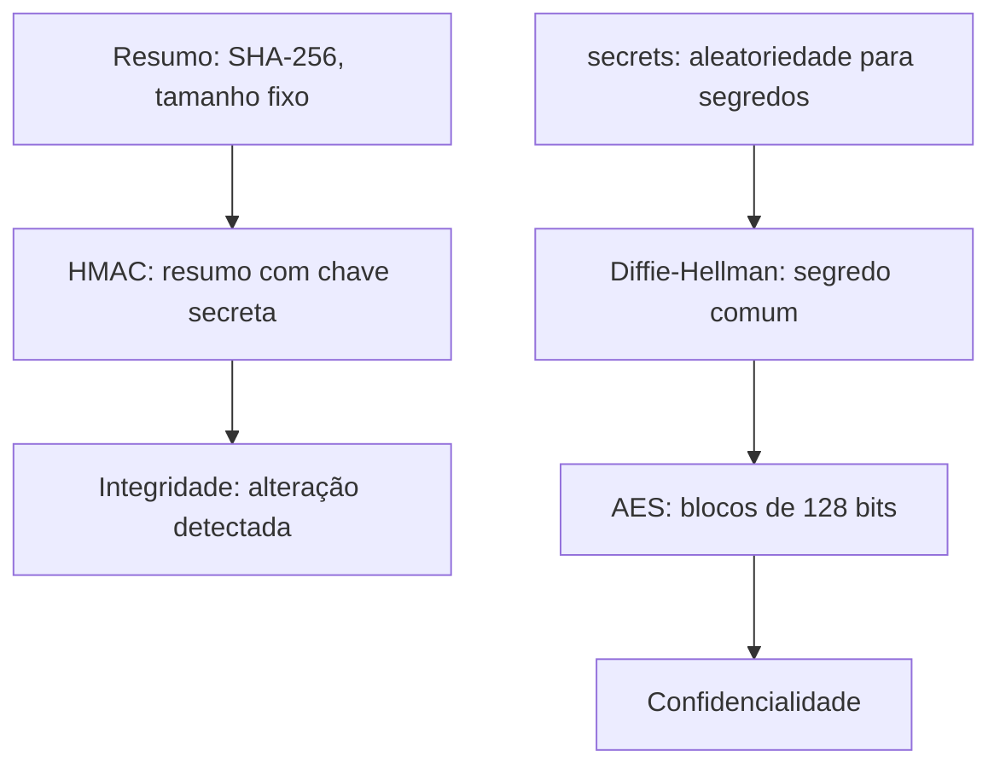

# 68 · Criptografia: resumos, HMAC, AES e troca de chaves

**Tempo estimado:** 55 minutos · **Pré-requisito:** [[67 - Propriedades de segurança, princípios e modelagem de ameaças]] e [[51 - Modelo relacional, chaves e álgebra relacional]] (identificação por chaves).

**Ao final você vai conseguir:**

1. Calcular o resumo SHA-256 de um texto e reconhecer que ele é de tamanho fixo.
2. Verificar uma etiqueta HMAC, e explicar por que ela detecta alteração.
3. Relacionar o AES aos blocos de 128 bits e às chaves de 128, 192 ou 256 bits.
4. Seguir uma troca de chaves Diffie-Hellman com números pequenos.
5. Gerar tokens com `secrets`, e não com `random`.

**Antes de começar:** no módulo 67 você nomeou a integridade e a confidencialidade. Aqui estão as ferramentas que as implementam.

---

## Para começar

Dois computadores precisam combinar uma chave secreta pela internet, que todos podem observar. Como ter um segredo comum sem enviá-lo? Como saber que uma mensagem não foi alterada no caminho? E como gerar valores imprevisíveis para uma senha de sessão? Cada pergunta tem uma ferramenta, e nenhuma delas é um tipo de cifra apenas.

---

## Mapa do módulo



*Figura 1: resumos e HMAC tratam integridade; AES, confidencialidade; Diffie-Hellman, a chave; e a aleatoriedade sustenta tudo.*

**Como ler:** a seta indica dependência: a chave de AES vem da troca, e a troca precisa de aleatoriedade.

---

## Mini-aula 1: resumos e HMAC

> [!tip] Ideia
> Uma função de resumo transforma dados de qualquer tamanho em um valor de tamanho fixo. Um HMAC mistura o resumo com uma chave secreta, e só quem tem a chave gera a etiqueta correta.

> [!info] Definição
> O Python (hashlib) oferece SHA-2, SHA-3, SHAKE e BLAKE2, e as versões antigas MD5 e SHA-1, que têm fraquezas conhecidas de colisão, segundo a documentação citada. O **HMAC** (RFC 2104) constrói um código de autenticação de mensagem a partir de um hash iterativo e de uma chave secreta.

Veja o resumo SHA-256 de `abc` e uma etiqueta HMAC. Antes de rodar, diga quantos caracteres tem o resumo SHA-256 em hexadecimal.

```python
import hashlib
import hmac

print("sha256('abc'):", hashlib.sha256(b"abc").hexdigest())
etiqueta = hmac.new(b"chave-secreta", b"pagamento de 100", hashlib.sha256).hexdigest()
print("HMAC da mensagem:", etiqueta[:16], "...")
print("etiqueta confere:", hmac.compare_digest(etiqueta, hmac.new(b"chave-secreta", b"pagamento de 100", hashlib.sha256).hexdigest()))
```

Saída real:

```
sha256('abc'): ba7816bf8f01cfea414140de5dae2223b00361a396177a9cb410ff61f20015ad
HMAC da mensagem: 20c8a6828628ad5b ...
etiqueta confere: True
```

**Como ler:** o resumo tem 64 caracteres hexadecimais, sempre, qualquer que seja o texto. A etiqueta HMAC só confere para quem tem a chave `chave-secreta`.

> [!warning] Armadilha comum
> Um resumo sem chave não prova autenticidade: quem altera a mensagem pode recalcular o resumo. A chave do HMAC é o que faz a diferença.

> [!question]- Checkpoint
> 1. Quantos caracteres tem o SHA-256 em hexadecimal?
> 2. Por que um resumo simples não basta para provar que a mensagem é autêntica?
>
> > [!success]- Resposta
> > 1. 64.
> > 2. Porque quem altera a mensagem pode recalcular o resumo; a chave é o que impede isso.

---

## Mini-aula 2: AES e blocos

> [!tip] Ideia
> O AES cifra dados em blocos de 128 bits. O nome indica o tamanho da chave: AES-128, AES-192 e AES-256.

> [!info] Definição
> Segundo o resumo da FIPS 197, citado na nota, o AES transforma dados em blocos de 128 bits, e o sufixo numérico indica o tamanho da chave em bits. A nota não cobre a estrutura das rodadas nem os modos de operação, como ECB, CBC e GCM.

No exercício A3, você confere os tamanhos aceitos. A cifragem em si não é implementada aqui, por ser delicada; use uma biblioteca revisada.

> [!warning] Armadilha comum
> O bloco de 128 bits não descreve sozinho como uma mensagem longa é cifrada. A nota não cobre os modos de operação.

> [!question]- Checkpoint
> 1. Qual é o tamanho do bloco do AES?
> 2. O que o sufixo `-256` indica?
>
> > [!success]- Resposta
> > 1. 128 bits.
> > 2. O tamanho da chave em bits.

---

## Mini-aula 3: troca de chaves

> [!tip] Ideia
> Duas partes geram segredos privados e trocam valores públicos derivados deles. Cada uma combina o público do outro com o seu segredo, e as duas chegam ao mesmo valor, sem que o segredo viaje pela rede.

> [!info] Definição
> A nota de Diffie-Hellman diz que, na versão de corpo finito, as partes derivam um segredo comum por exponenciação modular, sobre um primo `p` e um gerador `g`. Ela também diz que o DHE usa chaves novas por sessão, o que dá sigilo para o passado (forward secrecy). Aqui a construção segue a dos exercícios P1 e P2, com números pequenos, para ilustrar a simetria.

Veja a troca com `p = 23`, `g = 5`, e segredos `6` e `15`. Antes de rodar, diga se Alice e Bob chegam ao mesmo segredo.

```python
p, g = 23, 5
a, b = 6, 15

A = pow(g, a, p)
B = pow(g, b, p)
print("públicos: A =", A, "| B =", B)
print("segredo visto por Alice:", pow(B, a, p), "| segredo visto por Bob:", pow(A, b, p))
```

Saída real:

```
públicos: A = 8 | B = 19
segredo visto por Alice: 2 | segredo visto por Bob: 2
```

**Como ler:** os públicos são `8` e `19`. Cada parte eleva o público do outro ao seu segredo, e as duas chegam a `2`. Os números são pequenos, e não seguros: em uso real, `p` tem centenas de dígitos.

> [!warning] Armadilha comum
> A troca de chaves não autentica quem está do outro lado. A identidade é tratada por outro mecanismo, como os certificados de chave pública, que a nota de PKI descreve.

> [!question]- Checkpoint
> 1. O segredo `6` de Alice viaja pela rede?
> 2. Por que a troca não diz quem é o outro lado?
>
> > [!success]- Resposta
> > 1. Não; viajam só os valores públicos.
> > 2. Porque a troca não tem autenticação; a identidade precisa de outro mecanismo.

---

## Mini-aula 4: aleatoriedade segura

> [!tip] Ideia
> Chaves, senhas e tokens precisam ser imprevisíveis. Um gerador de simulação repete padrões que um atacante pode prever; o módulo `secrets` foi feito para segredos.

> [!info] Definição
> A documentação de `secrets` diz que ele deve ser preferido ao gerador padrão de `random`, que serve a modelagem e simulação, não a segurança ou criptografia. A nota cita `token_hex`, `token_bytes` e `compare_digest` como funções do módulo.

```python
import secrets

token = secrets.token_hex(16)
print("token com", len(token), "caracteres hexadecimais")
print("AES usa blocos de 128 bits e chaves de 128, 192 ou 256 bits")
```

Saída real:

```
token com 32 caracteres hexadecimais
AES usa blocos de 128 bits e chaves de 128, 192 ou 256 bits
```

**Como ler:** `token_hex(16)` gera 16 bytes, que aparecem como 32 caracteres hexadecimais. Cada chamada gera um valor diferente.

> [!question]- Checkpoint
> 1. Para que o módulo `random` é indicado?
> 2. Qual módulo gera tokens para autenticação?
>
> > [!success]- Resposta
> > 1. Modelagem e simulação.
> > 2. `secrets`.

---

## Exercícios

Cada exercício tem um bloco com a função a completar e os testes com `assert`. Quando todos passarem, aparece `Passou!`. As funções definidas em exercícios anteriores aparecem no código inicial.

### Aquecimento

**A1. Resumo SHA-256.** A nota de hashlib diz que o Python oferece SHA-2 e SHA-3. Uma função de resumo leva dados de qualquer tamanho a um valor de tamanho fixo. Complete `resumo_sha256(texto)`, que devolve o resumo SHA-256 do texto, em hexadecimal, calculado sobre os bytes UTF-8 do texto.

```python
import hashlib

def resumo_sha256(texto):
    """Resumo SHA-256 em hexadecimal dos bytes UTF-8 do texto."""
    ...

assert resumo_sha256("abc") == "ba7816bf8f01cfea414140de5dae2223b00361a396177a9cb410ff61f20015ad", "vetor conhecido"
assert len(resumo_sha256("qualquer coisa")) == 64, "sempre 64 caracteres hexadecimais"
assert resumo_sha256("a") != resumo_sha256("b"), "entradas diferentes, resumos diferentes"
print("Passou!")
```

> [!hint]- Dica 1
> Use `hashlib.sha256(texto.encode("utf-8")).hexdigest()`.

> [!hint]- Dica 2
> Para `"abc"`, o resultado começa com `"ba7816bf"`.

> [!example]- Solução
> ```python
> def resumo_sha256(texto):
>     """Resumo SHA-256 em hexadecimal dos bytes UTF-8 do texto."""
>     return hashlib.sha256(texto.encode("utf-8")).hexdigest()
> ```
>
> **Erro comum:** Passar a string direto para `sha256`. Ela só aceita bytes, e o erro aparece como `TypeError`.

**A2. Etiqueta HMAC.** Um código de autenticação de mensagem (MAC) deixa quem tem a chave conferir que a mensagem não foi alterada. O HMAC, descrito na RFC 2104 e citado na nota, é um MAC construído com um hash e uma chave secreta. Complete `verifica_etiqueta(mensagem, chave, etiqueta)`, que devolve `True` se o HMAC-SHA256 de `mensagem` com `chave` é igual a `etiqueta`. Compare com `hmac.compare_digest`, que não vaza informação pelo tempo de comparação.

```python
import hashlib
import hmac

def verifica_etiqueta(mensagem, chave, etiqueta):
    """True se o HMAC-SHA256 da mensagem com a chave é igual à etiqueta dada."""
    ...

msg = b"pagamento de 100"
tag = hmac.new(b"chave", msg, hashlib.sha256).hexdigest()
assert verifica_etiqueta(msg, b"chave", tag) is True, "a etiqueta certa"
assert verifica_etiqueta(b"pagamento de 900", b"chave", tag) is False, "mensagem alterada"
assert verifica_etiqueta(msg, b"outra", tag) is False, "chave errada"
print("Passou!")
```

> [!hint]- Dica 1
> Calcule `hmac.new(chave, mensagem, hashlib.sha256).hexdigest()` e compare com `hmac.compare_digest`.

> [!hint]- Dica 2
> Todos os argumentos de texto devem ser `bytes`.

> [!example]- Solução
> ```python
> def verifica_etiqueta(mensagem, chave, etiqueta):
>     """True se o HMAC-SHA256 da mensagem com a chave é igual à etiqueta dada."""
>     esperada = hmac.new(chave, mensagem, hashlib.sha256).hexdigest()
>     return hmac.compare_digest(esperada, etiqueta)
> ```
>
> **Erro comum:** Comparar com `==`. A comparação de tempo variável pode vazar informação sobre a etiqueta; a nota recomenda a comparação de tempo constante.

**A3. Tamanhos do AES.** A nota da FIPS 197 diz que o AES trabalha em blocos de 128 bits, e os nomes AES-128, AES-192 e AES-256 indicam o tamanho da chave em bits. Complete `tamanho_aes(bits_chave)`, que devolve `128` (o tamanho do bloco) quando a chave tem 128, 192 ou 256 bits, e levanta `ValueError` para qualquer outro tamanho.

```python
def tamanho_aes(bits_chave):
    """Tamanho do bloco do AES (128 bits) para uma chave de 128, 192 ou 256 bits."""
    ...

assert tamanho_aes(128) == 128, "AES-128 tem bloco de 128 bits"
assert tamanho_aes(256) == 128, "o bloco não muda com a chave"
try:
    tamanho_aes(100)
    assert False, "deveria levantar ValueError"
except ValueError:
    pass
print("Passou!")
```

> [!hint]- Dica 1
> Teste `bits_chave in (128, 192, 256)`.

> [!hint]- Dica 2
> O bloco é sempre 128, qualquer que seja a chave.

> [!example]- Solução
> ```python
> def tamanho_aes(bits_chave):
>     """Tamanho do bloco do AES (128 bits) para uma chave de 128, 192 ou 256 bits."""
>     if bits_chave not in (128, 192, 256):
>         raise ValueError("tamanho de chave inválido")
>     return 128
> ```
>
> **Erro comum:** Devolver o tamanho da chave em vez do bloco. A pergunta pede o bloco, que é fixo.

### Praticando

**P1. Valor público.** Na troca de chaves Diffie-Hellman de corpo finito, cada parte calcula `g` elevado ao seu segredo, módulo o primo `p`. A nota de Diffie-Hellman descreve essa exponenciação modular. Complete `publico_dh(g, segredo, p)`, que devolve `pow(g, segredo, p)`.

```python
def publico_dh(g, segredo, p):
    """Valor público g elevado ao segredo, módulo p, na troca Diffie-Hellman."""
    ...

assert publico_dh(5, 6, 23) == 8, "exemplo pequeno"
assert publico_dh(5, 0, 23) == 1, "segredo zero dá 1"
assert publico_dh(2, 10, 1000) == 24, "1024 mod 1000"
print("Passou!")
```

> [!hint]- Dica 1
> Use a função `pow` com três argumentos, que calcula a exponenciação modular de forma eficiente.

> [!hint]- Dica 2
> Com `g = 5`, `segredo = 6` e `p = 23`, o resultado é `8`.

> [!example]- Solução
> ```python
> def publico_dh(g, segredo, p):
>     """Valor público g elevado ao segredo, módulo p, na troca Diffie-Hellman."""
>     return pow(g, segredo, p)
> ```
>
> **Erro comum:** Calcular `g ** segredo % p`. Para segredos grandes, a potência inteira fica enorme antes do resto; `pow` com três argumentos evita isso.

**P2. Segredo comum.** Na troca Diffie-Hellman, Alice e Bob calculam o mesmo segredo: a chave pública de um elevada ao segredo do outro. Complete `segredo_compartilhado(p, g, a, b)`, que calcula `g` elevado a `a` e `b` módulo `p`, combinando as duas partes, e devolve o segredo que Alice obtém (`pow(B, a, p)`), em que `B = publico_dh(g, b, p)`. Use `publico_dh`, já definida acima.

```python
def publico_dh(g, segredo, p):
    return pow(g, segredo, p)

def segredo_compartilhado(p, g, a, b):
    """Segredo que Alice obtém a partir da chave pública de Bob: pow(B, a, p)."""
    ...

assert segredo_compartilhado(23, 5, 6, 15) == 2, "o segredo do exemplo"
assert segredo_compartilhado(23, 5, 6, 15) == pow(5, 6 * 15, 23), "é g elevado ao produto dos segredos"
print("Passou!")
```

> [!hint]- Dica 1
> Calcule `B = publico_dh(g, b, p)` e depois `pow(B, a, p)`.

> [!hint]- Dica 2
> Para `p = 23`, `g = 5`, `a = 6` e `b = 15`, o resultado é `2`, e Bob chega ao mesmo valor.

> [!example]- Solução
> ```python
> def segredo_compartilhado(p, g, a, b):
>     """Segredo que Alice obtém a partir da chave pública de Bob: pow(B, a, p)."""
>     B = publico_dh(g, b, p)
>     return pow(B, a, p)
> ```
>
> **Erro comum:** Devolver `publico_dh(g, a, p)`. Esse é o valor público de Alice, não o segredo compartilhado.

### Desafio

**D1. Token aleatório.** A documentação de `secrets` diz que ele deve ser usado para senhas, autenticação e tokens, em vez de `random`. Complete `token_seguro(n_bytes)`, que devolve um token hexadecimal gerado por `secrets.token_hex`, com `n_bytes` bytes, ou seja, `2 * n_bytes` caracteres.

```python
import secrets

def token_seguro(n_bytes):
    """Token hexadecimal de n_bytes bytes gerado por secrets, com 2 * n_bytes caracteres."""
    ...

assert token_seguro(16) is not None, "a função devolve o token"
assert len(token_seguro(16)) == 32, "16 bytes em hexadecimal"
assert len(token_seguro(1)) == 2, "um byte"
assert token_seguro(8) != token_seguro(8), "tokens diferentes, com probabilidade quase certa"
print("Passou!")
```

> [!hint]- Dica 1
> Use `secrets.token_hex(n_bytes)`, com `import secrets` no começo do arquivo.

> [!hint]- Dica 2
> Para `n_bytes = 16`, o token tem 32 caracteres.

> [!example]- Solução
> ```python
> def token_seguro(n_bytes):
>     """Token hexadecimal de n_bytes bytes gerado por secrets, com 2 * n_bytes caracteres."""
>     return secrets.token_hex(n_bytes)
> ```
>
> **Erro comum:** Usar `random.choice` para montar o token. O gerador de `random` não é criptográfico, e a nota de Python diz que ele serve a modelagem e simulação.


---

## Mini-projeto (opcional)

Você vai gerar uma etiqueta HMAC e conferir que uma alteração de um byte é detectada. Tente sozinho antes de abrir a solução.

**Mini-projeto: etiqueta e conferência.** Complete `assina_e_confere(mensagem, chave)`, que devolve a tupla `(etiqueta, ok_original, ok_alterada)`. A etiqueta é o HMAC-SHA256 hexadecimal da mensagem. `ok_original` é `True` quando a etiqueta confere com a mensagem original, e `ok_alterada` é `True` quando confere com a mensagem com o último byte trocado por `b"x"`. Use `verifica_etiqueta`, já definida acima.

```python
import hashlib
import hmac

def verifica_etiqueta(mensagem, chave, etiqueta):
    esperada = hmac.new(chave, mensagem, hashlib.sha256).hexdigest()
    return hmac.compare_digest(esperada, etiqueta)

def assina_e_confere(mensagem, chave):
    """(etiqueta, confere_original, confere_alterada): a alteração de um byte deve ser detectada."""
    ...

r = assina_e_confere(b"pagamento", b"k")
assert r is not None, "a função devolve a tupla"
assert r[1] is True and r[2] is False, "original confere, alterada não"
assert len(r[0]) == 64, "etiqueta SHA-256 em hexadecimal"
print("Passou!")
```

> [!hint]- Dica 1
> A mensagem alterada é `mensagem[:-1] + b"x"`.

> [!hint]- Dica 2
> Para `b"pagamento"` e `b"k"`, `ok_original` é `True` e `ok_alterada` é `False`.

> [!example]- Solução
> ```python
> def assina_e_confere(mensagem, chave):
>     """(etiqueta, confere_original, confere_alterada): a alteração de um byte deve ser detectada."""
>     etiqueta = hmac.new(chave, mensagem, hashlib.sha256).hexdigest()
>     alterada = mensagem[:-1] + b"x"
>     return (etiqueta, verifica_etiqueta(mensagem, chave, etiqueta), verifica_etiqueta(alterada, chave, etiqueta))
> ```
>
> **Erro comum:** Recalcular a etiqueta da mensagem alterada e conferir com ela. A etiqueta precisa ser a da mensagem original; o teste pergunta se a alteração foi detectada.


---

## Fechando

**Resumo**

- SHA-256 tem saída de 64 caracteres hexadecimais; um resumo sem chave não prova autenticidade.
- HMAC usa uma chave secreta e detecta alteração da mensagem.
- AES trabalha em blocos de 128 bits, com chaves de 128, 192 ou 256 bits; o modo de operação importa.
- Diffie-Hellman dá um segredo comum sem enviá-lo, mas não autentica as partes.
- Tokens e chaves vêm de `secrets`, não de `random`.

**Glossário rápido**

- **Função de resumo** (hash function): leva dados a um valor de tamanho fixo.
- **HMAC**: código de autenticação de mensagem com chave.
- **AES**: cifra de bloco de 128 bits.
- **Troca de chaves** (key exchange): combinação de um segredo comum pela rede.
- **Sigilo para o passado** (forward secrecy): chaves novas por sessão.

**Perguntas de revisão**

1. Qual é a diferença entre um resumo simples e uma etiqueta HMAC para quem altera a mensagem?
2. Qual problema a troca Diffie-Hellman deixa para outro mecanismo resolver?
3. Por que `pow(g, segredo, p)` é preferível a `g ** segredo % p` em código real?

**E agora?** O próximo módulo é **Autenticação, senhas e sessões**. Ele mostra como guardar senhas com um hash lento e com sal, e como manter a identidade depois do login.

---

## Para ir mais fundo

- [[Cryptographic Hash Functions and HMAC]]
- [[Symmetric Encryption and AES]]
- [[Diffie-Hellman Key Exchange]]
- [[Secure Randomness in Python]]
