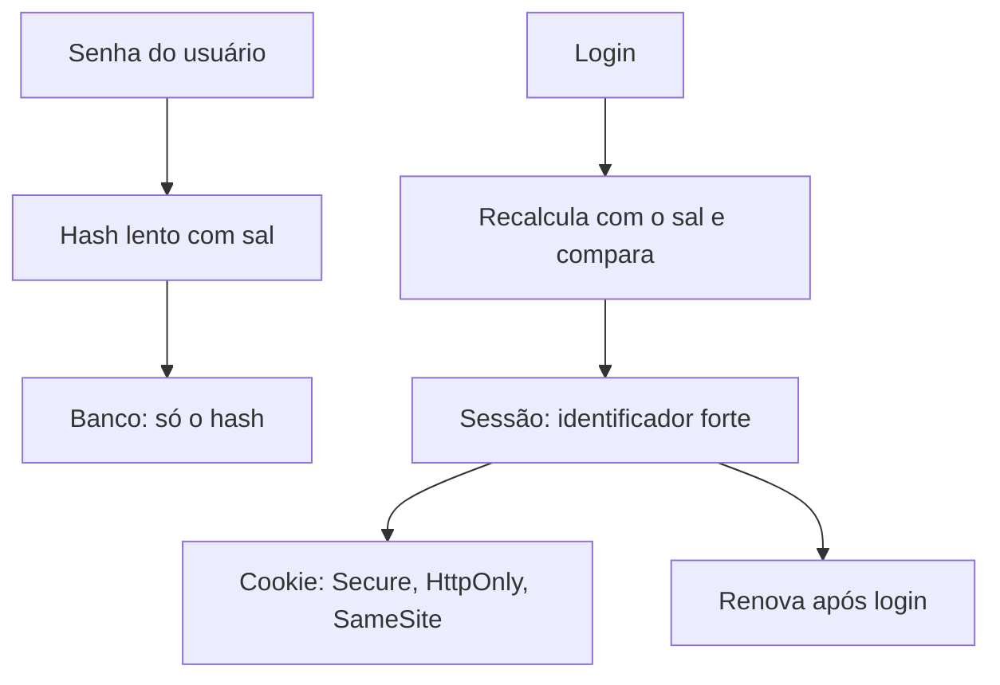

# 69 · Autenticação, senhas e sessões

**Tempo estimado:** 55 minutos · **Pré-requisito:** [[68 - Criptografia - resumos, HMAC, AES e troca de chaves]] (hash, HMAC, aleatoriedade).

**Ao final você vai conseguir:**

1. Explicar por que senhas são guardadas com hash lento e com sal, e não cifradas.
2. Calcular e conferir um hash de senha com PBKDF2 em Python, com comparação de tempo constante.
3. Aplicar a regra de tamanho mínimo de senha do NIST, com e sem autenticação em múltiplos fatores.
4. Gerar um identificador de sessão forte, configurar o cookie e renovar a sessão após o login.

**Antes de começar:** no módulo 68 você viu resumos e HMAC. Aqui essas ferramentas protegem um dado que todo sistema guarda: a senha.

---

## Para começar

Um site vazou o banco de usuários. Se as senhas estavam guardadas em texto, todas as contas estão comprometidas. Se estavam cifradas com uma chave que também estava no servidor, a cifra não protegeu nada. A regra da nota é diferente: guardar um resumo lento, com sal, que não se reverte. Assim, mesmo com o banco vazado, cada senha exige um trabalho próprio para ser testada.

---

## Mapa do módulo



*Figura 1: a senha vira um hash lento com sal; o login recalcula e compara; a sessão recebe um identificador forte, que é renovado depois do login.*

**Como ler:** cada etapa tem uma proteção própria. A senha nunca fica em claro; a sessão nunca fica previsível.

---

## Mini-aula 1: guardar senhas

> [!tip] Ideia
> A senha deve ser guardada como resumo, e não como texto nem cifrada. O resumo deve ser lento e ter sal, para que senhas iguais deem resumos diferentes e para que testar cada senha custe caro.

> [!info] Definição
> Segundo a nota de OWASP, a senha deve ser guardada com hash de uma só mão, e não cifrada. O **sal** (salt) é um valor único e aleatório por senha. O **fator de trabalho** é o parâmetro de custo da função, ajustável. O Python oferece `pbkdf2_hmac` e `scrypt`. A nota diz que OWASP prefere Argon2id, e que os parâmetros mudam depressa.

Veja o hash da mesma senha com dois sais. Antes de rodar, diga se os dois hashes são iguais.

```python
import hashlib

senha = b"correta-horse-battery"
h1 = hashlib.pbkdf2_hmac("sha256", senha, b"sal-1", 1000).hex()
h2 = hashlib.pbkdf2_hmac("sha256", senha, b"sal-2", 1000).hex()
print("hash com sal-1:", h1[:16], "...")
print("hash com sal-2:", h2[:16], "...")
print("mesma senha, sal diferente, hashes iguais:", h1 == h2)
```

Saída real:

```
hash com sal-1: b434b8afb6236009 ...
hash com sal-2: da3871a50946ef55 ...
mesma senha, sal diferente, hashes iguais: False
```

**Como ler:** a mesma senha com sais diferentes dá hashes diferentes. Quem vê a tabela não sabe quais senhas se repetem.

> [!warning] Armadilha comum
> Um sal fixo, igual para todos os usuários, não cumpre o papel do sal. Ele precisa ser único por senha.

> [!question]- Checkpoint
> 1. Por que o sal impede que senhas iguais tenham o mesmo hash?
> 2. Por que a senha não deve ser cifrada?
>
> > [!success]- Resposta
> > 1. Porque cada senha recebe um sal diferente, e o hash inclui o sal.
> > 2. Porque uma cifra é reversível com a chave; o hash não é.

---

## Mini-aula 2: força da senha

> [!tip] Ideia
> O NIST valoriza o tamanho da senha mais do que a composição de caracteres. Uma senha longa e simples pode ser mais forte que uma curta com símbolos.

> [!info] Definição
> Segundo a nota de NIST SP 800-63B, os níveis de garantia de autenticação (AAL) vão de 1 a 3, e as regras de senha exigem ao menos 15 caracteres quando a senha é o único fator, e ao menos 8 quando ela é usada dentro de um fator múltiplo. A nota também registra que se deve evitar trocas periódicas forçadas.

No exercício A3, você aplica a regra de tamanho.

> [!warning] Armadilha comum
> Uma senha forte não substitui o segundo fator em sistemas de alto risco. O nível de garantia depende do conjunto de fatores, e não só da senha.

> [!question]- Checkpoint
> 1. Qual é o mínimo de caracteres quando a senha é o único fator?
> 2. O que o NIST recomenda em vez de trocas periódicas forçadas?
>
> > [!success]- Resposta
> > 1. 15 caracteres.
> > 2. A nota registra que se deve evitar trocas periódicas forçadas; não detalha a alternativa.

---

## Mini-aula 3: sessões e cookies

> [!tip] Ideia
> Depois do login, o sistema lembra o usuário por um identificador de sessão. Esse identificador precisa ser imprevisível, protegido no cookie e renovado no login.

> [!info] Definição
> A nota de Session Management diz que o identificador deve ter ao menos 64 bits de entropia, de um gerador criptográfico. O cookie deve ter `Secure`, `HttpOnly` e `SameSite`, preferindo `Strict`. O `HttpOnly` limita o roubo por XSS. A sessão deve ser renovada após o login, para evitar fixação de sessão. A nota registra que os tempos de expiração devem ser impostos pelo servidor.

No exercício P2, você monta o cookie com os atributos. No mini-projeto, renova a sessão.

> [!warning] Armadilha comum
> Um identificador previsível, como um contador, permite adivinhar sessões de outros usuários. A aleatoriedade é o que protege o identificador.

> [!question]- Checkpoint
> 1. Qual é o mínimo de entropia do identificador de sessão?
> 2. Por que a sessão é renovada depois do login?
>
> > [!success]- Resposta
> > 1. 64 bits.
> > 2. Para evitar fixação de sessão, em que um identificador conhecido antes do login passaria a valer depois.

---

## Exercícios

Cada exercício tem um bloco com a função a completar e os testes com `assert`. Quando todos passarem, aparece `Passou!`. As funções definidas em exercícios anteriores aparecem no código inicial.

### Aquecimento

**A1. Hash de senha com sal.** A nota de Password Storage diz que senhas devem ser guardadas com uma função de hash lenta e com sal, e não cifradas. Python oferece `hashlib.pbkdf2_hmac`, citado na nota. Complete `hash_senha(senha, sal, iteracoes)`, que devolve o resultado de `pbkdf2_hmac` com SHA-256, em hexadecimal, para a senha (bytes), o sal (bytes) e o número de iterações.

```python
import hashlib

def hash_senha(senha, sal, iteracoes):
    """Hash de senha com PBKDF2-HMAC-SHA256, sal e iterações, em hexadecimal."""
    ...

assert hash_senha(b"segredo", b"sal", 1000) == hash_senha(b"segredo", b"sal", 1000), "determinístico com os mesmos dados"
assert hash_senha(b"segredo", b"sal-1", 1000) != hash_senha(b"segredo", b"sal-2", 1000), "o sal muda o hash"
assert len(hash_senha(b"segredo", b"sal", 1000)) == 64, "SHA-256 em hexadecimal"
print("Passou!")
```

> [!hint]- Dica 1
> Use `hashlib.pbkdf2_hmac("sha256", senha, sal, iteracoes).hex()`.

> [!hint]- Dica 2
> Duas chamadas com a mesma senha e o mesmo sal dão o mesmo resultado.

> [!example]- Solução
> ```python
> def hash_senha(senha, sal, iteracoes):
>     """Hash de senha com PBKDF2-HMAC-SHA256, sal e iterações, em hexadecimal."""
>     return hashlib.pbkdf2_hmac("sha256", senha, sal, iteracoes).hex()
> ```
>
> **Erro comum:** Ignorar o sal, usando um valor fixo no código. Senhas iguais de usuários diferentes passariam a ter o mesmo hash, e a tabela de hashes ficaria mais vulnerável.

**A2. Conferir a senha.** No login, o sistema recalcula o hash da senha digitada com o sal guardado e compara com o hash armazenado. A comparação deve ser de tempo constante. Complete `verifica_senha(senha, sal, iteracoes, digest)`, que devolve `True` se o hash da senha com esse sal e essas iterações é igual a `digest`. Use `hash_senha` e `hmac.compare_digest`.

```python
import hashlib
import hmac

def hash_senha(senha, sal, iteracoes):
    return hashlib.pbkdf2_hmac("sha256", senha, sal, iteracoes).hex()

def verifica_senha(senha, sal, iteracoes, digest):
    """True se a senha, com o sal e as iterações dados, produz o digest armazenado."""
    ...

guardado = hash_senha(b"senha-certa", b"sal", 1000)
assert verifica_senha(b"senha-certa", b"sal", 1000, guardado) is True, "a senha certa"
assert verifica_senha(b"senha-errada", b"sal", 1000, guardado) is False, "senha errada"
assert verifica_senha(b"senha-certa", b"outro", 1000, guardado) is False, "sal errado"
print("Passou!")
```

> [!hint]- Dica 1
> Calcule `calculado = hash_senha(senha, sal, iteracoes)` e devolva `hmac.compare_digest(calculado, digest)`.

> [!hint]- Dica 2
> Com a senha certa e o digest gerado pela mesma função, o resultado é `True`.

> [!example]- Solução
> ```python
> def verifica_senha(senha, sal, iteracoes, digest):
>     """True se a senha, com o sal e as iterações dados, produz o digest armazenado."""
>     calculado = hash_senha(senha, sal, iteracoes)
>     return hmac.compare_digest(calculado, digest)
> ```
>
> **Erro comum:** Comparar com `==`. A nota de Python recomenda `compare_digest` para comparações de segredos.

**A3. Tamanho mínimo.** A nota de NIST SP 800-63B diz que o tamanho importa mais que a composição de caracteres: a senha deve ter ao menos 15 caracteres quando é o único fator, e ao menos 8 quando é usada dentro de um fator múltiplo. Complete `senha_aceita(senha, em_mfa)`, que devolve `True` se a senha atinge o mínimo: 15 sem MFA, 8 com MFA.

```python
def senha_aceita(senha, em_mfa):
    """True se a senha tem o mínimo de caracteres: 8 com MFA, 15 sem MFA."""
    ...

assert senha_aceita("x" * 12, True) is True, "12 caracteres com MFA"
assert senha_aceita("x" * 12, False) is False, "12 caracteres sem MFA"
assert senha_aceita("x" * 15, False) is True, "no limite sem MFA"
print("Passou!")
```

> [!hint]- Dica 1
> Escolha o mínimo com `8 if em_mfa else 15` e compare com `len(senha)`.

> [!hint]- Dica 2
> Uma senha de 12 caracteres é aceita com MFA e recusada sem.

> [!example]- Solução
> ```python
> def senha_aceita(senha, em_mfa):
>     """True se a senha tem o mínimo de caracteres: 8 com MFA, 15 sem MFA."""
>     minimo = 8 if em_mfa else 15
>     return len(senha) >= minimo
> ```
>
> **Erro comum:** Exigir números e símbolos. A regra da nota é de tamanho, e composição obrigatória não é o critério.

### Praticando

**P1. Sal aleatório.** O sal de cada senha deve ser único e aleatório. A nota de Password Storage define o sal como um valor único por senha, e o módulo `secrets` gera valores para esse fim. Complete `gera_sal(n)`, que devolve `n` bytes aleatórios com `secrets.token_bytes`.

```python
import secrets

def gera_sal(n):
    """n bytes aleatórios e criptograficamente seguros, para servir de sal."""
    ...

assert gera_sal(16) is not None, "a função devolve o sal"
assert len(gera_sal(16)) == 16, "16 bytes"
assert gera_sal(16) != gera_sal(16), "dois sais diferentes, com probabilidade quase certa"
assert isinstance(gera_sal(4), bytes), "bytes"
print("Passou!")
```

> [!hint]- Dica 1
> Use `secrets.token_bytes(n)`, com `import secrets` no começo do arquivo.

> [!hint]- Dica 2
> Para `n = 16`, o resultado tem 16 bytes.

> [!example]- Solução
> ```python
> def gera_sal(n):
>     """n bytes aleatórios e criptograficamente seguros, para servir de sal."""
>     return secrets.token_bytes(n)
> ```
>
> **Erro comum:** Usar `random.randbytes`. O módulo `random` não é indicado para segredos, segundo a documentação de `secrets`.

**P2. Cookie de sessão.** A nota de Session Management recomenda os atributos `Secure`, `HttpOnly` e `SameSite=Strict` para o cookie de sessão. `HttpOnly` limita o roubo por XSS, e `Secure` exige HTTPS. Complete `cookie_seguro(sid)`, que devolve o texto `sid=<valor>; Secure; HttpOnly; SameSite=Strict`.

```python
def cookie_seguro(sid):
    """Valor do cookie de sessão com os atributos Secure, HttpOnly e SameSite=Strict."""
    ...

assert cookie_seguro("abc") == "sid=abc; Secure; HttpOnly; SameSite=Strict", "atributos completos"
assert "HttpOnly" in cookie_seguro("x"), "HttpOnly presente"
assert "Secure" in cookie_seguro("x"), "Secure presente"
print("Passou!")
```

> [!hint]- Dica 1
> Use uma f-string com `f"sid={sid}; Secure; HttpOnly; SameSite=Strict"`.

> [!hint]- Dica 2
> Para `sid = "abc"`, o resultado é `"sid=abc; Secure; HttpOnly; SameSite=Strict"`.

> [!example]- Solução
> ```python
> def cookie_seguro(sid):
>     """Valor do cookie de sessão com os atributos Secure, HttpOnly e SameSite=Strict."""
>     return f"sid={sid}; Secure; HttpOnly; SameSite=Strict"
> ```
>
> **Erro comum:** Omitir `HttpOnly`. Sem ele, o script da página pode ler o cookie, o que facilita o roubo por XSS.

### Desafio

**D1. Entropia do identificador.** A nota de Session Management diz que o identificador de sessão deve ter ao menos 64 bits de entropia, gerada por um gerador criptográfico. Complete `entropia_suficiente(bits)`, que devolve `True` se o número de bits é ao menos 64.

```python
def entropia_suficiente(bits):
    """True se o identificador de sessão tem ao menos 64 bits de entropia."""
    ...

assert entropia_suficiente(64) is True, "no mínimo"
assert entropia_suficiente(63) is False, "um bit abaixo"
assert entropia_suficiente(128) is True, "acima do mínimo"
print("Passou!")
```

> [!hint]- Dica 1
> Use `bits >= 64`.

> [!hint]- Dica 2
> Para 63 bits, o resultado é `False`.

> [!example]- Solução
> ```python
> def entropia_suficiente(bits):
>     """True se o identificador de sessão tem ao menos 64 bits de entropia."""
>     return bits >= 64
> ```
>
> **Erro comum:** Usar `>` no lugar de `>=`. Exatamente 64 bits atende ao mínimo da nota.


---

## Mini-projeto (opcional)

Você vai renovar a sessão após o login e garantir que o identificador antigo deixa de valer. Tente sozinho antes de abrir a solução.

**Mini-projeto: renovar após login.** A nota diz que o identificador de sessão deve ser renovado após o login, para evitar fixação de sessão. Complete `renova_sessao(sid_antigo)`, que devolve um dicionário com `"novo"`, um identificador novo gerado por `secrets.token_urlsafe(32)`, e `"antigo_valido"`, que é `False` (o antigo deixa de valer). Garanta que o novo é diferente do antigo.

```python
import secrets

def renova_sessao(sid_antigo):
    """Novo identificador após o login, diferente do antigo; o antigo deixa de valer."""
    ...

r = renova_sessao("sessao-antiga")
assert r is not None, "a função devolve o dicionário"
assert r["novo"] != "sessao-antiga", "o identificador mudou"
assert r["antigo_valido"] is False, "o antigo não vale mais"
print("Passou!")
```

> [!hint]- Dica 1
> Gere o novo em um laço enquanto ele for igual a `sid_antigo`, por segurança, e devolva as duas chaves.

> [!hint]- Dica 2
> Para qualquer entrada, `"antigo_valido"` deve ser `False`.

> [!example]- Solução
> ```python
> def renova_sessao(sid_antigo):
>     """Novo identificador após o login, diferente do antigo; o antigo deixa de valer."""
>     novo = secrets.token_urlsafe(32)
>     while novo == sid_antigo:
>         novo = secrets.token_urlsafe(32)
>     return {"novo": novo, "antigo_valido": False}
> ```
>
> **Erro comum:** Devolver o mesmo identificador. Renovar é justamente trocar o identificador, para que o antigo, possivelmente conhecido, deixe de servir.


---

## Fechando

**Resumo**

- Senhas são guardadas com hash lento e com sal; nunca em texto nem cifradas.
- A conferência recalcula o hash e compara em tempo constante.
- O NIST exige 15 caracteres sem MFA, e 8 com MFA; tamanho importa mais que composição.
- Sessões têm identificador com 64 bits ou mais, cookie com `Secure`, `HttpOnly` e `SameSite`, e renovação após o login.

**Glossário rápido**

- **Sal** (salt): valor único e aleatório por senha.
- **Fator de trabalho** (work factor): parâmetro de custo do hash.
- **AAL**: níveis de garantia de autenticação do NIST.
- **Fixação de sessão** (session fixation): uso de um identificador conhecido antes do login.
- **HttpOnly**: atributo que impede o script da página de ler o cookie.

**Perguntas de revisão**

1. Por que um hash lento protege mais que um hash rápido, se o banco vazar?
2. Por que o NIST aceita 8 caracteres quando há MFA, e exige 15 sem ele?
3. Por que um identificador de sessão previsível quebra a autenticação, mesmo com HTTPS?

**E agora?** O próximo módulo é **Ameaças de aplicação: injeção, XSS e estouro de buffer**. Ele mostra as falhas mais comuns no código e as defesas recomendadas.

---

## Para ir mais fundo

- [[Password Storage]]
- [[Authentication Assurance and Password Policy]]
- [[Session Management]]
- [[Secure Randomness in Python]]
