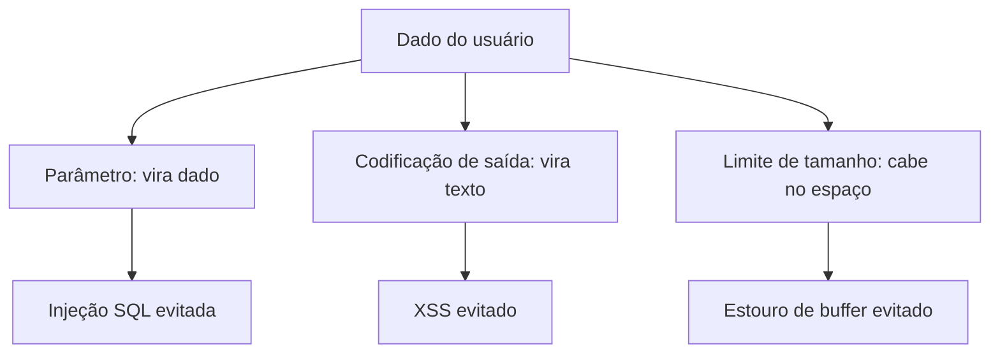

# 70 · Ameaças de aplicação: injeção, XSS e estouro de buffer

**Tempo estimado:** 55 minutos · **Pré-requisito:** [[54 - SQL com SQLite - consultas, junções, visões e restrições]] (consultas e parâmetros) e [[67 - Propriedades de segurança, princípios e modelagem de ameaças]].

**Ao final você vai conseguir:**

1. Explicar por que consultas parametrizadas separam a estrutura do SQL dos dados.
2. Codificar a saída para HTML e para outros contextos, e ver que o texto do usuário deixa de ser código.
3. Descrever o estouro de buffer e as mitigações que a nota lista.
4. Associar cada ameaça à defesa primária recomendada.

**Antes de começar:** no módulo 54 você usou `?` com o `sqlite3`. Aqui o mesmo parâmetro é a defesa, e o módulo mostra o porquê.

---

## Para começar

Um formulário de busca de clientes monta uma consulta com o texto digitado. Se o texto contém um apóstrofo, o SQL quebra; se contém comandos, o banco pode executá-los. O problema não é o texto: é a mistura entre texto que deveria ser dado e texto que deveria ser comando. As defesas deste módulo separam essas duas coisas.

---

## Mapa do módulo



*Figura 1: cada ameaça tem uma defesa que impede o dado de ser tratado como código ou de ultrapassar o espaço reservado.*

**Como ler:** as três defesas têm a mesma ideia: o dado do usuário fica no lugar de dado.

---

## Mini-aula 1: injeção SQL e consultas parametrizadas

> [!tip] Ideia
> Injeção SQL acontece quando um dado não confiável é interpretado como parte do comando SQL. A consulta parametrizada fixa a estrutura e passa os valores separadamente.

> [!info] Definição
> Segundo a nota de OWASP, a defesa primária contra injeção SQL é a consulta parametrizada, também chamada de instrução preparada. A estrutura fica fixa, e os valores entram pela API do banco. A nota trata só de defesas, sem passos de ataque. O `sqlite3` do Python usa `?` como parâmetro.

Veja uma consulta com um apóstrofo no nome. Antes de rodar, diga se o resultado é a linha de `O'Brien`.

```python
import sqlite3

con = sqlite3.connect(":memory:")
con.execute("CREATE TABLE usuario (id INTEGER PRIMARY KEY, nome TEXT)")
con.executemany("INSERT INTO usuario VALUES (?, ?)", [(1, "Ana"), (2, "O'Brien")])
entrada = "O'Brien"
print("consulta parametrizada:", con.execute("SELECT id FROM usuario WHERE nome = ?", (entrada,)).fetchall())
```

Saída real:

```
consulta parametrizada: [(2,)]
```

**Como ler:** o apóstrofo, que quebraria uma consulta montada com texto, aparece como um caractere do dado. O banco acha a linha certa, porque o valor não foi colado no comando.

> [!warning] Armadilha comum
> A defesa é separar o dado do comando. A nota não apresenta a limpeza do texto como substituto.

> [!question]- Checkpoint
> 1. Por que o apóstrofo em `O'Brien` não quebra a consulta parametrizada?
> 2. Qual é a defesa primária contra injeção SQL, segundo a nota?
>
> > [!success]- Resposta
> > 1. Porque o valor é passado como parâmetro, e não colado no texto do SQL.
> > 2. A consulta parametrizada.

---

## Mini-aula 2: XSS e codificação de saída

> [!tip] Ideia
> XSS acontece quando um dado não confiável chega à página de modo que o navegador o trata como código. A codificação de saída transforma os caracteres especiais em texto.

> [!info] Definição
> Segundo a nota de OWASP, a prevenção de XSS segue uma ordem: primeiro o auto-escape do framework; depois a codificação de saída por contexto (corpo de HTML, atributo, JavaScript, CSS e URL, cada um com sua codificação); depois destinos seguros, como `textContent` em vez de `innerHTML`; depois a sanitização de HTML do usuário com biblioteca mantida; e a CSP só como complemento.

Veja a codificação de um texto com marcação e aspas. Antes de rodar, diga qual é o resultado para a tag `<b>`.

```python
import html

texto = "<b>oi</b> & 'tchau'"
print("texto codificado para HTML:", html.escape(texto))
```

Saída real:

```
texto codificado para HTML: &lt;b&gt;oi&lt;/b&gt; &amp; &#x27;tchau&#x27;
```

**Como ler:** `<b>` vira `&lt;b&gt;`, que o navegador mostra como texto. O `&` e o apóstrofo também são codificados.

> [!warning] Armadilha comum
> A codificação depende do contexto. Um texto codificado para o corpo de HTML não está seguro dentro de um script ou de um atributo.

> [!question]- Checkpoint
> 1. O que a codificação faz com `<b>`?
> 2. Por que a codificação depende do contexto?
>
> > [!success]- Resposta
> > 1. Transforma em `&lt;b&gt;`, que aparece como texto.
> > 2. Porque cada contexto (HTML, atributo, JavaScript, CSS, URL) tem caracteres perigosos diferentes.

---

## Mini-aula 3: estouro de buffer

> [!tip] Ideia
> Um buffer tem tamanho fixo. Escrever mais dados do que ele comporta sobrescreve a memória vizinha, o que pode derrubar o programa ou alterar dados de controle.

> [!info] Definição
> Segundo OWASP, há estouro de buffer quando um programa tenta colocar mais dados em um buffer do que ele comporta. As consequências citadas pela nota são falhas, negação de serviço, dados corrompidos e, quando há sobrescrita de dados de controle, execução de código. As mitigações incluem linguagens com checagem de limites, bibliotecas de string seguras, proteções do compilador e do sistema operacional, checagem do tamanho da entrada e atualizações. A nota afirma que linguagens como Python são imunes para os programas que executam, mas o próprio interpretador pode ter falhas desse tipo.

No exercício P1, você implementa a checagem de tamanho.

> [!warning] Armadilha comum
> Truncar a entrada em silêncio também é um problema: o programa passa a trabalhar com um dado que não é o recebido. A checagem deve avisar.

> [!question]- Checkpoint
> 1. Quais são as consequências do estouro de buffer citadas pela nota?
> 2. Por que Python não está imune no nível do interpretador?
>
> > [!success]- Resposta
> > 1. Falhas, negação de serviço, dados corrompidos e, com sobrescrita de controle, execução de código.
> > 2. Porque o próprio interpretador é escrito em linguagem que pode ter esse tipo de falha.

---

## Exercícios

Cada exercício tem um bloco com a função a completar e os testes com `assert`. Quando todos passarem, aparece `Passou!`. As funções definidas em exercícios anteriores aparecem no código inicial.

### Aquecimento

**A1. Consulta parametrizada.** A nota de SQL Injection diz que a defesa primária contra injeção SQL é a consulta parametrizada: a estrutura do SQL é fixa, e os valores são passados pela API do banco. Complete `consulta_segura(con, nome)`, que devolve a lista dos ids dos usuários com esse nome, usando `?` como parâmetro. A função `cria_base`, definida aqui, monta a base de exemplo.

```python
import sqlite3

def cria_base():
    con = sqlite3.connect(":memory:")
    con.execute("CREATE TABLE usuario (id INTEGER PRIMARY KEY, nome TEXT)")
    con.executemany("INSERT INTO usuario VALUES (?, ?)", [(1, "Ana"), (2, "O'Brien"), (3, "Ana")])
    return con

def consulta_segura(con, nome):
    """Ids dos usuários com o nome, com o valor passado como parâmetro (não como texto do SQL)."""
    ...

base = cria_base()
assert consulta_segura(base, "Ana") == [1, 3], "dois Anas"
assert consulta_segura(base, "O'Brien") == [2], "o apóstrofo é só um caractere do dado"
assert consulta_segura(base, "Ninguém") == [], "nenhum"
print("Passou!")
```

> [!hint]- Dica 1
> Use `con.execute("SELECT id FROM usuario WHERE nome = ?", (nome,))` e devolva `[r[0] for r in ...]`.

> [!hint]- Dica 2
> Para `"O'Brien"`, o resultado é `[2]`; o apóstrofo é só um caractere do dado.

> [!example]- Solução
> ```python
> def consulta_segura(con, nome):
>     """Ids dos usuários com o nome, com o valor passado como parâmetro (não como texto do SQL)."""
>     return [r[0] for r in con.execute("SELECT id FROM usuario WHERE nome = ?", (nome,))]
> ```
>
> **Erro comum:** Montar a consulta com `+` ou `f-string` com o nome dentro. Mesmo que pareça funcionar, o dado passa a fazer parte do comando.

**A2. Codificação de saída.** A nota de Cross-Site Scripting diz que a codificação de saída por contexto evita que o dado seja lido como código. Para o corpo de HTML, os caracteres `<`, `>`, `&` e as aspas devem ser codificados. Complete `escapa_html(texto)`, que devolve o texto codificado com `html.escape` (aspas incluídas).

```python
import html

def escapa_html(texto):
    """Texto codificado para o corpo de HTML, com <, >, & e aspas substituídos."""
    ...

assert escapa_html("<b>") == "&lt;b&gt;", "marcação vira texto"
assert escapa_html("a & b") == "a &amp; b", "e comercial"
assert escapa_html('"x"') == "&quot;x&quot;", "aspas"
print("Passou!")
```

> [!hint]- Dica 1
> Use `html.escape(texto)`, com `import html` no começo do arquivo.

> [!hint]- Dica 2
> Para `"<b>"`, o resultado é `"&lt;b&gt;"`.

> [!example]- Solução
> ```python
> def escapa_html(texto):
>     """Texto codificado para o corpo de HTML, com <, >, & e aspas substituídos."""
>     return html.escape(texto)
> ```
>
> **Erro comum:** Remover só os `<`. Um atributo com aspas também pode ser quebrado; a codificação deve cobrir todos os caracteres especiais.

**A3. Codificação por contexto.** A nota de Cross-Site Scripting diz que o corpo de HTML, atributos, JavaScript, CSS e URL precisam, cada um, de sua própria codificação. Complete `codificacao_contexto(contexto)`, que devolve o nome da codificação para cada contexto: `"html"` → `"codificar HTML"`, `"atributo"` → `"codificar atributo"`, `"javascript"` → `"codificar JavaScript"`, `"css"` → `"codificar CSS"`, `"url"` → `"codificar URL"`. Para outro contexto, levante `ValueError`.

```python
def codificacao_contexto(contexto):
    """Nome da codificação de saída exigida pelo contexto; outro contexto levanta ValueError."""
    ...

assert codificacao_contexto("url") == "codificar URL", "URL"
assert codificacao_contexto("html") == "codificar HTML", "corpo de HTML"
try:
    codificacao_contexto("xml")
    assert False, "deveria levantar ValueError"
except ValueError:
    pass
print("Passou!")
```

> [!hint]- Dica 1
> Use um dicionário com os cinco contextos.

> [!hint]- Dica 2
> Para `"url"`, o resultado é `"codificar URL"`.

> [!example]- Solução
> ```python
> def codificacao_contexto(contexto):
>     """Nome da codificação de saída exigida pelo contexto; outro contexto levanta ValueError."""
>     codificacoes = {
>         "html": "codificar HTML",
>         "atributo": "codificar atributo",
>         "javascript": "codificar JavaScript",
>         "css": "codificar CSS",
>         "url": "codificar URL",
>     }
>     if contexto not in codificacoes:
>         raise ValueError("contexto desconhecido")
>     return codificacoes[contexto]
> ```
>
> **Erro comum:** Usar a mesma codificação para todos os contextos. Cada um tem regras próprias, e uma codificação de HTML não protege dentro de JavaScript.

### Praticando

**P1. Limite de tamanho.** A nota de Buffer Overflow diz que uma das mitigações é a checagem de tamanho da entrada antes de copiá-la para um espaço fixo. Complete `valida_tamanho(entrada, maximo)`, que devolve a entrada sem alterações quando cabe em `maximo` caracteres, e levanta `ValueError` quando é maior.

```python
def valida_tamanho(entrada, maximo):
    """Devolve a entrada se cabe em maximo caracteres; senão levanta ValueError."""
    ...

assert valida_tamanho("abc", 3) == "abc", "cabe exatamente"
assert valida_tamanho("", 3) == "", "vazia cabe"
try:
    valida_tamanho("abcd", 3)
    assert False, "deveria levantar ValueError"
except ValueError:
    pass
print("Passou!")
```

> [!hint]- Dica 1
> Use `if len(entrada) > maximo:` com o erro, e devolva `entrada` no fim.

> [!hint]- Dica 2
> Uma entrada de exatamente `maximo` caracteres cabe.

> [!example]- Solução
> ```python
> def valida_tamanho(entrada, maximo):
>     """Devolve a entrada se cabe em maximo caracteres; senão levanta ValueError."""
>     if len(entrada) > maximo:
>         raise ValueError("entrada maior que o espaço reservado")
>     return entrada
> ```
>
> **Erro comum:** Truncar a entrada em silêncio com `entrada[:maximo]`. A checagem deve avisar, e não esconder o excesso.

**P2. Destino seguro.** A nota de Cross-Site Scripting recomenda preferir destinos seguros, como `textContent` em vez de `innerHTML`, e sanitizar HTML do usuário com biblioteca mantida quando ele precisa ser HTML. Complete `sink_seguro(precisa_html)`, que devolve `"sanitizar com biblioteca"` quando `precisa_html` é verdadeiro, e `"textContent"` caso contrário.

```python
def sink_seguro(precisa_html):
    """Destino seguro: sanitizar HTML se é preciso marcação, senão textContent."""
    ...

assert sink_seguro(False) == "textContent", "texto puro"
assert sink_seguro(True) == "sanitizar com biblioteca", "marcação do usuário"
print("Passou!")
```

> [!hint]- Dica 1
> Use um `if` simples sobre o argumento booleano.

> [!hint]- Dica 2
> Para `False`, o resultado é `"textContent"`.

> [!example]- Solução
> ```python
> def sink_seguro(precisa_html):
>     """Destino seguro: sanitizar HTML se é preciso marcação, senão textContent."""
>     if precisa_html:
>         return "sanitizar com biblioteca"
>     return "textContent"
> ```
>
> **Erro comum:** Usar `innerHTML` quando não há necessidade de HTML. O texto puro não precisa de interpretação de marcação.

### Desafio

**D1. Defesa primária.** As notas da biblioteca dão, para cada ameaça, a defesa principal: para injeção SQL, a consulta parametrizada; para XSS, o auto-escape do framework; para estouro de buffer, a checagem de limites. Complete `defesa_primaria(ameaca)`, que devolve a defesa de cada uma, e levanta `ValueError` para outra ameaça.

```python
def defesa_primaria(ameaca):
    """Defesa principal indicada pela nota para cada ameaça; outra ameaça levanta ValueError."""
    ...

assert defesa_primaria("injecao SQL") == "consulta parametrizada", "SQL"
assert defesa_primaria("XSS") == "auto-escape do framework", "XSS"
try:
    defesa_primaria("phishing")
    assert False, "deveria levantar ValueError"
except ValueError:
    pass
print("Passou!")
```

> [!hint]- Dica 1
> Use um dicionário com as três chaves: `"injecao SQL"`, `"XSS"` e `"estouro de buffer"`.

> [!hint]- Dica 2
> Para `"XSS"`, o resultado é `"auto-escape do framework"`.

> [!example]- Solução
> ```python
> def defesa_primaria(ameaca):
>     """Defesa principal indicada pela nota para cada ameaça; outra ameaça levanta ValueError."""
>     defesas = {
>         "injecao SQL": "consulta parametrizada",
>         "XSS": "auto-escape do framework",
>         "estouro de buffer": "verificação de limites",
>     }
>     if ameaca not in defesas:
>         raise ValueError("ameaça desconhecida")
>     return defesas[ameaca]
> ```
>
> **Erro comum:** Devolver uma defesa genérica como `"validar tudo"`. A nota aponta a defesa específica de cada ameaça, e é isso que o exercício pede.


---

## Mini-projeto (opcional)

Você vai renderizar texto de usuário em HTML sem que ele vire código. Tente sozinho antes de abrir a solução.

**Mini-projeto: renderização segura.** Complete `renderiza(texto)`, que devolve um parágrafo HTML com o texto codificado: `"<p>" + escapa_html(texto) + "</p>"`. Use `escapa_html`, já definida acima, e não concatene o texto cru. Assim, o texto do usuário entra no HTML como dado.

```python
import html

def escapa_html(texto):
    return html.escape(texto)

def renderiza(texto):
    """Parágrafo HTML com o texto do usuário codificado como dado."""
    ...

assert renderiza("<i>x</i>") == "<p>&lt;i&gt;x&lt;/i&gt;</p>", "a marcação vira texto"
assert renderiza("oi") == "<p>oi</p>", "texto simples"
print("Passou!")
```

> [!hint]- Dica 1
> Use `f"<p>{escapa_html(texto)}</p>"`.

> [!hint]- Dica 2
> Para `"<i>x</i>"`, o resultado é `"<p>&lt;i&gt;x&lt;/i&gt;</p>"`.

> [!example]- Solução
> ```python
> def renderiza(texto):
>     """Parágrafo HTML com o texto do usuário codificado como dado."""
>     return f"<p>{escapa_html(texto)}</p>"
> ```
>
> **Erro comum:** Concatenar o texto sem `escapa_html`. A marcação do usuário passaria a ser interpretada pelo navegador.


---

## Fechando

**Resumo**

- Injeção SQL: a defesa é a consulta parametrizada, que separa o comando do dado.
- XSS: a defesa é a codificação de saída por contexto, com auto-escape do framework em primeiro lugar.
- Estouro de buffer: a defesa inclui checagem de limites, linguagens seguras e proteções do sistema.
- Em todos os casos, o dado do usuário deve ficar no lugar de dado.

**Glossário rápido**

- **Consulta parametrizada** (prepared statement): comando com estrutura fixa e valores passados à parte.
- **Codificação de saída** (output encoding): transforma caracteres especiais em texto.
- **Auto-escape**: codificação automática feita pelo framework.
- **Estouro de buffer** (buffer overflow): escrita além do espaço reservado.
- **CSP**: política de segurança de conteúdo, usada como complemento.

**Perguntas de revisão**

1. Por que a codificação de um texto para HTML não protege um valor inserido dentro de um script?
2. Qual é a diferença entre truncar a entrada e recusá-la, do ponto de vista da defesa?
3. Por que `textContent` é preferível a `innerHTML` quando o conteúdo é só texto?

**E agora?** O próximo módulo é **Nuvem, privacidade e regulação de dados**. Ele trata do modelo de responsabilidade compartilhada, de conceitos de privacidade e dos princípios de proteção de dados do GDPR.

---

## Para ir mais fundo

- [[SQL Injection and Parameterized Queries]]
- [[Cross-Site Scripting]]
- [[Buffer Overflow and Memory Safety]]
