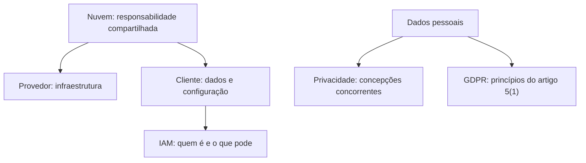

# 71 · Nuvem, privacidade e regulação de dados

**Tempo estimado:** 55 minutos · **Pré-requisito:** [[69 - Autenticação, senhas e sessões]] (identidade) e [[67 - Propriedades de segurança, princípios e modelagem de ameaças]] (menor privilégio).

**Ao final você vai conseguir:**

1. Separar, no modelo de responsabilidade compartilhada da nuvem, o que é do provedor e o que é do cliente.
2. Explicar como IAM controla autenticação e autorização, e por que o root não é usado no dia a dia.
3. Reconhecer que privacidade não tem uma definição única, e que a nota de SEP lista concepções concorrentes.
4. Aplicar os princípios do artigo 5(1) do GDPR a casos simples de coleta e uso de dados.

**Antes de começar:** os módulos anteriores trataram de sistemas e de dados. Este fecha o curso com a pergunta de quem responde pelos dados, e com quais regras.

---

## Para começar

Uma empresa guarda dados de clientes em um serviço de nuvem. Se o sistema vazar, quem é responsável: o provedor da nuvem, ou a empresa? E se a empresa coleta mais dados do que precisa, a nuvem a protege? A resposta depende de uma divisão de responsabilidades e de regras de proteção de dados, que este módulo organiza.

---

## Mapa do módulo



*Figura 1: na nuvem, cada parte responde por uma faixa; IAM controla o acesso do cliente. A privacidade e os princípios do GDPR tratam o dado em si.*

**Como ler:** as duas metades se encontram no cliente, que responde pelos dados e pelo acesso a eles.

---

## Mini-aula 1: responsabilidade compartilhada

> [!tip] Ideia
> Na nuvem, o provedor protege a infraestrutura, e o cliente protege o que coloca nela. Dados e configuração são do cliente, mesmo quando o provedor oferece o serviço.

> [!info] Definição
> Segundo a documentação da AWS citada na nota, a segurança "da" nuvem é do provedor (hardware, software, rede e instalações), e a segurança "na" nuvem é do cliente (dados, configuração e sistema convidado, conforme o serviço). A nota é específica de um fornecedor; outros provedores podem dividir a responsabilidade de outra forma.

Veja a divisão de alguns itens. Antes de começar o exercício A1, diga quem responde pelos dados.

> [!warning] Armadilha comum
> Um serviço gerenciado não transfere a responsabilidade pelos dados. Ele tira do cliente a manutenção da infraestrutura, e não a escolha do que guardar e de quem pode acessar.

> [!question]- Checkpoint
> 1. Quem responde pela segurança do hardware?
> 2. Quem responde pela configuração de acesso?
>
> > [!success]- Resposta
> > 1. O provedor.
> > 2. O cliente.

---

## Mini-aula 2: IAM

> [!tip] Ideia
> O IAM controla quem está autenticado e quem tem permissão para cada ação. A regra prática é dar o mínimo e evitar o uso do usuário com acesso total.

> [!info] Definição
> A nota da AWS diz que o IAM controla quem é autenticado (entrou) e autorizado (tem permissões) a usar os recursos. O usuário root tem acesso completo e não deve ser usado para tarefas do dia a dia; deve-se criar outras identidades com o necessário. Principal, papel e política são termos específicos da AWS.

Veja a decisão de permissão com um usuário comum e com o root. Antes de rodar, diga se o usuário comum pode apagar o bucket.

```python
permissoes = {"ler_relatorio"}

def pode(usuario_root, acao):
    if usuario_root:
        return True
    return acao in permissoes

print("root executa qualquer ação:", pode(True, "apagar_bucket"))
print("usuário comum lê relatório:", pode(False, "ler_relatorio"))
print("usuário comum apaga bucket:", pode(False, "apagar_bucket"))
```

Saída real:

```
root executa qualquer ação: True
usuário comum lê relatório: True
usuário comum apaga bucket: False
```

**Como ler:** o root pode tudo; o usuário comum só lê o relatório. Apagar o bucket é negado, porque não está entre as permissões dadas.

> [!warning] Armadilha comum
> Dar acesso amplo "para facilitar" aumenta o dano de um vazamento de credencial. O mínimo necessário limita o estrago.

> [!question]- Checkpoint
> 1. O que IAM decide: autenticação, autorização, ou as duas?
> 2. Por que o root não deve ser usado no dia a dia?
>
> > [!success]- Resposta
> > 1. As duas: quem é (autenticação) e o que pode (autorização).
> > 2. Porque tem acesso completo, e um uso rotineiro aumenta o dano de um vazamento.

---

## Mini-aula 3: privacidade

> [!tip] Ideia
> Privacidade é difícil de definir. Há concepções diferentes, e cada uma aponta para um aspecto: ser deixado em paz, controlar informações, ser inacessível, ou manter o contexto apropriado de fluxo de dados.

> [!info] Definição
> A entrada da Stanford Encyclopedia of Philosophy, citada na nota, não traz uma definição única. Lista concepções como o direito de ser deixado em paz (Warren e Brandeis, 1890), o controle sobre a informação (Westin, Fried), a inacessibilidade (Gavison) e a integridade contextual (Nissenbaum). Solove chama o conceito de "conceito em desordem".

> [!warning] Armadilha comum
> Tratar privacidade como um único valor leva a decisões inconsistentes. Escolher uma concepção muda o que conta como violação.

> [!question]- Checkpoint
> 1. A nota de SEP oferece uma definição única de privacidade?
> 2. Qual concepção fala em integridade contextual?
>
> > [!success]- Resposta
> > 1. Não; lista concepções concorrentes.
> > 2. A de Nissenbaum.

---

## Mini-aula 4: princípios do GDPR

> [!tip] Ideia
> O artigo 5(1) do GDPR lista princípios para tratar dados pessoais: licitude, finalidade, minimização, exatidão, conservação e integridade com confidencialidade. A nota acrescenta um dever de responsabilização.

> [!info] Definição
> A nota de GDPR, de uma reprodução não oficial, lista os seis princípios do artigo 5(1) do Regulamento (UE) 2016/679.

Veja a lista dos princípios. Antes de rodar, diga quantos são.

```python
principios = [
    "licitude, lealdade e transparência",
    "limitação da finalidade",
    "minimização dos dados",
    "exatidão",
    "limitação da conservação",
    "integridade e confidencialidade",
]
for n, p in enumerate(principios, 1):
    print(f"artigo 5(1), item {n}: {p}")
```

Saída real:

```
artigo 5(1), item 1: licitude, lealdade e transparência
artigo 5(1), item 2: limitação da finalidade
artigo 5(1), item 3: minimização dos dados
artigo 5(1), item 4: exatidão
artigo 5(1), item 5: limitação da conservação
artigo 5(1), item 6: integridade e confidencialidade
```

**Como ler:** a lista tem os seis itens em ordem. Cada um pede uma ação diferente: justificar a coleta, limitar o uso, reduzir os campos, manter o dado correto e apagá-lo quando não for mais preciso.

> [!warning] Armadilha comum
> Os princípios não são uma lista de verificação suficiente para cumprir a lei. Eles orientam o projeto; a aplicação concreta depende do contexto e do texto oficial.

> [!question]- Checkpoint
> 1. Quantos princípios o artigo 5(1) lista?
> 2. Qual princípio exige reduzir os campos coletados?
>
> > [!success]- Resposta
> > 1. Seis.
> > 2. A minimização dos dados.

---

## Exercícios

Cada exercício tem um bloco com a função a completar e os testes com `assert`. Quando todos passarem, aparece `Passou!`. As funções definidas em exercícios anteriores aparecem no código inicial.

### Aquecimento

**A1. Responsabilidade compartilhada.** A nota de AWS diz que a segurança "da" nuvem é do provedor (hardware, software, rede, instalações), e a segurança "na" nuvem é do cliente (dados e configuração). Complete `responsabilidade(item)`, que devolve `"provedor"` para `"hardware"`, `"rede"` e `"instalacoes"`, e `"cliente"` para `"dados"` e `"configuracao"`. Para outro item, levante `ValueError`.

```python
def responsabilidade(item):
    """Quem responde pelo item no modelo de responsabilidade compartilhada da nota."""
    ...

assert responsabilidade("dados") == "cliente", "os dados são do cliente"
assert responsabilidade("rede") == "provedor", "a rede é do provedor"
try:
    responsabilidade("café")
    assert False, "deveria levantar ValueError"
except ValueError:
    pass
print("Passou!")
```

> [!hint]- Dica 1
> Use um dicionário com os cinco itens.

> [!hint]- Dica 2
> Para `"dados"`, o resultado é `"cliente"`.

> [!example]- Solução
> ```python
> def responsabilidade(item):
>     """Quem responde pelo item no modelo de responsabilidade compartilhada da nota."""
>     mapa = {
>         "hardware": "provedor",
>         "rede": "provedor",
>         "instalacoes": "provedor",
>         "dados": "cliente",
>         "configuracao": "cliente",
>     }
>     if item not in mapa:
>         raise ValueError("item desconhecido")
>     return mapa[item]
> ```
>
> **Erro comum:** Atribuir a proteção dos dados ao provedor. O modelo da nota deixa os dados e a configuração com o cliente, mesmo que o provedor tenha um serviço gerenciado.

**A2. Princípios do artigo 5.** A nota de GDPR lista seis princípios do artigo 5(1) do Regulamento (UE) 2016/679: licitude, lealdade e transparência; limitação da finalidade; minimização dos dados; exatidão; limitação da conservação; e integridade e confidencialidade. Complete `principio_gdpr(n)`, que devolve o nome do princípio de número `n` (de 1 a 6), e levanta `ValueError` para outro número.

```python
def principio_gdpr(n):
    """Nome do princípio do artigo 5(1) de número n (1 a 6); outro número levanta ValueError."""
    ...

assert principio_gdpr(3) == "minimização dos dados", "o terceiro"
assert principio_gdpr(1) == "licitude, lealdade e transparência", "o primeiro"
try:
    principio_gdpr(7)
    assert False, "deveria levantar ValueError"
except ValueError:
    pass
print("Passou!")
```

> [!hint]- Dica 1
> Use uma lista com os seis nomes e acesse `lista[n - 1]`, depois de checar o intervalo.

> [!hint]- Dica 2
> Para `n = 3`, o resultado é `"minimização dos dados"`.

> [!example]- Solução
> ```python
> def principio_gdpr(n):
>     """Nome do princípio do artigo 5(1) de número n (1 a 6); outro número levanta ValueError."""
>     principios = [
>         "licitude, lealdade e transparência",
>         "limitação da finalidade",
>         "minimização dos dados",
>         "exatidão",
>         "limitação da conservação",
>         "integridade e confidencialidade",
>     ]
>     if not 1 <= n <= 6:
>         raise ValueError("número fora de 1 a 6")
>     return principios[n - 1]
> ```
>
> **Erro comum:** Usar `n` direto como índice. O primeiro princípio é o índice 0, e o índice `n` daria o segundo.

**A3. Minimização de dados.** O princípio da minimização, da nota de GDPR, pede coletar só os dados necessários para a finalidade. Complete `minimiza(campos, necessarios)`, que devolve um dicionário com apenas os pares de `campos` cujo nome está em `necessarios`, na mesma ordem.

```python
def minimiza(campos, necessarios):
    """Dicionário só com os campos necessários para a finalidade (minimização)."""
    ...

assert minimiza({"nome": "Ana", "cpf": "1", "cidade": "SP"}, ["nome", "cidade"]) == {"nome": "Ana", "cidade": "SP"}, "o CPF sai"
assert minimiza({"nome": "Ana"}, []) == {}, "nada necessário, nada guardado"
assert minimiza({}, ["nome"]) == {}, "sem campos"
print("Passou!")
```

> [!hint]- Dica 1
> Use uma comprehension de dicionário: `{k: v for k, v in campos.items() if k in necessarios}`.

> [!hint]- Dica 2
> Para `{"nome": "Ana", "cpf": "1", "cidade": "SP"}` com `["nome", "cidade"]`, o resultado é `{"nome": "Ana", "cidade": "SP"}`.

> [!example]- Solução
> ```python
> def minimiza(campos, necessarios):
>     """Dicionário só com os campos necessários para a finalidade (minimização)."""
>     return {k: v for k, v in campos.items() if k in necessarios}
> ```
>
> **Erro comum:** Devolver `campos` sem filtrar. Todos os dados extras continuariam sendo guardados, contra o princípio.

### Praticando

**P1. Permissões por padrão.** A nota de IAM diz que o usuário root tem acesso completo e não deve ser usado para tarefas do dia a dia, e que outras identidades devem receber só o necessário. Esta regra de decisão é deste exercício: o root pode tudo; qualquer outro usuário só pode as ações listadas em `permissoes`. Complete `pode_agir(permissoes, acao, e_root)`, que devolve `True` ou `False`.

```python
def pode_agir(permissoes, acao, e_root):
    """True se o root, ou se a ação está listada para o usuário comum; caso contrário, False."""
    ...

assert pode_agir({"ler"}, "ler", False) is True, "listada"
assert pode_agir({"ler"}, "apagar", False) is False, "não listada: negada"
assert pode_agir(set(), "apagar", True) is True, "o root não depende da lista"
print("Passou!")
```

> [!hint]- Dica 1
> Se `e_root`, devolva `True`. Senão, devolva `acao in permissoes`.

> [!hint]- Dica 2
> Com `permissoes = {"ler"}`, o usuário comum pode `"ler"` e não pode `"apagar"`.

> [!example]- Solução
> ```python
> def pode_agir(permissoes, acao, e_root):
>     """True se o root, ou se a ação está listada para o usuário comum; caso contrário, False."""
>     if e_root:
>         return True
>     return acao in permissoes
> ```
>
> **Erro comum:** Dar a todo usuário uma permissão padrão. A regra é negar por padrão e liberar só o que está listado.

**P2. Limitação da finalidade.** O princípio da limitação da finalidade exige que o dado seja usado para a finalidade declarada na coleta. Esta regra simples deste exercício devolve `True` apenas quando o uso é igual à finalidade declarada. Complete `uso_permitido(finalidade_declarada, uso)`.

```python
def uso_permitido(finalidade_declarada, uso):
    """True se o uso é exatamente a finalidade declarada na coleta (regra deste exercício)."""
    ...

assert uso_permitido("entrega", "entrega") is True, "mesma finalidade"
assert uso_permitido("entrega", "publicidade") is False, "outra finalidade"
assert uso_permitido("entrega", "entrega de pedido") is False, "mais específico não é o mesmo"
print("Passou!")
```

> [!hint]- Dica 1
> Use `uso == finalidade_declarada`.

> [!hint]- Dica 2
> Para `"entrega"` declarada e uso `"publicidade"`, o resultado é `False`.

> [!example]- Solução
> ```python
> def uso_permitido(finalidade_declarada, uso):
>     """True se o uso é exatamente a finalidade declarada na coleta (regra deste exercício)."""
>     return uso == finalidade_declarada
> ```
>
> **Erro comum:** Verificar só se o uso está contido na finalidade, como substring. Uma finalidade maior não autoriza qualquer uso dentro dela.

### Desafio

**D1. Prazo de conservação.** O princípio da limitação da conservação exige que o dado não fique guardado além do necessário. Esta regra deste exercício compara o número de dias de retenção com um limite: é válida quando `dias` não passa de `limite`. Complete `retencao_valida(dias, limite)`.

```python
def retencao_valida(dias, limite):
    """True se o prazo de retenção não passa do limite (regra deste exercício)."""
    ...

assert retencao_valida(30, 30) is True, "no limite"
assert retencao_valida(31, 30) is False, "passou"
assert retencao_valida(0, 30) is True, "sem retenção"
print("Passou!")
```

> [!hint]- Dica 1
> Use `dias <= limite`.

> [!hint]- Dica 2
> Para 30 dias e limite de 30, o resultado é `True`.

> [!example]- Solução
> ```python
> def retencao_valida(dias, limite):
>     """True se o prazo de retenção não passa do limite (regra deste exercício)."""
>     return dias <= limite
> ```
>
> **Erro comum:** Usar `<` no lugar de `<=`. Reter exatamente pelo limite permitido não viola o princípio.


---

## Mini-projeto (opcional)

Você vai montar um checklist de privacidade que aponta quais princípios um caso viola. Tente sozinho antes de abrir a solução.

**Mini-projeto: checklist de privacidade.** Complete `checklist_privacidade(dados, finalidade, uso, necessarios, dias, limite)`, que devolve a lista de princípios violados, nesta ordem: `"minimizacao"` se `dados` tem campos fora de `necessarios`; `"finalidade"` se `uso_permitido(finalidade, uso)` é falso; `"conservacao"` se `retencao_valida(dias, limite)` é falso. Use `minimiza`, `uso_permitido` e `retencao_valida`, já definidas acima.

```python
def minimiza(campos, necessarios):
    return {k: v for k, v in campos.items() if k in necessarios}

def uso_permitido(finalidade_declarada, uso):
    return uso == finalidade_declarada

def retencao_valida(dias, limite):
    return dias <= limite

def checklist_privacidade(dados, finalidade, uso, necessarios, dias, limite):
    """Princípios violados: minimização, finalidade e conservação, nessa ordem."""
    ...

assert checklist_privacidade({"nome": "Ana", "cpf": "1"}, "entrega", "entrega", ["nome"], 10, 30) == ["minimizacao"], "um campo extra"
assert checklist_privacidade({"nome": "Ana"}, "entrega", "publicidade", ["nome"], 40, 30) == ["finalidade", "conservacao"], "uso e prazo"
assert checklist_privacidade({"nome": "Ana"}, "entrega", "entrega", ["nome"], 10, 30) == [], "tudo conforme"
print("Passou!")
```

> [!hint]- Dica 1
> Para minimização, compare `set(dados) - set(necessarios)`: se há sobra, é violação.

> [!hint]- Dica 2
> Para `dados = {"nome": "Ana", "cpf": "1"}`, `necessarios = ["nome"]`, finalidade `"entrega"`, uso `"entrega"`, `dias = 10`, `limite = 30`, o resultado é `["minimizacao"]`.

> [!example]- Solução
> ```python
> def checklist_privacidade(dados, finalidade, uso, necessarios, dias, limite):
>     """Princípios violados: minimização, finalidade e conservação, nessa ordem."""
>     violados = []
>     if set(dados) - set(necessarios):
>         violados.append("minimizacao")
>     if not uso_permitido(finalidade, uso):
>         violados.append("finalidade")
>     if not retencao_valida(dias, limite):
>         violados.append("conservacao")
>     return violados
> ```
>
> **Erro comum:** Comparar `minimiza(dados, necessarios) == dados`. Essa igualdade já é verdadeira com `necessarios` que contém todos os campos, e a checagem mais clara é a diferença de conjuntos.


---

## Fechando

**Resumo**

- Na nuvem, o provedor protege a infraestrutura; o cliente protege dados, configuração e acesso.
- IAM decide autenticação e autorização; o root não deve ser usado no dia a dia.
- Privacidade tem concepções concorrentes, sem definição única.
- O GDPR lista seis princípios do artigo 5(1): licitude, finalidade, minimização, exatidão, conservação e integridade com confidencialidade.

**Glossário rápido**

- **Responsabilidade compartilhada** (shared responsibility): divisão de segurança entre provedor e cliente.
- **IAM**: gestão de identidade e acesso.
- **Root**: usuário com acesso completo.
- **Minimização** (data minimisation): coletar só o necessário.
- **Limitação da finalidade** (purpose limitation): usar o dado para a finalidade declarada.

**Perguntas de revisão**

1. Por que a responsabilidade pelos dados fica com o cliente, mesmo em um serviço gerenciado?
2. Duas empresas que coletam o mesmo dado podem ter obrigações diferentes? Justifique com a ideia de finalidade.
3. Por que uma definição única de privacidade faria falta a um checklist?

**E agora?** Com este módulo, o bloco 9 (Segurança) está completo, e com ele o curso inteiro: os nove blocos, de matemática discreta à segurança. O último passo é atualizar o índice e revisar a integridade dos módulos.

---

## Para ir mais fundo

- [[Cloud Shared Responsibility and IAM]]
- [[Privacy Concepts]]
- [[GDPR Data Protection Principles]]
