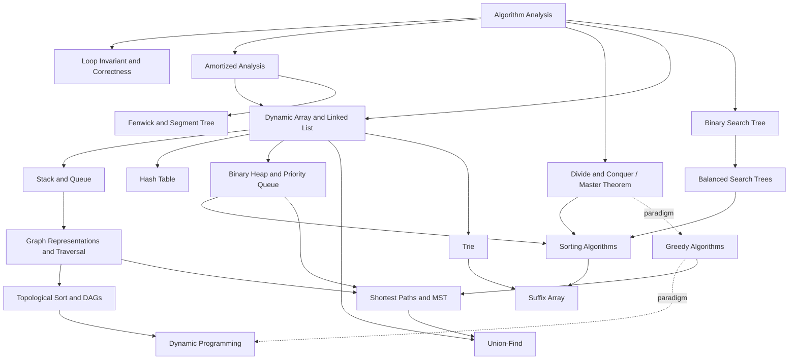

# MOC Algorithms and Data Structures

## Synthesis

This area covers how to measure the cost of a program, the standard structures that hold data, and the paradigms used to design efficient algorithms. The path runs from analysis ([[Algorithm Analysis]], [[Loop Invariant and Algorithm Correctness]], [[Divide and Conquer and the Master Theorem]], [[Amortized Analysis]]) to linear structures and hashing ([[Dynamic Array and Linked List]], [[Stack and Queue]], [[Hash Table]]), then to trees and heaps ([[Binary Heap and Priority Queue]], [[Binary Search Tree]], [[Balanced Search Trees]]) and sorting ([[Sorting Algorithms]]). Graphs ([[Graph Representations and Traversal]]) lead to [[Topological Sort and DAGs]] and [[Shortest Paths and Minimum Spanning Trees]]. Three design paradigms ([[Divide and Conquer and the Master Theorem]], [[Greedy Algorithms]], [[Dynamic Programming]]) cut across all of these. Advanced structures and string tools close the area ([[Union-Find]], [[Trie]], [[Fenwick Tree and Segment Tree]], [[Suffix Array]]).

**Process note.** All 20 findings were verified with a LIGHT pass that accepts single good sources, by user decision on 2026-11-23. Because of this, every note is `debated` (19) or `uncertain` (1, [[Trie]]); none is `established`. Treat the area as a solid first pass, not a settled reference. The CPython claims ([[Dynamic Array and Linked List]], [[Stack and Queue]], [[Hash Table]]) carry `review-by: 2027-11-23`.

## Map

*Dependency map: an arrow means "study first". Solid edges follow how the notes build on each other; dotted edges mark the three design paradigms (divide and conquer, greedy, dynamic programming) that recur across structures and graph algorithms. Edges are a proposed study order, not a claim made by a single source.*

## Notes

Confidence is read from each note's frontmatter (all `status: verified`).

### Analysis
- [[Algorithm Analysis]]: cost and asymptotic comparison. Confidence: debated.
- [[Loop Invariant and Algorithm Correctness]]: proving loops correct. Confidence: debated.
- [[Divide and Conquer and the Master Theorem]]: recursive splitting and recurrences. Confidence: debated.
- [[Amortized Analysis]]: cost averaged over a sequence of operations. Confidence: debated.

### Linear structures and hashing
- [[Dynamic Array and Linked List]]: contiguous vs linked storage. Confidence: debated; review-by 2027-11-23.
- [[Stack and Queue]]: LIFO and FIFO abstractions. Confidence: debated; review-by 2027-11-23.
- [[Hash Table]]: key-value lookup by hashing. Confidence: debated; review-by 2027-11-23.

### Trees and heaps
- [[Binary Heap and Priority Queue]]: priority access. Confidence: debated.
- [[Binary Search Tree]]: ordered search tree. Confidence: debated.
- [[Balanced Search Trees]]: height-guaranteed trees. Confidence: debated.

### Sorting
- [[Sorting Algorithms]]: comparison sorts and costs. Confidence: debated.

### Graphs
- [[Graph Representations and Traversal]]: representations, BFS and DFS. Confidence: debated.
- [[Topological Sort and DAGs]]: ordering acyclic graphs. Confidence: debated.
- [[Shortest Paths and Minimum Spanning Trees]]: weighted-graph problems. Confidence: debated.

### Design paradigms
- [[Greedy Algorithms]]: locally optimal choices. Confidence: debated.
- [[Dynamic Programming]]: overlapping subproblems. Confidence: debated.
- [[Divide and Conquer and the Master Theorem]]: listed under Analysis above; also a paradigm.

### Advanced structures and strings
- [[Union-Find]]: disjoint sets. Confidence: debated.
- [[Trie]]: prefix tree. Confidence: uncertain.
- [[Fenwick Tree and Segment Tree]]: range queries. Confidence: debated.
- [[Suffix Array]]: substring indexing. Confidence: debated.

## Connections to other areas

Builds on (verified notes in [[_MOC Mathematical Foundations]]):
- [[Asymptotic Notation and Growth of Functions]]: the notation behind [[Algorithm Analysis]].
- [[Mathematical Induction]]: the proof tool behind [[Loop Invariant and Algorithm Correctness]] and recurrence arguments.
- [[Linear Recurrence Relations]]: solving the recurrences of [[Divide and Conquer and the Master Theorem]].
- [[Partial Order]]: the structure behind [[Topological Sort and DAGs]].

Place in the course: see [[_Curriculum Map]] (module M2).

Planned areas (no notes yet, plain text): Theory of Computation, Databases, Operating Systems, Computer Architecture.

## Main sources

- [[Cornell CS2112 - Loop Invariants]]
- [[FSU Lacher - Divide and Conquer and the Master Theorem]]
- [[Cornell CS3110 - Amortized Analysis]]
- [[Python Docs - collections.deque]]
- [[Python Docs - Time Complexity of Built-in Types]]
- [[Sedgewick Wayne - Stacks Queues Hash Tables (algs4 1.3 and 3.4)]]
- [[Sedgewick Wayne - Trees and Priority Queues (algs4 2.4, 3.2, 3.3)]]
- [[Sedgewick Wayne - Sorting (algs4 2.1 and 2.2)]]
- [[Sedgewick Wayne - Graphs (algs4 4.1 to 4.4)]]
- [[Sedgewick Wayne - Union-Find and Tries (algs4 1.5 and 5.2)]]
- [[Open Data Structures - Chapter intros (arrays, sorting)]]
- [[Indiana C343 - Algorithmic Paradigms]]
- [[cp-algorithms - DP Fenwick Segment Tree DSU Suffix Array]]

## Gaps and next steps

Next step: course module M2 (Algorithms and Data Structures) can be built from these verified notes.

- [ ] AVL trees and rotations ([[Balanced Search Trees]])
- [ ] BST deletion and degeneration under sorted insertion ([[Binary Search Tree]])
- [ ] Quicksort, stability, radix and counting sort ([[Sorting Algorithms]])
- [ ] Binary search as its own topic
- [ ] Hash table resizing, hash functions, CPython collision strategy ([[Hash Table]])
- [ ] Linked-list cost table ([[Dynamic Array and Linked List]])
- [ ] `heapq` in Python ([[Binary Heap and Priority Queue]])
- [ ] Adjacency matrix trade-offs, all-pairs shortest paths, A* ([[Graph Representations and Traversal]], [[Shortest Paths and Minimum Spanning Trees]])
- [ ] Master theorem Cases 1 and 3 conditions: only Case 2 is recorded, and the FSU page cites Cormen ([[Divide and Conquer and the Master Theorem]])
- [ ] Worst, average and best case; the RAM model ([[Algorithm Analysis]])
- [ ] Union-find proofs and the inverse Ackermann definition ([[Union-Find]])
- [ ] Trie cost formulas ([[Trie]])
- [ ] Suffix trees and suffix automata ([[Suffix Array]])
- [ ] DP optimal substructure and state design ([[Dynamic Programming]])
- [ ] Greedy correctness proofs ([[Greedy Algorithms]])
- [ ] Brute force and backtracking
- [ ] Recursion correctness ([[Loop Invariant and Algorithm Correctness]])
- [ ] Unreadable PDFs: Erickson, CMU 15-451, Stanford CS161
- [ ] Several sources lack author or date
- [ ] CPython claims carry review-by 2027-11-23; recheck then
- [ ] Upgrade confidence from `debated`/`uncertain` by adding independent second sources

## History

- 2026-11-23: created from the 20 verified findings; verified with a light pass accepting single good sources (user decision); status draft.
- 2026-11-23: reviewed by verifier (stage 3 audit): links, index, confidence and review-by checked; quoted the slash label in the Mermaid node DC for safe parsing. Status reviewed.
