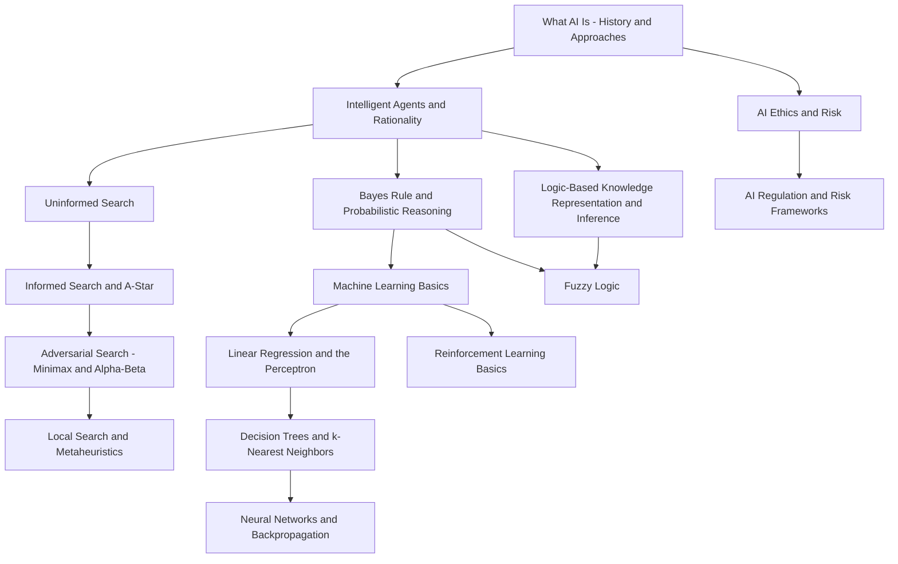

# MOC Artificial Intelligence

> **Process note**: all 16 findings below were verified with a LIGHT pass that accepted single good sources, by user decision on 2026-11-23. Read `verified` here as "checked once, lightly", not as multiply cross-checked. Confidence count from the frontmatter: 1 established, 14 debated, 1 uncertain. In this area `debated` mostly means single-source (see each note). Most sources were read through fetch summaries, not in full.

## Synthesis

Only what the verified notes support is stated here; own inferences stay labelled in the notes themselves.

**What AI is.** [[What Artificial Intelligence Is - History and Approaches]] records the definition used by SEP (attributed there to Russell and Norvig): AI is the study of agents that receive percepts and perform actions. SEP organizes the field into logic-based, non-logicist (including connectionist) and agent-centered approaches. History is only named (Dartmouth 1956, Turing 1950), not told; the note is single-source and `debated`. [[Intelligent Agents and Rationality]] gives the agent framing: sensors and actuators, rational agent = best expected outcome given goals or preferences, PEAS (Performance measure, Environment, Actuators, Sensors) to specify a task, reflex versus planning agents, and the environment types listed by Berkeley. It is the only `established` note, and only for the shared percept-action framing.

**Search and games.** All four search notes rest on one source (Berkeley CS188). [[Uninformed Search]] tabulates BFS, DFS and UCS with completeness, optimality and complexity (DFS is not complete; UCS is optimal for nonnegative edge costs). [[Informed Search and A-Star]] adds a heuristic h(n); A* orders by f(n) = g(n) + h(n) and with an admissible heuristic tree search is optimal; consistency is not covered. [[Adversarial Search - Minimax and Alpha-Beta]] covers zero-sum games: minimax in O(b^m), alpha-beta giving the same result and in the best case O(b^(m/2)). [[Local Search and Metaheuristics]] covers hill climbing (with random restart), simulated annealing and genetic algorithms, which improve a candidate instead of building a path.

**Knowledge and logic.** [[Logic-Based Knowledge Representation and Inference]] describes knowledge-based agents storing sentences in logic: propositional models (2^N for N symbols), validity and satisfiability, CNF conversion, and two routes for first-order inference (propositionalization then SAT solvers; lifted inference with Generalized Modus Ponens). Unification, resolution and soundness/completeness were not on the pages read.

**Machine learning.** [[Machine Learning Basics]] states supervised and unsupervised learning (two read sources), the train/validation/test split (Berkeley only) and overfitting, cross-validation and metrics (scikit-learn only). [[Linear Regression and the Perceptron]] covers regression as a weighted sum fitted by least squares and the perceptron as a linear classifier (w . f(x) > 0); the update rule is a gap. [[Decision Trees and k-Nearest Neighbors]] documents CART-style trees (prone to overfitting; pruning, depth limits) and k-NN (choice of k is data-dependent), from scikit-learn 1.9.1 only. [[Neural Networks and Backpropagation]] stacks perceptron-like units with nonlinear activations, computes gradients by the chain rule reusing forward-pass values, and updates by gradient descent (the learning rate must be neither too large nor too small). [[Reinforcement Learning Basics]] is intro only (online planning from samples (s, a, s', r); model-based versus model-free; agent, rewards, policy, exploration versus exploitation) and is rated `uncertain`; do not build a module on it alone.

**Uncertainty and soft computing.** [[Bayes' Rule and Probabilistic Reasoning]] gives random variables, joint and conditional distributions, marginalization and Bayes' rule; Bayesian networks are only named. [[Fuzzy Logic]] (SEP, a mathematical rather than engineering treatment) uses degrees of membership in [0,1], with conjunction by t-norms (minimum, product, Lukasiewicz).

**Ethics and regulation (fast-changing).** [[AI Ethics and Risk]] maps the debates listed by SEP (privacy, autonomy, opacity, fairness and bias, responsibility, superintelligence and others) without their arguments. [[AI Regulation and Risk Frameworks]] records, from official summary pages, the voluntary NIST AI RMF (1.0 released 2023-01-26) and the EU AI Act with four risk levels and phased dates shifted by the 2026 AI Omnibus. Neither the legal text nor the RMF 1.0 document was read.

## Map

*Proposed study order, not a claim from the sources: an arrow means "study first". Search, logic and probability branch from agents; machine learning follows probability; reinforcement learning is a side branch of machine learning basics; ethics and regulation can be read after the overview and again at the end.*

## Notes

Confidence is from each note's frontmatter. All have `status: verified` (light pass). `review-by` is empty unless shown.

### Foundations
| Note | Confidence | review-by |
|------|-----------|-----------|
| [[What Artificial Intelligence Is - History and Approaches]] | debated | none |
| [[Intelligent Agents and Rationality]] | established (percept-action framing only) | none |

### Search and games
| Note | Confidence | review-by |
|------|-----------|-----------|
| [[Uninformed Search]] | debated | none |
| [[Informed Search and A-Star]] | debated | none |
| [[Adversarial Search - Minimax and Alpha-Beta]] | debated | none |
| [[Local Search and Metaheuristics]] | debated | none |

### Knowledge and logic
| Note | Confidence | review-by |
|------|-----------|-----------|
| [[Logic-Based Knowledge Representation and Inference]] | debated | none |

### Machine learning
| Note | Confidence | review-by |
|------|-----------|-----------|
| [[Machine Learning Basics]] | debated | 2027-05-23 (scikit-learn 1.9.1) |
| [[Linear Regression and the Perceptron]] | debated | none |
| [[Decision Trees and k-Nearest Neighbors]] | debated | 2027-05-23 (scikit-learn 1.9.1) |
| [[Neural Networks and Backpropagation]] | debated | none |
| [[Reinforcement Learning Basics]] | uncertain (intro only) | none |

### Uncertainty and soft computing
| Note | Confidence | review-by |
|------|-----------|-----------|
| [[Bayes' Rule and Probabilistic Reasoning]] | debated | none |
| [[Fuzzy Logic]] | debated | none |

### Ethics and regulation
| Note | Confidence | review-by |
|------|-----------|-----------|
| [[AI Ethics and Risk]] | debated | 2027-03-27 (SEP Ethics, revised 2026-03-27) |
| [[AI Regulation and Risk Frameworks]] | debated | 2027-02-23 (EU AI Act dates, NIST revision) |

## Connections to other areas

Planning: [[_Curriculum Map]] (module M8, basis INE5827). Related area MOCs: [[_MOC Theory of Computation]], [[_MOC Algorithms and Data Structures]], [[_MOC Mathematical Foundations]].

Links already made by the findings (all are own inference, labelled as such in the notes; none is stated by an AI source):
- [[Graph Representations and Traversal]], [[Shortest Paths and Minimum Spanning Trees]] and [[Binary Heap and Priority Queue]] from [[Uninformed Search]] (BFS/DFS as traversals, UCS resembling Dijkstra, priority-queue frontier); the last two also from [[Informed Search and A-Star]]; [[Graph Representations and Traversal]] also from [[Adversarial Search - Minimax and Alpha-Beta]].
- [[Propositional Logic]], [[First-Order Logic]] and [[Logical Validity and Consequence]] from [[Logic-Based Knowledge Representation and Inference]]; [[Propositional Logic]] also from [[What Artificial Intelligence Is - History and Approaches]] and [[Fuzzy Logic]] (classical truth values as the 0/1 case).
- [[NP-Completeness and Cook-Levin]] and [[Complexity Classes P and NP]] from [[Logic-Based Knowledge Representation and Inference]] (SAT); [[NP-Completeness and Cook-Levin]] also from [[Decision Trees and k-Nearest Neighbors]] (optimal tree is NP-complete per scikit-learn).
- [[Permutations and Combinations]] from [[Bayes' Rule and Probabilistic Reasoning]].
- [[Dynamic Programming]] from [[Neural Networks and Backpropagation]] (reuse of stored values resembles memoization) and from [[Reinforcement Learning Basics]] (value iteration).

Security now exists in the library: [[_MOC Security]].

## Main sources

Level A:
- [[SEP - Artificial Intelligence]] (authors not visible in the fetched text)
- [[SEP - Ethics of AI and Robotics]] (authors not visible in the fetched text; read to about 100k of 168k characters)
- [[SEP - Fuzzy Logic]] (Cintula, Fermuller, Noguera)
- [[Dive into Deep Learning (Zhang et al)]] (read in part)
- [[scikit-learn User Guide - Supervised Learning Basics]] (review-by 2027-05-23; read in part)
- [[NIST AI Risk Management Framework]] (official page, not the RMF 1.0 document)
- [[EU Commission - AI Act Regulatory Framework]] (official summary page, not the legal text)
- [[AIMA 4th Edition Companion Site (Russell and Norvig)]] (SCOPE-ONLY: table of contents; no content claim rests on it)

Level B:
- [[Berkeley CS188 Textbook - Search and Games]]
- [[Berkeley CS188 Textbook - Logic]]
- [[Berkeley CS188 Textbook - Probability, ML, Neural Networks and RL]]
- [[Aiello and Georgievski - Introduction to AI Planning]] (arXiv preprint; SCOPE-ONLY: abstract only; no finding uses it)

All sources were read through fetch summaries.

## Gaps and next steps

- [ ] AI planning has no note: AIMA chapter 11 was seen as scope only and the Stuttgart preprint (Aiello and Georgievski) as abstract only; candidate full text: ar5iv HTML https://ar5iv.labs.arxiv.org/html/2412.11642.
- [ ] Heuristic consistency and graph-search optimality conditions are not covered ([[Informed Search and A-Star]]); constraint satisfaction problems (CSPs) are missing.
- [ ] Unification, resolution and soundness/completeness of inference are not covered ([[Logic-Based Knowledge Representation and Inference]]).
- [ ] Bayesian network semantics and inference are not covered ([[Bayes' Rule and Probabilistic Reasoning]]).
- [ ] Perceptron update rule, underfitting and generalization, clustering and other unsupervised methods, and definitions of MSE and R2 are missing ([[Linear Regression and the Perceptron]], [[Machine Learning Basics]]).
- [ ] Reinforcement learning beyond the intro: MDPs, value iteration, Q-learning ([[Reinforcement Learning Basics]], rated `uncertain`).
- [ ] SEP Ethics was read only to about 100k of 168k characters; positions within each debate are not in the library ([[AI Ethics and Risk]]).
- [ ] The AI Act legal text and the NIST AI RMF 1.0 document are unread; NIST Govern/Map/Measure/Manage is unsourced (image caption only); a NIST concept note dated 2026-04-07 exists and was not read ([[AI Regulation and Risk Frameworks]]).
- [ ] A beginner source for fuzzy logic (the SEP entry is mathematical) is missing ([[Fuzzy Logic]]).
- [ ] AI history (periods of reduced funding, "AI winters") and strong versus weak AI (Chinese Room) are only named, not sourced ([[What Artificial Intelligence Is - History and Approaches]]).
- [ ] Nielsen's book and deeplearningbook.org could not be read ([[Neural Networks and Backpropagation]]).
- [ ] Fast-changing material to recheck: regulation `review-by` 2027-02-23 (EU/NIST), 2027-03-27 (SEP Ethics), 2027-05-23 (scikit-learn 1.9.1).

Next steps: course module M8 (Artificial Intelligence) can be built from these notes; do not base a module on [[Reinforcement Learning Basics]] alone. Closing the planning, probability-network and logic-inference gaps first would deepen the course.

## History

- 2026-11-23: created from 16 verified findings (light verification pass, single good sources accepted per user decision); status draft until reviewed. Frontmatter of all 16 notes and their summaries were read before synthesizing; counts: 1 established, 14 debated, 1 uncertain.
- 2026-11-23: Security is no longer plain text; now links [[_MOC Security]].
- 2026-11-23: reviewed by verifier (stage 3 audit): all checks passed, no edits needed. Status reviewed.
