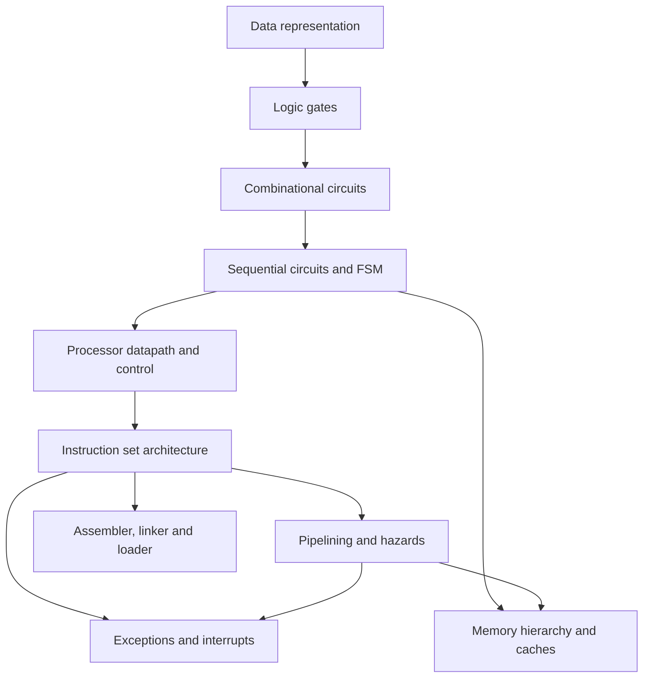

# MOC Computer Architecture

Part of [[_Curriculum Map]] (module M3). Related areas already in the library: [[_MOC Mathematical Foundations]] and [[_MOC Algorithms and Data Structures]].

> **Process note:** the 12 findings below were verified with a LIGHT pass, accepting single good sources per user decision on 2026-11-23. Only [[Pipelining and Hazards]] is `established` (two sources). The rest are `debated` or `uncertain`. Read every note's "Contradictions and uncertainties" before relying on a claim. This MOC stays `draft`.

## Synthesis

Computer architecture explains how a computer turns bits into computation. Data (integers, real numbers, text) is encoded in binary. Logic gates implement Boolean functions; combinational circuits (adders, multiplexers, the ALU) compute from inputs alone; sequential circuits (latches, flip-flops, registers, finite state machines) add memory and a clock. A processor datapath plus control unit combines these to execute instructions defined by an instruction set architecture (ISA). Assemblers, linkers and loaders connect the ISA to programs. Pipelining overlaps instruction stages to go faster and raises hazards. Exceptions and interrupts transfer control to handlers. A memory hierarchy with caches hides slow memory.

Evidence is thin by design: most notes rest on one good source (Python docs, Kann, nand2tetris, RISC-V manual, university notes). The ISA and exceptions notes are specific to RISC-V, not general.

## Map

*Proposed study order for Computer Architecture. The edges are the suggested learning order, not claims made by the sources. An arrow means "study first".*

## Notes

### Data representation
- [[Binary Integers and Two's Complement]] — `uncertain` (Python semantics only, no hardware source).
- [[Floating-Point Representation]] — `debated`.
- [[Character Encoding and Unicode]] — `debated`.

### Digital logic
- [[Logic Gates and Boolean Algebra]] — `debated`.
- [[Combinational Circuits]] — `debated`.
- [[Sequential Circuits and Finite State Machines]] — `debated`.

### Processor
- [[Processor Datapath and Control]] — `debated`.
- [[Instruction Set Architecture]] — `debated`; review-by 2027-11-23.

### Software interface
- [[Assembler, Linker and Loader]] — `debated`.
- [[Exceptions and Interrupts]] — `debated`; review-by 2027-11-23.

### Performance and memory
- [[Pipelining and Hazards]] — `established`.
- [[Memory Hierarchy and Caches]] — `debated`.

## Connections to other areas

- [[_Curriculum Map]]: module M3, based on INE5807, INE5813 and INE5815.
- [[_MOC Mathematical Foundations]]: [[Logic Gates and Boolean Algebra]] links [[Propositional Logic]] and [[Lattice]]; [[Binary Integers and Two's Complement]] links [[Modular Arithmetic]] (marked there as own inference).
- [[_MOC Algorithms and Data Structures]]: [[Assembler, Linker and Loader]] links [[Hash Table]]; [[Memory Hierarchy and Caches]] links [[Hash Table]] and [[Dynamic Array and Linked List]].
- Planned areas (plain text, no notes yet): Operating Systems, Theory of Computation, [[_MOC Security]].

## Main sources

- [[Python Docs - Integer Bitwise Operations]]
- [[Python Docs - Floating Point Arithmetic Tutorial]]
- [[Python Docs - Unicode HOWTO]]
- [[nand2tetris - Projects 1 to 5 (Nisan and Schocken)]]
- [[Kann - Digital Circuit Projects (Engineering LibreTexts)]]
- [[RISC-V ISA Manual - RV32I Base Integer ISA]]
- [[RISC-V ISA Manual - Machine-Level ISA (Traps)]]
- [[Rochester CSC 252 - Linking Notes]]
- [[Brown CSCI 1952y - Pipelined CPU Notes]]
- [[USFCA CS 315 - Processor Pipeline Hazards]]
- [[NYU Gottlieb - Computer Architecture Lecture 23 (Caches and Virtual Memory)]]

## Gaps and next steps

- [ ] Karnaugh maps, De Morgan, minimization.
- [ ] SR latch, master-slave design, setup/hold times, Moore vs Mealy machines.
- [ ] Single-cycle vs multicycle datapath; control-signal generation.
- [ ] Structural hazards, branch prediction.
- [ ] SIMD and instruction-level parallelism (ILP).
- [ ] Classic addressing modes (x86, MIPS, ARM), RISC vs CISC, RISC-V extensions.
- [ ] IEEE 754 bit layout, NaN and infinity, rounding.
- [ ] Hardware two's complement and overflow; binary/hex conversion.
- [ ] UTF-16/UTF-32 and Unicode normalization.
- [ ] Half adder, carry-lookahead, ALU control.
- [ ] Precise exceptions.
- [ ] Cache coherence, modern cache and virtual memory, replacement policies, definitions of write-through and write-back.
- [ ] Static vs dynamic linking comparison.
- [ ] PDFs unreadable by the tools: CMU 18-213, CS:APP, OSTEP, Cornell 3410. Find readable alternatives.
- [ ] Review ISA and Exceptions by 2027-11-23 (fast-changing specification).
- Next step: course module M3 can be built from these 12 verified findings (`generate-course`), keeping the light-verification caveat visible.

## History

- 2026-11-23: created from the 12 verified findings (light verification pass). Status draft.
- 2026-11-23: reviewed by verifier (stage 3 audit): all checks passed; Security in "Planned areas" now links [[_MOC Security]]. Status reviewed.
