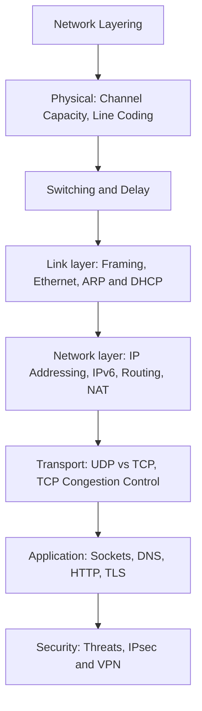

# MOC Computer Networks

Area MOC for INE5816 (Redes e Comunicacao de Dados, Networks and Data Communication) in [[_Curriculum Map]] (module M5). It indexes the 19 verified findings of the area. Process note: all 19 were verified with a LIGHT pass, accepting single good sources, per user decision on 2026-11-23; confidence is therefore mostly `debated` (read from frontmatter: 7 established, 11 debated, 1 uncertain).

## Synthesis

A computer network moves bits between machines. The library organises the topic by layers: each layer uses the service of the one below and hides its details, and the number of layers depends on the model (7 for OSI, 5 in Bonaventure's teaching model, 4 for TCP/IP in RFC 1122). See [[Network Layering - OSI and TCP-IP]].

- **Physical layer.** What limits the data rate of a channel ([[Channel Capacity - Nyquist and Shannon]], one level B source only) and how bits become signals ([[Line Coding and Transmission Media]]).
- **Switching and delay.** Circuit switching reserves a path; packet switching shares links on demand; latency is propagation plus transmit plus queuing delay ([[Circuit vs Packet Switching and Network Delay]]).
- **Link layer.** Frames are delimited and checked with a checksum or CRC ([[Framing and Error Detection]]); Ethernet uses 48-bit MAC addresses and CSMA/CD, while 802.11 uses CSMA/CA ([[Ethernet, MAC Addresses and Medium Access]]); ARP maps IP addresses to link-layer addresses and DHCP provides configuration information, with leased addresses ([[ARP and DHCP]]).
- **Network layer.** IPv4 addressing, subnet masks, CIDR and longest-prefix match ([[IP Addressing, Subnetting and CIDR]]); IPv6 ([[IPv6]]); routing with RIP, OSPF and BGP ([[Routing - Distance Vector, Link State and BGP]]); NAT as a short-term fix with known limits ([[NAT]]).
- **Transport.** UDP is unreliable and connectionless; TCP is a reliable byte stream ([[UDP vs TCP]]); flow control protects the receiver, congestion control protects the network ([[TCP Flow and Congestion Control]]).
- **Application.** Sockets are the door to the transport layer ([[Sockets and Socket Programming in Python]]); DNS resolves names ([[DNS]]); HTTP is the request/response protocol of the web ([[HTTP]]); TLS secures a channel ([[TLS]]).
- **Security.** Threats and cryptographic primitives ([[Network Threats and Cryptographic Basics]]); IPsec protects traffic at the IP layer ([[IPsec and VPN Concepts]]).

## Map

*Proposed study order, from the bottom of the stack to security. Edges are a study sequence chosen by the archivist, not claims made by the sources.*

## Notes

Format: note, confidence, review-by (empty means none set).

### Models and physical layer
- [[Network Layering - OSI and TCP-IP]] - established, no review-by
- [[Channel Capacity - Nyquist and Shannon]] - uncertain, no review-by
- [[Line Coding and Transmission Media]] - debated, no review-by
- [[Circuit vs Packet Switching and Network Delay]] - established, no review-by

### Link layer
- [[Framing and Error Detection]] - established, no review-by
- [[Ethernet, MAC Addresses and Medium Access]] - established, no review-by
- [[ARP and DHCP]] - debated, no review-by

### Network layer
- [[IP Addressing, Subnetting and CIDR]] - established, no review-by
- [[IPv6]] - debated, review-by 2027-11-23
- [[Routing - Distance Vector, Link State and BGP]] - debated, no review-by
- [[NAT]] - debated, no review-by

### Transport
- [[UDP vs TCP]] - established, no review-by
- [[TCP Flow and Congestion Control]] - debated, no review-by

### Application
- [[Sockets and Socket Programming in Python]] - established, review-by 2027-11-23
- [[DNS]] - debated, no review-by
- [[HTTP]] - debated, review-by 2027-11-23
- [[TLS]] - debated, review-by 2027-06-23

### Security
- [[Network Threats and Cryptographic Basics]] - debated, review-by 2027-11-23
- [[IPsec and VPN Concepts]] - debated, review-by 2027-11-23

## Connections to other areas

Parent and sibling MOCs: [[_Curriculum Map]], [[_MOC Operating Systems]], [[_MOC Computer Architecture]], [[_MOC Algorithms and Data Structures]], [[_MOC Mathematical Foundations]].

Links already present in the findings (most are own-inference analogies, not claims of the sources):

- Operating Systems: [[System Calls]], [[Process Creation - fork]] and [[Threads]] (from [[Sockets and Socket Programming in Python]]; [[System Calls]] also as an analogy for layer boundaries in [[Network Layering - OSI and TCP-IP]]).
- Computer Architecture: [[Sequential Circuits and Finite State Machines]] (protocol state machines, own inference; used in [[Line Coding and Transmission Media]], [[UDP vs TCP]] and the layering note); [[Binary Integers and Two's Complement]] (from [[IP Addressing, Subnetting and CIDR]]).
- Algorithms and Data Structures: [[Hash Table]] (caches and translation tables in [[ARP and DHCP]], [[DNS]], [[NAT]], switch learning), [[Trie]] (longest-prefix match, own inference), [[Graph Representations and Traversal]] and [[Shortest Paths and Minimum Spanning Trees]] (routing, STP, own inference).
- Mathematical Foundations: [[Modular Arithmetic]] (CRC arithmetic and public-key schemes), [[RSA]] and [[Divisibility and GCD]] (from [[Network Threats and Cryptographic Basics]] and [[TLS]]). The cross-area links to Hash Table, Trie and Modular Arithmetic are own-inference analogies, not stated by the sources.

Security now exists: [[_MOC Security]]. Planned areas (not in the library yet; plain text, no links): Databases, Theory of Computation (information theory relates to channel capacity).

## Main sources

Level A:
- [[Bonaventure - Computer Networking Principles Protocols and Practice]]
- [[Peterson and Davie - Computer Networks A Systems Approach]]
- [[MDN - An overview of HTTP]]
- [[RFC 1122 - Requirements for Internet Hosts (layers)]]
- [[RFC 3022 - Traditional IP NAT]]
- [[RFC 4301 - Security Architecture for IP (IPsec)]]
- [[RFC 4632 - CIDR]]
- [[RFC 8446 - TLS 1.3]]
- [[Python docs - ipaddress]]
- [[Python docs - socket module]]
- [[Python docs - Socket Programming HOWTO]]
- [[Python docs - ssl module]]
- [[man7 - tcp(7)]]
- [[NIST SP 800-41r1 - Firewalls and Firewall Policy]] (registered, unread: not used for any claim)

Level B:
- [[Newman-Wolfe UF CEN4500 - Transmission]]
- [[Newman-Wolfe UF CEN4500 - Packet Switching]]

Level C (lead only, cross-check, never a basis):
- [[Wikipedia - Shannon-Hartley theorem (lead)]]

## Gaps and next steps

- [ ] Firewalls: no readable source (NIST SP 800-41r1 registered, unread).
- [ ] VPN definition, IKE and SA management, rest of RFC 4301 (read through Sec. 4.4.1 only).
- [ ] TLS 1.3 handshake mechanics (RFC 8446 read only through Sec. 1 and the Abstract); Python ssl security considerations section.
- [ ] Parity and error-correcting codes; the exact CRC-32 polynomial.
- [ ] Delay formulas in symbols.
- [ ] Ethernet backoff formula; switching and STP internals.
- [ ] 802.11 (wireless link layer).
- [ ] DNSSEC and the DNS query steps.
- [ ] RFC 1918 (private ranges) and RFC 791 (IPv4).
- [ ] NAT64 and the IPv6 transition.
- [ ] HTTP/2, HTTP/3, methods, status codes, RFC 9110.
- [ ] Second sources for routing, ARP, DHCP, DNS and TLS (candidates: RFC 826, 2131, 1034/1035, 9293, 768, 8200).
- [ ] A level A source for Nyquist and Shannon (only a 1995 level B course note, plus a level C cross-check).
- [ ] TCP header and timers; Reno and CUBIC.
- [ ] Cross-area links (Hash Table, Trie, Modular Arithmetic and others) are own-inference analogies; keep them labelled or find sources.
- [ ] Next step: the course module M5 (Computer Networks) can be built from these notes. Review the MOC (`reviewed`) before relying on it.

## History

- 2026-11-23: created from the 19 verified findings (light verification pass, single good sources accepted per user decision of 2026-11-23); status draft.
- 2026-11-23: Security is no longer plain text; now links [[_MOC Security]].
- 2026-11-23: reviewed by verifier (stage 3 audit): all checks passed, no edits needed. Status reviewed.
