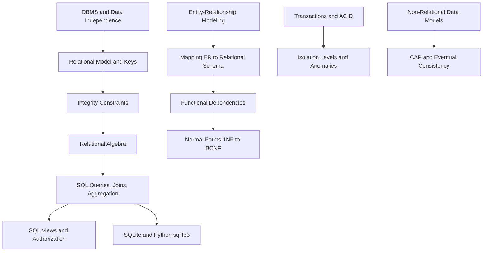

# MOC Databases

Area of the [[_Curriculum Map]] (planned module M6, basis INE5819). Built only from the 15 `verified` findings in this folder. Process note: the findings were verified with a LIGHT pass that accepts single good sources, by user decision on 2026-11-23. Confidence tally read from the frontmatter: 5 established, 9 debated, 1 uncertain. Several `debated` ratings mean "single source or thin corroboration", not necessarily "sources disagree".

## Synthesis

> **DBMS** (Database Management System): software that stores, queries, protects and shares a database; see [[Database Management System and Data Independence]].

A database course has four threads that meet in SQL.

1. **The model.** A DBMS hides physical storage behind a data model ([[Database Management System and Data Independence]]). The dominant model is relational: relations (tables) with keys ([[Relational Model and Keys]]) under integrity rules ([[Integrity Constraints]]). [[Relational Algebra]] gives a formal operator basis for querying, and [[SQL Queries, Joins and Aggregation]] is the practical language. [[SQL Views and Authorization]] covers abstraction and privileges. [[SQLite and Python sqlite3]] makes it runnable from Python.
2. **The design.** [[Entity-Relationship Modeling]] captures requirements, and [[Mapping ER to Relational Schema]] turns the diagram into tables. [[Functional Dependencies]] and [[Normal Forms 1NF to BCNF]] give a way to judge and repair a schema.
3. **The behavior under concurrency and failure.** [[Transactions and ACID]] define what a unit of work guarantees, and [[Isolation Levels and Anomalies]] define what concurrent transactions may observe.
4. **Beyond relations.** [[Non-Relational Data Models]] surveys document, key-value, graph and wide-column models from vendor docs, and [[CAP and Eventual Consistency]] frames the trade-offs when data is distributed.

Reading across the notes: confidence is highest for core relational vocabulary and basic SQL, and lowest for the non-relational survey, which rests on four vendor documentation sets and has no neutral taxonomy.

## Map

*Proposed study order, not claims made by the sources: an arrow means "study first". Four chains: the relational core and SQL; design and normalization; transactions and isolation; non-relational models and CAP. The chains are independent starting points; the design chain assumes the relational core.*

## Notes

Confidence and review-by are read from each note's frontmatter. An empty review-by means none set.

### Foundations
| Note | Confidence | Review-by |
|------|------------|-----------|
| [[Database Management System and Data Independence]] | debated | none |

### Relational model and algebra
| Note | Confidence | Review-by |
|------|------------|-----------|
| [[Relational Model and Keys]] | established | none |
| [[Integrity Constraints]] | established | 2027-11-23 |
| [[Relational Algebra]] | debated | none |

### SQL
| Note | Confidence | Review-by |
|------|------------|-----------|
| [[SQL Queries, Joins and Aggregation]] | established | 2027-11-23 |
| [[SQL Views and Authorization]] | debated | 2027-11-23 |
| [[SQLite and Python sqlite3]] | debated | 2027-11-23 |

### Design: ER, FDs and normalization
| Note | Confidence | Review-by |
|------|------------|-----------|
| [[Entity-Relationship Modeling]] | established | none |
| [[Mapping ER to Relational Schema]] | debated | none |
| [[Functional Dependencies]] | debated | none |
| [[Normal Forms 1NF to BCNF]] | debated | none |

### Transactions
| Note | Confidence | Review-by |
|------|------------|-----------|
| [[Transactions and ACID]] | established | 2027-11-23 |
| [[Isolation Levels and Anomalies]] | debated | 2027-11-23 |

### Non-relational and distributed
| Note | Confidence | Review-by |
|------|------------|-----------|
| [[Non-Relational Data Models]] | uncertain | 2027-11-23 |
| [[CAP and Eventual Consistency]] | debated | 2027-11-23 |

## Connections to other areas

Curriculum: [[_Curriculum Map]]. The links below are the ones the findings already carry; items marked "own inference" are analogies stated in the finding, not source claims.

- [[_MOC Mathematical Foundations]]: [[Relational Algebra]] and [[Relational Model and Keys]] link [[Set]], [[Relation]], [[Function]]; [[Functional Dependencies]] links [[Function]]; [[First-Order Logic]] and [[Propositional Logic]] are linked from [[Relational Algebra]]. All own inference (RPI notes mention logic only via Datalog).
- [[_MOC Algorithms and Data Structures]]: [[Hash Table]] and [[Balanced Search Trees]] (indexes, own inference in [[SQL Queries, Joins and Aggregation]]); [[Hash Table]] (Redis hash analogy) and [[Graph Representations and Traversal]] (graph storage) in [[Non-Relational Data Models]]; [[Graph Representations and Traversal]] (an ER diagram is a graph) in [[Entity-Relationship Modeling]]. All own inference.
- [[_MOC Operating Systems]]: [[Paging and Virtual Memory]] (abstraction-layer analogy, in [[Database Management System and Data Independence]]); [[File System Journaling and Crash Recovery]], [[Critical Sections and Semaphores]], [[Deadlock]] (in [[Transactions and ACID]]); [[Critical Sections and Semaphores]], [[Deadlock]] (in [[Isolation Levels and Anomalies]]). All own inference.
- [[_MOC Computer Networks]]: [[UDP vs TCP]] and [[Sockets and Socket Programming in Python]] (network unreliability behind partitions, in [[CAP and Eventual Consistency]], own inference); [[Sockets and Socket Programming in Python]] (another Python standard-library I/O interface, in [[SQLite and Python sqlite3]], own inference). [[TLS]] is deliberately not linked: no source relates it.
- [[_MOC Computer Architecture]]: no note-level link from the Databases findings yet.
- Security now exists: [[_MOC Security]] (access control relates to authorization). Planned area, not yet written (plain text): Theory of Computation.

## Main sources

Level A (vendor documentation marked **vendor**):
- [[Watt and Eng - Database Design Ch3-5 DBMS and Data Independence]]
- [[Watt and Eng - Database Design Ch7-9 Relational Model and Integrity]]
- [[Watt and Eng - Database Design Ch8-13 ER Modeling and Design Process]]
- [[Watt and Eng - Database Design Ch11-12 Functional Dependencies and Normalization]]
- [[PostgreSQL Docs - SQL Tutorial Constraints Views Privileges]] (vendor docs)
- [[PostgreSQL Docs - Transactions and Isolation]] (vendor docs)
- [[SQLite Docs - Datatypes Foreign Keys Atomic Commit]] (vendor docs)
- [[Python Docs - sqlite3 module]] (vendor docs)
- [[Official Docs - MongoDB Redis Neo4j Cassandra Data Models]] (vendor docs from four vendors)
- [[Brewer - CAP Twelve Years Later]] (paper)

Level B:
- [[RPI CSCI 4380 (Adali) - Relational Algebra and Logic Notes]] (course material)
- [[RPI CSCI 4380 (Adali) - ER Models and Mapping]] (course material)
- [[Guide to Database Systems - The Relational Model and UNC INLS 256 Notes]] (open book plus course notes, authors not named)

## Gaps and next steps

- [ ] Relational calculus: only Datalog is covered by a read source.
- [ ] Attribute closure, minimal cover and candidate-key finding.
- [ ] Candidate-key-based 3NF/BCNF definitions (the sources are primary-key based); decomposition, lossless join and dependency preservation.
- [ ] The SQL standard itself.
- [ ] SQLite `lang_*` pages.
- [ ] SQLite vs PostgreSQL locking and MVCC; the SQLite isolation claim.
- [ ] Indexes, query processing and optimization: not covered at all.
- [ ] The "C" (consistency) in ACID is not detailed.
- [ ] ANSI-SPARC formal wording: "three-schema architecture" and "data dictionary" appear in no read source.
- [ ] Second source for ER mapping (1:N and subclasses are RPI-only).
- [ ] Neutral NoSQL taxonomy, the Dynamo paper, the Gilbert-Lynch CAP proof, and the original Brewer IEEE article.
- [ ] Unread tail of the Python sqlite3 page.
- [ ] opentextbc.ca returned 403; the LibreTexts mirror was used instead.
- [ ] PostgreSQL, SQLite and sqlite3 pages are version-dependent: recheck by 2027-11-23.
- [ ] Next step: course module M6 (Databases) can be built from this MOC.

## History

- 2026-11-23: created from the 15 verified findings (light verification pass, single good sources accepted, per user decision); status draft.
- 2026-11-23: Security is no longer plain text; now links [[_MOC Security]].
- 2026-11-23: reviewed by verifier (stage 3 audit): all checks passed, no edits needed. Status reviewed.
