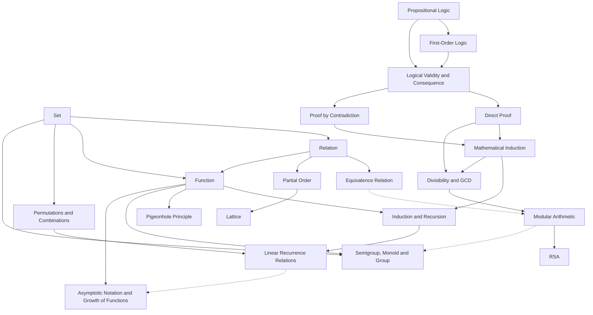

# MOC Mathematical Foundations

## Synthesis

Mathematical Foundations is the discrete-mathematics base that the rest of the Computer Science curriculum (see [[_Curriculum Map]]) builds on. It has seven strands that depend on each other:

- **Sets and relations.** A [[Set]] is the basic object. A [[Relation]] is a set of pairs. Two special kinds of relation are the [[Equivalence Relation]] (partitions elements into like classes) and the [[Partial Order]] (ranks elements). A [[Lattice]] is a partial order in which every pair has a least upper bound and a greatest lower bound. A [[Function]] is a special relation.
- **Logic.** [[Propositional Logic]] and [[First-Order Logic]] give the formal language. [[Logical Validity and Consequence]] says what it means for a conclusion to follow.
- **Proofs.** [[Direct Proof]], [[Proof by Contradiction]] and [[Mathematical Induction]] are the main proof techniques. [[Induction and Recursion]] connects induction to recursive definitions.
- **Counting and recurrences.** [[Permutations and Combinations]] and the [[Pigeonhole Principle]] count and bound. [[Linear Recurrence Relations]] describe sequences defined recursively and are solved with the tools from induction.
- **Number theory.** [[Divisibility and GCD]] leads to [[Modular Arithmetic]], which underlies [[RSA]] public-key encryption.
- **Algebra.** [[Semigroup, Monoid and Group]] name the structures behind operations that associate, have an identity, or have inverses.
- **Growth of functions.** [[Asymptotic Notation and Growth of Functions]] gives the vocabulary for comparing algorithm costs.

> **Process note (read before relying on this area).** This area was verified with a LIGHT pass: on 2026-11-23, by user decision, single good sources were accepted. The notes [[Function]], [[Direct Proof]], [[Proof by Contradiction]] and [[Pigeonhole Principle]] are marked `confidence: uncertain`. Do not read them as established. A second independent source is planned for each (see Gaps).

## Map

*Dependency map of the 21 notes. Solid arrows mean "is needed to understand"; dotted arrows mean "is an example of, or is used in". Sets, relations and functions are the shared base; logic feeds proofs, proofs feed induction and recursion, and induction feeds recurrences and number theory, which ends in RSA. Arrows reflect the intended learning order and were drawn by the archivist; check each note's Related section for the exact link.*

## Notes

Confidence is shown as in each note's frontmatter. Only [[Modular Arithmetic]] has a `review-by` date (2027-11-23); the others have none.

### Sets and relations
- [[Set]]: debated
- [[Relation]]: established
- [[Equivalence Relation]]: established
- [[Partial Order]]: established
- [[Function]]: uncertain (single source)
- [[Lattice]]: established

### Logic
- [[Propositional Logic]]: debated
- [[First-Order Logic]]: debated
- [[Logical Validity and Consequence]]: debated

### Proofs
- [[Direct Proof]]: uncertain (light pass)
- [[Proof by Contradiction]]: uncertain (light pass)
- [[Mathematical Induction]]: debated
- [[Induction and Recursion]]: debated

### Counting and recurrences
- [[Permutations and Combinations]]: established
- [[Pigeonhole Principle]]: uncertain (single source)
- [[Linear Recurrence Relations]]: debated

### Number theory
- [[Divisibility and GCD]]: debated
- [[Modular Arithmetic]]: debated (review-by 2027-11-23)
- [[RSA]]: established

### Algebra
- [[Semigroup, Monoid and Group]]: debated

### Growth of functions
- [[Asymptotic Notation and Growth of Functions]]: debated

## Connections to other areas

Planned areas, not yet in the library (plain text, no links yet):

- Algorithms and Data Structures: asymptotic notation, recurrences, induction for correctness, pigeonhole and counting arguments.
- Theory of Computation: logic, proofs, relations and functions, induction.
- Computer Architecture: propositional logic, lattices and Boolean structure.
- Security: modular arithmetic and RSA.

Curriculum context: [[_Curriculum Map]].

## Main sources

- Sets, relations, functions: [[Applied Discrete Structures (Doerr, Levasseur)]], [[Doerr Levasseur Applied Discrete Structures]], [[OpenDSA Sets and Relations (Shaffer)]], [[Open Logic Project Sets Relations Functions (Zach)]]
- Lattices: [[Judson AATA Lattices and Boolean Algebras]]
- Logic: [[SEP Classical Logic]], [[Logic and Proof (Avigad et al)]], [[CMU 15-311 Logic and Mechanized Reasoning]]
- Proofs and induction: [[Davies - A Cool Brisk Walk - Proof]], [[Hammack - Book of Proof]], [[Critchlow and Eck - Foundations of Computation - Recursion and Induction]]
- Counting and recurrences: [[Levin - Discrete Mathematics An Open Introduction]], [[Guichard - Combinatorics and Graph Theory]], [[MIT OCW 6.042J Mathematics for Computer Science]]
- Number theory: [[Introduction to Number Theory (Veerman)]], [[MCS Ch8 Number Theory (Lehman Leighton Meyer)]], [[Elementary Number Theory (Barrus and Clark)]], [[Python pow built-in (modular exponentiation and inverse)]]
- Algebra: [[Haskell base Data.Semigroup docs]], [[Milewski Free Monoids]]
- Asymptotics: [[Sedgewick Wayne - Analysis of Algorithms]], [[OpenDSA - Lower Bounds and Theta Notation]], [[UTSA CS3343 Lecture 3 - Asymptotic Notation]]

## Gaps and next steps

Process caveat: verification was a LIGHT pass accepting single good sources (user decision, 2026-11-23). Single-source notes ([[Function]], [[Direct Proof]], [[Proof by Contradiction]], [[Pigeonhole Principle]]; confidence uncertain) must not be read as established.

- [ ] **Sets:** power set, set operations, equivalence classes and partitions, and congruence mod m as an equivalence relation are unsourced.
- [ ] **Relations and order:** "connected" (total) is undefined; composition of relations, Hasse diagrams and topological sort are missing.
- [ ] **Functions:** composition, inverse, and a second source for [[Function]].
- [ ] **Lattices:** computing applications are unsourced; semilattices are missing.
- [ ] **Logic:** CNF, SAT and decidability are missing; [[SEP Classical Logic]] was only partly read; no independent propositional-logic source.
- [ ] **Proofs:** contrapositive, counterexample, structural induction and well-ordering are missing; the Hammack chapters were not read in full.
- [ ] **Combinatorics:** pigeonhole has a single source; stars and bars, inclusion-exclusion, non-homogeneous recurrences and the Master theorem are missing.
- [ ] **Number theory:** primes, the Fundamental Theorem of Arithmetic, primality tests, the statements of Euler, Fermat and CRT, RSA key sizes and padding, and lambda(n) are missing.
- [ ] **Algebra:** the semigroup definition comes only from the Haskell docs; uses of groups in CS are missing.
- [ ] **Asymptotics:** no level A source for the formal definitions; little-o and omega, and limit-based characterizations, are missing.

Next steps:
- Course module M1 can be built from the current notes.
- Add second independent sources later, starting with the four `uncertain` notes.
- A `verifier` pass should review this MOC and mark it `reviewed`.

## History

- 2026-11-23: created from the 21 verified findings (light verification pass); status draft.
- 2026-11-23: reviewed by verifier (stage 3 audit): all links resolve, all 21 findings indexed and verified, confidence and review-by match frontmatter, Mermaid valid, Gaps present. No edits needed. Status reviewed.
