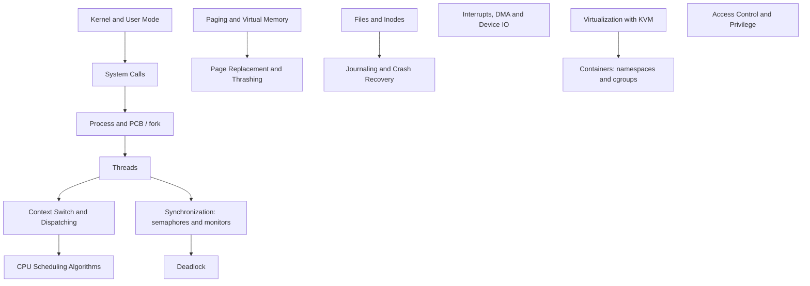

# MOC Operating Systems

Area MOC for INE5822 (Sistemas Operacionais, Operating Systems) in [[_Curriculum Map]]. It indexes the 20 verified findings of the area.

> **Process note:** all 20 findings were verified with a LIGHT pass, accepting single good sources, per user decision on 2026-11-23. Treat the area as reliable for orientation, not as a fully cross-checked reference. Confidence across the 20 notes (read from frontmatter): 8 `established`, 11 `debated`, 1 `uncertain` (Virtualization with KVM). The MOC stays `draft` until it is reviewed.

## Synthesis

An operating system (OS) is the software layer that shares hardware among programs and protects them from each other. The central mechanism is the split between privileged kernel code and unprivileged user code ([[Kernel and User Mode]]): programs ask the kernel for services through [[System Calls]], and the kernel can be organized in different ways ([[OS Kernel Architectures]]).

The kernel's first abstraction is the process, a program in execution with its own address space and a saved state in the PCB ([[Process and Process Control Block]]). New processes are made by duplicating an existing one ([[Process Creation - fork]]); threads give several execution flows inside one process ([[Threads]]). Because many activities want one CPU, the OS switches between them ([[Context Switch and Dispatching]]) following a policy ([[CPU Scheduling Algorithms]], with Linux specifics in [[Linux Scheduling Policies]]).

Activities that share data must coordinate ([[Critical Sections and Semaphores]], [[Monitors and Python Synchronization Primitives]]), and waiting without end is the risk of [[Deadlock]]. Memory is virtualized through [[Paging and Virtual Memory]], and [[Page Replacement and Thrashing]] covers what happens when memory runs short. Persistent data lives in files described by inodes ([[Files and Inodes]]) and survives crashes through journaling ([[File System Journaling and Crash Recovery]]). Devices signal the CPU through interrupts and move data with DMA ([[Interrupts, DMA and Device IO]]). The same kernel mechanisms underlie virtualization ([[Virtualization with KVM]]) and containers ([[Containers - Namespaces and cgroups]]), and protection is enforced through identities, permissions and capabilities ([[Access Control and Privilege]]).

## Map

*Proposed study order, not claims made by the sources. An arrow means "study first". Notes without arrows (interrupts/DMA, access control) can be studied once kernel/user mode is known.*

## Notes

### Kernel interface
- [[Kernel and User Mode]] - established
- [[System Calls]] - established
- [[OS Kernel Architectures]] - debated

### Processes and threads
- [[Process and Process Control Block]] - debated
- [[Process Creation - fork]] - established, review-by 2027-06-01
- [[Threads]] - established, review-by 2027-06-01
- [[Context Switch and Dispatching]] - debated

### Scheduling
- [[CPU Scheduling Algorithms]] - established (scoped to the algorithms listed by both sources)
- [[Linux Scheduling Policies]] - debated, review-by 2027-11-23

### Synchronization
- [[Critical Sections and Semaphores]] - debated
- [[Monitors and Python Synchronization Primitives]] - debated, review-by 2027-06-01
- [[Deadlock]] - debated

### Memory
- [[Paging and Virtual Memory]] - established
- [[Page Replacement and Thrashing]] - debated

### Files
- [[Files and Inodes]] - established
- [[File System Journaling and Crash Recovery]] - established

### I/O and virtualization
- [[Interrupts, DMA and Device IO]] - debated
- [[Virtualization with KVM]] - uncertain, review-by 2027-11-23
- [[Containers - Namespaces and cgroups]] - debated, review-by 2027-11-23

### Protection
- [[Access Control and Privilege]] - debated

## Connections to other areas

- [[_Curriculum Map]] - parent planning note (module M4).
- [[_MOC Computer Architecture]] - hardware side: [[Exceptions and Interrupts]], [[Memory Hierarchy and Caches]], [[Instruction Set Architecture]] (linked from the kernel mode, context switch, paging, journaling and interrupt notes).
- [[_MOC Algorithms and Data Structures]] - [[Hash Table]], [[Binary Search Tree]], [[Dynamic Array and Linked List]] (page tables, directories, replacement structures; mostly own inference in the findings).
- [[_MOC Mathematical Foundations]] - [[Relation]], [[Partial Order]] (priorities, circular wait; own inference in the findings).
- Planned areas, not yet written: Computer Networks, Theory of Computation. Security now exists: [[_MOC Security]] (it builds on access control and containers).

## Main sources

Level A (official documentation):
- [[man7 - syscalls(2)]], [[man7 - fork(2)]], [[man7 - sched(7)]], [[man7 - pthreads(7)]], [[man7 - inode(7)]], [[man7 - namespaces(7)]], [[man7 - capabilities(7)]], [[man7 - credentials(7)]]
- [[Linux kernel docs - Concepts overview (memory management)]], [[Linux kernel docs - ext4 Journal (jbd2)]], [[Linux kernel docs - DMA API HOWTO]], [[Linux kernel docs - Generic IRQ handling]], [[Linux kernel docs - KVM API]], [[Linux kernel docs - Control Group v2]]
- [[Python docs - threading]], [[Python docs - multiprocessing]]

Level B (university course notes):
- [[Wisc CS 537 Notes - Processes, Dispatching, Kernel Entry]], [[Wisc CS 537 Notes - Synchronization and Monitors]], [[Wisc CS 537 Notes - Deadlock]], [[Wisc CS 537 Notes - Memory Management and Virtual Memory]], [[Wisc CS 537 Notes - Files, Allocation and Crash Recovery]], [[Wisc CS 537 Notes - Protection and Security]]
- [[Cornell CS 4410 - Page Replacement and Thrashing]], [[Aspnes Yale - Processor Scheduling]], [[CSUStan CS 3750 - CPU Scheduling Notes]], [[NYU Gottlieb - OS Lecture 4 (structure)]]

## Gaps and next steps

- [ ] Process state diagram (ready/running/blocked) not covered.
- [ ] `exec`/`execve` not covered by any read source.
- [ ] Race condition definition missing.
- [ ] Semaphore P/V definitions missing; classic problems (producer-consumer, dining philosophers) not covered.
- [ ] Mesa vs Hoare monitor semantics not covered.
- [ ] Deadlock: "necessary" vs "necessary and sufficient" conditions divergence unresolved (NYU snippet unopened).
- [ ] LRU worked example and Wisc s19-s21 not used; page replacement rests on a single source.
- [ ] Virtualization: hypervisor theory (trap-and-emulate), VM vs container comparison and container runtimes missing.
- [ ] Hybrid kernels not covered.
- [ ] I/O at beginner level: drivers, polling vs interrupts, block vs character devices.
- [ ] Multiprocessor and real-time scheduling depth.
- [ ] Modern ext4 extents.
- [ ] Python `asyncio`, `os`, `mmap` unread.
- [ ] No textbook-level Level A source (OSTEP is PDF-only and could not be read).
- [ ] Partial reads: Python multiprocessing (~100k of 162k characters), cgroup v2, KVM API (~100k characters).
- [ ] University notes are undated or archived (Aspnes 2003-2012 archive; CSUStan author unstated).
- [ ] Review dates: 2027-06-01 for Python multiprocessing start-method claims (also Threads, Monitors); 2027-11-23 for Linux scheduling, namespaces/cgroups and KVM.
- [ ] Next step: course module M4 (Operating Systems) can be built from these notes; consider a second verification pass on `debated` and `uncertain` notes first.

## History

- 2026-11-23: created (draft) from the 20 verified findings; verified with a light pass per user decision of 2026-11-23.
- 2026-11-23: Security is no longer plain text; now links [[_MOC Security]].
- 2026-11-23: reviewed by verifier (stage 3 audit): all checks passed; quoted the slash label in Mermaid node PR. Status reviewed.
