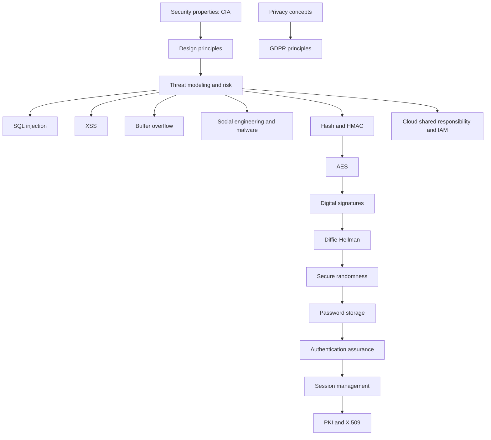

# MOC Security

## Synthesis

Security here starts from three properties, confidentiality, integrity and availability ([[Security Properties - Confidentiality, Integrity, Availability]]). OWASP's design principles ([[Security Design Principles]]) and its threat-modeling process with STRIDE and likelihood/impact risk ranking ([[Threat Modeling and Risk]]) turn those properties into a way of reasoning about systems.

The library then covers four groups of material, each as far as its sources support:

- **Application security.** Parameterized queries as the primary defense against SQL injection ([[SQL Injection and Parameterized Queries]]); the OWASP prevention order for XSS ([[Cross-Site Scripting]]); buffer overflow at concept level ([[Buffer Overflow and Memory Safety]]); and social engineering, phishing and NIST's definition of malware, framed defensively ([[Social Engineering, Phishing and Malware]]).
- **Cryptography.** Hash functions and HMAC ([[Cryptographic Hash Functions and HMAC]]), AES ([[Symmetric Encryption and AES]]), EdDSA signatures ([[Digital Signatures and EdDSA]]), finite-field Diffie-Hellman ([[Diffie-Hellman Key Exchange]]) and `secrets` versus `random` in Python ([[Secure Randomness in Python]]).
- **Authentication.** Slow, salted password hashing ([[Password Storage]]), NIST assurance levels and password rules ([[Authentication Assurance and Password Policy]]) and session handling ([[Session Management]]). PKI and X.509 certificates ([[Public Key Infrastructure and X.509 Certificates]]) come after these in the study order below.
- **Cloud, privacy and regulation.** The AWS shared responsibility model and IAM ([[Cloud Shared Responsibility and IAM]]); the lack of a single agreed definition of privacy ([[Privacy Concepts]]); and the GDPR Article 5 principles ([[GDPR Data Protection Principles]]).

This area builds on notes in other areas: public-key mathematics in [[RSA]] and [[Modular Arithmetic]]; transport and network protection in [[TLS]], [[IPsec and VPN Concepts]] and [[Network Threats and Cryptographic Basics]]; isolation and access in [[Access Control and Privilege]], [[Kernel and User Mode]] and [[Containers - Namespaces and cgroups]]; and database access in [[SQLite and Python sqlite3]].

Evidence strength is modest. Every note is `verified` under a light pass (single good sources accepted per user decision on 2026-11-23, not the usual two-source standard). Frontmatter confidence: 0 established, 16 debated, 3 uncertain. Much of the material is OWASP community guidance and vendor or unofficial reproductions (see Main sources).

## Map

*Proposed study order, chosen by the archivist; edges are not claims made by the sources. The application security branches and the cloud branch can be studied in any order after threat modeling.*

## Notes

Confidence is the frontmatter value; review-by is blank where the note has none.

### Foundations and threat models
- [[Security Properties - Confidentiality, Integrity, Availability]] - debated; review-by none.
- [[Security Design Principles]] - debated; review-by none. Single source (OWASP).
- [[Threat Modeling and Risk]] - debated; review-by none.

### Application security
- [[SQL Injection and Parameterized Queries]] - debated; review-by none.
- [[Cross-Site Scripting]] - debated; review-by none.
- [[Buffer Overflow and Memory Safety]] - debated; review-by none. Concept level only.
- [[Social Engineering, Phishing and Malware]] - debated; review-by none.

### Cryptography
- [[Cryptographic Hash Functions and HMAC]] - debated; review-by 2027-05-23.
- [[Symmetric Encryption and AES]] - debated; review-by none. Only the abstract page of FIPS 197 was read.
- [[Digital Signatures and EdDSA]] - debated; review-by none. No conceptual source.
- [[Diffie-Hellman Key Exchange]] - uncertain; review-by none.
- [[Secure Randomness in Python]] - debated; review-by 2027-05-23.

### Authentication
- [[Password Storage]] - debated; review-by 2027-05-23.
- [[Authentication Assurance and Password Policy]] - debated; review-by 2027-11-23.
- [[Session Management]] - debated; review-by none. Paraphrase only, no verbatim quote.

### PKI
- [[Public Key Infrastructure and X.509 Certificates]] - debated; review-by none. First 100,000 of 378,424 characters of RFC 5280 read.

### Cloud
- [[Cloud Shared Responsibility and IAM]] - uncertain; review-by 2027-05-23. AWS only.

### Privacy and regulation
- [[Privacy Concepts]] - debated; review-by none.
- [[GDPR Data Protection Principles]] - uncertain; review-by 2027-05-23. Unofficial reproduction, not legal advice.

## Connections to other areas

- [[_Curriculum Map]] - this is the Security area (M9).
- [[_MOC Computer Networks]] - [[TLS]], [[IPsec and VPN Concepts]], [[Network Threats and Cryptographic Basics]].
- [[_MOC Operating Systems]] - [[Access Control and Privilege]], [[Kernel and User Mode]], [[Containers - Namespaces and cgroups]].
- [[_MOC Mathematical Foundations]] - [[RSA]], [[Modular Arithmetic]] (Diffie-Hellman uses modular exponentiation).
- [[_MOC Databases]] - [[SQLite and Python sqlite3]] (parameterized queries).

## Main sources

Level A (official documentation, standards, reference works):
- [[NIST CSRC Glossary - Information Security and CIA]]
- [[NIST CSRC Glossary - Malware]]
- [[CISA - Avoiding Social Engineering and Phishing Attacks]]
- [[NIST FIPS 197 - AES]]
- [[RFC 2104 - HMAC]]
- [[RFC 8032 - EdDSA]]
- [[RFC 7919 - Finite Field Diffie-Hellman Groups for TLS]]
- [[RFC 5280 - X.509 PKI Certificate and CRL Profile]]
- [[NIST SP 800-63B-4 - Authentication and Authenticator Management]]
- [[Python docs - hashlib]]
- [[Python docs - hmac]]
- [[Python docs - secrets]]
- [[SEP - Privacy]]

Level B:
- OWASP (community guidance, undated; not an official standard): [[OWASP - Threat Modeling Cheat Sheet]], [[OWASP - Secure Product Design Cheat Sheet]], [[OWASP - SQL Injection Prevention Cheat Sheet]], [[OWASP - XSS Prevention Cheat Sheet]], [[OWASP Community - Buffer Overflow]], [[OWASP - Password Storage Cheat Sheet]], [[OWASP - Session Management Cheat Sheet]]
- Vendor documentation (AWS only): [[AWS - Shared Responsibility Model]], [[AWS - What is IAM]]
- Unofficial reproduction of the regulation: [[GDPR - Article 5 Principles (gdpr-info.eu)]]

## Gaps and next steps

- [ ] Malware taxonomy (NIST SP 800-83); only the NIST glossary definition is used.
- [ ] Block cipher modes and authenticated encryption (NIST SP 800-38); AES rounds (only the FIPS 197 abstract page was read).
- [ ] Conceptual source for digital signatures (sign/verify, non-repudiation) and for Diffie-Hellman (g^a mod p, man-in-the-middle, ECDH).
- [ ] XSS taxonomy, CSRF, memory-safety depth, CISA guidance on memory-safe languages.
- [ ] JWT (RFC 7519) and OAuth.
- [ ] OCSP (RFC 6960) and Certificate Transparency.
- [ ] Azure and Google Cloud equivalents; isolation between tenants.
- [ ] GDPR: data subject rights, lawful bases, breach notification, penalties; official EUR-Lex text; the application date is unsourced.
- [ ] Coverage limits: NIST SP 800-63B-4 read 100,000 of 289,336 characters (no session section); RFC 5280 read 100,000 of 378,424; RFC 8032 and SEP Privacy partly read (SEP: 100,000 of 160,904).
- [ ] Second source for design principles (Saltzer and Schroeder), and for threat modeling (NIST or ISO); OWASP is undated community guidance.
- [ ] UNRESOLVED divergence: PBKDF2 iteration counts (OWASP 600,000 versus hashlib "hundreds of thousands", 2022); see [[Password Storage]].
- [ ] UNRESOLVED divergence: NIST password minimum length (SP 800-63B Rev 3 versus Rev 4); see [[Authentication Assurance and Password Policy]].
- [ ] Fast-changing review dates: 2027-05-23 (OWASP, hashlib, AWS, GDPR-info) and 2027-11-23 (NIST).

Process note: all findings were verified with a LIGHT pass accepting single good sources, per user decision on 2026-11-23. Next steps: course module M9 can be built.

## History

- 2026-11-23: created (draft), indexing the 19 verified Security findings.
- 2026-11-23: reviewed by verifier (stage 3 audit): all checks passed, no edits needed. Status reviewed.
