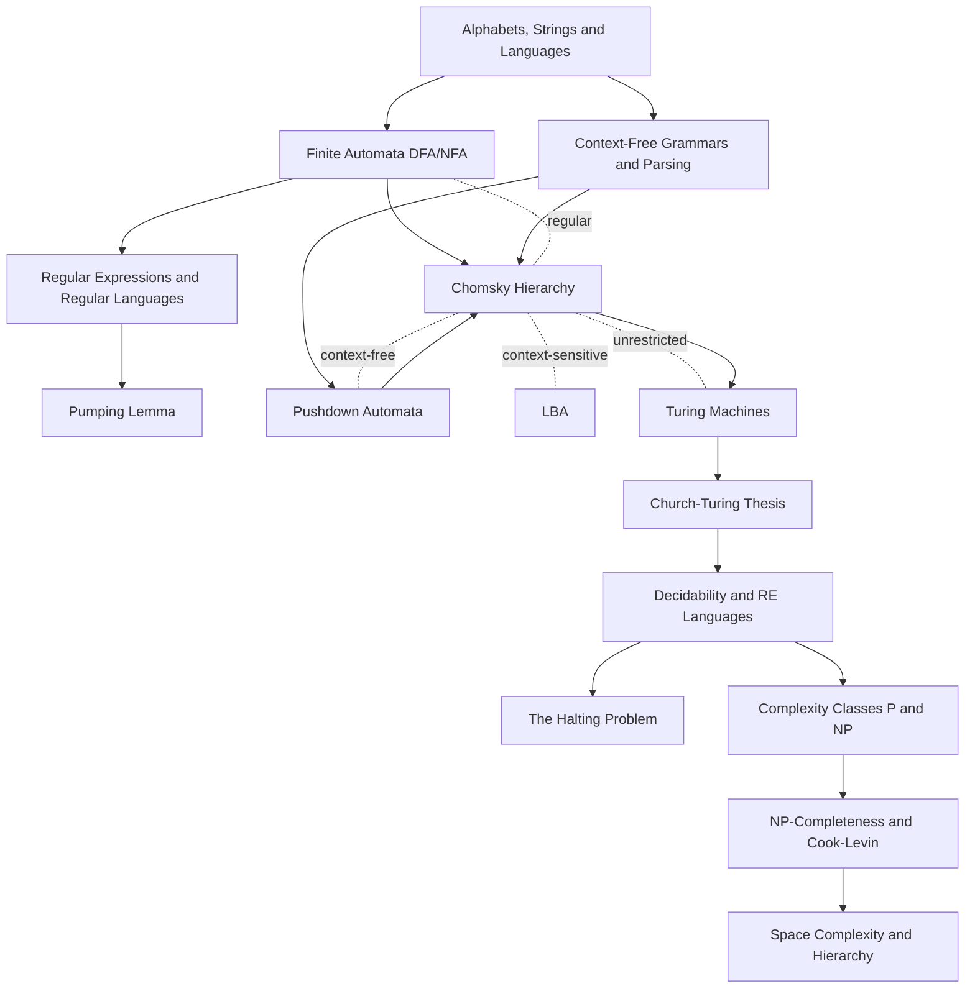

# MOC Theory of Computation

> **Process note**: all 14 findings below were verified with a LIGHT pass that accepted single good sources, by user decision on 2026-11-23. Read `verified` here as "checked once, lightly", not as multiply cross-checked. Confidence count from the frontmatter: 1 established, 13 debated, 0 uncertain.

## Synthesis

Theory of Computation asks what machines can compute and at what cost. The library note [[Alphabets, Strings and Languages]] frames a computational problem as a question about a set of strings (a language), and the rest of the topic sorts languages by the kind of machine or grammar that handles them.

The first half is the ladder of machine models. [[Finite Automata - DFA and NFA]] have finite memory and recognise the regular languages, described also by [[Regular Expressions and Regular Languages]]; the [[Pumping Lemma for Regular Languages]] is the tool recorded for showing a language is not regular. [[Context-Free Grammars and Parsing]] generate context-free languages, and [[Pushdown Automata]] add a stack to match them. The [[Chomsky Hierarchy]] ties regular, context-free, context-sensitive and unrestricted languages to finite automata, pushdown automata, linear bounded automata (LBA) and Turing machines.

The second half is computability. [[Turing Machines]] are a finite-state controller with an unbounded tape; they can compute functions, decide languages or merely accept them. The [[Church-Turing Thesis]] says that anything effectively computable can be computed by a Turing machine; it is a thesis about an informal notion, not a theorem (the "cannot be proved" wording is Critchlow and Eck's). [[Decidability and Recursively Enumerable Languages]] separates languages a machine always decides (recursive) from those it can only accept (r.e.), and [[The Halting Problem]] is the undecidability result the library records, proved by contradiction in Critchlow and Eck.

The third part is complexity. [[Complexity Classes P and NP]] classify decidable problems by time, [[NP-Completeness and Cook-Levin]] identifies the hardest problems in NP, and [[Space Complexity and Complexity Hierarchy]] adds memory bounds and the known (and unknown) inclusions between classes. Its note records, from the SEP entry, that P != EXP and L != PSPACE follow from the hierarchy theorems, while other inclusions are not known to be proper.

## Map

*Proposed study order, not a claim from the sources: solid arrows mean "study first". Dotted lines show the language-class to machine correspondence recorded in [[Chomsky Hierarchy]] (regular - FA, context-free - PDA, context-sensitive - LBA, unrestricted - TM). LBA has no note of its own.*

## Notes

Confidence is from each note's frontmatter. All have `status: verified` (light pass). `review-by` is empty unless shown.

### Languages and automata
| Note | Confidence | review-by |
|------|-----------|-----------|
| [[Alphabets, Strings and Languages]] | debated | none |
| [[Finite Automata - DFA and NFA]] | debated | none |
| [[Regular Expressions and Regular Languages]] | debated | 2027-05-23 (Python `re` behaviour) |
| [[Pumping Lemma for Regular Languages]] | debated | none |

### Grammars and the Chomsky hierarchy
| Note | Confidence | review-by |
|------|-----------|-----------|
| [[Context-Free Grammars and Parsing]] | debated | none |
| [[Pushdown Automata]] | debated | none |
| [[Chomsky Hierarchy]] | debated | none |

### Computability
| Note | Confidence | review-by |
|------|-----------|-----------|
| [[Turing Machines]] | debated | none |
| [[Church-Turing Thesis]] | established (narrow claim only: it is a thesis about an informal notion; second half of SEP unread) | none |
| [[Decidability and Recursively Enumerable Languages]] | debated | none |
| [[The Halting Problem]] | debated | none |

### Complexity
| Note | Confidence | review-by |
|------|-----------|-----------|
| [[Complexity Classes P and NP]] | debated | none |
| [[NP-Completeness and Cook-Levin]] | debated | none |
| [[Space Complexity and Complexity Hierarchy]] | debated | none |

## Connections to other areas

Planning: [[_Curriculum Map]] (module M7, basis INE5820 and INE5826).

Area MOCs: [[_MOC Mathematical Foundations]], [[_MOC Algorithms and Data Structures]], [[_MOC Computer Architecture]], [[_MOC Databases]], [[_MOC Artificial Intelligence]] (its logic and machine learning findings link back to [[NP-Completeness and Cook-Levin]] and [[Complexity Classes P and NP]], own inference).

Links already made by the findings (own-inference analogies stay labelled as such in the notes):
- [[Set]], [[Function]], [[Relation]] from [[Alphabets, Strings and Languages]] (own inference: same mathematical vocabulary).
- [[Induction and Recursion]] and [[Mathematical Induction]] from [[Regular Expressions and Regular Languages]] (own inference: regex-to-NFA by structural induction).
- [[Algorithm Analysis]] from [[Church-Turing Thesis]] (own inference: analysis presupposes a model of computation) and from [[Complexity Classes P and NP]].
- [[Asymptotic Notation and Growth of Functions]] from [[Complexity Classes P and NP]] and [[Space Complexity and Complexity Hierarchy]] (own inference: "polynomial" is measured with growth classes).
- [[Propositional Logic]] and [[Graph Representations and Traversal]] from [[NP-Completeness and Cook-Levin]] (own inference: Boolean satisfiability and graph problems such as Vertex Cover and TSP).
- [[Sequential Circuits and Finite State Machines]] from [[Finite Automata - DFA and NFA]] (own inference: state plus input gives next state; the sources read do not discuss hardware).
- [[Dynamic Programming]] from [[Complexity Classes P and NP]] (own inference: some problems have polynomial algorithms by dynamic programming; not discussed by SEP in the portion read).

Security now exists in the library: [[_MOC Security]].

## Main sources

Level A:
- [[Critchlow and Eck - Foundations of Computation - Ch3 Languages Regular Expressions and FSA]] (textbook; HTML on LibreTexts)
- [[Critchlow and Eck - Foundations of Computation - Ch4 Grammars]]
- [[Critchlow and Eck - Foundations of Computation - Ch5 Turing Machines and Computability]]
- [[SEP - The Church-Turing Thesis]] (author names not visible in the fetched text)
- [[SEP - Computational Complexity Theory]] (author names not visible in the fetched text)
- [[Python docs - re module]] (review-by 2027-05-23; fast-changing, describes Python 3.15; not a source for formal theory)

Level B:
- [[UAF CS 331 Chappell - Chomsky Hierarchy Lecture Notes]] (Glenn G. Chappell, University of Alaska Fairbanks)
- [[DePaul CSC 415 - The Chomsky Hierarchy Notes]] (author and date not shown on the page)

## Gaps and next steps

- [ ] DFA/NFA formal definitions (Ch3 sections 3.2-3.5) and the subset construction were not read.
- [ ] Exact pumping lemma statement is not recorded; the context-free pumping lemma (Ch4 section 4.5) is unread.
- [ ] CFG and BNF definitions (Ch4 sections 4.1 and 4.2) are unread.
- [ ] PDA acceptance-mode divergence between sources is UNRESOLVED (see [[Pushdown Automata]]).
- [ ] Only one direction of Theorem 4.6 (grammar to PDA) is sketched; the converse is not.
- [ ] LBA, context-sensitive languages and the strictness proofs rest only on light course-note support.
- [ ] Reductions and Rice's theorem are missing; the proof of Theorem 5.3 is not recorded.
- [ ] Second half of the SEP Church-Turing entry is unread.
- [ ] Last 127k characters of the SEP Complexity entry are unread (Savitch's theorem, Cobham-Edmonds thesis).
- [ ] Cook-Levin proof sketch and concrete NP-complete examples are missing.
- [ ] "If any NP-complete problem is in P then P = NP" is unverified.
- [ ] Strictness of the Chomsky hierarchy is asserted by DePaul only (Chappell states containment only); no proof in any source read.
- [ ] The claim that Python backreferences go beyond formal regular expressions is `unverified` (see [[Regular Expressions and Regular Languages]]).
- [ ] Exact statement and proof details of the halting-problem construction (machine M) are not recorded in [[The Halting Problem]].
- [ ] Sipser and Erickson PDFs were unreadable; no coverage from those texts.
- [ ] The Ch4 source note's "widely used in compilers" remark about LR(1) is unverified (flagged in the source note).

Next steps: course module M7 (Theory of Computation) can be built from these notes. Close the gaps above, starting with reductions and the Ch3 automata definitions, before deepening the course.

## History

- 2026-11-23: created from 14 verified findings (light verification pass, single good sources accepted per user decision). Fixed two source notes (Ch4 LR(1) remark flagged unverified; SEP Complexity recheck recorded as confirmed).
- 2026-11-23: checked this MOC against the summaries of all 14 findings. Confidence counts (1 established, 13 debated, 0 uncertain) and review-by values agree with the frontmatter. Fixed: Synthesis said the Church-Turing thesis "states why" the model captures algorithm and called the halting problem "the standard" example, neither of which the notes state; reworded to what the notes record (thesis, not theorem; proof by contradiction in Critchlow and Eck). Added the two own-inference links the findings make but the MOC omitted ([[Sequential Circuits and Finite State Machines]], [[Dynamic Programming]]), a note on the narrow scope of the "established" rating, three missing gaps (Chomsky strictness, backreference claim, halting construction details), and linked [[_MOC Artificial Intelligence]] (the AI area now exists; Security remains planned). Status kept draft.
- 2026-11-23: Security is no longer plain text; now links [[_MOC Security]].
- 2026-11-23: reviewed by verifier (stage 3 audit): all checks passed; quoted the slash label in Mermaid node FA. Status reviewed.
