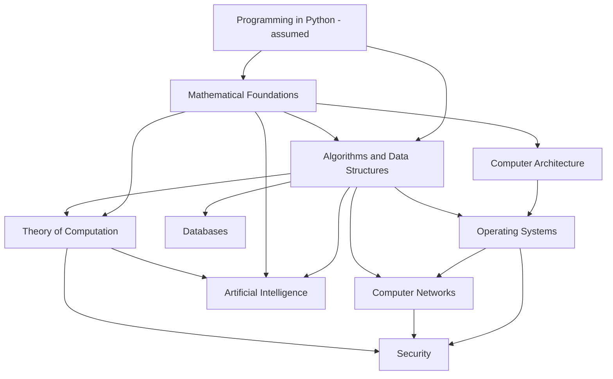

# Curriculum Map: Computer Science

Planning note for the Computer Science library and course. It maps the reference curriculum (UFSC, Bacharelado em Ciencias da Computacao, curriculo 20271, 9 phases, 3000 h CNE; document dated 20/11/2026, discipline names and codes in the original Portuguese with English glosses) to the areas studied here, and keeps everything left out annotated for later. Content comes only from the curriculum document; it states no outside facts. Topic notes will be added by `research-topic` runs; the topic MOC `_MOC Computer Science` will be created when verified findings exist.

> **H/A**: "hora-aula", class hour (the unit of the curriculum document). **Ob**: obligatory discipline. **Op**: elective discipline.

Request: [[Computer Science Theoretical Foundations]].

## (a) Reference curriculum, phase by phase

Legend for the last column: IN = in scope (module planned); DEF = deferred (see section c); ASSUMED = assumed known (programmer background).

### Phase 1
| Code | Discipline (English gloss) | H/A | Status |
|------|----------------------------|-----|--------|
| INE5801 | Introducao a Ciencia da Computacao (Introduction to Computer Science) | 108 | IN, as course overview (touches every area) |
| INE5802 | Introducao a Algoritmos e Programacao Estruturada (Intro to Algorithms and Structured Programming) | 108 | ASSUMED (Python practice) |
| INE5803 | Fundamentos da Matematica Discreta para Computacao (Discrete Mathematics Fundamentals) | 108 | IN |
| INE5804 | Preparacao para a Carreira em Computacao (Career Preparation) | 54 | DEF |
| INE5805 | Iniciacao a Extensao e a Pesquisa Academica (Intro to Extension and Academic Research) | 54 | DEF |

### Phase 2
| Code | Discipline | H/A | Status |
|------|-----------|-----|--------|
| INE5806 | Algoritmos e Estruturas de Dados Lineares (Linear Algorithms and Data Structures) | 108 | IN |
| INE5807 | Circuitos Digitais (Digital Circuits) | 72 | IN |
| INE5808 | Programacao Orientada a Objetos (Object-Oriented Programming) | 108 | DEF |
| INE5809 | Ciencia, Tecnologia e Sociedade (Science, Technology and Society) | 54 | DEF |
| MTM3110 | Calculo 1 (Calculus 1) | 72 | DEF |

### Phase 3
| Code | Discipline | H/A | Status |
|------|-----------|-----|--------|
| INE5810 | Algoritmos e Estruturas de Dados Nao-Lineares (Non-Linear Algorithms and Data Structures) | 90 | IN |
| INE5811 | Laboratorio de Programacao (Programming Lab) | 72 | DEF (Python practice inside modules) |
| INE5812 | Probabilidade e Estatistica (Probability and Statistics) | 90 | DEF |
| INE5813 | Sistemas Digitais (Digital Systems) | 36 | IN |
| INE5814 | Laboratorio de Sistemas Digitais (Digital Systems Lab) | 36 | DEF (hardware lab, HDL/FPGA) |
| MTM3120 | Calculo 2 (Calculus 2) | 72 | DEF |

### Phase 4
| Code | Discipline | H/A | Status |
|------|-----------|-----|--------|
| INE5815 | Organizacao de Computadores (Computer Organization) | 90 | IN |
| INE5816 | Redes e Comunicacao de Dados (Networks and Data Communication) | 72 | IN |
| INE5817 | Engenharia de Software (Software Engineering) | 72 | DEF |
| INE5818 | Teoria dos Grafos e Aplicacoes (Graph Theory and Applications) | 72 | IN (inside Algorithms and Data Structures and Mathematical Foundations) |
| INE5819 | Banco de Dados (Databases) | 72 | IN |
| MTM3121 | Algebra Linear (Linear Algebra) | 72 | DEF |

### Phase 5
| Code | Discipline | H/A | Status |
|------|-----------|-----|--------|
| INE5820 | Linguagens Formais e Modelos de Representacao (Formal Languages and Representation Models) | 72 | IN |
| INE5821 | Analise e Projeto de Algoritmos (Algorithm Analysis and Design) | 72 | IN |
| INE5822 | Sistemas Operacionais (Operating Systems) | 108 | IN |
| INE5823 | Seguranca em Computacao (Computer Security) | 72 | IN |
| INE5824 | Computacao Numerica (Numerical Computation) | 90 | DEF |

### Phase 6
| Code | Discipline | H/A | Status |
|------|-----------|-----|--------|
| INE5825 | Paradigmas de Programacao (Programming Paradigms) | 72 | DEF |
| INE5826 | Teoria da Computacao (Theory of Computation) | 72 | IN |
| INE5827 | Introducao a Inteligencia Artificial (Introduction to AI) | 72 | IN |
| INE5828 | Computacao Grafica (Computer Graphics) | 72 | DEF |
| INE5829 | Computacao Distribuida (Distributed Computing) | 72 | DEF |

### Phase 7 (optional hours of phase 7: 126 H/A)
| Code | Discipline | H/A | Status |
|------|-----------|-----|--------|
| INE5830 | Computacao Paralela (Parallel Computing) | 72 | DEF |
| INE5831 | Interdisciplinaridade e Empreendedorismo para Computacao (Interdisciplinarity and Entrepreneurship; extension 54 H/A) | 72 | DEF |
| INE5832 | Introducao a Pesquisa em Computacao (Intro to Research in Computing) | 72 | DEF |
| INE5833 | Compiladores (Compilers) | 72 | DEF |

### Phase 8 (optional hours of phase 8: 126 H/A)
| Code | Discipline | H/A | Status |
|------|-----------|-----|--------|
| INE5835 | Computador e Sociedade (Computer and Society; extension 54 H/A) | 90 | DEF |
| INE5836 | TCC I (Final Project I) | 144 | DEF |

### Phase 9
| Code | Discipline | H/A | Status |
|------|-----------|-----|--------|
| INE5837 | TCC II (Final Project II, with defense) | 144 | DEF |

Notes from the document: minimum 8 and maximum 18 semesters; mandatory workload 3000 h (CNE); extension workload totals 396 H/A (144 in obligatory disciplines INE5831, INE5834, INE5835 plus 252 in electives).

### Obligatory disciplines in the course

Obligatory disciplines brought in: INE5801 (as overview), INE5803, INE5806, INE5807, INE5810, INE5813, INE5815, INE5816, INE5818, INE5819, INE5820, INE5821, INE5822, INE5823, INE5826, INE5827. INE5802 is assumed.

## (b) In-scope areas and planned course modules

Folder pattern: `Library/Computer Science/<Area>/` with `_sources/` inside each area when sources exist. Folders are planned only; they are created when the first note exists.

| Module (planned) | Area folder | Curriculum basis | Python practice idea |
|------------------|-------------|------------------|----------------------|
| M0 Orientation: what Computer Science studies | `Library/Computer Science/` | INE5801 | map of the field, history timeline |
| M1 Mathematical Foundations | `Mathematical Foundations/` | INE5803, part of INE5818 | truth tables, induction proofs checked by code, combinatorics counts |
| M2 Algorithms and Data Structures | `Algorithms and Data Structures/` | INE5806, INE5810, INE5818, INE5821 | implement lists, hash tables, trees, graph search; measure growth |
| M3 Computer Architecture | `Computer Architecture/` | INE5807, INE5813, INE5815 | simulate gates and a tiny CPU |
| M4 Operating Systems | `Operating Systems/` | INE5822 | simulate scheduling and page replacement |
| M5 Computer Networks | `Computer Networks/` | INE5816 | sockets, a toy protocol, subnet calculations |
| M6 Databases | `Databases/` | INE5819 | sqlite3, relational algebra, normalization exercises |
| M7 Theory of Computation | `Theory of Computation/` | INE5820, INE5826 | DFA/PDA/Turing machine simulators |
| M8 Artificial Intelligence | `Artificial Intelligence/` | INE5827 | search, simple heuristics, minimal learning example |
| M9 Security | `Security/` | INE5823 | toy ciphers, hashing, access control model |

Suggested order of study: M1, M2 (linear then non-linear, then analysis), M3, M4, M5, M6, M7, M8, M9, with M7 reachable right after M1 and M2.

### Dependency map

*Dependency map of in-scope areas. Edges follow the prerequisite relations declared in the curriculum document where they exist (for example INE5810 before INE5816, INE5819 and INE5820; INE5822 and INE5816 before INE5830) and otherwise the proposed study order. An arrow means "study first".*

## (c) Deferred: not in this course (study later)

Everything in the reference curriculum not brought into the course. Ementa summaries are English paraphrases of the Portuguese text. Prerequisites quoted are the "Pre" column of the document (the document lists many alternatives and equivalences; only the main ones are repeated). Suggested order within each group follows the listed sequence.

### D1. Mathematics and numerical methods
Suggested order: Calculus 1, then Calculus 2 and Linear Algebra, then Probability and Statistics, then Numerical Computation, then the electives.

| Code | Discipline | Type, H/A | Ementa summary |
|------|-----------|-----------|----------------|
| MTM3110 | Calculo 1 (Calculus 1) | Ob, 72 | Real single-variable functions: limits, continuity, derivatives and applications (rates, tangents, optimization), definite and indefinite integrals. |
| MTM3120 | Calculo 2 (Calculus 2) | Ob, 72 | Applications of definite integrals, integration techniques, improper integrals, vector algebra, lines and planes, plane curves, surfaces, multivariable functions, partial derivatives, extrema of two-variable functions. Pre: Calculus 1. |
| MTM3121 | Algebra Linear (Linear Algebra) | Ob, 72 | Matrices, determinants, linear systems, real vector spaces, inner product, linear transformations, eigenvalues and eigenvectors, diagonalization, applications. |
| INE5812 | Probabilidade e Estatistica (Probability and Statistics) | Ob, 90 | Combinatorics, survey planning, exploratory data analysis, probability, discrete and continuous random variables, theoretical models, parameter estimation, hypothesis tests. |
| INE5824 | Computacao Numerica (Numerical Computation) | Ob, 90 | Errors and number systems, algebraic and transcendental equations, polynomial equations, linear and nonlinear systems, interpolation, least squares and series, numerical integration, numerical solution of ODEs. |
| INE5649 | Tecnicas Estatisticas de Predicao (Statistical Prediction Techniques) | Op, 72 | Correlation, simple and multiple linear regression, categorical predictors, time series and forecasting, spreadsheet/statistics package use. Pre: INE5812. |
| INE5839 | Modelagem e Simulacao Discreta de Sistemas (Discrete Systems Modeling and Simulation; extension 36 H/A) | Op, 108 | Modeling and simulation methodology, simulation languages, Markov chains, pseudo-random numbers, event-oriented discrete modeling, model verification and validation, analysis of results. Pre: INE5812. |
| INE5840 | Modelagem e Simulacao de Sistemas Ciber-Fisicos (Cyber-Physical Systems Modeling and Simulation; extension 36 H/A) | Op, 108 | Cyber-physical systems, continuous models (differential equations, finite elements, cellular automata), discrete models (extended state machines), hybrid models, simulation practice. |
| INE5841 | Avaliacao de Desempenho e Planejamento da Capacidade (Performance Evaluation and Capacity Planning; extension 36 H/A) | Op, 108 | Experiment planning, performance evaluation techniques, assumption analysis, workload modeling, load and performance prediction, service levels. |
| INE5858 | Programacao Matematica (Mathematical Programming) | Op, 72 | Linear programming with continuous and integer variables, simplex method, duality, integer programming, relaxation and bounds, branch-and-bound, cutting planes, branch-and-cut. |

### D2. Programming, paradigms and software engineering
Suggested order: OOP, Programming Lab, Programming Paradigms, Software Engineering, then the electives; Compilers after Formal Languages (in scope) and Non-linear Data Structures.

| Code | Discipline | Type, H/A | Ementa summary |
|------|-----------|-----------|----------------|
| INE5802 | Introducao a Algoritmos e Programacao Estruturada (assumed known) | Ob, 108 | Problem-solving techniques, control structures, I/O, variables, functions and recursion, structured programming, arrays, matrices, lists, heterogeneous collections, files. Revisit if gaps appear. |
| INE5808 | Programacao Orientada a Objetos (Object-Oriented Programming) | Ob, 108 | Objects, attributes, methods, classes; aggregation, composition, inheritance; polymorphism; reuse; class libraries; design patterns; exceptions; persistence; practice in an OO language. |
| INE5811 | Laboratorio de Programacao (Programming Lab) | Ob, 72 | Practice building software with an OO language and linear and non-linear data structures. |
| INE5825 | Paradigmas de Programacao (Programming Paradigms) | Ob, 72 | Classification and characterization of paradigms, declarative and imperative; logic programming; functional programming; practice. Pre: INE5810, INE5820, INE5824. |
| INE5817 | Engenharia de Software (Software Engineering) | Ob, 72 | Requirements analysis (functional, non-functional, use cases), OO modeling and design, design patterns, components and frameworks, architecture, object-relational mapping, developing an OO software. |
| INE5833 | Compiladores (Compilers) | Ob, 72 | Language specification design; compilation stages: lexical, syntax and semantic analysis, code generation and optimization; trends in compilers and languages. |
| INE5855 | Desenvolvimento Agil de Sistemas (Agile Systems Development) | Op, 54 | Traditional vs agile methods, agile manifesto, user stories, OKRs, TDD, Kanban, Scrum, XP, Lean, agile modeling, metrics, management, scaling. |
| INE5866 | Planejamento e Gerencia de Projetos (Project Planning and Management) | Op, 72 | Project management concepts, knowledge areas, processes, practices and tools, agile methods for software projects. |
| INE5869 | Engenharia de Usabilidade (Usability Engineering) | Op, 72 | Interaction basics, usability criteria, usability engineering process: context and requirements, UI prototyping, usability evaluation. |
| INE5878 | Desenvolvimento Orientado a Componentes (Component-Oriented Development) | Op, 72 | Component paradigm, component models, modeling components with UML, practice. |
| INE5879 | Testes de Software (Software Testing) | Op, 72 | Basic concepts, test levels, types and techniques, planning and execution, test-driven development, automation and tools. |
| INE5646 | Programacao para Web (Web Programming) | Op, 72 | Architectures, services, client/server protocols, data representation, database access, scalability, UI modeling languages, client and server languages, security, server setup, practice. |
| INE5843 | Desenvolvimento para Dispositivos Moveis (Mobile Development; extension 36 H/A) | Op, 108 | Mobile device technologies, programming approaches and APIs, platforms, resources and layouts, GUI design, persistence, web services, advanced topics. |
| INE5653 | Introducao a Internacionalizacao e Localizacao de Software (Software Internationalization and Localization) | Op, 36 | Character encoding, writing systems, locales, internationalized algorithms, software and web localization, tools. |
| INE5847 | Processo de Desenvolvimento de Sistemas de Deep Learning (Deep Learning Systems Development Process) | Op, 72 | Deep learning concepts, software process, requirements, data preparation, training, evaluation, deployment to web/mobile, interface design, testing. |
| INE5856 | Programacao Competitiva I (Competitive Programming I) | Op, 72 | Contest strategy, ad hoc problems, math, number theory, strings, data structures, backtracking, divide and conquer, dynamic programming, greedy. |
| INE5857 | Programacao Competitiva II (Competitive Programming II) | Op, 72 | Graph problems, advanced structures (segment tree, Fenwick tree, trie, suffix automata, sqrt decomposition), geometry, combinatorics, game theory, formal languages and compilers. |

### D3. Hardware, embedded and low-level design
Suggested order: Digital Systems Lab (after Digital Systems, in scope), Hardware-Aware Programming, Computer Architecture I and II, Embedded Systems, then IC and EDA electives.

| Code | Discipline | Type, H/A | Ementa summary |
|------|-----------|-----------|----------------|
| INE5814 | Laboratorio de Sistemas Digitais (Digital Systems Lab) | Ob, 36 | Hands-on combinational, sequential, synchronous and asynchronous circuits; RT-level analysis and design; hardware description language (HDL), simulation and FPGA synthesis. |
| INE5849 | Programacao Ciente de Hardware (Hardware-Aware Programming) | Op, 36 | Macro view of a computer, programming aware of data representation, cache and registers, performance and memory management exploitation. Pre: INE5815. |
| INE5850 | Arquitetura de Computadores I (Computer Architecture I) | Op, 36 | Instruction-level parallelism (compiler techniques, branch prediction, multiple issue, dynamic scheduling, speculation, multithreading); thread-level parallelism (shared memory, synchronization, cache coherence, consistency models). Pre: INE5815. |
| INE5851 | Arquitetura de Computadores II (Computer Architecture II) | Op, 36 | Data-level parallelism (vector, SIMD, GPU), loop-level parallelism, domain-specific architectures and accelerators. Pre: INE5815. |
| INE5854 | Sistemas Embarcados (Embedded Systems) | Op, 54 | Embedded design methodologies, processing options (microcontrollers, DSP, ASIP, programmable logic), peripherals, wireless, memories, bare-metal, real-time kernel, embedded OS, case studies. |
| INE5844 | Programacao de Sistemas Embarcados Microcontroladores (Microcontroller Embedded Programming; extension 36 H/A) | Op, 108 | Microcontroller families, architecture, serial/parallel interfaces, peripheral control, simulation platforms, resource-constrained programming, embedded OS, IoT applications. Pre: INE5822. |
| INE5862 | Concepcao de Circuitos Integrados (Integrated Circuit Design) | Op, 72 | SoC integration, CMOS fabrication notions, transistor behavior, CMOS inverter and gates, design styles, arithmetic and sequential circuits, ALU/SRAM/ROM/datapaths, layout and EDA tools. Pre: INE5813. |
| INE5863 | Electronic Design Automation (Automacao do Projeto Eletronico) | Op, 72 | EDA flow, ESL and high-level synthesis, logic synthesis, verification and test, physical synthesis, algorithms and heuristics. |
| INE5864 | Projeto e Verificacao de Sistemas Digitais Complexos (Complex Digital Systems Design and Verification) | Op, 72 | FSMD/ASM behavior capture, RTL design and verification, HDLs, testbenches, FPGA and ASIC synthesis flow, practical design project. |
| INE5848 | Tolerancia a Falhas em Hardware e Software (Hardware and Software Fault Tolerance) | Op, 36 | Reliability modeling, fault handling, recovery and reconfiguration, hardware and software tolerance techniques, applications. |
| INE5852 | Autonomous Embedded Systems I | Op, 36 | Autonomous and data-driven systems, autonomic computing, multiagent systems, vehicles, smart grid, architectures, communication, IoT and cloud integration, secure communication project. |
| INE5853 | Autonomous Embedded Systems II | Op, 36 | Timing and synchronization, localization (GNSS, sensor fusion), safety models, isolation and virtualization, runtime verification project. Pre: INE5852. |
| INE5871 | Robotica Movel e Adaptativa (Mobile and Adaptive Robotics) | Op, 72 | Mobile robotics history and applications, kinematics, sensors and actuators, architectures, localization, mapping, route planning, multi-robot systems, cognitive robotics. |

### D4. Systems at scale: distributed, parallel, network management
Suggested order: Distributed Computing, Parallel Computing, Special Topics in Parallel Computing; Network Administration and Industrial/Vehicular Networks after Networks and OS (in scope).

| Code | Discipline | Type, H/A | Ementa summary |
|------|-----------|-----------|----------------|
| INE5829 | Computacao Distribuida (Distributed Computing) | Ob, 72 | Characterization, requirements and models; architectures; OS support; direct and indirect communication; time, synchronization and agreement; consistency and replication; fault tolerance; case studies. Pre: INE5418 (per document). |
| INE5830 | Computacao Paralela (Parallel Computing) | Ob, 72 | Problem decomposition, communication and synchronization, architectures and taxonomies, performance analysis, languages and environments, multiprocessor/multicomputer/accelerator programming, classic parallel algorithms, optimization. |
| INE5877 | Topicos Especiais em Computacao Paralela (Special Topics in Parallel Computing) | Op, 36 | Advanced parallel algorithms and projects in parallel and high-performance computing for science and engineering. Pre: INE5829. |
| INE5619 | Administracao e Gerencia de Redes de Computadores (Network Administration and Management) | Op, 72 | Network management systems and information flows, innovative management, management technologies (TMN, OSI/NM, SNMP), market forces, trends, platform evaluation, management security. |
| INE5874 | Industrial and Vehicular Networks | Op, 72 | Industry 4.0 and IoT networks (VANETs), wired/wireless, protocols, resource management, synchronization, cross-layer, middleware, simulation, safety. Pre: INE5816. |
| INE5628 | Sistemas Multiagentes (Multiagent Systems) | Op, 72 | Agent properties, agent architectures, agent programming languages, case studies. Pre: INE5827. |

### D5. Data, AI-adjacent and advanced computation
Suggested order: Databases II (after Databases, in scope), Machine Learning (after Probability and Statistics, Calculus 2 or Linear Algebra, and Intro to AI), Deep Learning-oriented items, then specialized topics.

| Code | Discipline | Type, H/A | Ementa summary |
|------|-----------|-----------|----------------|
| INE5867 | Banco de Dados II (Databases II) | Op, 72 | Embedded SQL, query processing and optimization, transactions, failure recovery, concurrency control (serializability, optimistic/pessimistic, deadlock), distributed databases basics. Pre: INE5819. |
| INE5600 | Bancos de Dados III (Databases III) | Op, 36 | Non-conventional applications, new data management challenges, post-relational databases: categories, concepts, data models, manipulation, modeling. Pre: INE5867. |
| INE5870 | Semantica e Recuperacao da Informacao (Semantics and Information Retrieval) | Op, 36 | Information retrieval models, similarity retrieval, metric spaces, embeddings, language models, ontologies, semantic web, knowledge graphs, semantic queries. Pre: INE5819. |
| INE5868 | Aprendizado de Maquina (Machine Learning) | Op, 72 | ML project flow, fundamentals, unsupervised and supervised learning, model training, evaluation and selection. Pre: INE5812, MTM3120 or MTM3121 (per document). |
| INE5842 | Projetos em Ciencia de Dados (Data Science Projects; extension 18 H/A) | Op, 72 | Data science intro and methodology, exploratory analysis, collection, integration and storage, preprocessing, a real project. Pre: INE5868. |
| INE5846 | Visao Computacional (Computer Vision) | Op, 72 | Digital image fundamentals, spatial and frequency domain processing, filters, restoration, segmentation, binary morphology, image quality metrics, deep learning for vision (CNNs, attention, classification, detection, semantic segmentation). |
| INE5886 | Criatividade Computacional (Computational Creativity) | Op, 72 | Human and computational creativity, evaluation, computational models, ML applied to creativity, deep and generative models, Transformers, multimodal models, human-AI co-creation. Pre: INE5827. |
| INE5828 | Computacao Grafica (Computer Graphics) | Ob, 72 | 2D transformations and homogeneous coordinates, clipping, parametric curves and surfaces, 3D data structures, projections, ray shading/casting/tracing, rasterization and depth buffer, lighting, graphics APIs and OpenGL, animation, VR. |
| INE5865 | Codificacao de Video (Video Coding) | Op, 72 | Image and video coding, history of standards, hybrid coding model (prediction, transform, quantization, entropy coding, filters), state-of-the-art standards, light fields, point clouds, codec implementations. |
| INE5872 | Computacao Biologica I (Biological Computing I) | Op, 72 | Cell and molecular biology fundamentals, bioengineering, bioinformatics and biotechnology methods, modeling of biochemical pathways, biochemical information processing, biosensors, biological computing components. |
| INE5873 | Bioinformatica (Bioinformatics) | Op, 72 | Computational models of biological systems, biological databases, sequence alignment and phylogenetics, protein structure prediction, visualization and mining. |
| INE5859 | Buscas Heuristicas (Heuristic Search) | Op, 72 | Local search, constructive search, recombination, design and experimentation methodology. Pre: INE5821. |
| INE5860 | Laboratorio de Otimizacao Combinatoria (Combinatorial Optimization Lab) | Op, 72 | Practical mathematical, linear and integer programming; experiments with heuristics and optimization tools. Pre: INE5858. |
| INE5861 | Algoritmos de Aproximacao (Approximation Algorithms) | Op, 72 | Approximation for scheduling, knapsack, traveling salesman; primal, dual, primal-dual methods; probabilistic algorithms; Max SNP and APX classes, reductions, inapproximability. Pre: INE5821. |
| INE5875 | Introducao a Computacao Quantica (Intro to Quantum Computing) | Op, 72 | Linear algebra with Dirac notation, postulates of quantum mechanics, quantum gates and circuits, quantum protocols and algorithms. |
| INE5876 | Modelos de Maquinas Quanticas (Quantum Machine Models) | Op, 72 | Quantum finite automata, pushdown automata, Turing machines; properties; relation to classical models; computational power. Pre: INE5826. |
| INE5656 | Introducao a Logica Simbolica (Intro to Symbolic Logic) | Op, 36 | Scope and applications of logic, sequent calculi for propositional and quantified logic, notions of semantics, knowledge representation examples. Pre: INE5803. |
| INE5658 | Logica Simbolica II (Symbolic Logic II) | Op, 36 | Topics in quantified logic, sequent calculus and semantics for classical equational logic and a description logic. Pre: INE5656. |
| INE5680 | Seguranca da Informacao e de Redes (Information and Network Security) | Op, 72 | Basic concepts, classical and symmetric cryptography, Diffie-Hellman, public-key cryptography, hash functions, digital signatures and certification, authentication and cryptographic protocols, application security, VPNs, defense, security management. Deepens in-scope Security. |
| INE5890 | Tecnologias Blockchain e Criptomoedas (Blockchain Technologies and Cryptocurrencies) | Op, 72 | Cryptographic primitives, blockchain concepts and protocols, cryptocurrencies, non-financial applications, smart contracts. |

### D6. Professional, social, research and management
Suggested order: Career Preparation, Intro to Research, Science-Technology-Society (early); Interdisciplinarity and Entrepreneurship, Intro to Research in Computing, Computer and Society, TCC I and II (late).

| Code | Discipline | Type, H/A | Ementa summary |
|------|-----------|-----------|----------------|
| INE5804 | Preparacao para a Carreira em Computacao (Career Preparation) | Ob, 54 | Careers in computing, world of work, computing as science, role of the professional, responsibility, ethics, plagiarism. |
| INE5805 | Iniciacao a Extensao e a Pesquisa Academica (Intro to Extension and Academic Research) | Ob, 54 | Extension and research definitions, scientific methodology, project preparation, literature review, academic writing, joining a research or extension project. |
| INE5809 | Ciencia, Tecnologia e Sociedade (Science, Technology and Society) | Ob, 54 | Critical thinking, scientific and other knowledge, technoscience, impacts and risks, cultural differences, human rights, social effects of technology, case analysis. |
| INE5831 | Interdisciplinaridade e Empreendedorismo para Computacao (Interdisciplinarity and Entrepreneurship; extension 54 H/A) | Ob, 72 | Interdisciplinary extension projects, entrepreneurship, innovation and startup ecosystem, lean startup, opportunity validation, business plan, support policy, TCC proposal. |
| INE5832 | Introducao a Pesquisa em Computacao (Intro to Research in Computing) | Ob, 72 | How research works, publishing and peer review, venues and careers, funding, impact metrics, project preparation, TCC proposal, running an academic journal edition. |
| INE5835 | Computador e Sociedade (Computer and Society; extension 54 H/A) | Ob, 90 | Impact of computing on science, work, communication, politics, knowledge and environment; virtual worlds and massive AI use; transparency and privacy; power of large technology organizations; ethical limits of data use; case studies. |
| INE5836 | TCC I (Final Project I) | Ob, 144 | Guidance for the initial phase of the final project; progress reports. |
| INE5837 | TCC II (Final Project II) | Ob, 144 | Guidance for the final phase, final defense before an examination board. Pre: INE5836. |
| INE5657 | Tecnologia da Informacao e Governanca (IT and Governance) | Op, 72 | IT governance foundations, frameworks, ISO/BSI/ABNT norms, good practices for information systems and IT services. |
| INE5659 | Gestao Estrategica de Tecnologias, Informacao e Comunicacao (Strategic Management of IT and Communication) | Op, 72 | Types of information systems, planning, development and use, requirements, executive information systems, case studies, IT governance. Pre: INE5817. |
| INE5681 | Modelagem e Automacao de Processos de Negocios (Business Process Modeling and Automation) | Op, 72 | Business process view, architecture and rule modeling, process management cycle, notations and methods, automation and indicators, integration with requirements. Pre: INE5817. |
| INE5834 | Atividades de Extensao 1 (Extension Activities 1; EXT 36 H/A) | Op, 36 | Extension actions in projects, events or courses under UFSC rules; counts toward the 396 H/A extension total. |
| INE5838 | Atividades de Extensao 2 (Extension Activities 2; EXT 252 H/A) | Op, 252 | Variable extension workload: sum of separate activities, up to 252 H/A in one qualified activity. |
| INE5845 | Introducao a Informatica em Educacao (Intro to Informatics in Education; extension 54 H/A) | Op, 90 | History of informatics in education, computational thinking, distance education, MOOCs, constructionism, educational games, instructional design, delivering a short course. |
| INE5880, INE5881, INE5882, INE5883 | Topicos Especiais em Computacao 1 to 4 (Special Topics in Computing) | Op, 36 / 54 / 72 / 72 | Free advanced topics in Computer Science. |
| INE5884, INE5885 | Programa de Intercambio 1 and 2 (Exchange Program) | Op, variable | Variable content. |
| INE5887, INE5888 | Estagio Supervisionado 1 and 2 (Supervised Internship, extracurricular option) | Op, 72 each | Variable. |
| INE5889 | Atividades Complementares (Complementary Activities) | Op, variable | Variable. |
| ANT7003 | Relacoes Inter-etnicas (Inter-ethnic Relations) | Op, 72 | Ethnic groups, identity construction, ethnicity and race, pluri-ethnic societies. |
| DIR5933 | Direitos Humanos (Human Rights) | Op, 36 | Historical construction of human rights, citizenship, democracy, ethics, environment, pluralism. |
| ECZ5102 | Conservacao de Recursos Naturais (Conservation of Natural Resources) | Op, 36 | Ecosystem structure and dynamics, human impact, legislation and conservation. |
| HST7202 | Historia da Africa (History of Africa; PCC 12 H/A) | Op, 72 | African socio-political structures, 16th to 20th century, colonial systems and decolonization, teaching approaches. |
| LSB7244 | Lingua Brasileira de Sinais, Libras I (Brazilian Sign Language I; PCC 18 H/A) | Op, 72 | Basic Libras conversation practice, linguistics of sign languages, Deaf culture, education of the Deaf. |
| PSI5910 | Temas em Psicologia: Orientacao e Planejamento de Carreira (Career Orientation and Planning) | Op, 36 | University experience and transition to work, career planning, employability, job and internship search. |

### Suggested overall order for the deferred material

1. Mathematics base: Calculus 1, Calculus 2, Linear Algebra, Probability and Statistics.
2. Programming craft: Object-Oriented Programming, Programming Lab, Programming Paradigms, Software Engineering (then agile, testing, usability, web, mobile).
3. After the in-scope Algorithms module: Competitive Programming I and II, Heuristic Search, Approximation Algorithms.
4. After the in-scope Theory of Computation module: Compilers, Symbolic Logic I and II, Quantum Machine Models.
5. After the in-scope Architecture and OS modules: Digital Systems Lab, Hardware-Aware Programming, Computer Architecture I and II, Embedded Systems, IC and EDA electives.
6. After OS and Networks: Distributed Computing, Parallel Computing, Network Administration, Industrial and Vehicular Networks.
7. After Databases and Intro to AI plus step 1: Databases II and III, Machine Learning, Data Science Projects, Computer Vision, Computer Graphics, Information Retrieval, Numerical Computation.
8. Professional and research track at any time: Career Preparation, Intro to Research, Computer and Society; research and TCC items last.

## (d) In-scope areas: subtopics and guiding questions

These tables seed future `research-topic` runs (one run per area, or per subtopic with `depth: specific`).

### Mathematical Foundations (`Library/Computer Science/Mathematical Foundations/`)
Basis: INE5803 (ementa: sets, sequences and sums; propositional and first-order logic; theorem proving; induction and recursion; combinatorics, pigeonhole principle, recurrence relations; relations; functions and growth of functions; order relations and lattices; semigroups and groups; number theory elements; applications).

| # | Subtopic | Guiding question |
|---|----------|------------------|
| 1 | Sets, relations and functions | How are collections, relations (equivalence, order) and functions defined, and why do programs rely on them? |
| 2 | Propositional and first-order logic | How do we state facts precisely and decide whether an argument is valid? |
| 3 | Proof techniques: direct, contradiction, induction | How do we prove a claim about all inputs, and how does induction relate to recursion? |
| 4 | Combinatorics and recurrence relations | How do we count possibilities and solve counting problems that define themselves recursively? |
| 5 | Number theory and modular arithmetic | Which number-theoretic ideas (divisibility, gcd, congruences) are used in computing and security? |
| 6 | Order relations, lattices and algebraic structures | What are partial orders, lattices, semigroups and groups, and where do they appear in computing? |
| 7 | Growth of functions | How do we compare how fast functions grow (bridge to algorithm analysis)? |

### Algorithms and Data Structures (`Library/Computer Science/Algorithms and Data Structures/`)
Basis: INE5806, INE5810, INE5818, INE5821.

| # | Subtopic | Guiding question |
|---|----------|------------------|
| 1 | Algorithm analysis and asymptotic notation | How do we measure and compare the cost of an algorithm independent of the machine? |
| 2 | Recurrences and amortized analysis | How do we analyze recursive algorithms and operations whose cost varies over a sequence? |
| 3 | Linear structures and abstract data types | How do lists, stacks, queues and hash tables trade off time and memory? |
| 4 | Trees, balancing and heaps | Why do balanced trees and heaps give fast search, insertion and priority access? |
| 5 | Sorting and searching | What are the sorting algorithms, their costs and limits? |
| 6 | Graphs and graph algorithms | How are graphs represented and traversed (BFS, DFS, topological order, strongly connected components)? |
| 7 | Algorithm design paradigms | When do brute force, greedy, divide and conquer, and dynamic programming apply? |
| 8 | Advanced structures and string processing | What do tries, union-find and segment/Fenwick trees solve? |

### Computer Architecture (`Library/Computer Science/Computer Architecture/`)
Basis: INE5807, INE5813, INE5815 (INE5801 for number systems and Boolean algebra).

| # | Subtopic | Guiding question |
|---|----------|------------------|
| 1 | Number systems and data representation | How are numbers, text and other data encoded in bits? |
| 2 | Boolean algebra and logic gates | How do Boolean functions become circuits and how are they simplified? |
| 3 | Combinational circuits | How are adders, multiplexers and ALUs built from gates? |
| 4 | Sequential circuits and finite state machines | How do latches, flip-flops and clocks give circuits memory and state? |
| 5 | Datapath and control: processor as a digital system | How does a processor execute an instruction using a datapath and a control unit? |
| 6 | Instruction set, assembly and the software interface | What does the machine-level interface look like (instructions, addressing modes, assembler and linker role)? |
| 7 | Pipelining, hazards and performance | How does pipelining speed up execution and what hazards limit it? |
| 8 | Memory hierarchy and caches | Why is memory organized in levels and how do caches, associativity and TLB work? |

### Operating Systems (`Library/Computer Science/Operating Systems/`)
Basis: INE5822.

| # | Subtopic | Guiding question |
|---|----------|------------------|
| 1 | OS structure and the kernel interface | What does an OS do and how do programs request its services? |
| 2 | Processes and threads | What is a process, what is a thread, and how are they created and switched? |
| 3 | Scheduling | How does the OS decide what runs next, including multiprocessor and real-time cases? |
| 4 | Synchronization and deadlocks | How do concurrent activities coordinate safely (classic problems) and how do deadlocks arise? |
| 5 | Memory management and virtual memory | How do paging, segmentation and page replacement create the illusion of large private memory? |
| 6 | File systems | How are files and directories implemented on storage? |
| 7 | I/O and virtualization | How does the OS manage devices and how does virtualization work (notions)? |
| 8 | OS protection and security basics | How does the OS isolate and protect programs? (link to Security) |

### Computer Networks (`Library/Computer Science/Computer Networks/`)
Basis: INE5816.

| # | Subtopic | Guiding question |
|---|----------|------------------|
| 1 | Layered models: OSI and TCP/IP | Why are networks organized in layers and what does each layer do? |
| 2 | Physical layer: channel capacity, transmission rate, encoding | What limits how fast data can move through a medium? |
| 3 | Switching: circuit vs packet | How do circuit- and packet-switched networks differ? |
| 4 | Link layer services and technologies | How is data delivered reliably between neighboring nodes? |
| 5 | Network layer: addressing and routing | How are packets addressed and routed across networks (TCP/IP network layer)? |
| 6 | Application layer protocols | How do common application protocols work on top of the transport service? |
| 7 | Network security basics | What are the main threats to networks and the defenses (link to Security)? |

### Databases (`Library/Computer Science/Databases/`)
Basis: INE5819.

| # | Subtopic | Guiding question |
|---|----------|------------------|
| 1 | DBMS architecture and data models | What does a database management system provide beyond files? |
| 2 | Relational model, integrity constraints | What is the relational model and which rules keep data valid? |
| 3 | Relational algebra and calculus | What is the formal basis of querying relations? |
| 4 | SQL (DDL, DML, views, access authorization) | How do we define, query and protect data in SQL? |
| 5 | Entity-Relationship modeling and mapping | How do we design a database from requirements and map it to relations? |
| 6 | Functional dependencies and normalization | Why do normal forms prevent anomalies and how are they derived? |
| 7 | Non-relational models and trends | What other data models exist and when are they used? |

### Theory of Computation (`Library/Computer Science/Theory of Computation/`)
Basis: INE5820, INE5826.

| # | Subtopic | Guiding question |
|---|----------|------------------|
| 1 | Languages, alphabets and problems as languages | How do computational problems become questions about sets of strings? |
| 2 | Finite automata and regular languages | What can machines with finite memory recognize? |
| 3 | Pushdown automata and context-free grammars | What extra power does a stack give, and how do grammars generate languages? |
| 4 | Chomsky hierarchy and language class properties | How are language classes ordered and how do machines and grammars correspond? |
| 5 | Turing machines and the Church-Turing thesis | What is an algorithm in a formal sense? |
| 6 | Decidability and the halting problem | Which problems no algorithm can solve, and how do we prove it (reductions)? |
| 7 | Time complexity: P, NP, NP-completeness | Which problems are tractable, what does NP-complete mean, and what is Cook-Levin? |
| 8 | Space complexity and hierarchy | How does memory bound computation (PSPACE, Savitch, L and NL, hierarchy theorems)? |

### Artificial Intelligence (`Library/Computer Science/Artificial Intelligence/`)
Basis: INE5827 (ementa: history; symbolic approach; connectionist approach; machine learning; computational intelligence; metaheuristics and evolutionary approaches; fuzzy logic; distributed AI; impact and ethics).

| # | Subtopic | Guiding question |
|---|----------|------------------|
| 1 | History and main approaches | How did AI develop and how do its approaches differ? |
| 2 | Symbolic AI: search, logic and knowledge representation | How can a program reason by search and symbolic rules? |
| 3 | Machine learning basics | How do systems learn patterns from data (supervised vs unsupervised)? |
| 4 | Connectionist approach: neural networks | How do neural networks represent and learn functions? |
| 5 | Metaheuristics and evolutionary computation | How do search methods inspired by nature solve hard optimization problems? |
| 6 | Fuzzy logic | How is reasoning with degrees of truth formalized? |
| 7 | Distributed AI and agents | How do multiple agents cooperate or compete? |
| 8 | Impact and ethics of AI | What are the social risks and responsibilities? (fast-changing; set `review-by`) |

### Security (`Library/Computer Science/Security/`)
Basis: INE5823 (ementa: application security; OS security; network security; cryptography principles; authentication protocols; cloud security; privacy and regulation).

| # | Subtopic | Guiding question |
|---|----------|------------------|
| 1 | Security principles and threat models | What are we protecting, from whom, and how do we reason about it? |
| 2 | Application security: secure programming, flaws, malware | How do software flaws become attacks and how are they prevented? |
| 3 | OS security: access control, isolation, containers | How does a system separate users and programs? (link to Operating Systems) |
| 4 | Network security: attacks, defenses, wireless, Zero Trust | How are networks attacked and defended? (link to Computer Networks) |
| 5 | Cryptography: symmetric, asymmetric, integrity, post-quantum | Why do ciphers, hashes and public-key schemes work and what are their limits? |
| 6 | Authentication and PKI protocols (X.509, TLS, SSH, Kerberos, VPN, MFA) | How do parties prove identity and set up secure channels? |
| 7 | Cloud security | What changes when data and workloads live in the cloud? |
| 8 | Privacy, regulation and ethics (GDPR, LGPD) | What legal and ethical rules govern data protection? (fast-changing; set `review-by`) |

## Area MOCs

- [[_MOC Mathematical Foundations]]
- [[_MOC Algorithms and Data Structures]]
- [[_MOC Computer Architecture]]
- [[_MOC Operating Systems]]
- [[_MOC Computer Networks]]
- [[_MOC Databases]]
- [[_MOC Theory of Computation]]
- [[_MOC Artificial Intelligence]]
- [[_MOC Security]]

## Gaps and next steps

- [ ] Run `research-topic` per in-scope area using the subtopic tables above; each run files notes into the area folder.
- [ ] Create `_MOC Computer Science` (parent MOC) once verified findings exist; it must link to this map and to per-area MOCs.
- [ ] Reference curriculum prerequisite columns were partly garbled by text extraction; prerequisites above are indicative. Recheck on the official document before relying on them.
- [ ] Ementa translations are paraphrases; quote the Portuguese original when precision matters.

## History

- 2026-11-23: created from the reference curriculum text (curriculo 20271); status draft until reviewed.
- 2026-11-23: added "Area MOCs" section linking the Mathematical Foundations and Algorithms and Data Structures MOCs.
- 2026-11-23: appended [[_MOC Computer Architecture]] to "Area MOCs".
- 2026-11-23: appended [[_MOC Operating Systems]] to "Area MOCs".
- 2026-11-23: appended [[_MOC Computer Networks]] to "Area MOCs".
- 2026-11-23: appended [[_MOC Databases]] to "Area MOCs".
- 2026-11-23: appended [[_MOC Theory of Computation]] to "Area MOCs".
- 2026-11-23: appended [[_MOC Artificial Intelligence]] to "Area MOCs".
- 2026-11-23: appended [[_MOC Security]] to "Area MOCs".
