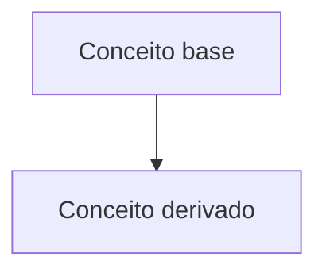

# MOC {{title}}

## Síntese

Visão geral do tema: o que é, por que importa, como funciona.

## Mapa

*Legenda do mapa.*

## Notas

### Fundamentos
- [[ ]]

### Aprofundamento
- [[ ]]

### Prática e ferramentas
- [[ ]]

## Conexões com outras áreas

- [[ ]]

## Fontes principais

- [[ ]]

## Lacunas e próximos passos

- [ ] 

## Histórico

- {{date:YYYY-MM-DD}}: criado.
