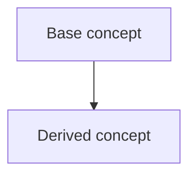

# MOC {{title}}

## Synthesis

Overview of the topic: what it is, why it matters, how it works.

## Map

*Map caption.*

## Notes

### Fundamentals
- [[ ]]

### Deep dive
- [[ ]]

### Practice and tools
- [[ ]]

## Connections to other areas

- [[ ]]

## Main sources

- [[ ]]

## Gaps and next steps

- [ ] 

## History

- {{date:YYYY-MM-DD}}: created.
