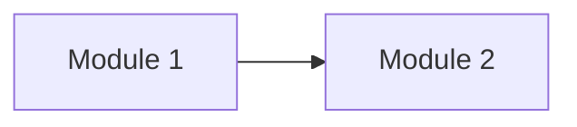

---
title:
stage: 4
layer: course
status: planned         # planned | written | reviewed | published
type: overview
created: {{date:YYYY-MM-DD}}
updated: {{date:YYYY-MM-DD}}
audience:
prerequisites: []
base-moc: "[[ ]]"
tags: [course]
---

# {{title}}

## Who it is for

## What you will be able to do at the end

-

## Prerequisites

-

## Track

| Module | Level | Topic | Main practice |
|--------|-------|-------|---------------|
| [[01 - ]] | basic | | |

## How to study

Each module has **Theory** and then **Practice**. Read all the theory before starting the exercises. Technical terms are glossed on first occurrence.

## General glossary

> **Term**: definition.

## Library base

- [[ ]]

## History

- {{date:YYYY-MM-DD}}: planned.
