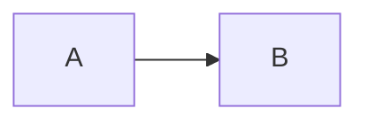

---
title:
stage: 4
layer: course
status: planned         # planned | written | reviewed | published
type: module
course:
module:
level: basic            # basic | intermediate | advanced
created: {{date:YYYY-MM-DD}}
updated: {{date:YYYY-MM-DD}}
base-notes: []          # [[links]] from the library that support the theory
reviewed-by:
tags: [course, module]
---

# Module {{module}} — {{title}}

## Objectives

By the end of this module you will be able to:

-

## Prerequisites

-

---

# Part 1 — Theory

> **Term**: gloss on first occurrence.

<!-- Complete, detailed theory. Keep technical terms. Link the library: [[ ]]. No fact outside the library. -->

## Visuals

*Caption: what the diagram shows.*

## Theory summary

-

---

# Part 2 — Practice

> Only start here after finishing Part 1.

## Guided example

## Exercises

### Basic

1.

### Intermediate

1.

### Advanced

1.

## Mini-project

## Answer key

## Comprehension check

- [ ]

## Next module

- [[ ]]

## History

- {{date:YYYY-MM-DD}}: created.
