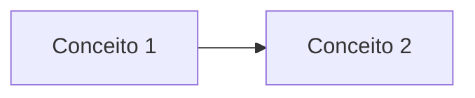

# {{NN}} · {{Título do módulo}}

<!--
Modelo de módulo de curso. Estrutura e regras em CLAUDE.md, seção "Courses".
Arquivo: Courses/Curso - <Nome>/NN - Título.md (dois dígitos, sem dois-pontos no nome).
Escrever em português. Termos técnicos em inglês entre parênteses, na primeira vez, com glosa.
Nada de confiança, status ou lacunas dentro do módulo: isso vai para as notas de entrega.
-->

---
título: Título do módulo
módulo: NN
tempo: 30 min
notas-base: "[[ ]]"
---

# {{NN}} · {{Título do módulo}}

**Tempo estimado:** 30 minutos · **Pré-requisito:** [[NN-1 - ]].

**Ao final você vai conseguir:**

1. verbo de ação + objetivo
2. verbo de ação + objetivo
3. verbo de ação + objetivo

**Antes de começar:** um lembrete curto do que vem dos módulos anteriores, com link.

---

## Para começar

Um problema ou pergunta real, em até 120 palavras. Por que importa.

---

## Mapa do módulo



*Figura: o que o diagrama mostra.*

**Como ler:** como seguir o diagrama.

---

## Mini-aula 1: título

> [!tip] Ideia
> Uma frase.

Intuição ou analogia (se houver; dizer que é analogia).

> [!info] Definição
> Definição precisa e curta. **Termo** (term): explicação.

Exemplo, com código e saída real quando couber.

> [!warning] Armadilha comum
> O erro mais frequente.

> [!question]- Checkpoint
> 1. Pergunta.
>
> > [!success]- Resposta
> > Resposta.

---

## Exercícios

Cada exercício: enunciado, código inicial com `...`, `assert` com mensagem, `print("Passou!")`.

### Aquecimento

**A1. Título.** Enunciado, indicando a função a completar.

```python
def funcao(...):
    """Descrição."""
    ...

assert funcao(...) == ..., "mensagem"
print("Passou!")
```

> [!hint]- Dica 1
> Dica.

> [!hint]- Dica 2
> Dica.

> [!example]- Solução
> ```python
> def funcao(...):
>     """Descrição."""
>     ...
> ```
> **Erro comum:** o erro mais frequente, e por que acontece.

### Praticando

**P1.** ...

### Desafio

**D1.** ...

---

## Mini-projeto (opcional)

**Objetivo.** Uma frase.

(código inicial, dicas, erro comum e solução, como nos exercícios)

---

## Fechando

**Resumo**

- ponto 1
- ponto 2

**Glossário rápido**

- **Termo** (term): definição.

**Perguntas de revisão**

1. Pergunta.
2. Pergunta.
3. Pergunta.

**E agora?** O próximo módulo e por quê.

---

## Para ir mais fundo

- [[ ]]
