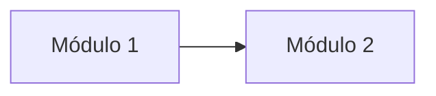

---
titulo:
etapa: 4
camada: curso
status: planejado       # planejado | escrito | revisado | publicado
tipo: visao-geral
criado: {{date:YYYY-MM-DD}}
atualizado: {{date:YYYY-MM-DD}}
publico:
pre-requisitos: []
moc-base: "[[ ]]"
tags: [curso]
---

# {{title}}

## Para quem é

## O que você será capaz de fazer ao final

-

## Pré-requisitos

-

## Trilha

| Módulo | Nível | Tema | Prática principal |
|--------|-------|------|-------------------|
| [[01 - ]] | básico | | |

## Como estudar

Cada módulo tem **Teoria** e depois **Prática**. Leia a teoria inteira antes de começar os exercícios. Termos técnicos ficam com legenda na primeira ocorrência.

## Glossário geral

> **Termo**: definição.

## Base no acervo

- [[ ]]

## Histórico

- {{date:YYYY-MM-DD}}: planejado.
