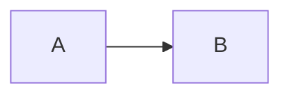

---
titulo:
etapa: 4
camada: curso
status: planejado       # planejado | escrito | revisado | publicado
tipo: modulo
curso:
modulo:
nivel: basico           # basico | intermediario | avancado
criado: {{date:YYYY-MM-DD}}
atualizado: {{date:YYYY-MM-DD}}
notas-base: []          # [[links]] do acervo que sustentam a teoria
revisado-por:
tags: [curso, modulo]
---

# Módulo {{modulo}} — {{title}}

## Objetivos

Ao final deste módulo você será capaz de:

-

## Pré-requisitos

-

---

# Parte 1 — Teoria

> **Termo**: legenda na primeira ocorrência.

<!-- Teoria completa e detalhada. Manter termos técnicos. Linkar o acervo: [[ ]]. Nenhum fato fora do acervo. -->

## Visuais

*Legenda: o que o diagrama mostra.*

## Resumo da teoria

-

---

# Parte 2 — Prática

> Só comece aqui depois de concluir a Parte 1.

## Exemplo guiado

## Exercícios

### Básico

1.

### Intermediário

1.

### Avançado

1.

## Mini-projeto

## Gabarito

## Checagem de entendimento

- [ ]

## Próximo módulo

- [[ ]]

## Histórico

- {{date:YYYY-MM-DD}}: criado.
